<div align="center">

<picture>
  <source media="(prefers-color-scheme: dark)" srcset="docs/assets/logo/eden-logo-dark-mode.svg">
  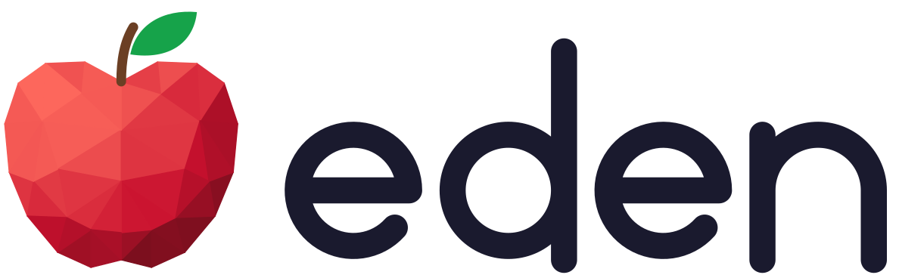
</picture>

**E**mbodied-AI **D**evelopment **E**nvironments **N**exus

[](LICENSE)
[](pyproject.toml)
[](https://github.com/Genesis-Embodied-AI/genesis-world/releases/tag/v1.4.6)
[](https://embodied-ai-nexus.github.io/Eden)

[Installation](#installation) · [Quick start](#quick-start) · [Gallery](#gallery) · [Documentation](https://embodied-ai-nexus.github.io/Eden) · [Citation](#citation)


</div>

Eden is a robot-learning framework built on [genesis-world](https://github.com/Genesis-Embodied-AI/genesis-world).
Write any robot-learning task as one typed config, train it across thousands of GPU-parallel environments, then
run the same policy on a real robot.

## Highlights

- **One typed config per task**: scene, MDP and learning runner in one Pydantic object; variants become CLI flags.
- **245 composable MDP terms**, searchable with `eden terms --grep <text>`; any decorated function becomes a new term.
- **47 robots and 11 composite rigs**: humanoids, quadrupeds, arms and dexterous hands.
- **66 tasks**, from locomotion and piano to calligraphy, plus robosuite, LIBERO, SIMPLER and PolaRiS ports.
- **Multi-physics**: every Genesis solver, plus Mochi for coupled rigid, cloth, soft-body and rod dynamics.
- **Sensing and rendering**: RGB-D, lidar, tactile, IMU and audio; batched Gaussian-splat scenes and path tracing.
- **Motion data and teleop**: retarget human motion, teleoperate, and record HDF5 or LeRobot datasets.
- **Train and deploy**: rsl-rl, rl_games, skrl or SB3 on multi-GPU DDP, then `eden deploy` to hardware or MuJoCo.
- **21-policy zoo**: SONIC, BeyondMimic, π0.5, GR00T, … with `eden inference --policy <name>`.
- **Built for coding agents**: strict configs, error messages that name the fix, and a shipped [`AGENTS.md`](AGENTS.md).

## Installation

Eden needs Python 3.12+ and runs on Linux, macOS (Apple silicon) and Windows. Linux with an NVIDIA GPU is the
primary platform; macOS and Windows are best-effort, and a few extras need more: Nyx path tracing has no macOS
build, Gaussian-splat rendering needs CUDA, and the Wuji Glove SDK is Linux-only. We use
[uv](https://docs.astral.sh/uv/):

```bash
git clone https://github.com/embodied-ai-nexus/Eden.git
cd Eden
uv sync --all-extras --all-groups # the groups add the extras' git-only packages
source .venv/bin/activate         # Windows: .venv\Scripts\activate
```

`uv sync` alone installs the core; the individual extras (`vis`, `nyx`, `batch-splat`, `gello`, `pico`, `wuji`,
…) are listed in the [installation guide](docs/getting-started/installation.md).

## Quick start

```bash
eden list                                     # every registered task and its variant flags
eden train --task reacher                     # train a Yam arm to reach, 4096 envs
eden inference --task reacher --checkpoint <path/to/model.pt> --vis
eden inference --policy sonic --vis           # roll out a published policy, no task needed
eden terms --grep friction                    # find a term and its parameters
```

Sim-to-sim, sim-to-real and export:

```bash
eden deploy --task <task> --checkpoint model.pt --mujoco    # sim-to-sim check
eden deploy --task <task> --checkpoint model.pt             # real hardware
eden export --task <task> --checkpoint model.pt             # ONNX / TorchScript + policy_spec.json
```

### A task is one config

```python
@TASK_REGISTRY.register(modifiers=(ReacherDifficultyMod,))  # → eden train --task reacher --difficulty hard
class ReacherConfig(EdenRLConfig):
    env_options = EnvOptions(num_envs=4096, episode_length_s=9.0, sim_dt=0.01, ...)
    scene_options = en.scenes.Empty(robot=en.robots.Yam())
    observation_options = ObservationManagerOptions(
        policy=ObservationGroupOptions(
            dofs_pos=observations.DofsPos.configure(entity_name="robot"),
            dofs_vel=observations.DofsVel.configure(entity_name="robot"),
        ),
    )
    action_options = ActionManagerOptions(
        joint_pos_controller=actions.ImplicitPDController.configure(
            entity_name="robot", dofs_name="joint*", scale=0.05,
        ),
    )
    command_options = CommandManagerOptions(reaching_target=UniformT3Command.configure(...))
    reward_options = RewardManagerOptions(
        reaching=RewardTerm.configure(func=reaching_reward, weight=1.0, params={...}),
        action_rate=RewardTerm.configure(func=rewards.action_rate_l2, weight=-0.01),
    )
    termination_options = TerminationManagerOptions(
        timeout=DoneTerm.configure(func=terminations.time_out, time_out=True),
    )
    runner_options = RslRlOnPolicyRunnerOptions(...)
```

The full version is [`eden/tasks/benchmark/reacher/config.py`](eden/tasks/benchmark/reacher/config.py), the
template every task follows.

## Gallery

<table>
  <tr>
    <td width="33%">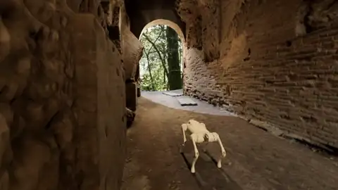<br><br><sub><b>Sensors</b>: a Go2 with LiDAR in a scanned tunnel</sub></td>
    <td width="33%">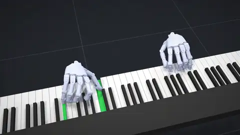<br> <br><sub><b>Multi-modality</b>: playing Chopin with sound synthesised from the pressed keys</sub></td>
    <td width="33%">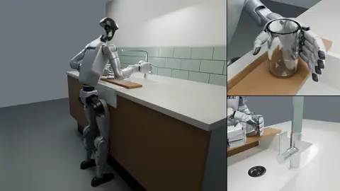<br> <br><sub><b>Beyond rigid</b>: a G1 fills a glass with water at a kitchen tap (1.5x)</sub></td>
  </tr>
  <tr>
    <td>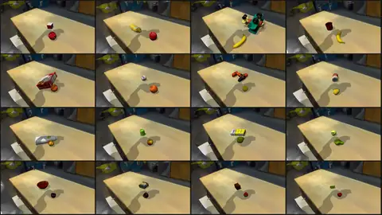<br><br><sub><b>Batch rendering</b>: batched splat + heterogeneous sim render</sub></td>
    <td>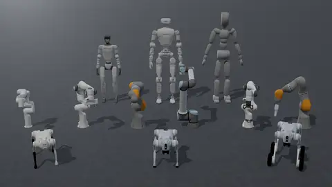<br><br><sub><b>Embodiments</b>: 47 robots and 11 rigs out of the box, with 950+ objects</sub></td>
    <td>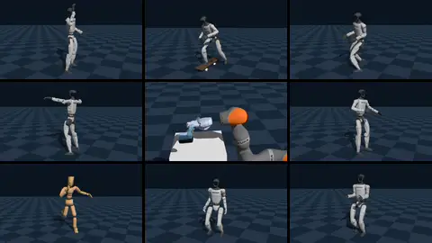<br><br><sub><b>Policy zoo</b>: published controllers run as shipped: <code>eden inference --policy &lt;name&gt;</code></sub></td>
  </tr>
  <tr>
    <td>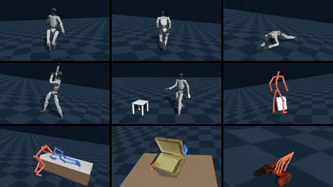<br><br><sub><b>Motion datasets</b>: shipped with loaders for 12+ datasets, shared one motion format.</sub></td>
    <td>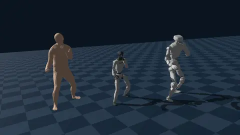<br><br><sub><b>Cross-embodiment retargeting</b>: <code>eden retarget</code> for retargeting the data</sub></td>
    <td>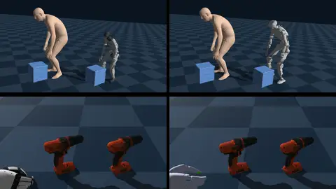<br><br><sub><b>HOI retargeting</b>: retarget with an object for a rig and hands</code></sub></td>
  </tr>
  <tr>
    <td>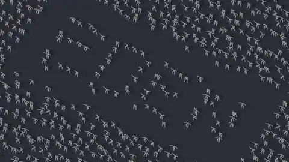<br><br><sub><b>Train at scale</b>: <code>eden train --task &lt;task&gt; --num_envs 4096</code>, across GPUs with DDP</sub></td>
    <td>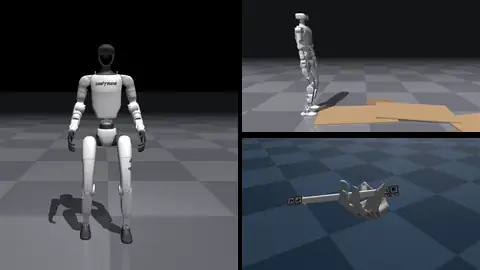<br><br><sub><b>Sim-to-sim</b>: <code>eden deploy --task &lt;task&gt; --checkpoint model.pt --mujoco</code></sub></td>
    <td>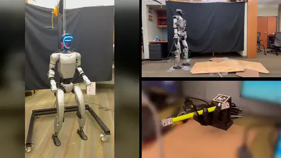<br> <br><sub><b>Sim-to-real</b>: <code>eden deploy --task &lt;task&gt; --checkpoint model.pt</code></sub></td>
  </tr>
  <tr>
    <td>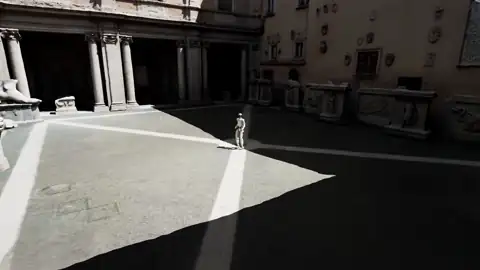<br><br><sub><b>Motion tracking</b>: native motion manager stack</sub></td>
    <td>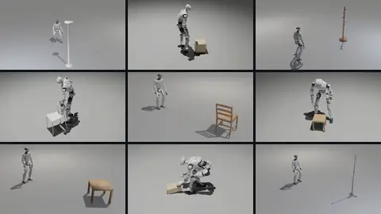<br><br><sub><b>Human–object interaction</b>: a G1+Inspire and a Oli+Wuji move OMOMO objects</sub></td>
    <td>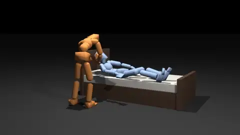<br><br><sub><b>Multi-agent RL</b>: flexible observation, action, reward design</sub></td>
  </tr>
  <tr>
    <td>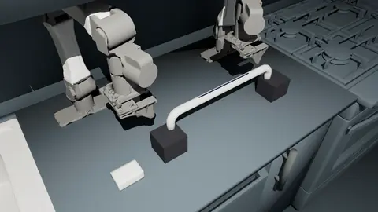<br><br><sub><b>Soft-body manipulation</b>: a trained policy wipes a bar with a foam sponge (1.5x)</sub></td>
    <td>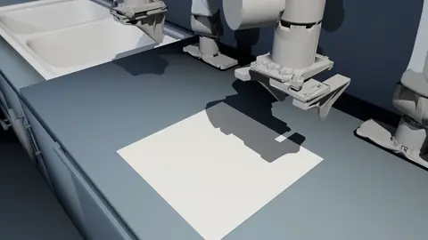<br><br><sub><b>Cloth manipulation</b>: two arms fold a towel in half (3x)</sub></td>
    <td>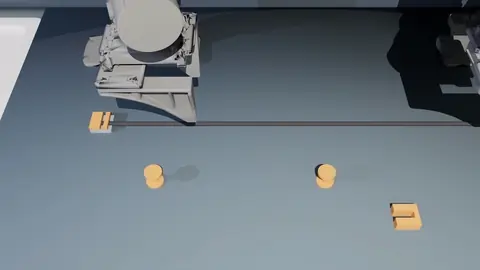<br><br><sub><b>Cable routing</b>: a cable routed round two spools into a port (8x)</sub></td>
  </tr>
  <tr>
    <td>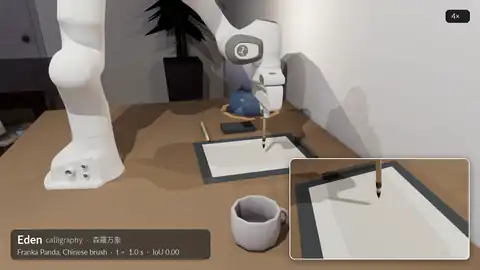<br><br><sub><b>Calligraphy</b>: 森羅万象 in kaisho with a modeled Chinese brush (24x)</sub></td>
    <td>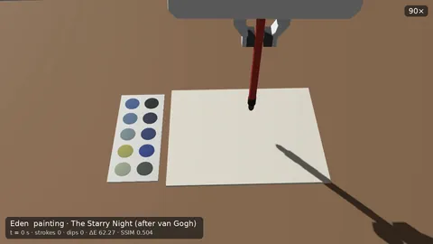<br><br><sub><b>Wet-acrylic painting</b>: The Starry Night with the wet paint blending (90x)</sub></td>
    <td>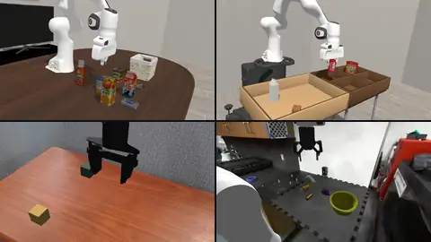<br><br><sub><b>Benchmark suites</b>: LIBERO, robosuite, SIMPLER, PolaRiS, etc., reimplemented</sub></td>
  </tr>
</table>

## Documentation

The [documentation](https://embodied-ai-nexus.github.io/Eden) covers concepts, every guide and the full API. To
build it locally:

```bash
uv sync --inexact --extra docs
uv run mkdocs serve        # → http://127.0.0.1:8000/Eden
```

Good places to start: [task configs](docs/guides/task-config.md), [writing terms](docs/guides/terms.md),
[entities](docs/guides/entities.md), [training runs](docs/guides/training-runs.md) and
[deployment](docs/guides/deployment.md). Runnable scripts live in [`examples/`](examples/) (`eden examples list`),
each with its own README.

## Contributing

Issues and pull requests are welcome. Before you open a PR:

```bash
pre-commit install                     # ruff + formatting on every commit
uv run pytest tests/<path>/test_X.py   # tests mirror eden/; run the files you touched
```

[`AGENTS.md`](AGENTS.md) holds the rules every change follows (and is what coding agents read first);
[`docs/guides/testing.md`](docs/guides/testing.md) explains how tests are written.

## Contributors

A huge thank you to everyone whose early feedback and contributions have helped shape this project!

<table>
  <tr>
    <td align="center"><a href="https://github.com/Kashu7100"><br><sub>Kashu7100</sub></a></td>
    <td align="center"><a href="https://github.com/lalit-jayanti"><br><sub>lalit-jayanti</sub></a></td>
    <td align="center"><a href="https://github.com/Milotrince"><br><sub>Milotrince</sub></a></td>
    <td align="center"><a href="https://github.com/pcseanlo"><br><sub>pcseanlo</sub></a></td>
    <td align="center"><a href="https://github.com/thanyu-hub"><br><sub>thanyu-hub</sub></a></td>
    <td align="center"><a href="https://github.com/hughperkins"><br><sub>hughperkins</sub></a></td>
    <td align="center"><a href="https://github.com/jasonzhou32"><br><sub>jasonzhou32</sub></a></td>
    <td align="center"><a href="https://github.com/ZuWang95"><br><sub>ZuWang95</sub></a></td>
  </tr>
  <tr>
    <td align="center"><a href="https://github.com/YutoShibata07"><br><sub>YutoShibata07</sub></a></td>
    <td align="center"><a href="https://github.com/yituoren"><br><sub>yituoren</sub></a></td>
    <td align="center"><a href="https://github.com/Akihisa-Watanabe"><br><sub>Akihisa-Watanabe</sub></a></td>
    <td align="center"><a href="https://github.com/dhruv0000"><br><sub>dhruv0000</sub></a></td>
    <td align="center"><a href="https://github.com/ziyin-xiong"><br><sub>ziyin-xiong</sub></a></td>
    <td align="center"><a href="https://github.com/yxKryptonite"><br><sub>yxKryptonite</sub></a></td>
    <td align="center"><a href="https://github.com/duburcqa"><br><sub>duburcqa</sub></a></td>
    <td align="center"><a href="https://github.com/YilingQiao"><br><sub>YilingQiao</sub></a></td>
  </tr>
</table>

## Acknowledgments

Eden builds on these open-source projects:

- [genesis-world](https://github.com/Genesis-Embodied-AI/genesis-world): high-performance cross-platform simulation backend.
  - [gs-madrona](https://github.com/Genesis-Embodied-AI/gs-madrona): high-throughput batch renderer.
  - [genesis-nyx](https://github.com/Genesis-Embodied-AI/genesis-nyx): high-quality path tracer.
- [quadrants](https://github.com/Genesis-Embodied-AI/quadrants): Python compiler that generates parallel kernels for Nvidia/Vulkan/Metal GPUs and x86/ARM CPUs.
- [IsaacLab](https://github.com/isaac-sim/IsaacLab) and [mjlab](https://github.com/mujocolab/mjlab): reference manager-based environment implementations.
- [ManiSkill](https://github.com/haosulab/ManiSkill): reference holistic environment for embodied agents.
- [ProtoMotions](https://github.com/NVlabs/ProtoMotions) and [MimicKit](https://github.com/xbpeng/MimicKit): reference environments for human motion priors.
- [Holosoma](https://github.com/amazon-far/holosoma) and [InstinctLab](https://github.com/project-instinct/InstinctLab): reference end-to-end humanoid frameworks.

## Citation

If you use Eden in your research, please cite:

```bibtex
@misc{Eden,
  author = {Eden Authors},
  title = {Eden: One Task Definition from Simulation to Real Robots},
  month = {November},
  year = {2026},
  url = {https://github.com/embodied-ai-nexus/Eden}
}
```

```bibtex
@misc{Genesis,
  author = {Genesis Authors},
  title = {Genesis: A Generative and Universal Physics Engine for Robotics and Beyond},
  month = {December},
  year = {2024},
  url = {https://github.com/Genesis-Embodied-AI/Genesis}
}
```

## License

Eden is released under the [Apache 2.0 License](LICENSE).
