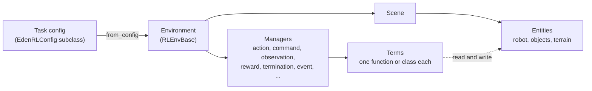
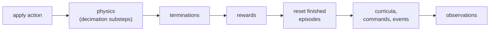

# Key concepts

Every Eden task is built from the same few pieces: a **config** that describes the task, an **environment** that
builds it, **entities** that live in its scene, and **managers** that run the task's **terms** on every step. This
page explains each piece and how they fit together, so that the rest of the docs read as detail on a picture you
already have.



## Configs

A task is a subclass of a config class whose fields are option groups: `env_options` (simulation settings),
`scene_options` (what is in the scene), one `*_options` field per manager, and, for a trainable task,
`runner_options` (the learning algorithm). All of them are Pydantic models. They validate when they are
constructed, save to and load from JSON or YAML, and refuse unknown fields: a misspelled field name raises
immediately instead of being ignored. Only the classes that hold children under names you choose, such as
`SceneOptions` (entities) and the manager options (terms), accept extra keys.

There are three config classes you subclass, and each is built by its own environment class:

| Config | Environment | For |
|---|---|---|
| [`EdenConfig`](../api/configs.md) | `EnvBase` | A scene with actions and observations, no rewards |
| `EdenRLConfig` | `RLEnvBase` | An RL task: adds rewards, terminations, commands, curricula and `runner_options` |
| `EdenMimicConfig` | `MimicRLEnvBase` | Motion imitation: adds `motion_options`, a reference motion |

The splat variants (`EdenSplatConfig`, `EdenSplatRLConfig`, `EdenNyxSplatConfig`) pair with environments that
render Gaussian-splat scenes. A config must be built by its own environment class:
`RLEnvBase.from_config(mimic_config)` raises a `TypeError` instead of building a mimic task with no motion
reference. When the class is not known in advance, `env_class_for_config(config)` from `eden.envs.base` picks it.

The options a task sets are described in [Task configuration](../guides/task-config.md), and the field-by-field
reference is in the [API reference](../api/index.md).

## Environments

An environment is a batch of `num_envs` copies of the task, simulated in parallel. You construct it from a config
and then build and reset it yourself:

```python
import eden as en
import genesis as gs

en.init(backend=gs.gpu)

from eden.envs.base import RLEnvBase
from eden.tasks import TASK_REGISTRY

config = TASK_REGISTRY.build("reacher")
config.env_options.num_envs = 16

env = RLEnvBase.from_config(config)
env.build()
obs, info = env.reset()             # step() returns (obs, reward, terminated, timeouts, info)
```

Two rules apply to every script:

- **Import `eden` before `genesis` and `torch`.** Importing `eden` assigns each multi-GPU rank its GPU, and that
  must happen before anything initializes CUDA. [Multi-GPU training](../guides/ddp.md) explains why.
- **Call `en.init()` once per process**, before building anything. It initializes Genesis, the log directory and
  logging. Its `backend` defaults to the CPU, so pass `backend=gs.gpu` to simulate on the GPU.

The training wrappers (such as `RslRlVecEnvWrapper` from `eden.envs.wrappers.rsl_rl_env`) build and reset inside
their own `from_config`, and `eden train` does all of this for you.
[Environments](../guides/environments.md) covers construction, stepping and resets in detail.

## Entities

Entities are the things in the scene: robots, rigid objects, terrain, and deformable bodies (MPM, SPH, PBD, FEM and
Mochi). The scene option you pick is a preset, and each extra keyword argument becomes an entity under that name:

```python
import eden as en
from eden.options import BoxOptions

scene_options = en.scenes.Empty(                  # a ground plane
    robot=en.robots.Yam(),                         # a robot preset, under the name "robot"
    cube=BoxOptions(size=(0.05, 0.05, 0.05), default_root_pos=(0.4, 0.0, 0.025)),
)
```

Once the environment is built, look an entity up by that name. Every getter returns a batch, one row per
environment:

```python
robot = env.entities["robot"]
pos = robot.get_pos()       # (num_envs, 3)
quat = robot.get_quat()     # (num_envs, 4), w x y z
```

!!! warning "Quaternions are w, x, y, z"
    Every quaternion in Eden, config fields such as `default_root_quat` included, is ordered `(w, x, y, z)`. The
    identity is `(1.0, 0.0, 0.0, 0.0)`.

[Entities](../guides/entities.md) covers pose frames, the two DOF index spaces, armature, contacts and the
deformable entity types; [Robots](../guides/robots.md) covers the robot catalog.

## Managers and terms

A manager owns one aspect of the task and computes it from a set of **terms**. A term is one small piece of
behavior: one observation, one reward, one termination condition. A task config lists the terms each manager runs,
by name:

| Manager | Its terms | Config field |
|---|---|---|
| Action | Turn the policy's action into actuator commands (PD, OSC, IK controllers, ...) | `action_options` |
| Command | Generate goals: target poses, velocities, reference motions | `command_options` |
| Observation | Compute observation groups (`policy`, `critic`, ...), with noise and history | `observation_options` |
| Reward | Compute weighted reward terms, summed into the step reward | `reward_options` |
| Termination | Decide which episodes end, and whether each ending is a time-out | `termination_options` |
| Event | Randomize and reset the scene at startup, on reset, or at intervals | `event_options` |
| Curriculum | Change the task's difficulty as training progresses | `curriculum_options` |
| Metric | Share a computation between terms, and report success | `metric_options` |
| Recorder | Record episodes to a dataset | `recorder_options` |

`EnvBase` runs the action, metric, event, observation and recorder managers; `RLEnvBase` adds the rest, and
`MimicRLEnvBase` adds a motion manager for the reference motion.

A term is either a function or a class:

```python
import torch

from eden.managers import REWARD_TERM_REGISTRY
from eden.managers.reward_manager import RewardTerm


@REWARD_TERM_REGISTRY.register()
def base_height_error(env, *, entity_name: str, target: float) -> torch.Tensor:
    """A function term: stateless, its parameters come from params={...}."""
    return torch.square(env.entities[entity_name].get_pos()[:, 2] - target)


@REWARD_TERM_REGISTRY.register()
class BaseHeightPenalty(RewardTerm):
    """A class term: its fields are its parameters, and build() runs once at env construction."""

    entity_name: str = "robot"
    target: float = 0.3

    def build(self) -> None:
        self.resolve_entity(self.entity_name)  # a wrong name raises now, not on the first step

    def compute(self) -> torch.Tensor:
        return torch.square(self.resolve_entity(self.entity_name).get_pos()[:, 2] - self.target)
```

A config refers to a term through `.configure(...)`. A function term goes through its kind's wrapper with
`func=` and `params=`; a class term is configured directly:

```python
from eden.options import RewardManagerOptions
from eden.terms import RewardTerm

reward_options = RewardManagerOptions(
    height_fn=RewardTerm.configure(func=base_height_error, weight=-1.0, params={"entity_name": "robot", "target": 0.3}),
    height_cls=BaseHeightPenalty.configure(weight=-1.0, target=0.3),
)
```

`eden.terms` holds the wrappers for function terms: `ObsTerm`, `RewardTerm`, `DoneTerm`, `EventTerm`, `CurrTerm`
and `MetricTerm`. (The `RewardTerm` there is the function wrapper; the class-term base above has the same name and
lives in `eden.managers.reward_manager`.) Eden's own terms are in `eden.observations`, `eden.rewards`,
`eden.terminations`, `eden.actions`, `eden.commands`, `eden.events`, `eden.curricula` and `eden.metrics`, and
`eden terms --grep <text>` searches all of them with their parameters.

Use a function when the term only reads state; use a class when it has parameters to validate, names to resolve
once, or state to keep between steps. [Writing terms](../guides/terms.md) explains that choice and the lifecycle of
a class term.

## Registries

Eden finds terms and tasks by name, through registries.

**Term registries.** Each kind of term has one (`REWARD_TERM_REGISTRY`, `OBSERVATION_TERM_REGISTRY`, ... in
`eden.managers`). A term's key is always its name in snake case: `BaseHeightPenalty` registers as
`base_height_penalty`, and the function `action_rate_l2` as `action_rate_l2`. Two terms whose names give the same
key cannot both be registered in one registry, and that includes Eden's built-in terms: registering your own
`base_height_l2` reward raises a `ValueError` naming the built-in that holds the key. `register()` takes no
`name=` argument; rename the term to change its key. A class term that was never registered configures without
complaint but fails when the environment is built.

**The task registry.** `TASK_REGISTRY` (in `eden.tasks`) maps a task name to its config class. A task registers
itself where it is defined, with `@TASK_REGISTRY.register()`, and the registry finds every such decorator by
scanning the source of `eden/tasks/` without importing it, so there is no central list to update and `eden list`
stays fast. The name is the class name in snake case without the `Config` suffix: `ReacherConfig` is `reacher`.

```python
from eden.tasks import TASK_REGISTRY

config = TASK_REGISTRY.build("reacher")                     # the config, with its task mods applied
config = TASK_REGISTRY.build("reacher", difficulty="hard")  # with a variant flag set
```

`TASK_REGISTRY.get("reacher")` returns the bare class instead. Instantiating it yourself skips the task's mods,
which for some tasks leaves required settings (such as which robot to load) empty, so construct a registered task
with `build()`.

**Task mods** are the variants of a task. A `TaskMod` is a small class whose constructor arguments become CLI
flags (`--difficulty` above) and whose `apply()` edits the config. [TaskMods](../guides/task-mods.md) covers them.

Tasks outside Eden's own tree register the same way; [Your first task](first-task.md) shows how to make
`eden train` find them.

## One control step

`env.step(action)` runs one control step. In outline, for an RL environment:



Three consequences are worth knowing before you write a term:

- **Auto-reset runs before the observation.** Finished environments are reset inside `step()`, after rewards and
  terminations, so the observation `step()` returns for them is the first observation of the new episode, not the
  terminal one.
- **The policy runs at the control rate.** Each step applies the action, then advances physics `decimation` times
  by `sim_dt` (both in `EnvOptions`), so the control period is `sim_dt * decimation`.
- **Observation `compute()` is a read.** The observation manager computes its terms at several points (at build,
  at reset, during the step), so a counter advanced inside an observation's `compute()` advances more than once per
  step. Per-step state goes in a hook that runs once per step.

The full sequence has twenty phases; [The step loop](../guides/environments.md#the-step-loop) lists them, and
[Writing terms](../guides/terms.md) says which hook each kind of per-step state belongs in.

## See also

- [Your first task](first-task.md): put these pieces together.
- [Task configuration](../guides/task-config.md): every option group.
- [Writing terms](../guides/terms.md): the term lifecycle and its gotchas.
- [Environments](../guides/environments.md): construction, the step loop, resets.
