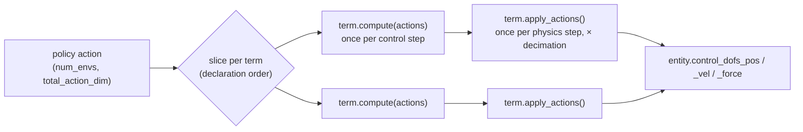

# Actions

The action manager turns the policy's action vector into commands for the simulated actuators. This page covers
how the vector is split across action terms, the built-in controllers (joint PD and velocity, task-space IK and
operational-space control, floating bases, grippers and welds), action modifiers such as delay and motor
models, and the rules the manager enforces. Read [Writing terms](terms.md) first for the general term contract.

## How an action reaches the robot

Each entry of `action_options` is one **action term**. The manager lays the terms' action widths end to end in
declaration order, so the policy's action vector is the concatenation of every term's slice:



- `ActionManager.compute(action)` runs once per **control step** (phase 1 of the [step
  loop](environments.md#the-step-loop)). It stores the raw action, hands each term its slice, and each term
  computes its command — its `processed_action`.
- `ActionManager.apply_actions()` runs once per **physics step**, `EnvOptions.decimation` times per control step
  (phase 4). Each term writes its command to Genesis there.

`env.step()` also accepts a `dict` keyed by action-term name, one tensor per term, instead of the flat tensor.
A flat tensor of the wrong width raises `ValueError` listing the expected per-term layout
(`[joint_pos_controller=7, gripper=1]`); `env.action_manager.summary()` prints the same layout as a table with
each term's slice.

A typical config, from the extreme-parkour student task (`eden/tasks/extreme_parkour/student/config.py`):

```python
import eden as en
from eden.constants import ReferenceSource
from eden.managers.modifiers.actions import ActionDelay
from eden.options.managers.actions import ActionManagerOptions

action_options = ActionManagerOptions(
    dofs_pos_controller=en.actions.ImplicitPDController.configure(
        entity_name="robot",
        dofs_name=_GO2.dofs_name,  # the robot's joint names
        scale=0.25,
        reference_source=ReferenceSource.DEFAULT,
        modifier=ActionDelay.configure(delay_range_s=(0.02, 0.02)),
    )
)
```

Action terms are class terms only (there is no function-wrapper form). The built-in ones are importable from
`eden.actions` (`from eden import actions`), which is `eden.managers.terms.actions`. Every action term takes
`entity_name` and `dofs_name`; `dofs_name` accepts a list of names or regex/glob patterns and is resolved against
the entity's own `dofs_name`.

## Joint controllers

The joint controllers command one DOF per action column. They share one target formula and one set of options.

| Term | Commands | Genesis call | Notes |
|---|---|---|---|
| `ImplicitPDController` | position target | `control_dofs_pos` | Genesis' built-in PD, integrated implicitly — the MuJoCo-like choice for sim-to-sim |
| `ExplicitPDController` | position target → torque `kp·(target − q) − kd·q̇` | `control_dofs_force` | the torque is computed in Eden, so torque modifiers (friction, effort limits, motor strength) apply |
| `VelocityFeedforwardPDController` | position **and** velocity targets → torque `kp·(q_t − q) + kd·(q̇_t·feed_forward_ratio − q̇)` | `control_dofs_force` | action width is twice the DOF count: positions first, then velocities (`velocity_scale`) |
| `ImplicitVelocityController` | velocity target | `control_dofs_vel` | `reference_source` must stay `"zero"` |
| `ExplicitVelocityController` | velocity target → torque `kp·(q̇_t − q̇)`, `kp = (F_max − F_min)·velocity_gain` | `control_dofs_force` | gain derived from the DOF force range |
| `NullJointAction` | the entity's default positions, always | `control_dofs_pos` | draws **no** action column; pins its DOFs |

The explicit controllers read `kp` and `kd` from the entity once at build and re-read them on reset when the
entity's DOF info is batched per env, so gain randomization (`events.RandomizeKpKdGains`) is picked up.

!!! warning "Explicit controllers want `sim_substeps=1`"
    `apply_actions()` runs once per `scene.step()`, and each `scene.step()` runs `EnvOptions.sim_substeps`
    solver substeps. An explicit controller's torque is therefore held constant across those substeps. Its
    docstring requires `sim_substeps=1` so the PD torque is recomputed every physics step; raise `decimation`
    instead to keep the control rate. This is not checked for you.

!!! note "Damping is explicit in torque mode under every integrator"
    The `-kd·q̇` of `ExplicitPDController`, `VelocityFeedforwardPDController` and
    `ExplicitVelocityController` is computed by Eden, so it is explicit whatever `EnvOptions.integrator` says.
    Genesis' implicit integrators only damp the DOFs it drives itself in position or velocity mode
    (`ImplicitPDController`, `ImplicitVelocityController`), and the `kd · substep_dt` armature fold runs under
    `integrator="euler"` only. A `kd` that is stable through `ImplicitPDController` at a given substep can
    diverge through `ExplicitPDController`. See [Entities](entities.md).

### The position target

The position controllers build their target additively:

```text
target = raw_action * scale + offset + reference_offset + dofs_pos_offset
```

- `scale` — a float, a `{pattern: value}` dict over DOF names, or `None` (the default, which applies no scale
  and reads as "not set", so a robot-binding TaskMod can fill it). `scale_ratio`, when set, replaces `scale` with
  `scale_ratio * (upper − lower)` per DOF, from the entity's DOF position limits (an unbounded joint uses `2π`).
- `offset` — a float or a `{pattern: value}` dict.
- `reference_offset` — chosen by `reference_source`, below.
- `dofs_pos_offset` — a per-env offset set through `set_dofs_pos_offset()`, zero until something sets it. This
  is the hook for joint-zero domain randomization such as `events.RandomizeDofsPosOffset`.

`reference_source` takes a `ReferenceSource` (`eden.constants`) or its string value:

| `reference_source` | Reference added | Use it for |
|---|---|---|
| `"default"` (`ReferenceSource.DEFAULT`, the default for position controllers) | the entity's `default_dofs_pos` | the usual "action is an offset from the standing pose" |
| `"zero"` (`ZERO`, the default for velocity controllers) | nothing | absolute targets |
| `"delta"` (`DELTA`) | the DOF positions measured at the start of the control step | incremental control: `target = q_now + scale·a` |
| `"accumulate"` (`ACCUMULATE`) | — the action is integrated onto a persistent target, `target_t = clamp(target_{t−1} + scale·a, soft limits)`, starting from and reset to `default_dofs_pos` | policies that emit per-step increments of a held target |
| `"motion_ref"` (`MOTION_REF`) | the motion reference's joint positions for this step | residual policies on top of a retargeted motion; needs a `MimicRLEnvBase` whose motion manager tracks the entity |

A non-zero `offset` stacks on top of the reference under `"default"`, `"delta"` and `"motion_ref"` (with a
warning at build), and is refused under `"accumulate"`, where it would be re-added every step.
`VelocityFeedforwardPDController` refuses `"accumulate"`, and the velocity controllers refuse anything but
`"zero"`.

The reacher task uses `"delta"` to low-pass its targets (`eden/tasks/benchmark/reacher/config.py`):

```python
joint_pos_controller=actions.ImplicitPDController.configure(
    entity_name="robot",
    dofs_name="joint*",
    scale=0.05,
    reference_source=ReferenceSource.DELTA,
),
```

**Dict-valued `scale` and `offset`.** Keys are DOF-name patterns, applied in dict order (a later key overrides
an earlier one on a DOF both match); DOFs no key matches get `1.0` for `scale` and `0.0` for `offset`. A key that
matches no DOF of the entity always raises. `dict_keys_scope` decides what happens to a key that matches only
DOFs *another* term controls: `"term"` (the default) raises; `"entity"` skips it, which lets the terms that split
one robot share its whole-body dict instead of each carrying a filtered copy.

Read what was actually resolved off the term, not the options: `effective_scale` (a float, or a `(1, num_dofs)`
tensor for a dict or `scale_ratio`) and `effective_offset` (the static offset with `default_dofs_pos` folded in
under `"default"`, plus any `dofs_pos_offset`).

### Coupled (mimic) joints

`mimic_dofs` derives extra position targets from the action instead of reading them off it — an underactuated
hand whose follower joints track a driver at a fixed ratio. Each entry is `follower: (driver, multiplier,
offset)`, and the follower is commanded `driver_target * multiplier + offset`:

```python
ImplicitPDController.configure(
    entity_name="left_hand",
    dofs_name=InspireRH56DFQ_L.actuated_dofs_name,  # the 6 drivers: the action columns
    mimic_dofs=InspireRH56DFQ_L.metadata.mimic_dofs,  # follower -> (driver, multiplier, offset)
)
```

The action stays driver-wide (`action_dim` counts the drivers), while `processed_action`, `dofs_name` and
`dofs_idx_local` widen to drivers-then-followers after build. `mimic_follower_dofs_name` lists the followers, so
a deployment whose hardware couples them itself can leave them out. Drivers must be in `dofs_name`, followers
must not be, chains (a follower driven by a follower) are refused, and only `ImplicitPDController` and
`ExplicitPDController` support it. A follower that Genesis already couples through a joint equality (a URDF
`<mimic>` tag) is refused, because the PD targets would fight the constraint.

## Task-space controllers

| Term | Action | What it does |
|---|---|---|
| `DifferentialIKController` | 6: a world-frame `(x, y, z, rx, ry, rz)` delta, squashed by `tanh` and scaled by `position_scale` / `orientation_scale` | damped-least-squares differential IK at a control point (`ee_link_name`, `ee_local_pos`); commands `q + Δq` through `control_dofs_pos`. `damping` (default 0.1), `max_dq` clamps the per-step joint change, `orientation_weight=0.0` makes it position-only |
| `OperationalSpaceController` | 3 (`control_mode="position"`) or 6 (`"pose"`): a clipped, scaled delta applied to the measured control-point pose | operational-space control: the absolute target is held while feedback, Jacobian, inertia and the optional nullspace posture term are recomputed every physics step; commands torques through `control_dofs_force` |
| `IKPoseController` | 7: an absolute base-frame target pose `[x, y, z, qw, qx, qy, qz]` (wxyz), optionally at a tool frame offset from the link | solves Genesis IK from the measured joint configuration each control step; `max_joint_delta`, `joint_limit_margin`, and residual checks that hold the measured pose when IK fails |

Use `DifferentialIKController` for a policy that emits per-step deltas relative to the measured pose, and
`IKPoseController` for one that emits accumulated absolute targets. `OperationalSpaceController` does not add
Coriolis or centrifugal terms; gravity compensation is a material setting on the kinematic-tree root
(`RigidMaterialOptions(gravity_compensation=1.0)`). Its full parameter contract is in its docstring and the
[Term Catalog](../api/terms/catalog.md#action-terms).

## Floating bases: `FreeBasePoseController`

An entity that stands on nothing — a dexterous hand or a gripper with no arm under it — is driven through its
free joint. `FreeBasePoseController` takes six numbers per env: a world-axis translation (`position_scale` metres
per unit) and a world-axis rotation vector (`orientation_scale` radians per unit), both applied to the entity's
**default root pose**, so the target is absolute and a zero action holds the default pose. It resolves the free
joint itself and takes no `dofs_name`; it writes its own gains (`position_kp`, `position_kd`, `orientation_kp`,
`orientation_kd`) and limits (`force_limit`, `torque_limit`) to the six free-joint DOFs at build.

Gravity is not in its loop. Give the entity `RigidMaterialOptions(gravity_compensation=1.0)`, as a real arm's
controller would, or it hangs `m·g / position_kp` below its target.

## Grippers and welds

| Term | Action | What it does |
|---|---|---|
| `BinaryJointController` | 1: `> 0` (or `True`) closes, `<= 0` opens | drives `dofs_name` to `close_action` or `open_action` (floats or per-DOF dicts) |
| `GripperDecisionController` | 1, in the units `input` names | owns the open/close decision for a policy server's gripper scalar: `input` (`"sign"`, `"open_sign"`, `"closedness"`, `"openness"`), thresholds and hysteresis, `hold_steps`, `sticky_repeats` latch, `continuous` interpolation, and `on_missing` for a `NaN` command. With the defaults it behaves like `BinaryJointController` |
| `SuctionCupWelding` | 1: suction on/off | welds the link touching `ee_link_name` to it while on |
| `ParallelJawWelding` | 1: weld on/off | welds a link to `ee_link_name` once **both** pads (`left_gripper_link_name`, `right_gripper_link_name`) press it above `grasp_force_threshold` |

The welding terms command no DOF. List support surfaces (table, floor) in `ignore_entities_name`;
`ignore_links_idx` takes **solver-global** link indices (`env.entities["table"].get_link("top").idx`), not
entity-local ones.

`ParallelJawWelding` is a *simulation surrogate* (`sim_surrogate` is `True`): it stands in for sim contact
friction, while on the robot the gripper joints closing — commanded by a separate joint term — hold the object,
so a deployment sends nothing for it. `SuctionCupWelding` is not: it is the vacuum bit, and a deployment that
cannot carry it must say so.

## Action modifiers

The joint controllers take one `modifier=` — an `ActionModifier` options object — that transforms the command
on its way to the actuator. To use several, wrap them in `Compose`. Modifiers live in
`eden.managers.modifiers.actions` (`TorqueOffset` is only in `eden.managers.modifiers.actions.actuators`).

A modifier overrides up to three hooks, which run at two rates:

| Hook | Runs | Acts on | Built-in modifiers |
|---|---|---|---|
| `modify_processed_action(target)` | once per **control step**, in the controller's `compute()` | the target; its output *is* `processed_action` | `GearBacklash`, `EnvelopeClip` |
| `modify_applied_target(target)` | once per **physics step**, in `apply_actions()` | the command the actuator acts on this physics step | `ActionDelay` |
| `modify_ctrl_torque(torque, dofs_vel, pos_err)` | once per physics step, after the control law | the computed torque | `FrictionModel`, `EffortClip`, `MotorStrength`, `TorqueOffset`, `ConstantTorqueKick`, `Deadband` |

This config from the HOMIE task (`eden/tasks/homie/config.py`) chains a task-local motor model with a
per-episode delay:

```python
from eden import actions
from eden.constants import ReferenceSource
from eden.managers.modifiers.actions import ActionDelay, Compose

dofs_pos_controller=actions.ExplicitPDController.configure(
    entity_name="robot",
    dofs_name=LEG_DOFS,
    scale=HOMIE_ACTION_SCALE,
    reference_source=ReferenceSource.DEFAULT,
    modifier=Compose.configure(
        modifiers=[
            HomieMotorModel.configure(rfi_scale=0.05, offset_scale=0.05),
            ActionDelay.configure(delay_range_steps=(0, DECIMATION - 1)),
        ]
    ),
),
```

`Compose` calls its children in list order **within each hook**, but the hooks run at different points of a
step: every `modify_processed_action` first, then every `modify_applied_target`, then every
`modify_ctrl_torque`. So a physics-step modifier such as `ActionDelay` acts after a control-step one such as
`EnvelopeClip` wherever each is listed; listing it first logs a warning.

!!! warning "Torque modifiers do nothing on an implicit controller"
    `ImplicitPDController` and `ImplicitVelocityController` hand a target to Genesis and never compute a
    torque, so they never call `modify_ctrl_torque`. `FrictionModel`, `EffortClip`, `MotorStrength`,
    `TorqueOffset`, `ConstantTorqueKick` and `Deadband` attached to one are silently inert. Use an explicit
    controller for a motor model.

`FrictionModel`, `EffortClip` and `EnvelopeClip` read their defaults from the entity's actuator spec when a
parameter is `None`; explicit values override it.

### `ActionDelay`

`ActionDelay` delays the command the actuator acts on by `d` **physics** steps, drawn uniformly per env at each
reset from `delay_range_steps` (physics steps, inclusive) or `delay_range_s` (seconds, each end a whole multiple
of `sim_dt`) — not both. Because the unit is the physics step, a latency shorter than one control step is
expressible: at `sim_dt=0.005` and `decimation=4`, `d=2` keeps the first two physics steps of every control step
on the previous command. After a reset the history is backfilled with the first new command.

`processed_action` stays undelayed — it is the command the policy issued and what a deployment sends.
`eden deploy` never calls `apply_actions()`, so it never applies the delay: the real robot has only its own
latency, and a MuJoCo sim-to-sim run has none. A policy trained against a delay therefore runs there with less
latency than it trained with.

## Clipping actions

The action manager does not clip. Two places do:

- The runner: `clip_actions` on the rsl_rl runner options (and on the rl_games options and the env wrappers)
  clamps actions to `[-clip_actions, clip_actions]` before the env sees them. It must be a finite positive
  bound, or `None` for no clamp. See [Training runs](training-runs.md).
- The term: a term can clamp inside its own `compute()`. Clamping only the *target* keeps the raw action
  unclipped, which is what action-rate penalties read — see the example below.

## Reading what was commanded

| Attribute | Shape | Meaning |
|---|---|---|
| `env.action_manager.action` / `.prev_action` | `(num_envs, total_action_dim)` | the raw policy action this step and last step |
| `term.action` / `term.prev_action` | `(num_envs, action_dim)` | the term's raw slice |
| `term.processed_action` | `(num_envs, ...)` | the command the term issued: a joint PD controller's target `raw·scale + offset + reference`, after control-step modifiers |
| `env.action_manager.processed_actions` | `dict[str, Tensor]` | every term's `processed_action`, keyed by term name |
| `term.effective_scale`, `term.effective_offset` | | what the joint controller resolved, see above |

Read `processed_action` rather than recomputing the target at the call site: a recomputation silently drops
whatever control-step modifiers are configured. Rewards such as `rewards.action_rate_l2` and observations such
as `observations.last_action` read the raw action, by default over the whole vector or, with
`action_term_name` / `action_name`, one term's slice.

## Rules the action manager enforces

These raise at env construction, naming the config keys involved:

- **`dofs_name` must name single-DOF joints.** A term's `scale` / `offset` dicts and a deployment's motor map
  are keyed by joint name, so a free or ball joint — whose name `Entity.dofs_name` lists once per DOF — is
  refused, naming the joint and its DOF count. No shipped robot lists one; a `.*` in an *entity's* own
  `dofs_name` is the usual way in. To drive a floating base, use `FreeBasePoseController`; to place one at
  reset, write it from an event (`events.reset_base_state_uniform`).
- **Two terms cannot command the same DOF.** Each term writes its own control target to Genesis every physics
  step, and `control_dofs_*` *replaces* a DOF's control mode and target, so an overlap would be
  last-writer-wins: the losing term is a no-op on the shared DOFs while its slice still costs policy output and
  still feeds action-rate rewards. Give each term a disjoint `dofs_name` — the arm/gripper split every
  manipulation task uses. Reordering the terms is not a fix. The check walks resolved DOF indices, so two
  `FreeBasePoseController`s on one entity are refused too.
- **A term must draw an action column or command a DOF.** A term with neither is almost always a forgotten
  `dofs_name` (it defaults to `[]`, which matches nothing). `NullJointAction` draws no column but commands its
  DOFs; the welding terms command no DOF but draw a column. A term class that applies a per-physics-step
  disturbance and needs neither declares `_acts_without_action_ = True`.

On the first step, a joint term whose command width differs from its DOF count raises naming the term, instead of
Genesis' shape error.

## Writing an action term

Subclass `ActionTerm` (or one of the controllers) and implement `compute(actions)`, called once per control step
with the term's slice, and `apply_actions()`, called once per physics step. Register it with
`@ACTION_TERM_REGISTRY.register()`. Keep `self._raw_action` and `self._prev_action` up to date in `compute()` so
the observations and rewards that read `action` / `prev_action` see the policy's output.

This task-local controller from the reorientation task (`eden/tasks/reorient/custom_terms/actions.py`, trimmed)
clamps the action for the target only, smooths the target with an EMA, and holds the default pose for a warmup
window:

```python
import torch

from eden.managers import ACTION_TERM_REGISTRY
from eden.managers.terms.actions.joint_actions import ImplicitPDController
from eden.utils.string import term_subject


@ACTION_TERM_REGISTRY.register()
class JointPositionOffsetEma(ImplicitPDController):
    ema_alpha: float = 0.5
    warmup_time_s: float = 0.4

    def build(self) -> None:
        super().build()
        if not 0.0 < self.ema_alpha <= 1.0:
            raise ValueError(f"{term_subject(self)}: ema_alpha must be in (0, 1], got {self.ema_alpha}.")
        # effective_offset already folds in default_dofs_pos for reference_source="default".
        self._default_target = self.effective_offset.expand(self.num_envs, -1).clone()
        self._ema_target = self._default_target.clone()
        soft_limits = self.entity.soft_dofs_pos_limits[:, self.entity.find_named_dofs(self.dofs_name).columns]
        self._target_lower = soft_limits[..., 0].expand(self.num_envs, -1)
        self._target_upper = soft_limits[..., 1].expand(self.num_envs, -1)

    def compute(self, actions: torch.Tensor) -> None:
        self._prev_action[:] = self._raw_action
        self._raw_action[:] = actions  # unclipped: the action-rate penalty reads this
        raw_target = self._compute_pos_target(self._raw_action.clamp(-1.0, 1.0))
        raw_target = raw_target.clamp(self._target_lower, self._target_upper)
        self._ema_target = self.ema_alpha * raw_target + (1.0 - self.ema_alpha) * self._ema_target
        in_warmup = (self._env.episode_length_buf * self._env.dt < self.warmup_time_s).unsqueeze(-1)
        self._processed_action = torch.where(in_warmup, self._default_target, self._ema_target)
        self._ema_target = self._processed_action

    def reset(self, envs_idx=None) -> None:
        super().reset(envs_idx)
        idx = slice(None) if envs_idx is None else envs_idx
        self._ema_target[idx] = self._default_target[idx]
```

`apply_actions()` is inherited from `ImplicitPDController`. A term that writes its own `apply_actions()` must
drive the entity with `self._applied_command()` exactly once per call, so a physics-step modifier such as
`ActionDelay` advances; reading `self._processed_action` directly skips it. Pass `self.genesis_dofs_idx` (a
`range` when the DOFs are contiguous) as `dofs_idx_local=` to the entity's `control_dofs_*` calls.

## See also

- [Writing terms](terms.md) — the general term contract
- [Entities](entities.md) — DOF index spaces, armature, implicit damping, gravity compensation
- [Events](events.md) — gain, motor-strength and joint-offset randomization
- [Deployment](deployment.md) — how `processed_action` reaches a real robot
- [Term Catalog: action terms](../api/terms/catalog.md#action-terms) and the
  [action term API](../api/terms/actions.md)
