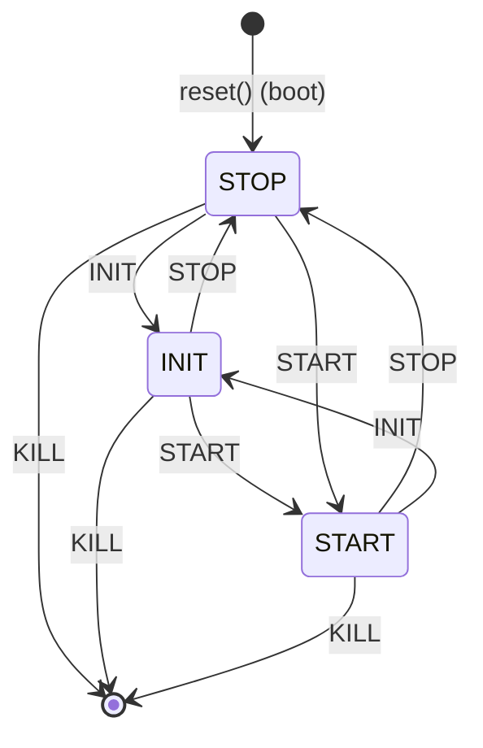

# Deployment

`eden deploy` runs a trained policy on a real robot, or on an independent MuJoCo simulation of
it, through one control loop. This page covers how that loop works, how to drive it, every safety
mechanism it has, and how to validate a policy in MuJoCo before it touches hardware. Per-robot
setup (SDKs, network, remotes, wire details) is on [Robot setup for deployment](deployment-hardware.md).

To run a policy on a stack without Eden (ROS 2, a Jetson, C++), export it instead; see
[Exporting a policy](policy-export.md).

## Quick start

Validate in MuJoCo first. It needs no SDK and no hardware, and runs the same loop a robot run does:

```bash
eden deploy --task velocity_tracking_flat --checkpoint logs/velocity_tracking_flat/<run>/model_<n>.pt \
    --mujoco --menagerie --base_policy none --vis
```

Then deploy onto the robot, starting at reduced gains:

```bash
eden deploy --task velocity_tracking_flat --checkpoint logs/velocity_tracking_flat/<run>/model_<n>.pt \
    --deploy_kp_kd_scale 0.2 --estimate_lin_vel --vis
```

Either way the robot **boots in STOP**, holding the pose it is measured at. Nothing moves until
you press INIT (it ramps the joints to the start pose) and then START (the policy takes over):
`i` + Enter, then `s` + Enter, or the robot's remote. `k` + Enter (KILL) or Ctrl-C ends the run;
legged backends soft-damp before they let go. See [The operator state machine](#the-operator-state-machine).

!!! danger "Connecting touches real hardware"
    Without `--mujoco`, `connect()` opens the link to the physical robot. Keep the e-stop within
    reach, support a legged robot (hoist or gantry) for first runs, start with a low
    `--deploy_kp_kd_scale`, and on a G1 confirm the Holosoma safety slot holds a stand before
    switching to your policy.

## How a deployment works

### Picking the backend

The backend comes from the robot the task puts under `--entity_name` (default `robot`). Each
backend module binds the robot options classes it drives with `bind_deployment(robot_cls,
"<registry key>")`, and `resolve_deployment_for(robot_options)` walks the robot class's MRO to find
one, so a robot subclass inherits its parent's backend. To support a new robot, write a
`DeploymentBase` subclass, register it with `@DEPLOYMENT_REGISTRY.register()` and add one
`bind_deployment(...)` line.

| Robot options class | Backend | Wire |
|---|---|---|
| `G1Dofs23`, `G1Dofs29`, `G1Dofs29NoHands` | `UnitreeG1Deployment` | Unitree SDK2 over CycloneDDS (`unitree_hg`) |
| `Go2` | `UnitreeGo2Deployment` | Unitree SDK2 over CycloneDDS (`unitree_go`) |
| `Go1` | `UnitreeGo1Deployment` | Legacy `unitree_legged_sdk` (`robot_interface`, UDP) |
| `Oli` | `LimxOliDeployment` | LimX low-level SDK (`limxsdk`) |
| `FrankaEmikaPanda`, `FrankaResearch3`, `FrankaEmikaPandaNoHand` | `FrankaPandaDeployment` | `panda-python` (libfranka) |
| `XHand1_R`, `XHand1_L` | `RoboTeraXHandDeployment` | `xhand_controller` (RS485 or EtherCAT) |
| `WujiHand1_R` / `_L`, `WujiHand2Beta2_R` / `_L` (and their subclasses) | `WujiHandDeployment` | `wujihandpy` (Hand 1) / `wuji_sdk` (Hand 2) |
| Any composite rig (`FrankaXHand`, `OliWuji`, …) | `CompositeDeployment` | Each part through its own backend |
| Anything, with `--mujoco` | `MujocoDeployment` / `MujocoCompositeDeployment` | In-process MuJoCo |

A robot with no binding is refused at startup, naming the class and the `bind_deployment` line to
add. The `Go2W` resolves to the Go2 backend through the MRO, and its wheel motors are refused at
construction: they have no confirmed SDK motor index. Install and wire details for each are on
[Robot setup for deployment](deployment-hardware.md).

### What `eden deploy` builds

1. **The config.** With `--task`, a checkpoint's sibling `config.json` (the exact trained config)
   is loaded when there is one; otherwise the task is rebuilt from `--task` and its TaskMod flags.
   Training-only randomization is then disabled (below), `num_envs` is forced to 1 and the episode
   length to effectively infinite. The deploy config is saved as `deploy_config.json` in the run's
   log directory (`logs/<task>/…`, or `logs/deploy/…` for a task-less deploy), distinct from a
   training `config.json`.
2. **The env.** Built in eval mode with `RslRlVecEnvWrapper.from_config(...)`, which builds and
   resets it. The env is never stepped: it mirrors the robot's state for the observation terms
   and the `--vis` viewer.
3. **The policy slots.** Checkpoints are loaded and extension policies constructed before any
   hardware contact, so a malformed checkpoint aborts with the robot untouched.
4. **The deployment.** Constructing the backend swaps `env.entities[entity_name]` for a
   `RobotStateEntity` (see [Writing terms that deploy](#writing-terms-that-deploy)) and runs every
   construction-time check. It does not touch the wire.
5. **`connect()`**, then `reset()` (boot into STOP), then the control loop until KILL or Ctrl-C,
   then `close()`, which every exit path reaches.

`eden deploy` supports rsl_rl checkpoints only. It refuses rl_games checkpoints, FlashSAC
policies (their tanh actions are scaled by the training wrapper, which the deploy loop bypasses),
and tasks whose `runner_options.class_name` names a custom runner (`"module:Class"`), whose
checkpoint layout the stock `OnPolicyRunner` cannot load. Each refusal happens before the robot is
touched; the FlashSAC and custom-runner ones point at `eden inference` for a replay in sim.

#### Training randomization is stripped

The deploy env is built without the task's domain randomization: every event term from
`eden/managers/terms/events/domain_rand.py` (subclasses included) is disabled, and so is every
randomized reset from `eden/managers/terms/events/resets.py` that targets a robot entity, since the
env mirrors the robot's actual state. Terms are matched by type (function resets by registry key),
whatever key the task stored them under. Object placement is scene setup and stays on. The log
line `[deploy] Stripped randomization event terms: {...}` lists what was disabled.

This matters beyond the mirror env: some of these terms reach the hardware. A
`RandomizeDofsPosOffset` or `RandomizeStartupDofsPosBias` left on would add its draw to every
position target the robot is sent. A task-local subclass of a domain-randomization term is
disabled with its base, so a term that sets a pose the task needs (rather than randomizing one)
must not derive from one.

### One control tick

Every backend runs the same `DeploymentBase.step(action)`. The CLI's loop calls it once per
control period with the active slot's action:

1. `_before_step()`: a backend's pre-command hook (the Franka re-syncs the sim entity its IK reads;
   a Wuji hand stops the run on stale feedback).
2. Advance a `kp`/`kd` ramp in progress (a policy switch, see
   [Each slot runs at its own PD gains](#each-slot-runs-at-its-own-pd-gains)).
3. Poll the operator inputs and pick the payload: the STOP hold, the INIT ramp, the end-of-clip
   action, or the policy's command (the action through `action_manager.compute`, then each joint
   term's `processed_action` gathered into deployment DOF order).
4. `send_payload(payload)`, then sleep off the rest of the control period (`RateLimiter`).
5. Advance the motion reference (only while the policy drives) and run
   `command_manager.compute()`.
6. `read_state()`, sync it onto the `RobotStateEntity` (and the sim entity's kinematics), run the
   velocity estimator, run `observation_manager.post_physics_refresh()`, and compute the
   observation the next action is chosen from.
7. Record the tick if `--debug_record` is on.

A backend that sets `sync_before_commands` (the Wuji hand) reads the robot before step 5, so a
command that grades the new state sees it in the same tick.

## The operator state machine

Every backend (humanoid, quadruped, arm, hand, and the MuJoCo robot) runs the same INIT / START /
STOP / KILL state machine, so a deployment never moves a robot the operator has not told it to.



| State | Entered by | What the robot is sent |
|---|---|---|
| STOP (boot) | `reset()`, or STOP at any time | The pose measured when the hold began, latched and held there, at the active slot's gains |
| INIT | INIT | A ramp from the pose measured at the press to the `--init_target` pose over `--init_steps` ticks (gains × `init_dofs_kp_scale` / `init_dofs_kd_scale`), then that pose, held |
| START | START | On the START tick, what was being sent before it (the INIT target or the hold); from the next tick, the active policy slot's command, with the clip at frame 0 and the yaw re-captured |
| KILL | KILL | Leaves the loop; `close()` settles the robot (G1, Go2, Go1 and Oli ramp to a damping state, kp = 0) |

**Inputs.** Commands come from the keyboard (line-based, so it works over SSH: type the key, then
Enter) and from the robot's own remote where it has one:

| Command | Keyboard | Unitree G1 remote | LimX Oli remote |
|---|---|---|---|
| START | `s` | A | R1 + □ |
| STOP | `x` | B | L1 + ✕ |
| INIT | `i` | Y | L1 + △ |
| KILL | `k` | L1 + R1 | L1 + □ |
| Next policy slot | `n` | Select | L1 + ○ |
| Policy slot 1–9 | `1`–`9` | | |
| Raise / lower the sim gantry | `+` / `-` | | |

Each backend prints its own cheat sheet at `reset()`. A remote command fires once per press, so a
held button is one command (the G1's L1 + R1 KILL fires while both are held).

**No operator, no motion.** A hardware backend with neither a remote nor a TTY holds in STOP for
good and says so once. Only a simulator (`--mujoco`) presses INIT and START itself when nobody is
there, and logs that it did.

**Why the hold latches.** STOP latches the pose measured on its first tick and holds that. Re-reading
the measured pose every tick would leave the command chasing the robot, turning the PD into a
damper that follows a sagging robot to the floor. Entering the hold never steps the torque,
however fast the robot is moving.

**The START handover.** START hands over on the tick after it is pressed. The action `step()` is
given on the START tick was computed before START (from the hold's observation, in the old yaw
frame, by a slot not yet re-armed), so it is not sent: that tick repeats the INIT target or the
hold, and its read is the policy's first observation, with history windows cleared, the episode
clock at 0 and the clip at frame 0. The loop re-arms the slot (`on_activate()`), and the slot's
action on that observation is the first command the policy sends. START pressed while the policy
already drives (to restart its clip) holds that tick at the measured pose, as STOP would.

At START every backend also warns about any joint whose `q`, `qd` and `tau` never changed by a
single bit through STOP and INIT while its command moved: that joint's encoder or driver is not
reporting, and the policy would act on a stale reading. `--disable_joints` does not help there;
check the joint's power and wiring.

**From a script.** A script that drives a deployment without an operator presses the keys itself:
`dep.reset()`, `dep.request_init()`, `dep.step(None)` until `dep.init_done`, then
`dep.request_start()` (`dep.request_stop()` to hold again). Targets reach the robot only after
that START. A script that reads the keyboard itself (a pynput teleop device, which also hears every
key typed into the terminal) passes `operator_keyboard=False` and relays its own operator keys to
those methods, as `examples/recipes/deployment/real_franka_teleoperation_keyboard.py` does;
otherwise a teleop key and a command key share a line, and `s` is both START and a WASD axis.

## Running a deployment

### Gains and the INIT ramp

- `--deploy_kp_kd_scale` scales every slot's kp/kd. **Ramp up from `0.2` toward `1.0`** while
  commissioning a policy. Backends that program gains once at connect or run their own loop treat
  it differently: the XHand refuses anything but 1.0 (lower its firmware `dofs_kp` / `dofs_kd`
  instead), a Wuji Hand 2 programs its MIT gains from it, Hand 1 refuses it, and on the Franka the
  arm runs panda-py's own stiffness, so command gains do not reach it.
- `--disable_joints NAME|PATTERN ...` sends kp = kd = 0 on matching joints so they go limp (the
  policy still observes and commands them). It is for bench debugging: isolate a buzzing joint,
  free the arms. **Do not disable load-bearing leg joints on an unsupported robot; it collapses.**
  Backends that ignore command gains (XHand, Wuji) refuse it.
- `--target_lpf A` low-passes every commanded target, `sent = A·new + (1−A)·prev` with `A` in
  (0, 1] (1.0 = off). It attenuates high-frequency command content, such as a single-frame
  policy's half-rate limit cycle or motor whine, without touching kp/kd or the standing stiffness,
  at the cost of about `1/(A·f)` of lag. Try 0.5 or 0.3 at full gains.
- `--init_steps N` (default 250, 5 s at 50 Hz; 0 disables the ramp) sets how long INIT takes, so a
  lying or folded robot rises instead of snapping upright under full PD.
- `--init_target default|motion|motion_rsi`. `default` ramps to the robot's `default_dofs_pos`,
  the only target safe from an arbitrary starting pose. `motion` ramps to frame 0 of the tracked
  clip, so a motion-imitation policy starts from the pose it was trained to continue from. It is
  **not** automatically safe: frame 0 of a crouched clip is an open-loop squat held by nothing but
  the joint PD, and it can topple. Ramp slowly, support the robot the first time, and prefer
  entering through a balance policy slot. `motion_rsi` also teleports the base to frame 0, which
  only a simulator can do; every hardware backend refuses it at construction.

!!! warning "A joint-space stand-up is blind to the feet"
    The INIT ramp interpolates joint angles; it does not resolve foot contact. A quadruped started
    from an awkward stance (feet splayed or shifted to one side) has legs fighting the ground to
    reach their target angles, which drives those motors into thermal derating. Set the robot
    down in a neutral stance with the feet under the hips before INIT, and wait for
    `[deploy] INIT reached the target pose and holds it` and a visual check before START.

### Base linear velocity and `--estimate_lin_vel`

No hardware backend publishes a base linear velocity (an IMU measures none), so
`RobotStateEntity` reports zeros for it unless the onboard estimator runs. A deploy whose policy
is fed a `base_lin_vel` observation (a checkpoint actor's observation groups, or a `--policy` that
declares the term) with neither the estimator nor a backend that publishes the velocity is
**refused at startup**, naming the terms. A critic-only `base_lin_vel`, as in the
`velocity_tracking` layout, is never fed to the actor and needs no estimator.

`--estimate_lin_vel` runs a contact-aided Kalman filter
(`eden/extensions/deployment/utils/lin_vel_estimator.py`) that fuses IMU acceleration with
leg-kinematics odometry:

- It hangs its odometry and contact detection on the robot's own feet,
  `RobotOptions.feet_links_name`, which every robot with a legged hardware backend declares (the G1
  and Oli families, Go1, Go2). `--feet_links <left> <right>` overrides them, for a robot that
  declares none or to estimate off a different pair of links.
- Contact comes from the motors' `tau_est`: the leg's gravity-compensated torque solved for the
  full foot wrench on a leg with six or more DOFs, and for a point force on a shorter one, latched
  above 12% of the robot's weight (about 40 N on a G1). A loaded foot more than 5 cm above another
  loaded foot is swinging and is not latched. When no foot is latched but the accelerometer reads
  support, the most-loaded foot is latched if it reads any real load, never a dangling foot, so a
  robot on a hoist is not anchored on a leg swinging free.
- After 0.5 s with no foot in contact the estimate decays toward zero instead of integrating the
  IMU open loop, and a warning says so.
- With `--debug_record` the recording carries the estimate (`x_base_lin_vel_estimate`) and, per
  foot, the latch (`x_contacts`) and the solved contact force (`x_forces`), so a contact dropout
  can be told apart from IMU drift afterwards.

The base *position* is unknown on hardware too: `RobotStateEntity` holds it at the env's spawn
pose unless something supplies `RobotState.extra["base_pos"]` (an external estimator, mocap).

### The velocity command at deploy time

A locomotion policy deployed from its training config would keep generating the command it was
trained on: `UniformVelocityCommand` resamples a fresh random `(vx, vy, wz)` every few seconds,
which on a robot reads as the machine wandering off on its own. So a deploy **substitutes** that
term:

| `--velocity_command` | Substituted term | Command |
|---|---|---|
| `constant` *(default)* | `ConstantVelocityCommand` | Holds `--base_command VX VY WZ`, default `0 0 0`: the robot stands until told otherwise, unless the task pinned that axis (below) |
| `keyboard` | `OperatorVelocityCommand` | <kbd>↑</kbd>/<kbd>↓</kbd> `vx` · <kbd>←</kbd>/<kbd>→</kbd> `vy` · <kbd>,</kbd>/<kbd>.</kbd> `wz` |
| `gamepad` | `OperatorVelocityCommand` | Left stick `vx`/`vy` · right stick X `wz` (`--gamepad_layout ps4|xbox`, default `ps4`) |
| `task` | *(no swap)* | The training generator, resampling at random |

```bash
eden deploy --task velocity_tracking_flat --robot g1 --checkpoint model.pt --velocity_command keyboard
eden deploy --task velocity_tracking_flat --robot g1 --checkpoint model.pt --base_command 0.5 0 0
```

- A held key or a pushed stick is **full** deflection, the fastest command the policy was trained
  on, from the first press. An operator command returns to zero the moment you release. A gamepad
  unplugged mid-run zeroes its axes rather than holding its last value.
- `--base_command` and an operator device are mutually exclusive: passing both is an error, not a
  silently ignored flag.
- Only an exact `UniformVelocityCommand` is substituted. A *subclass* carries behaviour a held
  command would drop, so it is left running with a warning, and `--velocity_command
  keyboard|gamepad` on one is refused. Two such terms on one entity are refused as ambiguous.
- The keyboard needs `pynput`, the gamepad `inputs`; both come with the `all` extra
  (`pip install 'eden-world[all]'`, or `uv sync --inexact --extra all` in a checkout). Each device
  says which package is missing.
- With `--policy` slots, `--velocity_command keyboard|gamepad` also drives the policies that take a
  command through `set_command`; one device drives whichever slot is active, so switching between
  the safety policy and your checkpoint keeps one set of controls.
- All of it behaves identically under `--mujoco`, which is the place to get used to the controls.

!!! warning "Full deflection is what the *saved config* declares"
    The substitute is clamped to the `lin_vel_x_range` / `lin_vel_y_range` / `ang_vel_z_range` of
    the term it replaces, so neither an operator nor a `--base_command` typo can drive the policy
    outside the distribution it was trained on.

    For a task with a **command curriculum** that is the *initial* range: the curriculum widens the
    ranges at runtime and the saved config holds the starting values. `velocity_tracking_flat`
    starts at `lin_vel_x_range=(-1.0, 1.0)` with curricula out to `(-2.0, 3.0)`, so its ceiling is
    1.0 m/s until you raise it with `--velocity_command_scale VX VY WZ` (symmetric per-axis
    limits). Lowering it below the trained range is the right move while commissioning.

    A command-driven **extension policy** takes `--base_command` through `set_command` with no
    term in between, so before it goes anywhere the command is capped at a per-axis *ceiling*,
    `|v| ≤ max(|lo|, |hi|)`, logged when it bites. On an asymmetric range the ceiling and the
    term's clamp differ: with `lin_vel_x_range=(-1.0, 3.0)`, `--base_command -3 0 0` reaches an
    extension policy as `-3.0` while the substituted term clamps it to `-1.0`. Pass
    `--velocity_command_scale` if you want one number to mean one thing on both. On a task-less
    `--policy` deploy there is no trained range at all, so nothing caps `--base_command` unless
    you pass `--velocity_command_scale`; an operator device there defaults to ±1 on each axis.

!!! note "A pinned axis is not controllable, and holds its trained value"
    `move_forward` ships `lin_vel_x_range=(0.5, 0.5)`: the policy has never seen another forward
    speed, so neither `--base_command` nor a device can change it. A `move_forward` deploy walks
    at 0.5 m/s from the moment the policy is armed, and the log says so (`Velocity command [0.0,
    0.0, 0.0] is outside the trained ranges ...; holding [0.5, 0.0, 0.0] instead.`). Read "stands
    until told otherwise" as applying to the axes the task left free.

!!! note "Why the bindings are arrows and not WASD"
    `pynput` listens to the keyboard *globally*, so it also sees the `s` / `x` / `i` / `k` / `n` /
    digit keys you type to drive the state machine; on WASD, typing START would also command the
    robot backwards. Global listening cuts the other way too: the arrows drive the robot from
    whatever window has focus, and <kbd>↑</kbd> in the terminal you type START into is also your
    shell's history key. It also needs a local display: over a plain SSH shell `pynput` cannot open
    the keyboard, and the device raises saying so.

The substitution is generic: `DeploymentBase.command_overrides` (`{term_name: CommandTermOptions}`)
installs any substitute through `CommandManager.swap_term` at construction, and `close()` puts the
original term back (a substitute whose input device has stopped would report zeros forever to
anything still using the env). Terms that resolved the replaced term once in their own `build()`
are repointed at the substitute, but only in the term trees the deploy loop steps (observations
and commands).

### Action terms that reach the robot

The payload (`RobotCommand`) carries per-joint `dofs_pos` / `dofs_vel` / `dofs_torque` /
`dofs_kp` / `dofs_kd` and nothing else, and a deploy fills only the position target (velocity and
feedforward torque go out as zeros). It can only be built from a term whose `processed_action` is
a `(num_envs, n_dofs)` joint buffer:

- A term commanding something else (a suction term's per-env vacuum bit) has no channel. The
  deployment refuses to start rather than drop it silently, naming the term. If you drive it over
  a channel of your own, acknowledge it with `--ignore_action_terms <term>`. The flag is
  validated: it rejects a name that is not an action term, and one whose joint targets the payload
  *does* carry (use `--disable_joints` to leave joints undriven).
- A joint term driving **another entity** (the hand of an arm + hand rig, deployed arm-only) is
  skipped with a log line. Ownership is decided by entity, not DOF name: two entities built from
  one asset share joint names, so a term of the wrong entity that spells its joints the same way
  is dropped too, at `WARNING`.
- A term of the deployed entity that reaches only part of its DOFs still maps, minus those, and the
  gap is logged at `WARNING`. Any DOF no action term reaches is logged once at construction: it is
  not left alone but sent position target `0.0` at the robot's default stiffness. Use
  `--disable_joints` to actually leave a joint undriven.
- A term that only stands in for something the real robot does itself declares
  `_sim_surrogate_ = True` (`ActionTerm.sim_surrogate`; for example `ParallelJawWelding`, which
  welds the object to the gripper because sim contact friction is unreliable). It is not sent, and
  the log says so.
- A task's `ActionDelay` models the simulated actuator's latency inside `apply_actions()`, which no
  deployment calls, so every backend sends the command undelayed; the robot's own latency takes its
  place. The log names each deployed term whose delay is left out (see
  [Actions](actions.md#action-modifiers)).
- The Franka backend refuses torque-mode terms (`OperationalSpaceController`): panda-py's
  `JointPosition` controller would read their torques as joint angles.

### Motion-imitation deploys

- The deploy loop advances the motion reference itself, through both paths a task may use: the
  motion manager (`MimicRLEnvBase.motion_manager`) and a `MotionCommand`'s
  `CommandTerm.advance_reference()`. The clip holds at frame 0 through STOP and INIT and plays
  from the START handover; it is rewound (clock only, no resampling and no robot teleport) at
  reset, INIT, START and every policy switch.
- On a deploy, `MotionCommand` holds its last frame instead of wrapping. `--on_motion_end` decides
  what happens then: `continue` (default) keeps running the policy against a reference that has
  stopped; `switch` hands control to `--motion_end_slot` through the same queue the operator uses
  (point it at a loco policy at zero command, and the robot keeps its balance); `stand` disengages
  the policy and ramps the joints to the default stance over `--stand_steps` (default 100), which
  holds a shape, not a stand, so a biped topples within seconds. It suits a quadruped or a
  fixed-base arm. All three run off the motion clock and send ordinary wire commands.
- `--motion_file` gives the reference clip to a motion-tracking extension policy such as `sonic`;
  it is required when one is loaded.
- `--vis` on a motion-imitation task draws the reference as a translucent ghost next to the robot.

## Policy slots

A deploy can hold up to 9 policies and switch between them live (`n` / Select / `1`–`9`). Slots
are numbered in load order: the base policy (if any) is slot 1 and active at boot, then
`--checkpoint`, then `--extra_checkpoint`s, then the `--policy` extensions.

### The Holosoma safety slot

On a G1 29-DOF (`G1Dofs29`), `--base_policy auto` (the default) preloads the frozen Holosoma
locomotion policy as slot 1: after INIT and START the robot stands (or walks `--base_command`)
under a known-good controller, and you switch to your checkpoint, and back, at any time. On any
other robot `auto` loads nothing and `--checkpoint` becomes slot 1; `holosoma` forces it (an error
on a non-G1); `none` disables it. Holosoma is an ONNX policy, so a G1 deploy with the default
needs one of the ONNX runtime extras (see [Robot setup](deployment-hardware.md#onnx-runtime)).

`--base_policy none` makes your checkpoint the boot slot: the robot then runs your policy right
after START with no safety controller to fall back to, which is not recommended for first
commissioning.

### Loading a frozen policy as a slot

`--policy NAME` (repeatable) preloads a policy from `eden/extensions/policies` as a slot, with or
without a `--task`. `NAME` is the package name (`holosoma`, `homie`), the `POLICY_REGISTRY` key, or
the key without its `_policy` suffix. `--policy_checkpoint NAME=PATH` points one at a local
checkpoint instead of its released weights. Without `--task`, `--robot` (default `G1Dofs29`) names
the robot, and the env is built from the loaded policies' own spec. See [Policy zoo](policy-zoo.md)
for what each policy needs.

```bash
# The Holosoma safety slot boots; switch to the tracker with Select / `n`.
eden deploy --policy beyondmimic_moves --vis
```

- **Each slot converts its own actions.** A policy's `action_options()` terms are built privately
  for its slot, so a policy trained with a scaled, offset controller (BeyondMimic Moves scales per
  joint on top of its training pose) deploys exactly as one emitting absolute targets (Holosoma).
- **Only joint-position controllers** (`ImplicitPDController`, `ExplicitPDController`) are
  accepted, because a slot writes only the payload's position field. A
  `VelocityFeedforwardPDController` (its feedforward half would be dropped) or a torque-commanding
  term is refused at startup.
- **A policy that reads the env's observations owns the env.** A policy whose `step(obs)` reads the
  observation dict (`PolicyBase.reads_env_observations`: `amo`, `beyondmimic_moves`, `gmt`,
  `humanoid_gpt`, `husky`, `metamotivo`, `omnireset`, `omnixtreme`, `protomotionv3`, `twist2`, and
  the server-backed client policies) gets an env built from its own observation groups and action
  terms, and its action is routed through the env's action manager so env-computed observations
  (`last_action` above all) reflect what the robot was commanded. Two such policies together, or
  one alongside `--task`, are refused: one env publishes one observation layout. Policies that read
  raw robot state (Holosoma) can ride along on any env.
- When **no** loaded policy reads the env, the first policy you named with `--policy` owns it,
  ahead of the Holosoma base the CLI inserts for you: the env's robot fixes the standing pose
  every slot is held to.
- **One robot, one rate.** Every slot shares the env's control rate and robot, so a policy is
  refused if the env's rate is not the one it declares, or (when its controller or observations
  are relative to the default pose) if the robot spawns in another pose than it was trained in.
  When the slot that disagrees is the Holosoma base the CLI added, `--base_policy none` drops it.

### Each slot runs at its own PD gains

A slot's kp/kd come from its policy's pinned robot (`robot_options()`) on every joint that robot
names, and from the env's robot on the rest, so a `--checkpoint` (trained in the env) and a policy
pinning no robot run at the env robot's gains. With `--task`, the task's robot sets every slot's
gains, extension policies included (a task robot is how a deploy retunes gains for the hardware),
and the deploy warns at startup for each policy whose pinned gains differ. `--deploy_kp_kd_scale`
and `--disable_joints` apply to every slot alike.

The boot slot's gains are on the wire from the first command. A switch ramps kp/kd linearly to the
new slot's over `--gain_ramp_steps` control steps (default 50, 1 s at 50 Hz; `0` jumps), because a
stiffness step of the size between SONIC's and Holosoma's hip-pitch gains (about 2.4×) can knock a
standing robot over. The ramp covers every command (the policy's, the STOP hold and the INIT ramp),
and the new policy drives from the switch on, through the ramp: a humanoid is balanced only by its
policy, and holding the measured pose while the gains ramp toppled a free-standing G1 in MuJoCo
sim-to-sim. The deploy logs the largest change:

```text
[deploy] Ramping kp/kd over 50 control steps to the gains 'holosoma base (loco)' was trained at:
4 gain(s) change, the largest left_hip_pitch_joint kp 99.10 -> 40.18.
```

The Wuji and XHand hands and the Franka do not take gains per command (they program theirs once at
connect or run their own loop), so the robot runs one gain set whichever slot is active, and the
deploy warns at startup for each slot that will not run at its own, naming the joints and both
values. Deploy slots trained at other gains separately.

A policy whose pinned robot gives gains for only some of its joints is refused at startup. A
pydantic dict field is replaced whole, so an override such as
`G1Dofs29(default_dofs_kp={"*_hip_pitch_joint": 200.0})` leaves every other joint without a gain.
A robot declaring no gains at all (`G1Dofs23`'s empty map) runs at the env robot's.

### Start-up checks on the slots

Before the robot is enabled, each slot's `step()` is run once against the observations the env
publishes, and what it emits is checked against the action terms it declared. A policy that
*raises* on that input is refused at startup if it reads the observation dict (that is its real
input). For a policy that reads raw state instead, a raise there says nothing, so it is a warning,
and the check moves to the first control step; a failure there closes the deployment on the way
out, so the robot settles rather than holding its last command.

On a switch, `DeploymentBase.restart_observations()` restarts every observation window from the
last reading, so the switched-in slot does not read history another slot drove.

## Safety

Every mechanism below is on by default; this list is the place to check before a first run.

- **Boot in STOP, INIT, then START.** Nothing moves until the operator says so, and a hardware run
  with no operator input holds in STOP forever. See [The operator state machine](#the-operator-state-machine).
- **Fail before connecting.** Unknown entities, joints, action terms, command terms, gain maps,
  unsupported options and impossible `--init_target` / `--on_motion_end` values all raise at
  construction, before `connect()`. A construction that fails rolls back the entity and command
  swaps, so the env is reusable.
- **Settle on the way out.** KILL, Ctrl-C and errors all reach `close()`. The G1, Go2, Go1 and Oli
  backends send `shutdown_damping_steps` (default 50) ticks of kp = 0 with kd ×
  `shutdown_damping_kd_scale` before releasing the link, so the joints settle instead of holding
  their last stiff target until a watchdog trips.
- **Stale observations are cleared.** The first read of every episode (after construction,
  `reset()` and START) clears per-step observation state and the action manager's last actions, in
  an env reset's order (see [Writing terms that deploy](#writing-terms-that-deploy)).
- **Frozen joints are reported** at START (see above).
- **Torque budgets.** The Oli clamps every target so the position term of the implied PD torque
  stays within each joint's budget. The Franka clamps each step's joint delta to a fraction
  (`velocity_safety_factor`, default 0.5) of the joint velocity limits, so libfranka's velocity
  reflex does not trip. The Go1 applies the SDK's `PowerProtect`. Details per robot on
  [Robot setup](deployment-hardware.md).
- **Hand feedback.** A Wuji hand stops the run on stale joint feedback and, by default, on a
  latched hardware fault, checked before every tick.

!!! warning "A stalled control thread is reported, not acted on"
    On the backends that re-send the held command between ticks (G1, Go2, Oli; see
    [Republishing the wire command](#republishing-the-wire-command)), the re-send loop keeps
    sending the last command for as long as the process lives. It does not fall back to a damping
    state when the control thread stalls. The robot therefore never sees a command dropout, so any
    receive-side watchdog it has will not engage: it holds the last commanded pose, at the gains it
    was commanded with, until the process goes away. This matches what the vendor references do.
    The loop warns when the held command goes stale; the soft shutdown in `close()` is the only
    orderly way down, so stop the process (KILL, Ctrl-C) or hit the e-stop.

## Timing and diagnostics

### Control-loop timing

The loop's `RateLimiter` paces it at the control rate and **warns once a second while it is
overrunning**:

```text
[deploy] control loop overran 34/40 ticks in the last 1.2 s (worst 10.3 ms late; 33.1 Hz achieved against 50 Hz). ...
```

and every backend logs the run's summary (ticks, overruns, worst lateness, achieved rate) at
`close()`. An overrunning loop is otherwise silent: the robot still receives targets, only late,
the motion reference plays slower than real time, and every history observation is stretched.
Lockstep `--mujoco` cannot show it, because physics advances per tick regardless of the wall clock;
`--mujoco --async` can (see [Lockstep or asynchronous physics](#lockstep-or-asynchronous-physics)).

**ONNX thread pools.** ONNX Runtime's default is one *spinning* thread per core per session. Eden
builds every ONNX session with one non-spinning intra-op thread instead; `ONNX_INTRA_OP_THREADS=<n>`
overrides the count. The code records the measurement behind it
(`eden/extensions/policies/onnx.py`): with the default pool, SONIC's two graphs plus the Holosoma
base made 72 busy-waiting threads on a 24-core box and 70–89% of the 50 Hz ticks overran (policy
step 13–18 ms); with one thread per session the step took 3.7 ms and no tick overran. The CPU wheel
is therefore fast enough for the deployed policies.

### Republishing the wire command

Some robots evaluate the PD law of their **parallel-linkage** joints (ankles, waist roll/pitch)
once per *received command packet*, on that packet's state. At one packet per 50 Hz tick the
derivative term acts on a 20 ms-old velocity, which is anti-damping at 25 Hz, and the linkage rings
at that frequency once anything kicks it. The fix is not a faster policy but re-sending the same
command between ticks, so the robot re-closes those joints against fresh state. The G1 (500 Hz),
Go2 (500 Hz, for vendor-rate parity only) and Oli (1000 Hz) backends do this from a background
thread (`eden/extensions/deployment/utils/republisher.py`); `--publish_rate HZ` changes the rate,
and `--publish_rate 0` sends one packet per tick, for A/B only. Why each robot needs it is on
[Robot setup](deployment-hardware.md).

Every re-sent packet is byte-identical to the last, so a re-send loop that has stopped doing its
job looks exactly like one that works, and the robot quietly goes back to one packet per tick. The
loop therefore reports on itself once a second as `[deploy] Republisher degraded: …`, naming which
of these applies:

- **sends that failed**: counted and retried at the next deadline, rather than killing the loop;
- **a starved loop**: publishing below half its target rate;
- **a stale command**: re-sending a command the control thread stopped refreshing for more than
  about 10 control ticks (every path, policy, hold and INIT alike, refreshes it every tick).

A `[deploy] Republisher recovered: …` line says when the condition clears, a thread that dies
outright logs at error level with its traceback, and the end-of-run summary repeats the packet rate
it achieved.

### `--debug_record`

`--debug_record` records, per control step, the command actually sent (`cmd_pos`, `cmd_kp`,
`cmd_kd`), the measured proprioception (`q`, `qd`, `tau`, base orientation, angular velocity and
linear acceleration), a wall-clock `stamp`, and every numeric `RobotState.extra` entry under an
`x_` prefix (the Go1's motor temperatures, the velocity estimate, …). It writes
`<log_dir>/deploy_record.npz` unless `--debug_record_path` says otherwise.

The record is **streamed to disk as the run goes**, in `--debug_record_flush_steps` chunks (default
100, 2 s at 50 Hz), because the runs worth recording are the ones that end badly, where the exit
path may not finish. Chunks are written on a background thread and atomically renamed into place.
A clean exit merges them into the single `.npz`; a killed run (a second Ctrl-C, a segfault) leaves a
`<stem>.parts/` directory with every completed chunk, losing at most the last chunk. Read either
with:

```python
import numpy as np

from eden.extensions.deployment.utils.record import load_deploy_record

rec = load_deploy_record("deploy_record.npz")  # the merged file, or the surviving chunks
print("achieved control rate:", 1.0 / np.diff(rec["stamp"]).mean(), "Hz")
```

Check the achieved control rate first on any hardware record. A useful rule: a joint stuck with its
measured `tau` far below the commanded PD demand (`kp·(cmd − q) − kd·qd`, reconstructable from the
record) is a motor limiting itself (temperature, battery), not the controller or the policy.

## Deploying a composite rig

A task whose scene places a composite rig (`robot=FrankaXHand(...)`, an arm with a hand welded to
its flange, or `robot=OliWuji(...)`, a humanoid with a hand on each wrist) deploys onto all of its
hardware at once, with no extra flags, assuming every part is connected:

```bash
eden deploy --task manipulation_dex_lift --checkpoint /path/to/model.pt \
    --part_option robot.robot_ip=172.16.0.2 \
    --part_option hand.protocol=EtherCAT
```

`CompositeDeployment` (`eden/extensions/deployment/composite.py`) builds each part's own backend
from that part's robot binding (`FrankaPandaDeployment` + `RoboTeraXHandDeployment`, or
`LimxOliDeployment` + two `WujiHandDeployment`s) and drives them as one robot. Each part runs as it
does deployed alone, with its backend's own option defaults, wire and hooks.

- **One state machine and one loop.** The rig boots in STOP holding every part's pose, INIT ramps
  every joint, START hands the whole rig to the policy. Every part's remote drives it (the Oli's
  on an `OliWuji`), plus one keyboard. The action manager runs once per tick, each term's targets
  go to the part whose entity it drives, every part's reading is joined into one `RobotState`, and
  one observation is computed from all of them.
- **One DOF layout.** The parts' DOFs are laid end to end in `entity_parts` order, a welded part
  always after the part it is welded to (the arm's 7 joints, then the hand's 12).
  `--disable_joints`, `--debug_record` (each part's extras as `x_<part>.<key>`) and a policy's
  `write_dofs_targets` use it. Two parts with a joint of the same name are refused.
- **Each part on its own thread.** Every part's `connect`, `read_state`, `send_payload`, idle tick
  and `close` run on its own thread, all parts at once, so a tick's I/O takes as long as the slowest
  part, not the sum. A part that raises on its thread raises in the loop, naming the part. A part
  that fails to `connect` disconnects the ones that came up; `close` closes every part, even if one
  raises. The state sync and other per-tick hooks run on the loop's thread in rig order, so a
  welded part's forward kinematics reads its parent's fresh pose.
- **The pace.** The parts are built with `sync=False` and the rig's rate limiter paces the loop,
  unless a part's send itself waits out the control period (a Wuji hand's default
  `stream_mode="sync"`). Then that part paces the rig, and two such hands still take one period.
- **Loop settings.** `sync_before_commands` and `advances_episode_clock` act on the env every part
  shares, so the rig follows one only when every part sets it, and otherwise runs the standard loop
  and warns which parts it does not follow.
- **The base.** Orientation and the velocity estimator come from the root part, on the rig's feet
  (a `HumanoidOptions.feet_links_name` override, else the root robot's). A welded part's base pose
  is read off forward kinematics through the weld; the hands have no IMU.
- **Gains.** Commands carry each part's robot gains scaled by `--deploy_kp_kd_scale`, and each part
  applies the scale its own way (the Oli per command, a Wuji Hand 2 at connect, an XHand refuses
  anything but 1.0). A part may run its own: `--deploy_kp_kd_scale 0.2 --part_option
  hand.deploy_kp_kd_scale=1.0` commissions the body at 0.2 next to a hand that cannot be scaled.
  `--disable_joints` on a part that runs its own gains is refused, and so is an
  `init_dofs_kp_scale` / `init_dofs_kd_scale` other than 1.0 on a rig with such a part.
- **`--part_option PART.OPTION=VALUE`** (repeatable) sets one option of one part's backend (its
  address, bus, firmware gains, `stream_mode`) and may override `connect_timeout_s`, `target_lpf`
  and `deploy_kp_kd_scale` for that part. `VALUE` is read as the option's declared type: a `str`
  stays as typed (a serial number `0123`, an IP), a `bool` takes `true` / `false`, a number or tuple
  is read as a Python literal, and anything else is refused, naming the option. Options the rig
  owns (the state machine, the recording, the estimator) are refused there. A backend-specific flag
  (`--publish_rate`, `--power_protect_factor`) goes to every part whose backend declares it; a
  `--part_option` for the same option wins on its part.

`--entity_name <part>` (for example `left_hand`) deploys that part alone through its own backend.
`--entity_name robot` names the scene entry, so it is always the whole rig.

!!! warning "Not supported yet"
    Refused at startup rather than run partly: on hardware, a part no backend is bound to
    (`KukaSharpa`'s parts, `G1Inspire`'s Inspire hands) and a part whose backend overrides a
    `DeploymentBase` method the composite never calls on a part (anything outside
    `composite.PART_HOOKS`); under `--mujoco`, the single-robot MuJoCo flags (`--menagerie`,
    `--async`, `--gantry`, `--imu_noise` / `--imu_bias`). Each message says how to deploy one part
    alone with `--entity_name <part>`.

## Sim-to-sim validation with MuJoCo

`--mujoco` runs the **same deploy loop** against an in-process MuJoCo simulation of the robot
instead of a hardware wire: policy slots, the `RobotStateEntity` swap, observation assembly,
command terms, the operator state machine, `--target_lpf`, `--disable_joints`, `--gain_ramp_steps`
and `--debug_record` are unchanged; only state reads and command writes are redirected. That makes
it a check of a Genesis-trained checkpoint against an *independent* physics engine before the
policy touches a robot.

```bash
eden deploy --task velocity_tracking_flat --checkpoint /path/to/model.pt \
    --mujoco --menagerie --base_policy none --vis
```

The flag selects `MujocoDeployment` by registry name, **overriding** the robot→backend binding, so
it works for any `--task` / `--robot`, not just robots with a hardware backend. It needs none of the
hardware setup: `mujoco` is a core dependency, and an ONNX runtime is needed only if you load an
ONNX policy. It is the robot-agnostic counterpart of Unitree's `unitree_mujoco` bridge, driving
MuJoCo directly instead of over the DDS protocol.

### Which model is loaded

| Selector | Model |
|---|---|
| *(default)* | The robot's own Genesis **training asset** (`robot_options.file`). Always available. |
| `--menagerie` | A [MuJoCo Menagerie](https://github.com/google-deepmind/mujoco_menagerie) model (or the vendor's own MJCF), fetched from an HF dataset mirror. Errors if the robot is unmapped or the download fails. |
| `mjcf_path=...` | Any hand-authored MuJoCo scene, bypassing resolution (backend option, see [Backend options](#backend-options)). |

**Prefer `--menagerie` when the robot has a mapping.** Menagerie models carry the joint armature,
damping, frictionloss and contact parameters MuJoCo needs, which Eden's Genesis-authored training
assets do not, so they are both higher-fidelity and a more independent target. The difference is not
subtle: a G1 holds a stand under a plain PD on the Menagerie model but topples on the training MJCF.
Mapped today (`eden/extensions/deployment/utils/menagerie.py`): Unitree G1 (`G1Dofs29`,
`G1Dofs29NoHands`), Go2, Go1, and LimX Oli, whose model is LimX's own `HU_D04_01.xml` with the
ankle and waist linkages as real equality constraints.

!!! tip "A topple on the training asset is not automatically a policy bug"
    On the Eden asset the reconstructed dynamics (below) are the backend's best effort at a model
    never authored for MuJoCo. If a checkpoint falls over there, re-run with `--menagerie` before
    concluding anything about the policy.

The models download and cache like any other asset. To add a robot, map its options class in
`menagerie.py` (the lookup walks the MRO, so subclasses inherit a mapping) and mirror that robot's
directory, with its `LICENSE`, into the dataset. Every name in the robot's `dofs_name` must exist in
the model: `MujocoSim` maps by name and reorders, so extra model joints are tolerated but a missing
controlled joint raises at `connect()`. That is why the 23-DOF G1 has no entry.

### What the backend reconstructs

Eden's training assets are authored for Genesis: zero joint armature and damping, no ground plane,
sometimes no free joint, and no `<actuator>` elements. A stiff PD on such a model **diverges** in
MuJoCo, so `MujocoSim` (`eden/extensions/deployment/utils/mujoco_sim.py`) rebuilds a runnable scene
at `connect()`:

- injects a ground plane where the scene's ground plane stands, raised or tilted alike, with its
  friction but MuJoCo's default solver parameters: the robot's own geoms keep its asset's, and a
  contact mixing a Genesis value with a MuJoCo one would be neither engine's. A scene with no ground
  keeps MuJoCo's plain floor at `z = 0`, and so does one with several, with a warning; a terrain
  lends the floor its friction but not its shape, with a warning. An asset with a plane of its own
  keeps that one, and no warning about the scene's ground is given;
- adds a free joint on the base body of a floating-base robot whose asset lacks one;
- injects its own IMU site with gyro, accelerometer and frame-quaternion sensors on the base body,
  so proprioception is identical across robots. The accelerometer reads specific force (`+g` when
  supported), like a real IMU;
- adds `kd · sim_dt` to each actuated DOF's armature (it follows the active slot's kd through a gain
  ramp). This mirrors what Genesis does under `EnvOptions(integrator="euler")`; Genesis' implicit
  integrators, the default included, damp the position-mode `kd` implicitly instead;
- integrates with `implicitfast` and re-evaluates `tau = tau_ff + kp·(q* − q) + kd·(dq* − dq)`
  **every physics substep** (`control_dt / sim_dt` substeps per control step), applied through
  `qfrc_applied`, so the asset needs no actuators.

The last two are what keep a stiff joint PD numerically stable; changing either is the first thing
to suspect if a sim-to-sim run blows up. `MujocoSim` takes nothing but an asset path and a list of
DOF names, so it is usable, and unit-testable, outside a deployment.

In lockstep every control tick ends on a physics step. A `--mujoco_sim_dt` that does not divide the
control period is refused, naming the largest step under it that does; rounding the step count
instead would run the physics clock ahead of or behind the policy's. An asset's own timestep that
does not divide it gives way to that largest step, with an info line.

### Lockstep or asynchronous physics

A robot and its policy run on two clocks that nothing keeps in step. The robot closes its PD loop
and publishes state at its own rate whether or not the policy is ready; a policy that overruns its
period does not pause the robot, which keeps executing the previous command.

By default `--mujoco` hides all of that. Physics advances exactly one control period inside each
`send_payload` and then waits for the next command, so the loop's timing has **no effect** on the
rollout: deterministic, and the right mode for comparing two runs, or a run against `eden
inference`. It is the wrong mode for asking whether a policy that is *sometimes late* still stands.

```bash
eden deploy --policy sonic --mujoco --async --base_policy none --motion_file clip.npz
```

`--async` (backend option `async_physics=True`) makes the simulation the robot. It advances on its
own thread so simulated time tracks wall time one-to-one, stepping at `1 / sim_dt` (500 Hz for a
0.002 s timestep) whether or not a new command has arrived. `send_payload` only replaces the
command the thread holds, and `read_state` returns the latest published state. An overrunning loop
therefore leaves the robot on its previous command and observes an older state, and the
[control-loop timing](#control-loop-timing) warnings now describe something that hurts.

- **It is not deterministic.** Use lockstep for A/B comparisons and `--async` for "does it survive
  the loop I actually have".
- **Sim time is kept equal to wall time by catching up.** The thread schedules substep `k` at
  `t0 + k·sim_dt` and runs whatever is overdue in one burst on each wake. A Python thread waiting
  for the GIL while the control thread runs pure-Python code waits out the interpreter's 5 ms switch
  interval, so a 500 Hz thread routinely wakes a few substeps late; a burst under one held command
  is what lockstep does for a whole period, so only *when* a new command is picked up jitters.
- **A thread that cannot keep up says so.** Past a 250 ms backlog it drops the missing simulated
  time, counts it, and warns once a second while it keeps happening (`... fell behind wall clock
  Nx ...`); the shutdown summary repeats it. A run that logs that line was not real-time, and its
  timing conclusions do not hold.
- **A thread that dies fails the run**: `read_state` and `send_payload` raise with its traceback,
  instead of the loop reading a robot frozen mid-air.
- **`--vis`** is synced from the physics thread at 60 Hz, so the window shows the robot's clock.

The loop is `RealtimePhysics` in `eden/extensions/deployment/utils/realtime_physics.py`.

### Differences from a hardware run

- **The operator sequence is the robot's, minus the remote.** The robot boots in STOP and nothing
  moves until INIT and START from the keyboard; with no TTY (headless) the backend presses them
  itself and logs it. On a G1 the default `--base_policy auto` still boots Holosoma in slot 1; pass
  `--base_policy none` to boot straight into your `--checkpoint` or `--policy`.
- **Sim-only extras.** `--init_target motion_rsi` teleports the base to the clip's first frame, and
  `--gantry` hangs the robot from a simulated hoist (below).
- **The base state is ground truth.** `provide_ground_truth_base` (default on) hands MuJoCo's exact
  base position and linear velocity to the observations, so `base_pos` / `base_lin_vel` terms work
  without `--estimate_lin_vel`. Turn it off to emulate a hardware-blind base.
- **`--estimate_lin_vel` works here too**, which is the point: sim-to-sim is where you validate the
  estimator. With ground truth on, the estimate is what the policy observes, while MuJoCo's truth
  stays in `state.extra["base_lin_vel"]` next to `state.extra["base_lin_vel_estimate"]` for
  scoring.
- **The IMU is exact unless you say otherwise.** An exact accelerometer barely drifts even when the
  estimator has lost every foot contact. `--imu_noise ACC GYRO` adds white noise (per-axis standard
  deviation, m/s² and rad/s; `0.3 0.05` is a reasonable start), `--imu_bias AX AY AZ GX GY GZ` a
  constant body-frame bias, and `--imu_noise_seed` makes a noisy run repeatable.
- **The robot has no command latency.** No deployment applies a task's `ActionDelay`, and the MuJoCo
  robot has none of its own: each command acts from the substep it arrives on. A policy trained
  against a delay therefore runs with less latency than it trained with; with a fixed delay (both
  ends of the range equal) it never trained without one. `--async` adds only the loop's real
  lateness. To run a policy with its trained delay, use `eden inference --async`, which steps the
  training env.
- **`--vis` opens MuJoCo's own passive viewer**, and the Genesis viewer stays closed (the Genesis env
  is only a state mirror), so a motion-imitation run gets no reference ghost.
- **The loop is wall-clock paced, like hardware.** `eden deploy` passes `sync=True`, so `step()`
  sleeps off the control period rather than running as fast as MuJoCo allows; that is what makes
  `--velocity_command` drivable. Without `--async` the physics still waits for each command, so a
  late policy costs nothing.

#### The gantry

`--gantry` hangs the robot from a tension-only rope to a fixed anchor, the sim counterpart of a
bring-up hoist, attached above the centre of mass so it gives a real restoring torque. By default
the ropes tie to the robot's declared mount links (`RobotOptions.gantry_links_name`; both shoulders
on Oli, like a spreader bar), else one rope to the base. `+` / `-` (+ Enter) crank the anchor by
`--gantry_step` (default 0.05 m). `--gantry_body`, `--gantry_attach`, `--gantry_height`,
`--gantry_slack` (a positive value makes it a safety tether that does nothing until the robot drops
that far) and `--gantry_support` (0–1, ramp down across runs to hand the weight back) tune it; the
ropes and their forces are drawn under `--vis` unless `--gantry_no_draw`.

**The gantry is the rig, not the robot: anything that only stands with it does not stand.** It is
needed for an unsupported bring-up because no joint-space hold can balance a biped: holding every
joint still leaves an inverted pendulum, and a G1's two ankle-pitch joints together carry roughly a
quarter of the `m·g·h` needed to resist the lean, so it topples rigidly.

### Recording and ending a headless run

`--mujoco_record out.mp4` renders the rollout offscreen from the first START on, every tick
including a STOP's holds, as two views side by side framed on the robot, with the scene's kinematic
markers (goal spheres and boxes) drawn in their own colour. Without a display, set `MUJOCO_GL=egl`
(or `osmesa`). A single robot records in lockstep only: `--async` steps MuJoCo on its own thread,
under the render, and is refused with it.

`--mujoco_seconds S` ends the run, as KILL does, once the policy has driven the robot for `S`
seconds since its latest START. It is the base option `policy_seconds`, which only a simulator
takes: a hardware backend refuses it, as the operator ends a robot's run.

### A composite rig in MuJoCo

`--mujoco` on a rig runs `MujocoCompositeDeployment` (`eden/extensions/deployment/mujoco_composite.py`):
the composite deployment itself (per-part threads, one state machine, the joined observation) with
every part on a `MujocoPartDeployment` in place of its hardware backend. It needs no backend bound
to the parts, so rigs without hardware backends run too:

```bash
eden deploy --policy simtoolreal --base_policy none --mujoco --debug_record
```

- **One MuJoCo model of the rig and its props**, assembled from the built env: each part from its
  own asset, welded where the env welds it (the mount read off the env's forward kinematics), and
  checked link by link against that kinematics at connect (`kinematics_tolerance`, default 1e-4);
  each part keeps its built armature, joint damping, per-link friction and gravity compensation. The
  asset's own actuators are dropped; every joint runs the per-substep PD above.
- **Inertias MuJoCo cannot compile are repaired.** A body inertia that is not positive definite (the
  XHand1 URDFs' dummy links carry a rank-1 one) or whose principal moments break `A + B >= C` is
  replaced by an isotropic one of the same mass and trace, with a warning naming the bodies and
  saying which are welded to their parent. The XHand's all are: Genesis merges fixed links into
  their parent and MuJoCo welds them, so in both engines they only add to the parent's rigid body.
  The asset is what to fix; the repair keeps it running.
- **Contacts as the env built them.** Every link's and prop's contact solver parameters are read off
  the built env, a task's `set_contact_sol_params` startup event included, and become its MuJoCo
  geoms' `solref` / `solimp`. Both engines take a contact's parameters as the mean of its two geoms'
  and its friction as their max (an asset's geom `priority` / `solmix`, which would make MuJoCo pick
  one geom's, is reset), then floor the mixed time constant: Genesis at twice its substep, MuJoCo at
  twice its timestep. Where those floors differ and a geom's time constant lies below the higher
  one, the run warns, naming the `--mujoco_sim_dt` that floors them alike. A link whose geoms carry
  different values in the env (an MJCF asset's own) keeps the asset's, with a warning if they are
  not the same set. Friction alone is not enough: at MuJoCo's default impedance a cube held in
  Genesis slips out of the hand.
- **The floor** stands where the scene's ground plane does, raised or tilted alike, with its
  friction and solver parameters. A scene with no ground keeps MuJoCo's plain floor at `z = 0`, and
  so does one with several, with a warning; a terrain lends the floor its contact but not its shape,
  with a warning.
- **Props.** Every colliding scene entity besides the rig and the ground is simulated at its spawn
  pose, with the mass, centre of mass and inertia the env built it with (MuJoCo would otherwise
  derive them at 1000 kg/m³, where Genesis uses the material's `rho`, 200 by default). Each tick its
  MuJoCo pose is written into its env entity before the observation, as a mocap system would report
  it. A prop must be a box primitive or a jointless rigid URDF / MJCF body; anything else is
  refused, naming it. `--mujoco_props <entity> ...` simulates only those named (none: the rig
  alone). A kinematic entity (a goal marker the env moves) is never a prop: it is left out of the
  default set, and naming it in `--mujoco_props` is refused, saying why.
- **A camera instead of mocap.** Where the hardware sees the object through a camera, as an
  AprilTag pose estimate, `--prop_noise POS ROT` turns what the policy reads of every free prop into
  one: per-axis position noise (m) and a rotation error about a random axis (rad), both standard
  deviations, with a random quaternion sign. `--prop_camera HZ LATENCY_S` delivers it at the
  camera's frame rate on the simulation clock, held between frames, each frame that old (rounded half
  up to whole control ticks, with a warning when that changes it). `--prop_noise_seed` repeats a
  run. Only the observation changes; `--debug_record` keeps the exact pose beside the estimate
  (`<prop>.true_pos` / `<prop>.true_quat`).
- **Recording** frames the rig and its free props.
- **Lockstep.** Every part writes its command on its own thread, then the composite advances the
  physics one control period. `sim_dt` (`--mujoco_sim_dt`) defaults to the largest step of at most
  2 ms that divides the control period exactly, and a timestep given must divide it too. The
  friction cone is elliptic by default (grasps hold far better).

A DexLift policy against an AprilTag camera's cube pose, recorded:

```bash
MUJOCO_GL=egl eden deploy --task manipulation_dex_lift --checkpoint /path/to/model.pt --mujoco --base_policy none \
    --prop_noise 0.003 0.035 --prop_camera 30 0.04 --mujoco_record lift.mp4 --mujoco_seconds 6
```

### Backend options

`--mujoco`, `--menagerie`, `--async`, `--vis`, `--gantry*`, `--imu_*`, `--mujoco_sim_dt`,
`--mujoco_record`, `--mujoco_seconds`, `--init_target` and `--on_motion_end` are the CLI surface
(plus `--mujoco_props`, `--prop_noise`, `--prop_camera` and `--prop_noise_seed` on a rig). The
remaining `MujocoDeployment` options (`mjcf_path`, `mjcf_source` = `"eden"` / `"menagerie"` /
`"auto"`, where `auto` falls back to the Eden asset when Menagerie is unavailable; `integrator`;
`add_floor`; `provide_ground_truth_base`;
`menagerie_registry` / `menagerie_dataset`; the gantry's `gantry_stiffness` / `gantry_damping`) are
set when constructing the backend in a script:

```python
from eden.extensions.deployment.mujoco import MujocoDeployment

dep = MujocoDeployment(env, MujocoDeployment.configure(sim_dt=0.001, integrator="implicit"))
```

See [`MujocoDeployment`](../api/extensions/deployment.md) for the full option reference.

### Relation to `eden inference --async`

Both are dry runs of the deploy loop, and they catch different bugs:

| | Engine | Catches |
|---|---|---|
| `eden inference --async` (alias `--sim2sim`) | Genesis, the engine the policy trained in | Latency behaviour: async inference on a wall-clock loop, stale actions, overruns, real-time factor; keeps the trained `ActionDelay` |
| `eden deploy --mujoco` | MuJoCo, independent, lockstep | Dynamics assumptions only Genesis satisfies (armature, damping, contacts, integrator); deterministic, so the run to A/B against |
| `eden deploy --mujoco --async` | MuJoCo, independent, wall-clock | Both at once, through the real deploy loop: the robot keeps moving while the policy is late, and the loop's timing report means what it says |

Run `eden inference --async` first (cheaper, needs no MuJoCo model), then `--mujoco --menagerie` as
the closed-loop step of [policy-porting verification](policy-porting.md), and `--mujoco --async`
last, as the rehearsal of the loop you will run on the robot.

## Writing terms that deploy

A term that works in simulation can be silently wrong on a robot. What changes for term authors:

**Which hooks run.** The deploy loop never calls `env.step()`. Per control tick it runs:

| Runs at deploy | Does not run at deploy |
|---|---|
| `ActionTerm.compute()` (via `action_manager.compute`); `processed_action` is what is sent | `ActionTerm.apply_actions()` and anything in it (per-substep torque laws, `ActionDelay`) |
| `CommandTerm.advance_reference()` (defaults to `pre_physics_advance()`), `CommandManager.compute()` | `CommandTerm.post_physics_refresh()` |
| `ObservationTerm.post_physics_refresh()` (once per tick, after the robot state is synced), observation `compute()` | Rewards, terminations, metrics, curricula, event terms |
| On each episode's first read: `ActionManager.clear_action_history()`, observation `reset()` / `post_reset()` | Physics; the scene is never stepped |

So **grading state belongs in `CommandTerm.post_physics_refresh()`, and the deploy path never
runs it**: any state a deployed term's *observations* read must be produced from `compute()` too
(an idempotent cache refresh can live in both, as `MotionCommand` refreshes its robot-state cache).
Per-step observation state does advance on hardware, in `ObservationTerm.post_physics_refresh()`, so
put it there and never in `compute()`, which runs several times per step. A backend that overrides
`state_to_observation` must accept and forward the keyword `post_physics_refresh`; the constructor
refuses one that does not. See [Terms](terms.md#which-hook-grade-the-step-or-prepare-the-next-one) for
which hook state belongs in, and [why `compute()` cannot hold it](terms.md#compute-is-a-read-not-a-tick).

**The entity is hot-swapped.** Constructing a deployment replaces `env.entities[entity_name]` with a
`RobotStateEntity`, a wrapper that serves the real robot's state through the entity getter
interface. It implements the base and joint getters (`get_pos`, `get_quat`, `get_vel`, `get_ang`,
`get_dofs_pos` / `_vel` / `_force`, …) from the robot reading, link poses and velocities
through the sim entity's forward kinematics (whose joints and base pose it syncs from the robot
every tick), and copies the resolved `default_dofs_*` tensors at construction. Anything else falls
through to the sim entity, which is never stepped: contact forces, sensors and similar reads there
do not describe the real robot.

- **Resolve the entity lazily.** Reach it with `self.resolve_entity(name)`
  (`ManagerTermBase.resolve_entity`) in `compute()`, not a handle cached in `build()`. Cache only
  derived data (link and DOF indices stay valid across the swap).
- **Still touch it in `build()`**, so a missing entity or link raises at env construction, not on
  the first deploy tick.
- **The safety net.** The deployment repoints cached handles by object identity in every
  observation term, its modifiers, every action term and the action modifiers it owns, whatever the
  attribute is called. A handle it cannot reassign (a bound method of the entity, the entity inside
  a top-level list / tuple / set / dict) or a `__slots__` term it cannot scan raises at construction
  with the fix. References nested deeper (inside a helper object, a `functools.partial`, a closure)
  are out of its reach and would read the sim entity silently, so do not rely on the net.
- **Command terms** cached in `build()` (`self._command = env.command_manager.get_term(...)`) are
  repointed when the deploy substitutes a velocity command, but only in observation and command
  terms. Prefer `env.command_manager.get_command(name)` in `compute()`.

**What a hardware reading lacks.** No base linear velocity unless `--estimate_lin_vel` (and a deploy
that feeds one to the policy without it is refused), no base position unless something supplies
`extra["base_pos"]`, IMU angular velocity in the body frame, and a joint velocity that is a finite
difference on the hands (XHand, Wuji). World-frame quantities are yaw-aligned at START
(`auto_yaw_align`), so the policy sees the yaw frame it trained in.

**Observation state is cleared at each episode's first read.** The observation manager reaches a
deployment holding state computed against the *simulated* robot at its spawn pose (the training
wrapper's `reset()`), and at START it holds frames from the hold and the INIT ramp in the pre-START
yaw frame. A `history_length` window, an `ExponentialMovingAverage`, an `ObservationDelay` and a
stateful term's own buffer would all carry that forward into the policy's first action. So the
first read after construction, `reset()` and START runs this tick's `post_physics_refresh`, then
`ActionManager.clear_action_history()` (a `last_action` term reads zero), then
`observation_manager.reset()`, then `post_reset()` (which a term like `ParkourProprio` needs to
backfill its history from the current frame), then the read, which backfills every window from the
robot. Only the last actions are cleared on the action side: a full `action_manager.reset()` would
also reset each term's modifiers and `ACCUMULATE` target, which nothing rewrites on a robot.

There is one tick of skew relative to simulation, inherent to the loop's order: the new command is
published before `read_state`, so a term that integrates `command − measured` in
`post_physics_refresh` pairs this tick's measurement with the command just published.

## Driving a backend from a script

The CLI is a thin layer over `DeploymentBase`. A script builds the env, constructs the backend with
`configure()`, connects, and steps it. Excerpt from `examples/recipes/deployment/real_wuji_hand2.py`:

```python
env = RLEnvBase.from_config(make_config(robot))
env.build()
env.reset()

dep = WujiHandDeployment(
    env,
    WujiHandDeployment.configure(entity_name="robot", mit_kp=MIT_KP, mit_kd=MIT_KD, clip_targets_to_joint_limits=True),
)
dep.connect()
try:
    dep.observe()        # read the hand once
    dep.request_start()  # the script is the operator: its targets now go out
    ...                  # dep.write_dofs_targets(targets, dep.dofs_name); dep.step(None)
finally:
    dep.close()
```

`write_dofs_targets(targets, dofs_name)` writes absolute joint targets into the payload buffer, and
`step(None)` then sends them without running the action manager; `step(None)` before anything was
written sends nothing rather than an all-zero command. Every backend's `close()` must call
`_teardown_common()` before dropping its transport (it flushes the recording and restores
substituted command terms), and a backend's own config checks belong in `_resolve_options()`, which
runs before the entity swap, so a raise there leaves the env untouched.

## See also

- [Robot setup for deployment](deployment-hardware.md): SDKs, network, remotes and wire details per robot
- [Policy zoo](policy-zoo.md): the frozen policies `--policy` loads
- [Policy porting](policy-porting.md): matching a ported policy's dynamics before deploying it
- [Exporting a policy](policy-export.md): running a policy outside Eden
- [Training runs](training-runs.md): `eden inference`, checkpoints and logs
- [Terms](terms.md): the term lifecycle and per-step hooks
- [CLI reference](../reference/cli.md): every `eden deploy` flag
