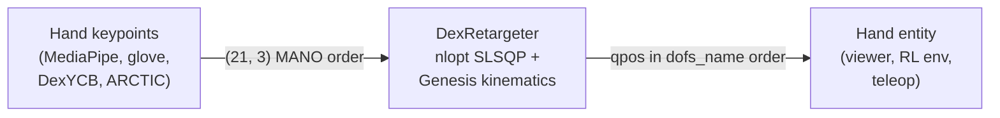

# Dex Retargeting

`DexRetargeter` maps human hand keypoints (from MediaPipe, a data glove, or a hand-object dataset) onto the joint
angles of a dexterous robot hand. It is a port of [`dex-retargeting`](https://github.com/dexsuite/dex-retargeting)
with its three optimizers, running its kinematics in Genesis instead of Pinocchio. This page covers building a
retargeter, choosing an optimizer, driving a hand in simulation, and adding a new hand. For batch retargeting from the
shell (`eden retarget dex`) and the full-body retargeters, see [Retargeting](retargeting.md).



## Install

=== "uv (checkout)"

    ```bash
    uv sync --inexact --extra dex-retargeter           # the library: nlopt
    uv sync --inexact --extra dex-retargeter-example   # + mediapipe 0.10.14, opencv-python, tyro for the scripts
    ```

=== "pip"

    ```bash
    pip install 'eden-world[dex-retargeter]'
    pip install 'eden-world[dex-retargeter-example]'
    ```

`mediapipe` is pinned to 0.10.14 because later releases removed the legacy `solutions` API the example hand
detector uses. Importing `eden.extensions.retargeting` or the preset module does not import `nlopt`; only importing
`DexRetargeter` itself does.

## Pick an optimizer

| `type` | matches | translation-invariant | handles a size mismatch | typical source |
|---|---|---|---|---|
| `vector` (default) | wrist → fingertip vectors | yes | yes, `scaling_factor` | monocular hand video |
| `dexpilot` | fingertip-pair and wrist → tip vectors, with a thumb-pinch projection prior | yes | yes, `scaling_factor` | live teleoperation, grasp-heavy motion |
| `position` | absolute keypoint positions | no | no | offline hand-object datasets (DexYCB, ARCTIC) |

`dexpilot` is usually the right choice for live teleoperation, `vector` when the hand never closes on a grasp, and
`position` for offline retargeting where the human keypoints and the robot share a wrist frame.

## Build a retargeter from a preset

A preset pairs robot options with retargeter options. The ones that ship, in
`eden.extensions.retargeting.dex_retargeter.presets.HAND_PRESETS`:

| preset | robot | optimizer |
|---|---|---|
| `xhand1_right_dexpilot` | `XHand1_R` | `dexpilot`, `scaling_factor=1.5`, `low_pass_alpha=0.2` |
| `xhand1_right_vector` | `XHand1_R` | `vector` from MediaPipe's wrist and fingertip indices, `scaling_factor=1.5` |
| `xhand1_right_position` | `XHand1_R` | `position` on MANO keypoint indices, no smoothing |
| `wuji_hand2beta2_right_dexpilot` | `WujiHand2Beta2_R` | `dexpilot`, `scaling_factor=1.05` (the hand is human-sized) |
| `wuji_hand2beta2_left_dexpilot` | `WujiHand2Beta2_L` | as above, left hand |

Each preset's robot is a fixed-base hand at `default_root_pos=(0.0, 0.0, 0.2)`. Build a one-env scene with it and
construct the retargeter against the entity by name:

```python
import genesis as gs

import eden as en
from eden.envs.base import EnvBase
from eden.extensions.retargeting.dex_retargeter import DexRetargeter
from eden.extensions.retargeting.dex_retargeter.presets import HAND_PRESETS
from eden.options import EnvOptions, SceneOptions
from eden.options.entities import PlaneOptions

en.init(backend=gs.cpu)

preset = HAND_PRESETS["xhand1_right_dexpilot"]
env = EnvBase(
    env_options=EnvOptions(num_envs=1),
    scene_options=SceneOptions(robot=preset.robot_options_factory(), floor=PlaneOptions()),
    show_viewer=True,
)
env.build()
env.reset()

retargeter = DexRetargeter(env=env, options=preset.retargeter_options())
```

This is what `eden retarget dex` does (`eden/utils/cli/retarget.py`). The retargeter needs a built env because it
evaluates forward kinematics and Jacobians on the entity itself.

To configure one yourself, pass the fields to `DexRetargeter.configure(...)`. The `dexpilot` preset above is:

```python
DexRetargeter.configure(
    entity_name="robot",
    type="dexpilot",
    finger_tip_link_names=list(en.robots.XHand1_R.metadata.target_hand_links),
    wrist_link_name="right_hand_link",
    scaling_factor=1.5,
    low_pass_alpha=0.2,
)
```

An `entity_name` that is not in the scene raises at construction and lists the entities.

## Retarget frames and trajectories

`retarget(ref_value)` solves one frame, warm-started from the previous one, and returns a full-DOF qpos in the
entity's `dofs_name` order. The shape of `ref_value` depends on the optimizer: positions `(n, 3)` for `position`,
vectors `(n, 3)` for `vector` and `dexpilot`. `extract_ref_value` builds it from a `(21, 3)` keypoint array, as the
upstream MediaPipe pipeline does:

```python
ref_value = DexRetargeter.extract_ref_value(
    joint_pos=keypoints,                                   # (21, 3), MANO order
    target_link_human_indices=retargeter.optimizer.target_link_human_indices,
    retargeting_type=retargeter.retargeting_type,          # "POSITION", "VECTOR" or "DEXPILOT"
)
qpos = retargeter.retarget(ref_value)                      # (n_dofs,)

qpos_seq = retargeter.retarget_motion(ref_sequence)        # (T, n_dofs), one ref_value per frame
```

`reset()` forgets the warm start and the output filter (call it between clips); `set_qpos(qpos)` seeds the warm start
from a known pose, such as the simulator's current state. Joints you want held rather than optimized are left out of
`target_joint_names` and passed per frame as `fixed_qpos`.

Because the result is already in `dofs_name` order, it goes straight onto the entity:

```python
import torch

robot = env.entities["robot"]
robot.set_qpos(torch.as_tensor(qpos, dtype=torch.float32, device=robot.device).unsqueeze(0))
env.scene.visualizer.update()
```

## Options

| option | default | effect |
|---|---|---|
| `type` | `"vector"` | `"position"`, `"vector"` or `"dexpilot"` |
| `target_joint_names` | `None` | subset of `entity.dofs_name` to optimize; `None` optimizes all |
| `target_link_human_indices` | `None` | indices into the keypoint array: `(n,)` for `position`, `(2, n)` (origins, tasks) for `vector`; leave `None` for `dexpilot`, which derives them from the fingertip count |
| `target_link_names` | `None` | `position`: robot links matched to the selected keypoints |
| `target_origin_link_names`, `target_task_link_names` | `None` | `vector`: the start and end link of each vector |
| `finger_tip_link_names`, `wrist_link_name` | `None` | `dexpilot`: up to five fingertips and the wrist link |
| `scaling_factor` | `1.0` | human-to-robot scale for `vector` and `dexpilot` |
| `huber_delta` | `2e-2` | Huber (smooth-L1) threshold of the per-frame cost |
| `normal_delta` | `4e-3` | weight of the quadratic pull toward the previous frame's solution |
| `project_dist`, `escape_dist` | `0.03`, `0.05` | `dexpilot` pinch thresholds: fingertip pairs closer than `project_dist` are drawn together, released past `escape_dist` |
| `has_joint_limits` | `True` | pass the entity's DOF limits to nlopt as bounds |
| `low_pass_alpha` | `0.1` | output smoothing in `[0, 1]`: `1` passes through, `0` freezes, a negative value disables the filter |

## Frames and MANO

The retargeter matches keypoints in the world frame the hand is loaded in. Keypoints from MANO-based data come in
MANO's own wrist frame, and `eden.extensions.retargeting.dex_retargeter.calibrate.urdf_to_mano_rot(robot)` returns
the rotation that brings them into the robot's frame (`R_mano_to_world`) and the wrist rotation to place a
floating hand for display (`q_urdf_to_mano`). It derives both from the hand's `up` / `front` declarations and
MANO's canonical axes, so no per-robot rotation is stored anywhere. For keypoints from a camera,
`operator2mano(hand_type)` gives the operator-to-MANO rotation upstream's video pipeline uses.

The MANO keypoint order is `eden.datasets.constants.MANO_KEYPOINTS_NAME`: the wrist, three joints per finger
(index, middle, pinky, ring, thumb), then the five tips at indices 16 to 20 (thumb, index, middle, ring, pinky).

## Adding a hand

A MANO-driven hand needs three pieces of metadata on its robot options and the right axis declaration:

| field | where | what |
|---|---|---|
| `target_hand_links` | `metadata` | fingertip link names, thumb to pinky |
| `mano_hand_idx` | `metadata` | the MANO keypoint index of each of those links (`[16, 17, 18, 19, 20]` for five fingers, in the same order) |
| `side` | `metadata` | `"right"` (default) or `"left"`, which picks the MANO frame |
| `up` | robot options | the asset axis the fingers extend along |
| `front` | robot options | the asset axis the palm normal points along |

Eden's defaults, `up=(0, 0, 1)` and `front=(1, 0, 0)`, already describe `XHand1_R` (fingers along +Z, palm normal
along +X), so it overrides nothing. The MANO hand asset declares MANO's own axes (`eden/options/robots/mano_hand.py`):

```python
class ManoHand_R(_ManoHand):
    file: str = "hands/mano_hand/mano_right.urdf"

    # Hand-axis convention: ``up`` = fingers, ``front`` = palm normal.
    # MANO right-hand URDF has fingers along -X and palm normal along -Y.
    up: tuple[int, int, int] = (-1, 0, 0)
    front: tuple[int, int, int] = (0, -1, 0)

    metadata: ClassVar[MetadataOptions] = MetadataOptions(
        side="right",
    )
```

`up` and `front` are the same fields that place every Eden asset in the world, so changing them also changes how the
hand loads: a fixed-base hand is loaded rotated accordingly. Compensate with `default_root_quat` (wxyz) if a scene
depended on the old orientation. A wrong declaration shows up as fingertip errors of 10 cm or more on real MANO
data; `examples/recipes/retargeting/dex_retargeter/dex_ycb_position_retargeting.py` logs
`fingertip_err_mean_m` / `fingertip_err_max_m` per clip for that check.

Finally add a `HandPreset(robot_options_factory, retargeter_options, side)` to `HAND_PRESETS`, and, for the offline
CLI, its name to `POSITION_PRESET_NAMES` if it is a position preset.

## Scope and differences from upstream

- **No base DOFs.** The optimized entity must have an immobile base: a fixed-base hand, or a hand welded onto an arm
  (welding removes its root joint). A floating hand raises; upstream's `add_dummy_free_joint` URDF surgery is not
  ported. Mount the hand at the wrist pose you want.
- **Mimic joints must already be resolved in the asset.** Upstream's `MimicJointKinematicAdaptor` is not ported.
- **Python presets replace YAML configs.** There is no `RetargetingConfig.load_from_file`; use
  `DexRetargeter.configure(...)` or `HAND_PRESETS`.

| aspect | upstream `dex-retargeting` | Eden `DexRetargeter` |
|---|---|---|
| forward kinematics | Pinocchio | Genesis (`entity.set_qpos`) |
| Jacobian | body Jacobian, rotated to world | Genesis' world-frame Jacobian (`get_jacobian`) |
| joint order | Pinocchio's | `entity.dofs_name` |
| viewer | SAPIEN | Genesis viewer |
| dependencies | pinocchio, sapien, nlopt | nlopt |

## Examples

`examples/recipes/retargeting/dex_retargeter/`:

| script | does |
|---|---|
| `show_realtime_retargeting.py` | webcam → MediaPipe → `XHand1_R` in the viewer (`--preset xhand1_right_dexpilot --hand-type right`) |
| `detect_from_video.py` | a video file → a `.pkl` of qpos |
| `render_robot_hand.py` | replays a saved `.pkl` |
| `position_retargeting.py` | a keypoints `.npz` → qpos with a position preset |
| `dex_ycb_position_retargeting.py` | DexYCB clips → `retargeted_<label>.npz` next to each clip, which `DexYCBDataset(retargeted_label=...)` loads as a `robot` key |

The Wuji Glove recipes (`examples/recipes/teleop/wuji/`) drive a Wuji hand through the
`wuji_hand2beta2_*_dexpilot` presets; see [Teleoperation](teleoperation.md).

## See also

- [Retargeting](retargeting.md): `eden retarget dex` and the full-body backends.
- [Motion datasets](motion-datasets.md): DexYCB, ARCTIC and the MANO hand-object releases.
- Upstream: [AnyTeleop](https://yzqin.github.io/anyteleop/), [DexPilot](https://arxiv.org/abs/1910.03135).
- API: [retargeting](../api/extensions/retargeting.md).
