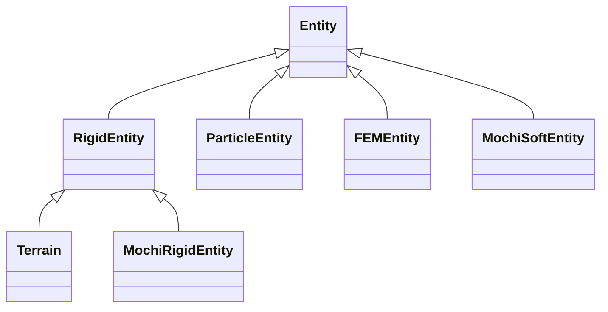

# Entities

Entities are the physical things in a scene: robots, props, the ground, terrain, and deformable bodies. This
page covers how an entity is declared and loaded, the frames its poses are reported in, how its joints are
indexed, and the physics settings that most often surprise people (armature, gains, friction, constraint
stiffness). Read it before writing a term that touches an entity, and before porting a robot or a policy from
another simulator. Robot presets are on [Robots](robots.md); scene presets, objects and terrain generators are
on [Scenes and terrains](scenes-and-terrains.md).

## Entity types

You never construct an entity class yourself. You declare an *options* object under a name in
[`SceneOptions`](../api/options/entities.md), and the environment picks the runtime class at construction from
the options type and its `material` (`_entity_class_for_options` in `eden/envs/base.py`):

| Options | `material` | Runtime class (`eden.entities.*`) | Use |
|---|---|---|---|
| `TerrainOptions` | any rigid | `terrain.Terrain` | height-field ground |
| `EntityOptions`, `RobotOptions`, `PrimitiveOptions`, `GroupedEntityOptions` | none, `RigidMaterialOptions` or `KinematicMaterialOptions` | `rigid.RigidEntity` | robots, props, fixtures, markers |
| same | an MPM / SPH / PBD material | `particle.ParticleEntity` | MPM solids, liquids, sand, PBD cloth |
| same | an FEM material | `fem.FEMEntity` | FEM elastic bodies, cloth, muscle |
| same | `MochiRigidMaterialOptions` | `mochi.MochiRigidEntity` | rigid bodies in the Mochi solver |
| same | `MochiElasticMaterialOptions`, `MochiShellMaterialOptions`, `MochiRodMaterialOptions` | `mochi.MochiSoftEntity` | Mochi solids, shells, rods |

A missing `material` means rigid. The material groups are the tuples `PARTICLE_MATERIAL_TYPES`,
`FEM_MATERIAL_TYPES`, `MOCHI_RIGID_MATERIAL_TYPES` and `MOCHI_SOFT_MATERIAL_TYPES` in
`eden/options/entities.py`; all material classes live in [`eden.options.materials`](../api/options/materials.md).



The options side has one class per shape of asset:

- `EntityOptions` loads a file (URDF, MJCF, USD or a mesh). USD needs OpenUSD's `pxr` module (the `usd-core`
  package), which no Eden extra installs: `pip install usd-core`, or under uv `uv pip install usd-core`, keeping
  `--inexact` on later `uv sync` calls so it stays.
- `RobotOptions` is an `EntityOptions` that is articulated and actuated by default; every robot preset
  subclasses it (see [Robots](robots.md)).
- `PlaneOptions`, `BoxOptions`, `SphereOptions` and `CylinderOptions` are primitives (`PrimitiveOptions`). A
  primitive has no joints, so any `default_dofs_*` field on one raises. `RodOptions` is a Mochi-only primitive.
- `TerrainOptions` builds a height field from generators (see [Terrains](scenes-and-terrains.md#terrains)).
- `GroupedEntityOptions` builds one entity that holds a different variant per environment (see
  [Heterogeneous entities](#heterogeneous-entities-groupedentityoptions)).
- `CompositeEntityOptions` is not an entity: it is a rig of several entities plus the welds between them,
  expanded when the environment is constructed (see [Composite robots](robots.md#composite-robots)).

All of them are importable from `eden.options.entities` (the common ones also from `eden.options`).

## Declaring and accessing entities

Each keyword argument of `SceneOptions` other than `attachments_dict` is an entity, and its keyword is the
entity's name. Terms, cameras and sensors refer to entities by that name.

```python
import eden as en
from eden.options.entities import BoxOptions, PlaneOptions, SceneOptions
from eden.options.materials import RigidMaterialOptions

scene_options = SceneOptions(
    plane=PlaneOptions(),
    robot=en.robots.Go2(),
    cube=BoxOptions(size=(0.05, 0.05, 0.05), default_root_pos=(0.5, 0.0, 0.025),
                    material=RigidMaterialOptions(rho=500.0)),
)
```

After the environment is built, the runtime entities are in `env.entities`:

```python
robot = env.entities["robot"]
pos = robot.get_pos()      # (num_envs, 3)
quat = robot.get_quat()    # (num_envs, 4), w x y z
robot.set_pos(new_pos, envs_idx=torch.tensor([0, 2, 5]))
```

Every getter returns a leading `num_envs` axis and accepts `envs_idx`: an int, a slice, an index tensor, or a
`(num_envs,)` bool tensor. A bare `True` / `False`, or a Python list of bools, raises `IndexError` rather than
being read as the indices 1 / 0.

!!! warning "Quaternions are wxyz"
    Every quaternion in Eden is `(w, x, y, z)`, config fields such as `default_root_quat` included.

## Loading an asset

### Where `file` comes from

`EntityOptions.file` names a file in a Hugging Face dataset (the entity's `registry` / `dataset`, by default
`DEFAULT_ASSET_REGISTRY` / `DEFAULT_ASSET_DATASET` in `eden/options/entities.py`), cached on first use. It is
one of:

- an existing local path, used as is (an absolute path that does not exist raises and is never fetched);
- a path inside the entity's cache directory, which names the repo path below it;
- the file's **full** path in the repo, for example `quadrupeds/unitree_go2/go2.urdf`.

A bare file name (`go2.urdf`) or a path suffix (`eggplant/object.urdf` for `models/eggplant/object.urdf`) is
not looked up: the asset root holds other datasets' caches (`ycb/`, `simpler/`, `policies/`, …), so a tail
could name another dataset's file. The `FileNotFoundError` for one lists the repo paths that end in it.

The asset root is `eden.utils.misc.get_assets_dir()`: `$EDEN_ASSETS_DIR` when it is set (it must be absolute),
else `~/.cache/eden/assets` (under `$XDG_CACHE_HOME` when that is set). Each asset family caches into its own
subdirectory of it. See [Assets](../getting-started/assets.md) for offline use and moving the cache.

!!! warning "Fetch an entity's file through its options"
    Code that needs an entity's file calls `options.fetch_asset(file)` (default: `options.file`), never
    `get_asset_path(file, local_dir=options.local_dir)`. An unset `local_dir` means "the family's
    `assets_subdir` under the asset root", resolved at load time by `options.resolve_local_dir()`. Passing the
    raw `None` on fetches into the asset root instead, and nothing fails. A file the family's dataset ships that
    no entity is built from (a task catalogue, a background image) is fetched with the class method
    `FamilyOptions.fetch_family_asset(file)`. Two source scans in `tests/options/test_entities.py` refuse both
    mistakes. Adding a family is covered in [Robots](robots.md#adding-an-asset-family).

### Load-time options

The fields of `EntityOptions` that shape what Genesis loads:

| Field | Default | Meaning |
|---|---|---|
| `up`, `front` | `(0, 0, 1)`, `(1, 0, 0)` | The asset's own up and forward axes. Eden rotates the asset so they become world +z / +x; `default_root_quat` is applied on top. They must not be parallel. |
| `scale` | `1.0` | Uniform scale, or one per axis. Per-axis scale needs a mesh file; URDF / MJCF / USD scale uniformly and a tuple with unequal entries raises. |
| `convexify` | `True` | Replace each collision mesh with convex hulls (CoACD decomposition when one hull is not accurate enough). |
| `decompose_object_error_threshold` / `decompose_robot_error_threshold` | `0.15` / `inf` | Skip decomposition when the hull's volume error is below this. |
| `decimate`, `decimate_face_num`, `decimate_aggressiveness` | `True`, `1000`, `3` | Mesh simplification. |
| `links_to_keep` | `[]` | URDF links that must survive Genesis' fixed-link merging (feet, sensor frames). |
| `recompute_inertia` | `False` | Ignore the file's mass and inertia and recompute them from the collision geometry and `material.rho`. Useful for a mesh authored at unit scale whose `<mass>` would otherwise shrink by `scale**3`. |
| `align` | `None` | Whether Genesis re-frames a free root body onto its centre of mass (see [below](#which-frame-relativefalse-vs-relativetrue)). |
| `default_armature` | `0.1` | Rotor inertia filled into joints the asset leaves at zero (see [the 0.1 trap](#armature-defaults-and-the-urdf-01-trap)). |

!!! danger "URDF `<inertial><density>` is not supported"
    Genesis' URDF parser crashes with `AttributeError: 'NoneType' object has no attribute 'attrib'` on the
    PyBullet `<inertial><density .../></inertial>` extension (an inertial block with no explicit `<mass>` /
    `<inertia>`). Use a URDF with explicit mass and inertia; for meshes, an offline-decomposed variant.

### `is_fixed_base` must match an MJCF

URDF, USD and mesh assets are built to match `is_fixed_base`. An MJCF is not: Genesis has no `fixed` switch for
MJCF, and the file's own joints decide whether the base moves. Eden still reads the flag (`has_immobile_base`,
`qs_idx_local`, the Jacobian column order and the initial-pose write all branch on it), so declare what the file
says. The build raises when you don't, naming the base link, its joints and the fix. The question is asked of
the *base link*, the first link Genesis builds:

- it carries a `<freejoint/>` → `is_fixed_base=False` (the G1);
- it has no joint, or is moved by a joint of its own other than a free one (hinge, slide or ball) →
  `is_fixed_base=True` (a jointless fixture, an arm such as `panda.xml`, the `Piano`; such a base joint stays an
  ordinary DOF).

A free joint on any *other* body (a second top-level body, or a free body in a file that authors geoms directly
under `<worldbody>`, where Genesis keeps a `world` link first) is not a floating base Eden can pose: load that
body as its own entity. A welded child is exempt, because attaching removes its base joints.

The robosuite and LIBERO object families rewrite their MJCF from the flag at load (their class sets
`mjcf_follows_is_fixed_base = True`), so for them the option is the source of truth. `eden view` and `eden
arrange` pin or free an entity only where the flag reaches the asset.

For a primitive, `fixed=True` and `is_fixed_base=True` mean the same thing.

## Poses and frames

### Which frame? `relative=False` vs `relative=True`

The rigid root-pose getters and setters, and the link pose, velocity and acceleration getters, take a
keyword-only `relative` flag:

| `relative` | Frame | Meaning |
|---|---|---|
| `False` | solver | Genesis' internal pose, **including** the morph pose offset and inertial alignment |
| `True` | authored | the pose with those stripped: the asset's declared root frame, the frame `default_root_pos` uses |

Genesis re-origins the base link of a free body whose subtree has no DOFs (a prop or tool, not an articulated
robot) onto its centre of mass and principal axes. `get_pos()` defaults to `relative=False`, so for an asset
whose centre of mass is far from its root, the returned position is not where you placed the asset:

```python
obj.get_pos()                  # solver frame: re-origined onto the centre of mass
obj.get_pos(relative=True)     # authored frame: what the asset file declares
```

On the DexToolBench tools the gap between the two ranges from 2.9 to 14.8 cm, growing with how far the centre
of mass sits down the handle. Fixed bases, articulated bodies and meshes centred on their centre of mass carry
no offset, which is why the difference stays hidden until a real prop is used.

!!! danger "Passing a pose between entities in the solver frame silently misplaces them"
    Every free body's solver frame sits on its *own* centre-of-mass anchor, kinematic bodies included. If you
    place one entity (a translucent goal ghost, a debug frame) at a pose read from another with the default
    `relative=False`, it lands the other body's offset away from where it should be, with no error. Use
    `relative=True` on both sides whenever two entities have to agree on a pose.

**Opting out: `align=False`.** Set `EntityOptions(align=False)` on a free file-loaded body and Genesis keeps
the authored frame as the solver frame, so `get_pos()` equals `get_pos(relative=True)`, as in MuJoCo. The body's
centre of mass and inertia also stay writable per environment after the build, which a task that randomizes them
needs (`RigidEntity.links_with_anchored_inertials` names the links Genesis would refuse). The cost: the unaligned
free body loses its diagonal 6×6 mass block, so linear and angular motion couple through the offset — the
numerical-stability benefit alignment exists for. Primitives have no `align` field; Genesis always aligns them.

**Porting a policy?** IsaacGym and MuJoCo both report a body's declared frame and neither re-origins it, so a
policy trained in either expects `relative=True`. Reading the default solver frame hands it an object pose
displaced by the offset. This fails quietly: the closed loop still converges (the policy servos whatever pose it
is shown), and an observation-parity test on synthetic poses cannot see it, because the mismatch is in the read.
What you see instead is a constant offset between where the object ends up and where it was asked to go.
`eden/extensions/policies/simtoolreal/policy.py` is a worked case.

!!! note "Setter defaults are asymmetric"
    `set_pos` defaults to `relative=False` but `set_quat` defaults to `relative=True`. Pass `relative`
    explicitly whenever it matters.

!!! note "`relative` on a non-rigid entity"
    Only a rigid body is re-origined, so only `RigidEntity` implements the flag. `get_pos` / `get_quat` still
    accept it on every entity kind, because shared terms (`observations.base_pos` / `base_quat`,
    `metrics.object_above_height`, `terminations.object_in_region`) are written against `Entity` and pass it
    through. An FEM or particle entity answers `relative=False` and raises on `relative=True`. A Mochi soft
    entity is the exception: its `get_pos` (the mean vertex position) and `get_quat` (identity) take no `relative`
    keyword, so those shared terms raise `TypeError` on it. Read its vertices (`get_vertex_positions()`) instead.
    A kinematic-material entity is still a `RigidEntity` and answers both.

### Where `default_root_pos` lands

`default_root_pos` / `default_root_quat` are the **root link's authored-frame pose**, whatever the base is:

- A fixed base bakes them into the morph.
- A floating base is written after the build with `relative=True` on both setters (orientation first).
- The built-in `events.reset_base_state_uniform` writes the same frame and composes its sampled roll / pitch /
  yaw *onto* `default_root_quat`, so an object authored lying on its side stays on its side.
- `env.reset()` restores the post-build state, so build and reset agree.

What the root link *is* depends on the asset. For a floating base it is the free body itself, so the default
pose **replaces** that body's own authored pose: the G1 MJCF's pelvis declares `pos="0 0 0.793"`, and
`default_root_pos=(0, 0, 0.78)` puts the pelvis at 0.78, not 1.57. A jointless (fixed) MJCF gets a `world` root
link from Genesis, so there the default pose places the file's world frame and its bodies keep their authored
offsets below it: a stand body declared at `pos="0 0 0.3"` lands 0.3 above `default_root_pos`.

A welded child skips the write: its `default_root_pos` / `default_root_quat` are its mounting transform on the
parent link (see [Attaching entities](#attaching-entities)).

The one exception to the authored-frame rule is a **floating base coupled to IPC**: it is written through
`set_qpos`, which is the solver frame, so a re-origined free body places its centre of mass on
`default_root_pos` there.

### Child links carry the root's CoM shift

Genesis anchors a free body whose subtree has no DOFs (a prop, a tool, a bin with welded parts) on its centre of
mass and principal axes. It re-expresses every geom so the geometry stays where the asset put it, but the *link
frames* move with the anchor, and only the root link carries the offset that `relative=True` strips. For a fixed
child link of such a body, `get_links_pos(..., relative=True)` equals `relative=False`, and both are displaced
from the authored body frame by the root's full offset, rotated into the principal axes. A reward or metric keyed
on such a child link (a handle body, a bin's base slab) silently reads the wrong point, while contacts and
rendering are correct.

Read a site-like point off the **root** with `relative=True` plus a body-frame offset, or undo the anchor through
the root's two frames:

```python
from genesis.utils.geom import inv_transform_by_trans_quat, transform_by_trans_quat

child_w = obj.get_links_pos(ls_idx_local=[idx])[:, 0]                       # anchored frame
in_root = inv_transform_by_trans_quat(child_w, obj.get_pos(), obj.get_quat())
authored_w = transform_by_trans_quat(in_root, obj.get_pos(relative=True), obj.get_quat(relative=True))
```

`tests/entities/test_rigid.py::test_a_fixed_child_link_carries_the_root_shift_that_relative_cannot_strip` pins
this recovery. Child links are still the right handle for *restricting contacts*: link identity is unaffected.

### Velocities live in the same frame as poses

`get_links_vel` and `get_links_acc` take the same `relative` flag. Genesis defaults it to `True`; **Eden pins
`False`**, matching its pose getters, so a link's reported velocity is the velocity of the very point
`get_links_pos()` reports, and finite-differencing the pose agrees with the velocity read.

```python
obj.get_links_vel()                  # velocity of the solver-frame origin (Eden default)
obj.get_links_vel(relative=True)     # velocity of the authored-frame origin
```

The two differ by the transport term `ω × d` over the offset `d` between the origins, so they diverge only for a
spinning body that carries an offset: in practice free single-body props and tools. `get_links_ang()` has no
`relative` variant, since angular velocity is the same at every point of a rigid body. `get_links_pos` and
`get_links_vel` also take `ref="link_origin"` (default) or `ref="link_com"` to report the link's centre of mass
instead of its origin; the other link getters have no `ref`.

The base getters `Entity.get_vel` and `get_ang` take `frame="world"` (default) or `frame="body"`, and no
`relative` argument: they report the solver frame.

The porting caveat applies here too: a policy trained in IsaacGym or MuJoCo expects `relative=True` on both the
pose and the velocity. Pass it on both or on neither.

### A free base's DOF velocities: linear is world, angular is body

The getters above report world-frame velocity. The free base joint's six DOFs, which `set_dofs_vel` writes, do
not use one frame for both halves; Genesis follows MuJoCo's `qvel` convention:

| Free-joint DOFs | Frame |
|---|---|
| 0–2, linear | world |
| 3–5, angular | **base body** |

So `get_ang()` and `get_dofs_vel()[:, 3:6]` are different numbers for a tilted base, and writing a world-frame
angular velocity straight into DOFs 3–5 perturbs the wrong axes. Rotate it into the body frame first, and leave
the linear half alone:

```python
from genesis.utils.geom import inv_transform_by_quat

ang_vel_b = inv_transform_by_quat(robot.get_ang(envs_idx=envs_idx), robot.get_quat(envs_idx=envs_idx))
ang_vel_b += perturbation          # body frame, e.g. a random yaw rate about the base's own z
robot.set_dofs_vel(
    torch.cat([robot.get_vel(envs_idx=envs_idx), ang_vel_b], dim=1),
    dofs_idx_local=robot.find_free_base_dofs_idx_local(),   # found by joint type, so robot-agnostic
    envs_idx=envs_idx,
)
```

There is no `set_vel` on an entity: writing the base velocity *is* writing these DOFs. `events.PushByVelocity`
and `events.PushSetPlanarVelocity` are the in-tree examples. A custom reset event that sets an initial base
velocity has to do the same conversion and, since it reads `get_quat()`, run after whichever reset event
randomizes the heading (see [Events](events.md)).

## Joints and DOFs

### Reading and writing joint state

```python
qpos = robot.get_dofs_pos()     # (num_envs, num_dofs), dofs_name order
qvel = robot.get_dofs_vel()
robot.set_dofs_pos(target, envs_idx=envs_idx)
robot.set_qpos(qpos)            # generalized coordinates; a floating base's 7 root qs come first
lower, upper = robot.get_dofs_limit()
```

`set_qpos` zeroes the entity's velocities afterwards by default (`zero_velocity=True`).
`control_dofs_pos` / `control_dofs_vel` / `control_dofs_force` set Genesis' controller targets; action terms
call them for you (see [Actions](actions.md)).

### DOF ordering

!!! info "DOF ordering"
    Eden's public API uses **`dofs_name` order**: the order of the entity's configured `dofs_name` list, with a
    pattern expanding in Genesis' joint order. It is not the asset's declaration order:
    `dofs_name=["c", "a", "b"]` puts `c` in column 0 whatever the file says. `get_jacobian` reorders its
    joint columns into this order for you, but on a floating base it puts six base columns in front of them
    (see below).

Two index spaces address a DOF, and each fits one kind of use:

| Space | Comes from | Use it for |
|---|---|---|
| **column** (position in `dofs_name`) | `find_named_dofs(...).columns` | the columns of `default_dofs_*`, `soft_dofs_pos_limits`, `get_dofs_limit`, and every full-width `get_dofs_*()` read; `get_jacobian` after its base columns (below) |
| **local** (Genesis' index within the entity) | `find_named_dofs(...).dofs_idx_local`, or `find_named_dofs_idx_local` for an uncontrolled joint | only the `dofs_idx_local=` argument of `get_dofs_*` / `set_dofs_*` / `control_dofs_*` |

`get_jacobian` is column space offset by the base. On an entity whose base can move, its first six columns are
the free base joint's DOFs and the joints follow in `dofs_name` order, so joint column `c` is Jacobian column
`c + 6`. An immobile base (`entity.has_immobile_base`: a fixed base, or a hand or gripper welded into a rig) has no
base columns. Joints left out of `dofs_name` have no column at all. Indexing a floating-base Jacobian with
`.columns` alone silently reads the wrong joints. `DifferentialIKController` adds the offset itself
(`base_offset` in `eden/managers/terms/actions/task_space_actions.py`).

They agree only when the robot has a fixed base, controls every joint that has a DOF, and declares its joints in
tree order. Otherwise a local index used as a column silently reads another joint's value. A floating base
shifts every local index by six, so the last six also run past the final column; on CUDA that surfaces as an
asynchronous device-side assert, far from the faulty line.

Resolve names **once, in `build()`**, with `find_named_dofs`. Its `DofSelection` carries both spaces from the
same resolution, so they cannot drift apart:

```python
def build(self):
    self._dofs = robot.find_named_dofs(self.dofs_name)  # None selects every controlled DOF

def compute(self):
    limits = robot.soft_dofs_pos_limits[:, self._dofs.columns]   # property tensor: columns
    pos = robot.get_dofs_pos(dofs_idx_local=self._dofs.dofs_idx_local)  # Genesis call: local indices
```

A multi-DOF joint (a ball joint) contributes one entry per DOF, and `names` repeats it. A free base or a passive
joint has no column, so `find_named_dofs` refuses it and its error says which of your keys did it; address one
with `find_named_dofs_idx_local` (or `find_free_base_dofs_idx_local`), whose indices belong only in
`dofs_idx_local=`. Passing an explicit `dofs_idx_local` to a getter returns values in the order you supplied.

**Name matching.** Every DOF-keyed option and lookup takes exact names, globs (`"*_knee_joint"`) or regexes,
inferred per key. A key that is exactly a joint's name is taken literally, even when it contains a pattern
character, and exactness is judged against *every* joint of the entity: a passive `pin.1` selects nothing rather
than a controlled `pin_1` it would match as a regex. A DOF matched by two keys of one dict raises
`ValueError: Multiple matches for '<dof>'` at build, so a `"*"` catch-all cannot be layered under narrower keys.

### Reading configured DOF properties

Read the configured per-DOF properties **by name**, so that no index reaches your code at all:

```python
kp = robot.get_default_dofs_kp(["left_knee_joint", "right_knee_joint"])  # (num_envs, 2)
pos = robot.get_default_dofs_pos()                                     # (num_envs, num_dofs)
soft = robot.get_soft_dofs_pos_limits(".*_knee_joint", envs_idx=[0])   # (1, 2, 2): lower, upper
```

There is one getter per resolved property: `get_` plus the config field's name (`get_default_dofs_pos` /
`_vel` / `_kp` / `_kd` / `_stiffness` / `_damping` / `_armature` / `_frictionloss` / `_pos_limits` /
`_force_limits`, and `get_soft_dofs_pos_limits`). Each accepts names or a `DofSelection` in place of
`dofs_idx_local`, always returns a leading env axis (narrowed by `envs_idx`), and returns a copy.

- **Configured, not live.** `get_default_dofs_armature` is what the entity was configured with;
  `get_dofs_armature` is what the solver holds now, after domain randomization or the explicit-integrator bump.
- **Stored layout varies.** The stored tensors have one row or one per env, depending on the property, the
  config, `batch_dofs_info` and whether the entity is heterogeneous, and rows can differ
  (`RandomizeStartupDofsPosBias`, a heterogeneous entity). Code that reads `default_dofs_pos[0]` is reading
  env 0.
- **Cost.** Each call allocates a `(num_envs, n)` copy, so keep the getters in `build()`. Anything that runs every
  step or writes into a property tensor indexes it with a `find_named_dofs` selection's `columns`.

### State vs info, and the environment axis

Eden's getters always return a leading `num_envs` axis. That is Eden's contract, not Genesis'. Genesis splits
per-DOF and per-link data in two:

| | Batched in Genesis? | Examples |
|---|---|---|
| **state** | always | `get_dofs_pos`, `get_dofs_vel`, `get_links_pos`, `get_friction_ratio` |
| **info** | only with `EnvOptions.batch_dofs_info` / `batch_links_info` | `get_dofs_kp`, `get_dofs_armature`, `get_dofs_limit`, `get_links_inertial_mass`, `get_mass_shift` |

Read an *info* field straight from Genesis and its shape depends on the env config, and `envs_idx` raises
outright when it is unbatched. Eden's wrappers normalize that away: when info is unbatched every env shares the
one stored row, so broadcasting it is exact. Code like `if values.ndim == 2: values = values[0]` is a leftover
workaround; with Eden's getters, `values[0]` is the whole story.

`EnvOptions.batch_dofs_info` defaults to `True` and `batch_links_info` to `False`. Either option only configures
the **rigid** solver; the kinematic solver keeps unbatched DOF info unless it holds a heterogeneous entity.
Genesis also turns batching on by itself for every entity of a solver that holds a heterogeneous entity. Eden's
wrappers read the solver's own flags (`has_batched_dofs_info`, `has_batched_links_info`), not the env option, so
this is transparent.

### Soft joint position limits

`post_build()` derives `soft_dofs_pos_limits` from each DOF's hard range, shrunk about its midpoint by a factor of
0.9 (mjlab and Isaac Lab call it `soft_joint_pos_limit_factor`; Eden hard-codes it in
`RigidEntity._init_soft_pos_limits` and exposes no option). This, not `default_dofs_pos_limits`, is what the
`dofs_pos_limits` reward and termination measure against, and what `reset_dofs_by_offset` /
`reset_dofs_by_scale` clamp the reset pose to. Setting `EntityOptions.soft_dofs_pos_limits` overrides the derived
value for the DOFs it names.

!!! warning "Unbounded DOFs keep their hard range"
    A DOF with an infinite hard limit (a ball joint, or a hinge the model gives no `range`) has no midpoint to
    shrink about. Such rows pass through at their ±inf range, which the penalty clips to zero violation and the
    reset clamps treat as a no-op. Half-bounded DOFs pass through whole. ±inf is fine for a *clamp* but not for
    a *sample*: `sample_uniform(-inf, inf)` is NaN. A term that draws a pose inside the limits has to reject an
    unbounded DOF in `build()` and name it; `DropFromHeight` in
    `eden/tasks/mujoco_playground/getup/custom_terms.py` is the worked example.

### Actuator gains: `default_dofs_kp` / `default_dofs_kd`

The PD gains a policy's position targets are tracked with are **entity options**, not action-term options:
`default_dofs_kp` and `default_dofs_kd`, dicts keyed by DOF-name patterns.

```python
# one gain for every DOF
hand = en.robots.WujiHand2Beta2_R(default_dofs_kp={"*": 50.0}, default_dofs_kd={"*": 1.0})

# per joint group: the patterns must not overlap, and should cover every DOF
robot = en.robots.Oli(
    default_dofs_kp={
        "*_hip_*_joint": 150.0,
        "*_knee_joint": 150.0,
        "*_ankle_*_joint": 40.0,
        # ... and the waist / shoulder / elbow / wrist / head groups Oli declares
    },
)
```

The gains are written into the solver at build, and `get_dofs_kp()` / `get_dofs_kd()` read back the built
values, which is what to audit when porting. Genesis calls the derivative gain `kv`; Eden calls it `kd`
throughout.

A gain dict you pass **replaces** the robot class's dict rather than merging into it, and a DOF no pattern
matches falls back to *the sim's current gain*, not to the class's. For an asset with no `<actuator>` block
(every URDF) that is **0**, a joint the policy's targets no longer move, and Eden logs a warning at build
naming those DOFs.

!!! warning "The warning only covers DOFs that land on zero"
    An MJCF robot whose asset authors actuator gains has a *nonzero* fallback, so unmatched DOFs silently keep
    the asset's gains and nothing is logged. That is the quieter half of the same mistake and the likelier one
    when porting. Re-state every entry you are not deliberately changing.

!!! warning "`default_dofs_stiffness` is **not** kp"
    Coming from Isaac Lab, where an actuator's proportional gain is called `stiffness`, `default_dofs_stiffness`
    is the field the name leads you to, and it is the wrong one. It sets the joint's **passive spring** (the
    MJCF joint `stiffness`, a restoring torque toward `qpos0`), with `default_dofs_damping` its passive damper.
    Setting kp there leaves the PD controller at whatever the asset authored (often 0) while hanging a large
    spring off every joint. Nothing raises.

    | Isaac Lab / mjlab | Eden |
    |---|---|
    | actuator `stiffness` (kp) | `default_dofs_kp` |
    | actuator `damping` (kd) | `default_dofs_kd` |
    | joint `stiffness` (passive spring) | `default_dofs_stiffness` |
    | joint `damping` (passive damper) | `default_dofs_damping` |

`default_dofs_spring_ref` re-anchors a passive spring away from `qpos0` (see
[closed-loop grippers](#closed-loop-grippers-and-constraint-fidelity)). Deployment can scale the gains it sends
to hardware with `eden deploy --deploy_kp_kd_scale` (see [Deployment](deployment.md)), and
[Policy porting](policy-porting.md) covers matching gains against a source stack.

### Armature defaults and the URDF 0.1 trap

Genesis fills `default_armature` (0.1 unless you override it) into every DOF whose armature the asset leaves at
zero, at `scene.build()`. The rule is about the *value* the asset leaves:

- It targets bodies moved by exactly one hinge or slide joint. A ball joint, a free joint and a body carrying
  several joints are skipped and keep the asset's value (zero unless authored).
- An MJCF joint that authors `armature="0"` is indistinguishable from one that omits it, so it receives the
  default too.
- A nonzero authored `armature` always wins.
- `default_armature=0.0` disables the fill, on a URDF, MJCF or USD asset alike; `HuskySkateboard`
  (`eden/options/objects/husky.py`) does this for its free wheels.

URDF has no armature element at all, so for a URDF asset this hits **every** joint: the 0.1 is a loader default,
not something the asset asked for. For low-stiffness joints it is wildly wrong: a dexterous hand's fingers run at
`kp ~1`, where 0.1 is roughly 30× the intended rotor inertia and leaves them too sluggish to close on an object.
When porting a robot, set `default_dofs_armature` explicitly from the source (Isaac Sim / MJCF `armature`), never
inherit the 0.1:

```python
# keys are DOF-name patterns; "*" sets every joint
hand = en.robots.XHand1_R(default_dofs_armature={"*": 1.0 / 300})
```

Because the fill lands at build, the pre-build joint description still reads the raw asset value. Audit the
built `get_dofs_armature()`, which is also what `default_dofs_armature` is seeded from.
`tests/entities/test_rigid.py` pins the fill rule.

### Implicit damping

!!! note
    Under the **explicit** Euler integrator (`EnvOptions.integrator="euler"`), `post_build()` adds
    `kd * substep_dt` to the armature of an actuated entity, a first-order correction that keeps the explicit
    `-kd·q̇` term stable. The default `approximate_implicitfast` and MuJoCo's `implicitfast` both integrate the PD
    controller's damping implicitly, so no bump is applied there and the effective armature equals the
    configured value (`RigidEntity._needs_explicit_damping_armature` is the gate). Audit `get_dofs_armature()`
    rather than assuming either way.

"The PD controller" here is the one **Genesis** runs: a DOF driven in position or velocity mode
(`ImplicitPDController`, `ImplicitVelocityController`, `DifferentialIKController`, `BinaryJointController`,
`FreeBasePoseController`), whose `kd` Genesis holds and adds to `M + h·D`. A torque-mode term (anything calling
`control_dofs_force`: `ExplicitPDController`, `VelocityFeedforwardPDController`, `ExplicitVelocityController`,
`OperationalSpaceController`) computes `-kd·q̇` in Python and hands Genesis a torque, so its damping is explicit
under **every** integrator. The gate is per entity and cannot see which term drives a DOF: under `euler` such a
term gets the fold like any other, and under the two implicit integrators it gets nothing. A stiff `kd` at a
coarse substep that is stable through `ImplicitPDController` can therefore diverge through
`ExplicitPDController`; lower the substep or `kd`, or switch the term. Integrators are described on
[Physics](physics.md).

### Effort limits start from the asset

`RigidEntity._init_dof_force_limits` seeds `default_dofs_force_limits` from the force range Genesis parsed,
overrides it per DOF with the actuator spec's `EFFORT_LIMIT` (or the option's `default_dofs_force_limits`), and
writes the symmetric range back with `set_dofs_force_range`. The parsed range composes every bound an MJCF
states: the motor's `ctrlrange` through its `gear`, its `forcerange`, and the joint's own `actuatorfrcrange`. A
DOF whose Eden options leave the effort unspecified therefore inherits the asset's limit; `FrankaResearch3`, for
example, gets ±87 / ±12 N·m from the `actuatorfrcrange` in its `fr3.xml`. A DOF the spec covers takes the spec's
value either way.

## Links, geoms and mass

### Link queries

```python
names, idx = robot.find_named_links_idx_local(["link_left_finger", "link_right_finger"], preserve_order=True)
link_pos = robot.get_links_pos(ls_idx_local=idx)     # (num_envs, n_links, 3)
hand = robot.get_link("hand")                         # a Genesis link object
jac = robot.get_jacobian(hand)                        # 6 base columns unless has_immobile_base, then dofs_name order
```

### Geom indices are global

A link carries both `link.idx` (scene-global) and `link.idx_local` (its position within the entity). A geom
carries only `geom.idx`, which is **scene-global**, while `entity.geoms` is an entity-local list. Indexing one
with the other is an `IndexError`, or silently the wrong geom, on any entity with geoms before it in the scene:

```python
geom = cube.geoms[0]
cube.geoms[geom.idx - cube.geom_start]                # local position = global idx - geom_start
```

### Mass and inertia

Three different quantities, easy to confuse:

```python
robot.get_mass()                      # the entity's TOTAL mass (links not fixed to the world)
robot.get_links_inertial_mass()       # (num_envs, n_links): each link's own mass, as the solver uses it
robot.get_mass_shift()                # (num_envs, n_links): deviation from the nominal, 0 if unrandomized
robot.get_links_invweight()           # (num_envs, n_links, 2): inverse effective inertia (trans, rot)
```

!!! warning "`get_mass()` is the total, not a per-link array"
    `get_mass()` returns a 0-dim tensor (or a `(num_envs,)` tensor when link info is batched or the entity is
    heterogeneous) and sums only links not fixed to the world. Reach for `get_links_inertial_mass()` whenever
    you mean *this link's* mass.

Genesis holds a single per-link mass channel, and the mass-randomization events write to it. Eden's shift API is
defined against the *nominal* mass, captured on first use (after the build, before the first randomization
write): `set_mass_shift(shift, ls_idx_local)` writes `nominal + shift` as an absolute value and
`get_mass_shift()` reads back `current − nominal`. `set_COM_shift` / `get_COM_shift` work the same way. Per-env
shifts require `EnvOptions(batch_links_info=True)`; the domain-randomization terms that write them fail at build
without it.

A link fixed to the world (`robot.links[i].is_fixed`: every joint up to the root is fixed, as for a fixed-base
arm's base link, a mounted hand's palm, or a `fixed=True` prop) never moves, so the solver never reads its mass
or centre of mass. The setters accept such a link, but the value changes no dynamics, so `RandomizeMassShift`,
`RandomizeLinkMassScale` and `RandomizeComShift` reject one at build and name the moving links to randomize
instead. `get_links_invweight` has no setter: Genesis derives it from masses, poses, inertias and armatures, so it
follows a mass or centre-of-mass write automatically.

## Contacts and constraints

### A pose setter clears every contact of the envs it writes

`get_contacts`, `get_grouped_contacts` and the contact forces report the contacts found at the last
`scene.step()`. Every pose setter of a rigid entity (`set_pos`, `set_quat`, `set_qpos`, `set_dofs_pos`) drops
**all** of them in the environments it writes, not only the moved entity's, because they were found at the old
pose; the constraint solver also starts those environments cold. They come back at the next step. So a term that
teleports something after physics (an interval event, see [Environments](environments.md)) empties the contacts
any later read sees in that step, and rewriting a marker every step costs every env its solver warm start. Write
only the environments whose pose changes (as `LiberoStoveBurnerVisualization` in `eden/tasks/libero` does with a
bool mask), or give a marker `KinematicMaterialOptions()`: the kinematic solver has no collider to clear.

### Trimmed and padded contact reads

`get_contacts()` trims its result to the most live contacts any env has, which reads that count back to the
host: one GPU→CPU sync per call. `get_contacts(is_padded=True)` returns every contact slot of each env instead,
with no sync. In both, `valid_mask` marks the contacts of the pair asked for, and a reader must respect it: the
trimmed form also holds other entities' contacts. In the padded form the floating-point fields (`position`,
`force_a`, `force_b`, …) of every invalid slot are zero, so `force * valid_mask` and
`where(valid_mask, force, 0)` agree. While the graded phase runs under a CUDA graph
(`EnvOptions.cuda_graph_options`), every query returns the padded form, so a term that sizes something by the
contact width sees the full capacity.

### Restricting which geoms collide

- `collision=False` removes an entity from collision checking entirely.
- `contype` / `conaffinity` (default `0xFFFF`) are 32-bit masks: two geoms can collide only if one's `contype`
  and the other's `conaffinity` share a set bit.
- `collision_link_patterns` keeps collision only on the links matching the patterns, and disables it on every
  other link, before the scene is built. The composite rigs use `collision_link_patterns=[".*pad"]` on the
  Robotiq 2F85 so objects are pinched between the pads instead of wedged against the inner linkage.
  `collision_friction` sets the friction of the geoms it keeps.

A kinematic entity has no collision geometry, so these options are ignored on it with a warning.

### Friction combines as `max`, not `min`

Genesis resolves a contact pair's friction as `max(friction_a, friction_b)`, clamped to at least `1e-2`, not the
minimum, average or product. High friction on *one* geom is therefore enough: grippy fingertips work against a
default-friction object without touching the object's options. PhysX averages by default; MuJoCo also takes the
max when both geoms have the same `priority`, but a higher-priority geom's coefficient wins outright (see
[porting a friction-randomization setup](#porting-a-friction-randomization-setup-max-combine-absolute-ratios-low-friction-ground)).
Check this when matching another simulator's grasp behaviour. The same rule applies to the torsional and rolling
coefficients below.

Set friction entity-wide with `material=RigidMaterialOptions(friction=...)`, or per link pattern with
`default_geoms_friction={pattern: value}`, which is applied at build and keeps every link colliding. Prefer the
latter over `collision_friction`, which only covers the geoms `collision_link_patterns` keeps.

### Torsional and rolling friction are opt-in, and their strength is per geom

Sliding friction is always on. Resistance to *spin about the contact normal* (torsional) and to *rolling about
the two tangent axes* (rolling) are opt-in per scene, because each adds constraint rows to every contact: one for
torsional, two more for rolling.

```python
EnvOptions(enable_torsional_friction=True)                                # spin resistance
EnvOptions(enable_torsional_friction=True, enable_rolling_friction=True)  # + rolling
```

`enable_rolling_friction` requires `enable_torsional_friction`; Genesis raises if rolling is enabled on its own.

The switch adds the axis; the **strength** is per geom, and unlike sliding friction it is a *length* (the
effective contact-patch radius, in metres), so values are small. Genesis' fallbacks are 0.005 m torsional and
0.0001 m rolling. Set it on the material, or per link pattern:

```python
# whole entity, on the material
cube = BoxOptions(size=(0.05,) * 3, material=RigidMaterialOptions(friction_torsional=0.02))

# per link pattern, from eden/tasks/simpler/base_config.py (WidowX fingers)
default_geoms_friction_torsional={".*_finger_link": 0.02}
```

Pattern semantics and the `max` pair rule match `default_geoms_friction`, so only one side of the grasp needs the
value. A link pattern is written after the material coefficient, so the two compose. Setting either coefficient
while its scene switch is off raises at build, because the solver would never read it. Friction domain
randomization moves these axes too: Genesis multiplies a geom's `friction_ratio` into its torsional and rolling
coefficients as well as its sliding one.

!!! danger "The switch alone does nothing for an MJCF entity"
    Genesis reads a geom's torsional / rolling coefficient from MJCF `friction[1]` / `friction[2]` *only* when
    that geom declares `condim >= 4` / `>= 6`; otherwise it parses to **0.0**, which zeroes the spin and
    rolling rows for that geom. MuJoCo's default is `condim=3`, so an MJCF robot gets no spin resistance from
    `enable_torsional_friction` alone: set the coefficient. Every other kind of entity (primitive, URDF, mesh, USD)
    falls back to 0.005 / 0.0001 unless its material sets one.

Without spin resistance, an object held in a hand slowly rotates inside the grasp; torsional friction is the fix
for in-hand tracking tasks.

### Porting a friction-randomization setup (max-combine × absolute ratios × low-friction ground)

Reproducing an Isaac Lab / mjlab friction-randomization setup means composing four facts; missed together they
produce randomization that silently does nothing.

1. **Genesis combines pair friction as `max`** (above). The randomized coefficient only takes effect on a contact
   when it is the larger of the pair.
2. **`RandomizeFrictionRatio` is absolute, not a scale.** Every call first pins the whole entity's base friction
   to 1.0 (`set_friction(1.0)`, which also overwrites any authored `default_geoms_friction` on that entity) and
   then writes per-link ratios, so `friction_range=(0.3, 1.6)` means absolute coefficients 0.3–1.6, whatever the
   asset authored. Convert a source config written as "scale × authored value" into the resulting absolute
   range.
3. **MuJoCo resolves these pairs differently** (geom `priority`, or elliptic combine): a source scene whose feet
   have `priority=1` uses the foot's coefficient against any ground. Under `max`, the equivalent is making the
   other side of the pair small.
4. **Therefore, give the ground low friction.** With a default plane (friction 1.0), a randomized foot coefficient
   below 1.0 loses the `max` and the range is effectively clipped.

```python
scene_options = SceneOptions(
    robot=MyRobot(),
    # Low-friction ground so the randomized foot coefficients win Genesis' max-combine.
    plane=PlaneOptions(default_geoms_friction={"*": 0.01}),
)
event_options = EventManagerOptions(
    # Whole-robot pass first, feet re-randomized after it: startup events run in ascending
    # `priority` order, and both events write absolute coefficients.
    robot_friction=events.RandomizeFrictionRatio.configure(
        mode="startup", entity_name="robot", links_name=["*"], friction_range=(0.3, 1.6), priority=0
    ),
    foot_friction=events.RandomizeFrictionRatio.configure(
        mode="startup", entity_name="robot", links_name=["left_ankle_roll_link", "right_ankle_roll_link"],
        friction_range=(0.3, 1.8), priority=10,
    ),
)
```

The HUSKY skateboarding task (`eden/tasks/husky/config.py`) is the worked example of this recipe.

### Closed-loop grippers and constraint fidelity

Genesis diverges from MuJoCo in several ways that specifically break closed-loop and tendon-driven grippers
(audited on the Robotiq 2F85):

- **No runtime tendons.** MJCF fixed-tendon actuators are approximated per wrapped joint at parse time and the
  tendon `coef` is dropped, so gains and force limits land *unscaled* on each joint and the shared-force
  underactuation is lost.
- **`solref` `timeconst` is clamped to `2 × substep_dt`**, for contacts, joint limits *and* equality
  constraints, and constraint stiffness goes as `1/timeconst²`. An asset tuned for MuJoCo at `dt=0.002` turns
  soft at a larger step. Closed-loop grippers need an effective substep (`sim_dt / sim_substeps`) of at most
  0.001 s, for example `sim_dt=0.004, sim_substeps=4`.
- **MJCF `springref` is ignored**: joint springs anchor at `qpos0`, dropping any preload. Use
  `default_dofs_spring_ref`, which re-anchors the spring at build as a `kp = stiffness` position servo at the
  reference. Don't also drive those DOFs from an action term.
- **Contact solver parameters are the mean of the two geoms', and geom `priority` is not read.** A stiff pad is
  diluted by a soft partner, so the *object* side has to be stiff too: set it per object with that object's
  `default_geoms_sol_params`.
- **kp / kd cannot damp contact chatter on a force-capped servo.** At contact the drive saturates (`kp·err` far
  above the force cap), so only always-on joint `damping` (implicit, stable at any value) and `frictionloss` (a
  dry-friction stick band) dissipate the penetrate-and-repel cycle.

!!! danger "Never stiffen constraints globally to fix one grip"
    A global `EnvOptions.constraint_timeconst` over-stiffens *every* rigid contact in the scene, including a
    mesh object's convex-hull-on-plane contact, which then ejects the object on contact. A box primitive
    tolerates it; a mesh does not. Stiffening per object with `default_geoms_sol_params` keeps the near-rigid
    behaviour local to the grip pair (the mean of pad and object) while the object-on-plane pair stays at the
    default.

The build-time knobs are fields of every entity options class (`BaseEntityOptions`), applied in
`RigidEntity.post_build`:

| Field | What it sets |
|---|---|
| `default_dofs_frictionloss` | per-DOF dry friction (stiction) torque |
| `default_dofs_spring_ref` | the reference a passive spring pulls toward |
| `default_equalities_sol_params` | `(timeconst, dampratio, dmin, dmax, width, mid, power)` for all of the entity's equality constraints (loop closures, joint couplings) |
| `default_geoms_sol_params` | the same seven numbers for the collision geoms of links matching each pattern |

`en.robots.Robotiq2f85` ships defaults tuned against MuJoCo: drive cap 2.4 N·m per driver (tendon `forcerange`
5 × wrap coef 0.485), loop closures and pads at `timeconst` 0.002 with `dmax` 0.999, spring reference 2.62 rad,
driver `damping` 1.0 / `frictionloss` 0.1, and pad-only collision meant to be paired with
`collision_link_patterns=[".*pad"]`. It declares `max_substep_dt = 0.001`, the coarsest substep its constraints
stay stiff at; a rig that carries it reports the same through `max_substep_dt` (see
[Robots](robots.md#composite-robots)). `tests/options/robots/test_robotiq_2f85.py` pins these values, and
`examples/recipes/collision/robotiq_2f85_grasp.py` grasps with them.

## Gravity compensation

### Per-entity gravity compensation

Gravity compensation is a **material** field, not a morph, `RigidOptions`, or `add_entity` argument:

```python
import eden as en
from eden.options.materials import RigidMaterialOptions

arm = en.robots.Iiwa14(material=RigidMaterialOptions(gravity_compensation=1.0))
```

`1.0` cancels gravity for that entity while everything else in the scene keeps it. Use it for arms whose real
controller compensates internally, and for policies trained with gravity disabled. The arm halves of the
industrial-arm rigs (`Droid`, the UR rigs) and the LIBERO Panda use it.

## Attaching entities

Weld one entity onto a link of another with `SceneOptions.attachments_dict`:

```python
SceneOptions(
    arm=en.robots.UR5e(),
    gripper=en.robots.Robotiq2f85(is_fixed_base=False),
    attachments_dict={
        "gripper": ("arm", "ee_link"),                                   # mount at the gripper's default_root_*
        # or ("arm", "ee_link", (0.0, 0.0, 0.01), (1.0, 0.0, 0.0, 0.0))  # explicit offset (xyz) and quat (wxyz)
    },
)
```

The 2-tuple form uses the child's own `default_root_pos` / `default_root_quat` as the mounting transform in the
parent link's frame; the 4-tuple form overrides it. Genesis merges the pair into one kinematic tree and removes
the child's root joint, so an attached entity has no base DOFs of its own even when `is_fixed_base` is `False`.
Ask `entity.has_immobile_base` (fixed *or* attached), not `is_fixed_base`, when the question is "are there base
DOFs to read or write". Its world pose is the output of forward kinematics, so `place_on_to` refuses to move it;
place the parent instead. Give the child `is_fixed_base=False`: it is posed by its parent link, and the composite
rigs refuse a child that is also pinned to the world.
Only `RigidEntity` and, for tetrahedral solids, `MochiSoftEntity` can be attached; anything else raises. A
heterogeneous entity cannot be attached, because the mounting transform is one pose shared by every env.

The composite robots in [Robots](robots.md#composite-robots) fill `attachments_dict` for you, including the
frame-alignment correction a hand with non-default `up` / `front` needs.

## Fixed, kinematic and invisible entities

- `is_fixed_base=True` pins the root link to the world (see the MJCF rule above).
- `material=KinematicMaterialOptions()` puts the entity in Genesis' kinematic solver: it is posed but not
  simulated and has **no collision geometry**. Use it for goal ghosts and markers. `vis_mode="collision"` or
  `"sdf"` on a kinematic entity falls back to its visual mesh with a warning, and `collision_link_patterns` and
  `is_support_enabled` are ignored on it.
- `visualization=False` hides an entity from rendering while it still collides.
- `surface=` takes an Eden `SurfaceOptions` (for example `PlasticSurfaceOptions(color=(1.0, 0.0, 0.0))`) from
  `eden.options.surfaces`, which can be built before `gs.init()`; `color=` is a shortcut for a plastic surface.

## Heterogeneous entities (`GroupedEntityOptions`)

A `GroupedEntityOptions` builds one Genesis entity that holds a different variant per env, in contiguous blocks
(`num_envs=4` over two variants: envs 0–1 hold the first, 2–3 the second). `entity.env_variant_idx` gives the
variant each env holds, and is fixed at build: a reset re-poses an env's variant but never swaps it.

```python
from eden.options.entities import BoxOptions, GroupedEntityOptions
from eden.options.materials import RigidMaterialOptions

bank = GroupedEntityOptions(
    material=RigidMaterialOptions(friction=1.0),  # every variant's, unless it sets its own
    grouped_entities=[
        BoxOptions(size=(0.1, 0.1, 0.1), material=RigidMaterialOptions(rho=25.0)),      # 25 g, friction 1.0
        BoxOptions(size=(0.1, 0.1, 0.1), material=RigidMaterialOptions(friction=2.0)),  # 200 g, friction 2.0
    ],
)
```

Each variant contributes its morph (file or shape, mesh processing, its own `default_root_pos` /
`default_root_quat`, composed onto the group's) and may hold its own value for some of the group's fields. A
variant *holds* a value when it differs from the field's default, whether passed in or its catalog class's
default.

| Fields | A variant's own value | Needs |
|---|---|---|
| `material.friction` / `friction_torsional` / `friction_rolling`, `default_geoms_friction*`, `default_geoms_sol_params` | written over that variant's own collision geoms | nothing |
| `material.rho` | each env's mass (and inertia) rescaled by `variant_rho / group_rho` | a mesh or primitive variant |
| `default_dofs_*`, `soft_dofs_pos_limits` | one row per env | per-env DOF info (`batch_dofs_info`, on by default; Genesis also batches a heterogeneous solver by itself) |
| `dofs_name`, `default_dofs_spring_ref`, a variant class's `dofs_spec` | shared: the group's, else the first variant's that sets one | a different value is refused |
| `surface`, `color`, `vis_mode`, `is_fixed_base`, support and collision-mask fields, `default_equalities_sol_params`, every other material field | group only | a different value is refused |

What a variant's asset itself states is its own too: Genesis simulates each env with its variant's geometry,
inertia, link frames and joint parameters (damping, limits, armature, frictionloss, force range), and a
`default_dofs_*` field a variant leaves unset defaults per env to that variant's own. The variants must share
their kinematic topology (the same links, hung from the same parents through joints of the same names, types and
DOF counts) or Genesis refuses the build.

A variant overrides a value the group sets only with a value other than its class's default: one equal to it is
read as inherited and refused, since the group's value would then silently skip that variant. The message gives
the fix. A group value that every variant overrides is refused too. The check reads values, not which fields were
passed, so it holds for an `--override` and a reloaded config alike, and the entity runs it again before the
build, so a TaskMod's later edit is checked as well.

Worked scripts: `examples/recipes/heterogeneous/heterogeneous_sim.py` and `heterogeneous_articulated.py`.

## Deformable entities

Deformable bodies are vertex- or particle-based. They have no DOFs, links or joint control, and the DOF and
support-surface fields are rejected on them at validation. Their solver options (`mpm_options`, `sph_options`,
`pbd_options`, `fem_options`) live on `EnvOptions`; see [Physics](physics.md).

### ParticleEntity (MPM / SPH / PBD)

```python
from eden.options.entities import EntityOptions, SceneOptions
from eden.options.materials import MPMElasticMaterialOptions

scene_options = SceneOptions(
    soft_body=EntityOptions(
        file="mesh.obj",
        default_root_pos=(0.0, 0.0, 0.5),   # baked into the morph at creation
        material=MPMElasticMaterialOptions(E=1e4, nu=0.3),
    ),
)
```

!!! warning "Particle entities cannot be moved after build"
    `set_pos()` and `set_quat()` raise `NotImplementedError` on a `ParticleEntity`. Bake the pose into the morph
    (`default_root_pos` / `default_root_quat`) at creation time.

`get_particles_in_bbox(lower, upper)` selects particles by their rest position, and
`set_particle_constraints(mask, link_idx, ...)` ties them to a rigid link.

### FEMEntity (elastic / cloth / muscle)

An `FEMEntity` wraps Genesis' FEM materials (`FEMElasticMaterialOptions`, `FEMClothMaterialOptions`,
`FEMMuscleMaterialOptions`).

```python
pos = fem.get_pos()                    # (num_envs, 3): unweighted mean of the vertices, not the centre of mass
verts = fem.get_vertex_positions()     # (num_envs, n_vertices, 3)
vels = fem.get_vertex_velocities()
```

- `set_quat()` raises `NotImplementedError`: bake the orientation into the morph.
- None of the setters accept `envs_idx`; they apply to every env at once.
- Prefer the two explicit setters over `set_pos`. `set_com_offset(offset)` places the **undeformed** build-time
  shape at its build-time position plus `offset` (repeated calls do not accumulate);
  `set_vertex_positions(pos)` writes absolute per-vertex positions.
- `set_pos` forwards to Genesis' `set_position`, which dispatches on the tensor shape: `(3,)` / `(num_envs, 3)`
  is an **absolute** centroid position, `(n_vertices, 3)` / `(num_envs, n_vertices, 3)` are per-vertex
  positions. When `num_envs == n_vertices` the two readings collide and Genesis takes the per-vertex one; the
  explicit setters avoid that.
- `get_vel(frame="body")` and `get_quat(relative=True)` raise: an FEM body reports an identity orientation and
  has no body frame.

## Mochi entities

The MochiSolver (Eden-hosted in `eden.engine.solvers.mochi`, on stock Genesis) assembles every body of a scene
and a smooth penalty contact model into one Newton system per substep. It owns two entity families:
`MochiRigidEntity`, a full `RigidEntity` with DOFs, PD control, IK and `attach_to`; and `MochiSoftEntity`, a
vertex-based solid, shell or rod. Solver settings (`MochiOptions`, precision, performance) are on
[Physics](physics.md#mochi-the-eden-hosted-implicit-solver); this section covers the entities.

!!! warning "A Mochi scene is all-Mochi"
    A scene with one Mochi entity may hold **only** Mochi and kinematic entities, the ground plane included:
    `SceneOptions` rejects a mix at validation, because the solver refuses to run beside another one. Run with
    `en.init(precision="64")` unless every `penalty_coefficient` is lowered from the 1e9 Pa/m default (which
    ill-conditions the Newton system in fp32). `requires_grad` is refused. On a `MochiRigidEntity`,
    `default_dofs_frictionloss`, `default_dofs_force_limits`, the constraint-solver parameters and support
    surfaces are rejected at validation (the solver reads none of them), `set_mass` raises (set the material's
    `rho`), and per-env DOF info is `MochiOptions.batch_dofs_info`, not the `EnvOptions` field of the same name.
    `MochiSoftEntity.set_quat` raises: bake the orientation into `default_root_quat`.

```python
from eden.engine.solvers.mochi import MochiOptions
from eden.options.entities import PlaneOptions, RodOptions, SceneOptions, SphereOptions
from eden.options.envs import EnvOptions
from eden.options.materials import MochiElasticMaterialOptions, MochiRigidMaterialOptions, MochiRodMaterialOptions

env_options = EnvOptions(
    sim_dt=1 / 60,
    mochi_options=MochiOptions(n_newton_iterations=8),  # the substep is sim_dt / sim_substeps
)
scene_options = SceneOptions(
    plane=PlaneOptions(material=MochiRigidMaterialOptions()),
    blob=SphereOptions(
        radius=0.15,
        material=MochiElasticMaterialOptions(E=5e4),
        morph={"maxvolume": 5e-4, "nobisect": False},   # tetgen refinement
    ),
    rope=RodOptions(points=centerline, radius=0.01, material=MochiRodMaterialOptions()),
)
```

A **rod** (`RodOptions`) is the one morph unique to this solver: the centerline polyline plus a
`MochiRodMaterialOptions`; clamp it after build by fixing its first nodes (`set_vertices_fixed([0, 1])`). A
**solid** may load a tetrahedral mesh directly, a tetgen `.node` (its `.ele` sibling is read alongside) or a
legacy ASCII `.vtk`, which only a `MochiElasticMaterialOptions` entity may do. A tetgen box meshes into a handful
of tetrahedra, too few to deform, so `eden.utils.procedural_meshes` writes regular meshes to the cache:
`box_tet_lattice_file(size, cells)` (a 5-tet-per-cell lattice) and `grid_sheet_file(size, cells)` (a flat sheet
for a shell).

**Pinning and driving vertices.** `set_vertices_fixed` / `set_vertices_target` take one vertex set for every env,
`(n,)`, or one per env: an `(n_envs, n)` tensor padded with `-1`, which stays on the device. This is how a
gripper carries whichever vertices it closed on in each env (`SettledGraspLatch` / `FeatureGraspLatch` in
`eden.tasks.mochi.custom_terms`). A pin, and the position it holds the vertex to, live outside the state
`scene.reset` restores, so re-pin at reset (`PinSoftBodyVertices`) rather than once at startup, and release
whatever a gripper held when its env resets.

**Mounting a soft body.** A **solid** mounted on a robot link (a sponge under a gripper) is named in
`attachments_dict` like a welded rigid child. The mounting transform means what it means for
`RigidEntity.attach_to`, and the vertices of the face nearest the link are tied to it. The body is placed at the
link's *build* pose (every joint at zero), where the ties are anchored, and `post_build` carries it to wherever the
parent's default joint positions put the link:

```python
SceneOptions(
    robot=en.robots.FrankaEmikaPanda(material=MochiRigidMaterialOptions()),
    sponge=EntityOptions(file=box_tet_lattice_file((0.075, 0.05, 0.03), (6, 4, 3)),
                         material=MochiElasticMaterialOptions(E=8e4)),
    attachments_dict={"sponge": ("robot", "hand", (0.0, 0.0, 0.1284), (1.0, 0.0, 0.0, 0.0))},
)
```

Shells and rods cannot be mounted this way; tie them with `attach_to_link(entity, link_name, verts)` from a
pre-build hook, choosing the vertices. `set_visual_mesh`, `set_rest_positions` and `set_contact_skin` also change
what the solver assembles, so they are pre-build work too. Run them from a hook, which fires after the entities
are added and before the build:

```python
env.register_pre_build_hook(lambda: finger.attach_to_link(gripper, "finger_link", base_verts))
env.build()
```

Within the hook, `set_visual_mesh` must come **before** `set_rest_positions`: the render mesh is bound to the
tetrahedra by barycentric coordinates, which then carry it along when the rest geometry moves. The other order
raises. `set_contact_skin` (same placement arguments as `set_visual_mesh`) moves a solid's contact samples onto a
detailed triangle surface; the solver embeds the skin only at build, so it and `set_rest_positions` each raise
after the other. Place a skinned body through `default_root_pos` / `default_root_quat` instead.

**Contact.** Mochi contact is sample points of one body against the other's distance field, and four
consequences shape a manipulation scene:

- **The activation band is the collider's.** A shell or a rod touches through its mid-surface or centreline, so a
  plane lets it lie on that surface; give the plane `penalty_threshold=radius` and a cable lies on top. The same
  band stops a robot's fingertips that far up; jaws feel a thin body's thickness only through their own band
  (`MochiRigidMaterialOptions.penalty_threshold` on the robot). `set_contact_enabled(other, False)` switches a
  pair off.
- **Every collision triangle is three samples**, so a finely tessellated primitive is expensive
  (`eden.tasks.mochi.common.yam_mochi_file` drops the YAM's fingertip spheres for this reason).
- **Friction below `friction_falloff_vel` grows with the slip** (0.01 m/s by default), so a part under a steady
  load (a bent cable, a sponge in the jaws) creeps. Lower it, for example to `1e-4`, to hold it.
- **Friction combines by the geometric mean** of the two bodies' coefficients, unlike the rigid solver's `max`.

Worked scripts for every feature above are in `examples/recipes/mochi/`; the Mochi tasks are on
[Mochi tasks](../tasks/mochi.md).

## Terrain

`TerrainOptions` builds a `Terrain`, a fixed `RigidEntity` whose geometry is a height field stitched from a grid
of generators. Its `default_root_quat` must be the identity. The options, the generator catalog, and the
`Terrain` API (`bounds`, `get_height`, `subterrain_origins`, `goals`) are on
[Scenes and terrains](scenes-and-terrains.md#terrains).

## See also

- [Robots](robots.md): robot presets, composite rigs, actuators, adding a robot or asset family
- [Scenes and terrains](scenes-and-terrains.md): scene presets, objects, support surfaces, terrains, splat scenes
- [Physics](physics.md): integrators, solvers, substeps, precision
- [Terms](terms.md): resolving entities and DOFs in `build()`
- [Policy porting](policy-porting.md): auditing the built robot against a source stack
- API: [`eden.entities`](../api/entities.md), [`eden.options.entities`](../api/options/entities.md),
  [`eden.options.materials`](../api/options/materials.md)
