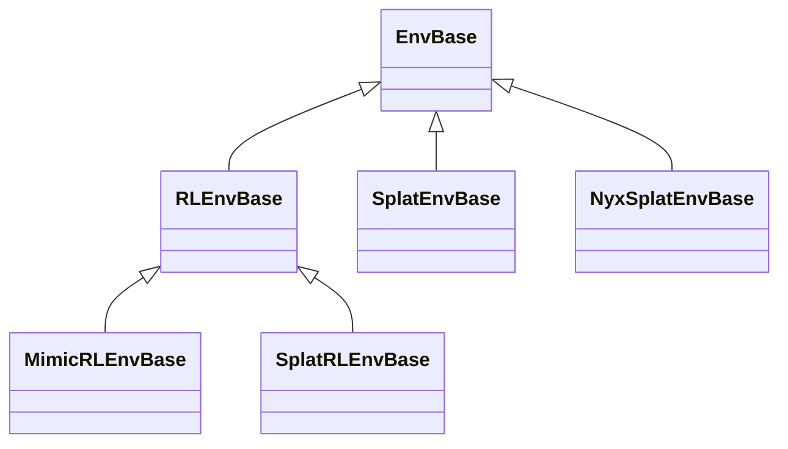

# Environments

An environment turns a task config into a running, vectorized simulation: it creates the entities,
builds the Genesis scene, owns the managers and runs the step loop. This page covers the environment
classes, building one from a config, what `step()` and `reset()` do and in which order, inspecting a
built environment, and writing a new environment class. Read it when you build an environment by hand,
write a term whose timing matters, or debug a reset.

## The environment classes

Each environment class reads exactly one config class (its *config leaf*). The pairing is fixed, and
`from_config` refuses a config of another leaf:

| Environment (`eden.envs`) | Config leaf | Adds |
|---|---|---|
| `base.EnvBase` | `EdenConfig` | the scene, entities, cameras, sensors, and the action, metric, event, observation and recorder managers |
| `base.RLEnvBase` | `EdenRLConfig` | the reward, termination, command and curriculum managers, the RL step with auto-reset, `reward_buf` / `reset_buf` |
| `base.MimicRLEnvBase` | `EdenMimicConfig` | the motion manager, which streams a reference motion |
| `splat.SplatEnvBase` | `EdenSplatConfig` | a Gaussian-splat background (gsplat), on a non-RL environment |
| `splat.SplatRLEnvBase` | `EdenSplatRLConfig` | the same splat background, on an RL environment |
| `nyx_splat.NyxSplatEnvBase` | `EdenNyxSplatConfig` | a path-traced splat background (Nyx), on a non-RL environment |



The config classes are described in [Task Configuration](task-config.md#the-config-hierarchy). API
reference: [Environments](../api/envs.md).

## Building an environment

```python
import eden as en          # import eden before genesis and torch
import genesis as gs
from eden.envs.base import RLEnvBase
from eden.tasks import TASK_REGISTRY

en.init(backend=gs.gpu)    # the default backend is gs.cpu

config = TASK_REGISTRY.build("reacher")
env = RLEnvBase.from_config(config)   # constructs only: the scene is NOT built yet
env.build()                           # builds the Genesis scene and the managers
obs, extras = env.reset()             # call reset() once before the first step()
```

Or let a training wrapper do all of it:

```python
from eden.envs.wrappers.rsl_rl_env import RslRlVecEnvWrapper

env = RslRlVecEnvWrapper.from_config(config)   # seeds, constructs, builds and resets
```

!!! warning "What `from_config()` does depends on the class"
    | Call | Constructs | `build()` | `reset()` | Seeds the RNGs |
    |---|:---:|:---:|:---:|:---:|
    | `EnvBase` / `RLEnvBase` / `MimicRLEnvBase.from_config(cfg)` | yes | no, call it yourself | no | no: an env has no `runner_options` to read a seed from |
    | `RslRlVecEnvWrapper` / `RlGamesVecEnvWrapper.from_config(cfg)` | yes | yes | yes, in the wrapper's `__init__` | yes, from `runner_options.seed`, before it constructs the env |

    A raw environment is unbuilt: its managers, entity handles and buffers do not exist until `build()`,
    and `build()` does not reset. The wrapper path requires `cfg.runner_options`; a config without one
    raises `ValueError` pointing back at `RLEnvBase.from_config`. A wrapper owns the environment its
    `from_config` built: `close()` destroys the scene, and so does a wrapper that fails to construct. An
    environment you build yourself and pass to a wrapper's `__init__` stays yours to destroy, with
    `env.destroy()`.

`from_config()` takes only `show_viewer` and `eval_mode` as keywords; a wrapper's also takes
`apply_seed`. `eval_mode=True` sets `env.training = False`: curricula freeze and command debug drawing
turns on. `en.init()` also sets up the run's log directory and the console log theme; see
[Training runs](training-runs.md).

`from_config()` does not copy the config. The environment holds the config's own option objects, so an
edit to `env.env_options` after construction is also an edit to `config.env_options`.

**Seeding is the wrapper's job.** Put the seed on the config (`cfg.runner_options.seed = ...`) instead of
seeding around a wrapper's `from_config()`, which would overwrite it. If you build a raw environment and
wrap it yourself, call `eden.utils.random.apply_run_seed(cfg.runner_options.seed)` before `from_config`.
`env.seed(seed)` and `env.reset(seed=...)` seed the RNGs with exactly the value given, with no per-rank
offset. Seeds must be non-negative. Per-rank offsets under multi-GPU training are in
[Training runs](training-runs.md).

### Picking the env class: `env_class_for_config()`

The environment class and the config leaf must match. An environment's `from_config()` forwards only the
option groups its *own* config leaf declares, so `RLEnvBase.from_config(mimic_cfg)` would drop
`motion_options` and train with no motion reference at all. `from_config()` therefore raises `TypeError`
on a mismatch, naming the class that should build the config. Task subclasses on either side are fine:
the check compares leaves, so a `ReacherEnv(RLEnvBase)` built from a `ReacherConfig(EdenRLConfig)` is one
pairing.

When the config class is not known statically (a CLI `--task`, a registry lookup, a helper that takes any
config), dispatch on the config's type:

```python
from eden.envs.base import env_class_for_config

env = env_class_for_config(cfg).from_config(cfg, show_viewer=True)
env.build()
env.reset()
```

`env_class_for_config` (`eden/envs/base.py`) is the single source of the mapping. It checks the most
specific leaf first, because the configs form an inheritance chain:

| Config | Env class |
|---|---|
| `EdenNyxSplatConfig` | `NyxSplatEnvBase` |
| `EdenSplatRLConfig` | `SplatRLEnvBase` |
| `EdenSplatConfig` | `SplatEnvBase` |
| `EdenMimicConfig` | `MimicRLEnvBase` |
| `EdenRLConfig` | `RLEnvBase` |
| `EdenConfig` | `EnvBase` |

A config of none of these types raises `TypeError`. The splat classes are imported only when a splat
config asks for them, so a splat config without the optional renderer dependencies raises `ImportError`
(install the `batch-splat` or `nyx` extra), rather than falling back to a plain environment. `eden
inference`, the training wrappers and the smoke harness (`eden.utils.smoke.build_and_step`) all dispatch
through it, and new code should too.

Before it constructs anything, `from_config()` also calls `cfg.check_bindings()`, which names any field a
TaskMod should have filled ([TaskMods](task-mods.md#check_bindings-name-what-is-still-unset)).

### What construction and `build()` do

**Construction** (`__init__`) creates the Genesis scene from `env_options`, then one Eden entity per
scene entry (a composite rig unfolds into its bodies and welds), the welds of `attachments_dict`, the
cameras and the sensors. A parent and the entities welded onto it are created consecutively, as Genesis
requires; a weld to an entity that does not exist raises `ValueError` here.

**`build()`** runs three steps:

1. `pre_build_setup()`: every entity's, camera's and sensor's pre-build hook, then the hooks registered
   with `register_pre_build_hook()`.
2. `scene.build()`, with `env_options.num_envs` environments (and `env_spacing` /
   `center_envs_at_origin`, which `build()` also accepts as arguments).
3. `post_build_setup()`: every entity's and camera's post-build hook, then the managers are constructed
   in [manager order](#manager-order) and checked against it, the STARTUP events fire, and the hooks
   registered with `register_post_build_hook()` run. The scene state at this point is saved as the
   state every reset restores.

Afterwards `build()` checks the built scene. A rigid body lighter than 1 g that is not carried by an
immobile base gets a warning and its mass set to 0.01 kg (a Mochi body raises instead, since its mass
cannot be patched). A scene with equality constraints (closed kinematic loops) and an effective substep
`sim_dt / sim_substeps` above 0.004 s gets a warning.

`register_pre_build_hook()` must be called before `build()`. A post-build hook may be registered later,
from a manager's construction inside step 3, because the queue is drained at the end of that step;
`MotionManager` registers one that way. Registering one after the drain raises `RuntimeError`, since it
could never run.

`register_substep_callback(callback, before=False)` registers a zero-argument callback that runs around
every `scene.step()` of a control step, that is `decimation` times per step: after the physics step, or
just before it with `before=True` (after the action manager has written its controls). It is for a term
that has to act between physics steps. Keep callbacks cheap and free of GPU syncs.

## Stepping and resetting

```python
obs, extras = env.reset()                          # all envs; env.reset(envs_idx) for some
obs, reward, terminated, timeouts, extras = env.step(action)
```

- `reset(envs_idx=None, *, seed=None)` resets the given environments (all of them when `None`) and
  returns `(obs, extras)`, where `extras["log"]` holds the managers' reset logging.
- `step(action)` advances one control step and returns `(obs, reward, terminated, timeouts, extras)`.
  `obs` maps each observation group to its tensor; `reward`, `terminated` and `timeouts` have shape
  `(num_envs,)`. `extras["log"]` holds the logging of the envs that reset this step, and
  `extras["final_observations"]` the [final observations](#final-observations), when enabled.
- `action` may be `None`: the simulation still advances, with no new controls.
- On an `EnvBase` (no RL layer), `step()` returns `(obs, None, None, None, extras)`.

## The Step Loop

`RLEnvBase.step()` runs these phases in this order. The table is the contract, not a summary:
`tests/envs/test_base.py` runs the real `step` against a recording harness and fails if the code and this
table disagree.

<!-- step-order-table -->

| # | phase | call | runs when |
|---|---|---|---|
| 1 | Map the policy action onto the actuators | `action_manager.compute` | `action` |
| 2 | Open the recorded step | `recorder_manager._on_step_started` | always |
| 3 | Advance command references *before* physics | `command_manager.pre_physics_advance` | `command_manager` |
| 4 | ×`decimation`: `apply_actions()` + `scene.step()` | `_scene_step_with_sensor_gating` | always |
| 5 | Refresh command caches on the post-physics state | `command_manager.post_physics_refresh` | `command_manager` |
| 6 | Shared computations for the graded layer | `metric_manager.compute` | `metric_manager` |
| 7 | Tick stateful observation terms (once per step) | `observation_manager.post_physics_refresh` | always |
| 8 | Terminations | `termination_manager.compute` | always |
| 9 | Rewards | `reward_manager.compute` | always |
| 10 | Tag the ending episodes with their success flag | `recorder_manager.set_episode_success` | `metric_manager`, `recording`, `episode_ends` |
| 11 | Close the recorded step (terminal envs still un-reset) | `recorder_manager._on_step_finished` | always |
| 12 | Snapshot done envs' final obs (opt-in) | `_record_final_observations` | `record_final_observations` |
| 13 | Reset done envs: scene reset + RESET events | `_reset_idx` | always |
| 14 | `post_reset()` on every term, for the envs phase 13 reset | `_dispatch_post_reset` | always |
| 15 | Record new-episode data | `recorder_manager._on_reset_finished` | always |
| 16 | Adapt difficulty (frozen at eval) | `curriculum_manager.compute` | `curriculum_manager` |
| 17 | **Resample / publish commands** | `command_manager.compute` | `command_manager` |
| 18 | INTERVAL events | `event_manager.compute` | `interval_events` |
| 19 | Observations | `observation_manager.compute` | always |
| 20 | Command debug draw (eval only) | `command_manager.draw_vis` | `command_manager`, `eval_mode` |

<!-- /step-order-table -->

A phase runs only when **all** of its conditions hold; `always` means every step of every RL environment.
The test switches each condition off in turn to check that the phase disappears with it and nothing else
does:

- `action`: `step()` was called with an action. The `apply_actions()` inside phase 4 is gated the same
  way; with no action the simulation still advances.
- `command_manager`, `metric_manager`, `curriculum_manager`: the task declares at least one term for that
  manager. A task with no command terms has no phases 3, 5, 17 or 20.
- `recording`: a recording is active (`recorder_manager.is_recording`).
- `episode_ends`: at least one environment's episode ends on this step.
- `record_final_observations`: opted in with `EnvOptions.record_final_observations`.
- `interval_events`: at least one event term uses INTERVAL mode.
- `eval_mode`: the environment is not training.

Phase 13 always runs, but it resets only the environments whose episode ended. `episode_length_buf` and
`common_step_counter` advance right after phase 4.

### Grade the step, then prepare the next one

Phases 6–9 *grade* the step that just happened, phases 16–20 *prepare* the next one, and phases 10–15 close
the books in between: the recorder closes the finished step, then the done environments are reset and
their terms rebuilt.

- **Phase 5** feeds the grading: it refreshes command-owned state on the post-physics robot, above
  everything that reads it.
- **Phase 7** is the one call per step a *stateful* observation term can count on. It comes after the
  command caches (5) and the metrics (6) that such a term may integrate, and before anything grades or
  resets. `observation_manager.compute()` at phase 19 is a *read*: it also runs at phase 12, at build,
  in `reset()` and from `get_observations()`, so a counter advanced inside it would be wrong.
- **Commands update at phase 17, after the reward at phase 9, on purpose.** The policy chose this step's
  action from the observations computed at phase 19 of the previous step. Grading at phase 9 against the
  command those observations carried keeps observation, action and reward aligned on one command.
- **Phase 14** is where a term rebuilds per-step caches for the environments phase 13 reset. Without it,
  phase 19 would read the finished episode's values for those environments. It runs once the *whole*
  reset is done, including a subclass's extra work (the motion environment's buffer refill).

Which per-step hook a term's state belongs in follows from this split, and getting it wrong fails
silently; the rules are in [Terms](terms.md#which-hook-grade-the-step-or-prepare-the-next-one), and why
phase 19 must not advance state is in [Terms](terms.md#compute-is-a-read-not-a-tick).

!!! info "Auto-reset runs before observation"
    Done environments are reset **after** the reward and the termination but **before** the observation,
    so the observations `step()` returns for them already show the **fresh post-reset state**, not the
    terminal one. This matters to an algorithm that uses the "next observation" of the done step; enable
    [final observations](#final-observations) if it needs the terminal one.

### The step of the other environment classes

- `MimicRLEnvBase.step()` first advances the motion reference (`motion_manager.compute`), then runs the
  twenty phases above.
- `EnvBase.step()` is a subsequence of them, with no commands, no terminations or rewards, and no
  auto-reset: phases 1, 2, 4, 6, 7, 11, 18 and 19. It returns no reward.

### Final observations

Because of the auto-reset, the observation `step()` returns for a done environment is the first one of
its next episode, not the terminal post-physics state. On-policy PPO in RSL-RL does not need the terminal
state: it masks natural terminations out of its value targets, and bootstraps time-outs from the value
it computed on the previous step. The wrapper reports `extras["time_outs"]` as truncated and not
terminated, so an environment that failed on the step it timed out counts as terminal.

A learner that needs the real terminal state opts in with `EnvOptions(record_final_observations=True)`.
Phase 12 then computes the observations of the post-physics state *before* the reset, and `step()`
returns them in `extras` next to the reset log:

```python
extras = {
    "log": ...,                    # the managers' reset logging
    "final_observations": {        # one entry per observation group, laid out like obs
        "policy": ...,             # (num_envs, *obs_shape); a nested dict for a group that does not concatenate
        "critic": ...,
    },
}
```

- Rows of environments whose episode did not end are zero. Rows of done environments hold the
  observation of the pre-reset state.
- For a group with history, the row has the history's shape, with the fresh post-physics frame in the
  most recent slot. The snapshot is computed with `update_history=False`, so it does not advance the
  history buffer; the once-per-step advance still happens at phase 19.
- The tensors are **reused** on every step. Copy them if you keep them, for example in a replay buffer.
- The cost is one more observation pass and one `torch.where` per group on every step, with no GPU sync.

The consumers it exists for are off-policy learners that bootstrap a timed-out transition from its real
next state (the FlashSAC learner of `flashdexretarget` refuses to run without it, from
`check_bindings()`), estimators whose target is the true next observation (`homie` turns it on for
HIMPPO), and evaluation recording that needs the terminal frame. It is off by default.

To change what counts as the terminal observation, override `RLEnvBase._compute_final_observations()`,
for example to skip a group whose terms are unsafe to evaluate on the post-physics state.

### Solver errors

A physics solver that leaves an environment's state corrupt (a NaN contact, force or acceleration, or a
diverged Mochi solve) does not stop the run:

- phases 6 and 9 drop what the metric and reward terms read from those environments, so no NaN reaches
  the learner;
- phase 8 truncates them, logged as `Episode_Termination/solver_error`;
- phase 13 resets them, which clears the flag and zeroes the control force the solver reports for them.

`env.get_solver_error_envs_mask()` returns the flagged environments. Genesis raises a flag that is still
set at the start of its next `scene.step()`, so phase 4 lets only the first `scene.step()` of a control
step check the flags: an environment flagged during any of the `decimation` physics steps is reset before
the check that would raise for the whole scene. An environment that nothing resets (a plain `EnvBase`)
raises at the next control step.

A **misconfiguration** of the scene is never reset away. An environment flagged with a contact capacity
overflow, an unsupported collision pair or, under `requires_grad`, a NaN gradient is truncated and its
values dropped like any other, but it keeps the flag across the reset. The flag is handed back to the
solver right before the first `scene.step()` of the next control step, which then raises with a message
naming the option to change (on CUDA, the step after that, since its check does not wait for the
device).

### Replaying the graded phase from a CUDA graph

Phases 6–9 read the post-physics state and write only the managers' own buffers, in hundreds of small
kernels. When a step is limited by the host, launching them is the cost, and
`EnvOptions(cuda_graph_options=CudaGraphOptions())` replays them from one CUDA graph instead. The module
docstring of `eden/envs/graded_graph.py` gives the scale: about 3 ms of host time for the eager phase on
`beyondmimic` at 4096 envs, a replay that launches in about 5 µs, and about 70 µs of checks before each
replay.
<!-- TODO(material): an eager vs graph-mode step-time table per task, with the GPU it was measured on. -->

It is off by default (`cuda_graph_options=None`) and needs an `RLEnvBase` on a CUDA device; any other
environment refuses it. It is in `EnvOptions.training_only_fields`, which `eden inference`, `eden export`
and `eden deploy` reset when they replay a run's own config. `CudaGraphOptions` (`eden.options.envs`)
holds its settings:

| Field | Default | Meaning |
|---|---|---|
| `warmup_steps` | `2` | Eager steps before the first capture, so terms can build their lazy caches. |
| `validation_steps` | `3` | Replays after each capture that are also run eagerly and compared bit for bit (at least 1). |
| `recapture_window` | `100` | The span, in steps, over which re-captures are counted. |
| `max_recaptures_per_window` | `2` | Re-captures allowed within the window; one more raises, naming what changed. |

A term the graph cannot reproduce fails a validated replay, and the error names the buffers that differ.
Before every replay the graph checks what it baked in, and re-captures (and re-validates) when one of
these changed:

- a graded term's configured field, such as a termination threshold a curriculum moves;
- an environment constant a term may read: `dt`, `max_episode_length`, `training`;
- a tensor the graph reads, rebound to a new one (by a term, by `load_state_dict`, or by replacing the
  container that holds it). The check walks every object reachable from the environment, except the
  environment itself, the standard library's objects, and those of `genesis`, `quadrants` and `torch`.

Reward weights are mirrored on the device and copied before every replay, so a weight curriculum needs
no re-capture. A curriculum that moves a graded value on every step must keep it in a tensor written in
place, or it re-captures too often and raises.

A term is replayable when it follows the term contract: state in buffers written in place, and no value
read back to the host. These are not:

- **A host read** (`.item()`, `nonzero()`, a boolean-mask gather) fails the capture, and the error names
  the term's source line. Contact queries switch to their padded, fixed-shape form inside the graded phase
  of graph mode, eager runs included, for this reason (see [Entities](entities.md)).
- **`env.common_step_counter`** changes every step, so reading it during the capture raises
  `BakedHostReadError` naming the line: a replay would keep the branch the capture took.
- **Python state** a term advances outside its configured fields fails validation.
- **Any other Python value** read from outside the term's own fields, such as another manager's term
  attribute or a module global, is **not watched**: the graph replays the value it read at capture. Keep
  such a value in a tensor written in place.

## Events and resets

Event terms fire in one of three modes (`eden.constants.EventMode`):

| Mode | When it fires |
|---|---|
| `STARTUP` | once, in `build()`, after every manager is constructed |
| `RESET` | on every reset of an environment, right after the scene state of the reset environments is restored and before the managers' `reset()`: in `env.reset()` and at phase 13 |
| `INTERVAL` | at phase 18 of each step, with the control `dt`, when the term's interval has elapsed |

A reset therefore runs in this order: the scene state of the reset environments is restored, the RESET
events fire, every manager's `reset()` runs in [manager order](#manager-order) (publishing the finished
episode's statistics and clearing accumulators), `episode_length_buf` is zeroed for those environments,
and then every term's `post_reset()` runs, in the same order. `env.reset()` ends by computing the
observations. How `priority` orders the terms of one mode, and the fields of each mode, are in
[Events](events.md).

## Manager order

One declared order, `_manager_order()`, drives three walks: the construction of the managers in
`build()`, every manager's `reset()`, and every term's `post_reset()`. It is checked at build against
the managers the environment owns.

| env | `_manager_order()` |
|---|---|
| `EnvBase` | action → metric → event → observation → recorder |
| `RLEnvBase` | action → command → metric → termination → reward → curriculum → event → observation → recorder |
| `MimicRLEnvBase` | the RL order, **bracketed** by the motion manager (below) |

The order meets four constraints:

1. **`action_manager` before `event_manager`.** Reset-mode domain-randomization terms write the action
   modifiers' per-env buffers in `reset()`, so that the write lands *after* `action_manager.reset()`
   restores the baselines. With events first, every such draw would be overwritten within the same reset.
   This is the one constraint the check tests by position.
2. **The metric manager and the curricula may sit anywhere in the loop.** They normalize the finished
   episode by `episode_length_buf`, which is zeroed only after the loop.
3. **Every build-time handle lookup points backwards.** A term that resolves another manager's term in its
   own `build()` (an action-rate reward finding the action term, a velocity-tracking reward finding its
   command, a curriculum finding the reward or termination term it adjusts) needs that manager to exist
   already. Construction follows this order, so a bad name raises at build, not mid-rollout.
4. **The ended episode's motion is read through `motion_manager.ended_episode_validity()`.** In a motion
   environment, the reset environments' reference window is refilled for the new episode before the
   manager loop, so reading `motion_manager.data` from a manager's `reset()` raises. A term that grades
   the ended episode registers with `record_ended_episode_validity` in `build()`; a term that wants the
   new episode's reference reads it in `post_reset()`.

Everything else is a choice of producer before consumer. Commands are the reference every graded term
reads, so they come first; metric terms, the shared computations, feed termination and reward; the
curriculum reads the graded outcome last. Observation and recorder terms consume every other layer and
produce nothing, so they go last, with events just ahead of them.

Two consequences matter to term authors:

- **Every manager before `event_manager` publishes the finished episode under the domain-randomization
  draw it actually ran with.** The new draw lands at `event_manager.reset()`.
- **`curriculum_manager.reset()` runs after `reward_manager.reset()` has cleared its accumulators.** A
  curriculum that adapts on the finished episode's reward must read something published, such as another
  term's `get_state()` from its own `compute()` at phase 16, not the reward manager's internal sums. An
  evaluation environment never computes a curriculum, so it logs no `Curriculum/*` keys.

**The motion manager brackets the loop.** Its `reset()` must run *before* the scene reset, because
reference-state initialization (RSI) events read the freshly sampled clip, and its buffer is refilled
around the scene reset and the RESET events, before every other manager. No position in a flat list
expresses that, so `MimicRLEnvBase` constructs it before the others, calls `motion_manager.reset()` before
the base reset and `motion_manager.post_reset()` before the others' `post_reset()`, and declares it in
`_BRACKETED_MANAGERS` so the check knows it is handled.

### Adding a manager to your own environment

1. Add a `"<name>_manager": lambda: ...` entry to your `_manager_factories()` override, merged into
   `super()._manager_factories()`.
2. Add `"<name>_manager"` to your `_manager_order()` override, in the producer-before-consumer position it
   belongs in. The order is restated in full per class rather than composed, because the RL managers sit
   *between* the base ones.
3. If the manager may legitimately be absent (no terms declared), add it to `_OPTIONAL_MANAGERS` as well:
   it is then left as `None`, which every consumer's `is not None` check expects. The metric, command and
   curriculum managers are optional; the others are always constructed.

Miss a step and the build raises `RuntimeError` naming the manager: a factory no position in the order
calls, an ordered name with no factory, and a `*_manager` attribute the order does not mention are all
refused. Managers are discovered by that `_manager` suffix, so do not give any other attribute that name.
Override `_manager_order()`, not `_reset_idx()`: an imperative reset override bypasses the declared order,
and the check cannot see it.

## Inspecting a built environment

```python
env.num_envs              # parallel environments
env.device                # torch device
env.sim_dt                # physics time step
env.dt                    # control step: sim_dt * decimation
env.training              # False when built with eval_mode=True
env.episode_length_buf    # (num_envs,) steps into the current episode
env.max_episode_length    # steps per episode (RLEnvBase and subclasses)
env.max_episode_length_s  # seconds per episode (RLEnvBase and subclasses)
env.common_step_counter   # control steps since construction (RLEnvBase and subclasses)
print(env.summary())      # every manager and its terms
```

### Entities, cameras and sensors

```python
robot = env.entities["robot"]                 # by the name given in scene_options
robot = env.get_entity("robot")               # same, but a miss lists the entities that exist
arms = env.get_entities(["robot_.*", "box.*"])  # regex patterns, matched from the start of the name
camera = env.get_camera("wrist")              # also env.cameras["wrist"]
sensor = env.sensors["imu"]
```

An entity's class follows its options: `Terrain` for `TerrainOptions`, `ParticleEntity` for MPM, SPH and
PBD materials, `FEMEntity` for FEM materials, the Mochi entity classes for Mochi materials, and
`RigidEntity` otherwise. Test it with `isinstance`. Poses, DOF indexing and contacts are in
[Entities](entities.md).

`env.scene` is the Genesis scene and `env.rigid_solver` its rigid solver. `env.mochi_solver` is the Mochi
solver, and raises `RuntimeError` when no entity uses a Mochi material.

### Managers

```python
env.action_manager, env.observation_manager, env.event_manager, env.recorder_manager
env.reward_manager, env.termination_manager                          # RLEnvBase and subclasses
env.metric_manager, env.command_manager, env.curriculum_manager      # None when the task declares no terms
env.motion_manager                                                   # MimicRLEnvBase
term = env.reward_manager.get_term("action_rate")
```

The optional managers read `None` both before the build and after it when the task declares none of
their terms, so test them with `is not None`.

### Reading what the controller commanded

Three buffers describe an action step, and logging the wrong one is a common mistake:

```python
term = env.action_manager.get_term("joint_pos_controller")

term.action             # the raw policy output this step, (num_envs, action_dim)
term.prev_action        # the raw policy output last step
term.processed_action   # the command the term issued, which deployment also sends

env.action_manager.processed_actions  # {term_name: processed_action} for every term
```

Read `processed_action` when you need the controller target, for a rollout export, a sim-to-real
comparison or a tracking-error plot. Recomputing `raw * scale + offset` yourself drops any configured
control-step action modifier. A joint controller's resolved multiplier and bias are
`term.effective_scale` and `term.effective_offset`, the built values rather than the `scale` / `offset`
config fields. `processed_action` differs per term in units and width, so only its leading `num_envs`
dimension is guaranteed. An `ActionDelay` modifier acts later, once per physics step inside
`apply_actions()`, and no deployment applies it. Controllers and modifiers are covered in
[Actions](actions.md), and what deployment sends in [Deployment](deployment.md).

## Recovering the config

`env.config` reconstructs the config that describes the environment. For an environment built with
`from_config`, it is a **round trip**: an instance of the *source config's own class* (`ReacherConfig`,
not `EdenRLConfig`) that carries every field the environment never receives (`runner_options`,
`language_instructions`, task-specific fields), while the option groups the environment owns are read
off the live environment.

```python
config = TASK_REGISTRY.build("reacher")
env = RLEnvBase.from_config(config)

type(env.config)               # ReacherConfig
env.config.runner_options      # kept, though no environment parameter takes it
env.config.save_as_json("config.json")   # reloads into a ReacherConfig
```

The returned root is a fresh, unlocked object, but its option groups are the *live* ones, so editing
them edits the environment; use `env.config.clone()` for an independent copy. An environment constructed
**directly** (`RLEnvBase(env_options=..., ...)`) has no source config, so `env.config` synthesizes a plain
`EdenConfig` / `EdenRLConfig` / `EdenMimicConfig`, and the fields the environment does not own take their
class defaults.

The list of option groups is the same in both directions: `from_config` forwards every field the
environment's config leaf declares except `runner_options` and `language_instructions`, and `env.config`
reads that same list back. Neither side writes the list out, so they cannot drift apart. A loaded config
keeps its concrete class too ([Saving and loading configs](task-config.md#saving-and-loading-configs)),
which is what lets `eden train --config <a saved config.json>` rebuild the right environment without
being told the task.

## Writing a new environment class

### A task environment: subclass, and do not re-parameterize

To customize an environment for one task, subclass the environment class its config leaf uses, and stop
there:

```python
from eden.envs.base import RLEnvBase


class MyTaskEnv(RLEnvBase):   # the config leaf stays EdenRLConfig
    ...


env = MyTaskEnv.from_config(MyTaskConfig())
env.config.grasp_threshold    # a task-specific field, recovered from the source config
```

Task-specific config fields need no environment parameter, because `env.config` carries them over from
the config the environment was built from.

Leave `from_config` alone in a subclass that only customizes `step()`. An override that genuinely needs to
exist must declare `show_viewer` and `eval_mode` by name: a `**kwargs` there would swallow a misspelled
keyword that the base would have rejected. `tests/envs/test_base.py` holds every `from_config` under
`eden/` and `examples/` to this.

### A new config leaf: parameterize on it

An environment class declares its config leaf by parameterizing on it:
`class RLEnvBase(EnvBase[EdenRLConfig])`, `class MimicRLEnvBase(RLEnvBase, EnvBase[EdenMimicConfig])`.
That binding is the list `from_config` forwards from and `env.config` reads back, so it is a promise that
the environment's `__init__` takes every field the leaf declares. The promise is checked when the class is
created:

```python
class MyTaskConfig(EdenRLConfig):
    grasp_threshold: float = 0.03


class MyTaskEnv(RLEnvBase, EnvBase[MyTaskConfig]):   # TypeError, at class creation
    pass
```

The `TypeError` names `['grasp_threshold']` as declared by the config and missing from
`MyTaskEnv.__init__`. Unchecked, both directions would fail without naming the config: `from_config`
would pass `grasp_threshold=...` into `__init__`, whose `**kwargs` hands it on to the Genesis scene
(`Scene.__init__() got an unexpected keyword argument 'grasp_threshold'`), and `env.config` would raise a
bare `AttributeError`.

Re-parameterize only to add a genuinely new leaf with option groups of its own, as the splat configs do.
Then declare those groups as constructor parameters, and add the config-to-environment pair to
`env_class_for_config`. The two directions are declared separately (each environment declares its own
leaf, and `env_class_for_config` dispatches), so a new leaf must update both;
`tests/envs/test_base.py` fails if only one of them lands.

## See also

- [Task Configuration](task-config.md): the config classes and option groups an environment reads
- [Terms](terms.md): which per-step hook a term's state belongs in
- [Events](events.md): event modes, priorities and domain randomization
- [Training runs](training-runs.md): the training wrappers, seeding and logs
- [RL libraries](rl-libraries.md): Gymnasium, SB3, skrl and rl_games wrappers
