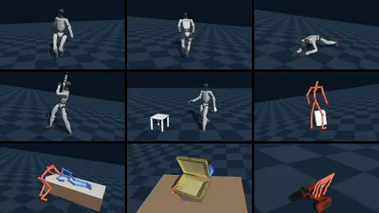

# Motion Datasets

Eden reads motion libraries (human motion capture, robot retargets, hand-object recordings) through dataset loaders
that all produce the same in-memory format. This page lists the loaders that ship, says where each one expects its
data and what you must obtain yourself, documents the motion fields they fill, the offline modifiers you can stack
on top, and how to write a loader for a new library. How a loaded dataset drives a training environment is in
[Motion tracking](motion-tracking.md).



## Loading a dataset

Every loader is a [`DatasetBase`](../api/datasets.md) subclass, constructed from its options and a device. The
LAFAN1 replay recipe (`examples/recipes/datasets/lafan1.py`):

```python
import genesis as gs

import eden as en
from eden.datasets.lafan1_dataset import LAFAN1RetargetedG1Dataset

en.init(backend=gs.gpu)

dataset = LAFAN1RetargetedG1Dataset(
    options=LAFAN1RetargetedG1Dataset.configure(
        raw_data_path=data_path,   # None downloads the dataset from HuggingFace
        target_framerate=50.0,
    ),
    device=gs.device,
)

robot_seq = dataset.motion_sequences["g1"]          # a BatchMotionSequence
robot_seq.base_pos_w[0, 0]                          # clip 0, frame 0
robot_seq.buffer_length                             # frames per clip
dataset.metadata["all_motion_files"]                # source file per clip
```

`dataset.motion_sequences` maps each *motion sequence key* (one per actor) to a `BatchMotionSequence` holding every
clip; `len(dataset)` is the number of clips. In a task you never construct the dataset yourself: you pass
`SomeDataset.configure(...)` as a `MotionTerm`'s `dataset_options` (see
[Motion tracking](motion-tracking.md#a-minimal-tracking-config)). Each loader under `examples/recipes/datasets/`
replays one library on a robot in the viewer.

## Shipped loaders

All of these are importable from `eden.datasets` and registered in `DATASET_REGISTRY` under the snake-case key shown.

| loader | registry key | sequence keys | content | data source |
|---|---|---|---|---|
| `AMASSRetargetedG1Dataset` | `amass_retargeted_g1_dataset` | `g1` | AMASS retargeted to a 29-DOF G1, IsaacLab AMP `.npz` with link poses included | HuggingFace `ember-lab-berkeley/AMASS_Retargeted_for_G1`, auto-download |
| `LAFAN1RetargetedG1Dataset` | `lafan1_retargeted_g1_dataset` | `g1` | Ubisoft LAFAN1 retargeted to G1, CSV (30 fps) | HuggingFace, auto-download (`g1/` only) |
| `SEEDRetargetedG1Dataset` | `seed_retargeted_g1_dataset` | `g1` | BONES Studio SEED, G1 CSV split (120 fps) | HuggingFace `bones-studio/seed`, **gated** |
| `PHUMADataset` | `phuma_dataset` | `g1` | PHUMA physically grounded humanoid motion, G1 split | HuggingFace `DAVIAN-Robotics/PHUMA`, auto-download |
| `OMOMOHolosomaDataset` | `omomo_holosoma_dataset` | `human`, `object` | OMOMO processed by the Holosoma pipeline: root pose, 52 SMPL-H joint positions, object pose (30 fps) | HuggingFace, auto-download |
| `ArcticDataset` | `arctic_dataset` | `object`, `left_hand`, `right_hand` | ARCTIC bimanual manipulation: two MANO hands (21 keypoints each) and a 1-DOF articulated object | HuggingFace, auto-download |
| `HHIAssistDataset` | `hhi_assist_dataset` | `caregiver`, `recipient` | HHI-Assist paired BVH of a caregiver and a care recipient (link poses only) | HuggingFace, auto-download |
| `DexYCBDataset` | `dex_ycb_dataset` | `hand`, `object` | DexYCB single-hand grasps of YCB objects (30 fps) | manual download, **gated** |
| `TacoDataset` | `taco_dataset` | `right_hand`, `object_right`, `left_hand`, `object_left` | TACO bimanual tool use (30 fps) | manual download + MANO |
| `OakInk2Dataset` | `oak_ink2_dataset` | as TACO | OakInk2 bimanual manipulation, one clip per program stage (120 fps) | manual download + MANO |
| `Hot3dDataset` | `hot3d_dataset` | as TACO | HOT3D egocentric recordings cut into hand-object segments (30 fps) | manual download + MANO |
| `WeaveG1InspireHOIDataset` | `weave_g1_inspire_hoi_dataset` | `robot`, `left_hand`, `right_hand`, `object` | Weave reference clips: a G1 with two Inspire hands moving an OMOMO object | HuggingFace, auto-download |

Three more loaders live with the task that uses them: `BvhCsvG1Dataset` (`eden/tasks/beyondmimic/dataset.py`, G1
CSV in BeyondMimic's layout), `DexterHandDataset` (`eden/tasks/contrack/dataset.py`, ConTrack xArm7 + XHand clips)
and `FlashDexRetargetDataset` (`eden/tasks/flashdexretarget/dataset.py`, the `motion.pt` that
[`eden retarget flashdex`](retargeting.md#flashdex-hand-object-demos-bimanual-robot-hands) writes).

The datasets' own licences and citations are in `eden/datasets/README.md`. Check each licence before using a
library or anything trained on it.

## Getting the data

### Automatic download

With `raw_data_path=None`, a loader that names a HuggingFace repo downloads it into the HuggingFace cache on first
use and reads it from there. Some repos hold more than the loader reads, so a loader may fetch only part of the repo
(`_hf_allow_patterns`), unpack an archive in place (`_post_download_process`), and read a subdirectory
(`_hf_data_subdir`):

- **LAFAN1** fetches and reads only the `g1/` CSVs; the repo also holds `h1/` and `h1_2/` retargets with other DOF
  counts.
- **SEED** fetches only `g1.tar.gz` and unpacks it to `g1/csv/`. The repo is gated: request access on its
  HuggingFace page and run `huggingface-cli login` first.
- **PHUMA** downloads one `data.zip`, unzips it, and reads `data/g1`.
- **Weave** downloads only the files of the `split` (`"train"` or `"test"`, default `"test"`) and `objects` you ask
  for.

A finished unpack is marked with a `.eden_extracted` file inside the unpacked directory (`g1/` for SEED, `data/` for
PHUMA), so an interrupted unpack is redone on the next run; delete that directory to force it. An upstream revision
bump downloads and unpacks into a fresh snapshot directory and leaves the old one behind. Set `raw_data_path` to a
directory you manage if you want a stable location. Where downloads go in general is covered in
[Assets](../getting-started/assets.md).

### An explicit `raw_data_path`

An explicit `raw_data_path` is used exactly as given and must already exist. A missing path raises (listing the
sibling directories, so a typo is visible) rather than downloading. Because the download stages only run on the
download path, an explicit path must point at what the narrowing would have produced: for LAFAN1 the `g1/`
directory itself, since mixing robots' CSVs fails with a shape mismatch.

SEED is the one exception: its `raw_data_path` may be the directory holding `g1.tar.gz` (it extracts it there, so
that directory must be writable), the extracted `g1/`, or `g1/csv/`. For a read-only copy, point at `g1/csv`.

### Licence-gated data you must obtain yourself

Eden never ships the SMPL, SMPL-H, SMPL-X or MANO model files, raw AMASS data, or the gated releases. You need:

| what | needed by | where to get it | where the loader expects it |
|---|---|---|---|
| DexYCB | `DexYCBDataset` | [dex-ycb.github.io](https://dex-ycb.github.io/) (Google Drive consent form) | `raw_data_path`: the extracted root holding `<YYYYMMDD-subject-NN>/<sequence>/`; `calibration_dir`: its `calibration/` directory |
| TACO | `TacoDataset` | [github.com/Satorinal/TACO](https://github.com/Satorinal/TACO) | `raw_data_path` holding `Hand_Poses/`, `Object_Poses/`, `object_models_released/` |
| OakInk2 | `OakInk2Dataset` | [oakink.net/v2](https://oakink.net/v2/) | `raw_data_path` holding `anno_preview/`, `program/program_info/`, `object_repair/align_ds/` |
| HOT3D | `Hot3dDataset` | [HOT3D](https://facebookresearch.github.io/hand_tracking_toolkit/dataset) | `raw_data_path` holding `dataset/<recording>/`, `_assets/assets/` |
| MANO models | TACO, OakInk2, HOT3D always; DexYCB with `body_model_params=True` | [mano.is.tue.mpg.de](https://mano.is.tue.mpg.de/), *Models & Code* (`mano_v1_2.zip`) | `body_model_dir`: its `models/` directory (`MANO_RIGHT.pkl`, `MANO_LEFT.pkl`) |
| SEED access | `SEEDRetargetedG1Dataset` | request access on HuggingFace | `huggingface-cli login`, then auto-download |

The MANO, SMPL and SMPL-H `.pkl` files pickle `chumpy` arrays. Eden reads them without chumpy
(`eden.utils.chumpy_pickle`), so they need no extra package; a `.npz` next to the `.pkl` is read instead when
present.

## Dataset notes

**AMASS.** The clips are already retargeted to the G1, with link poses precomputed. This is the retargeted split
only; the raw AMASS SMPL clips (for [`eden retarget soma`](retargeting.md#soma-smpl-family-motion-a-humanoid))
come from [amass.is.tue.mpg.de](https://amass.is.tue.mpg.de/).

**SEED.** The CSV root rotation columns are Euler angles in degrees composed in intrinsic ZYX order (the Maya
export convention); translation is in centimetres and joints in degrees. The loader handles all three. At about
142k clips, use the file filters and `GroundFirstFrame(chunk_size=...)` to keep memory bounded.

**ARCTIC.** The object's one DOF is `rotation`, and its links are `bottom` and `top`; each hand's links are the 21
MANO keypoints (`eden.datasets.constants.MANO_KEYPOINTS_NAME`). This loader does not trim clips, so
`drop_first_n_frames` / `drop_last_n_frames` raise; use the `TrimFrames` modifier.

**DexYCB.** `calibration_dir` is required: each clip's master-camera extrinsic is applied so poses land in DexYCB's
AprilTag world frame (z-up, origin on the table tag), and a missing or nonexistent `calibration_dir` raises
`FileNotFoundError`. The hand's base is the labelled MANO wrist keypoint (MANO's `transl` is a shape-dependent
offset of about 9 cm away from it), and its links are the 21 labelled keypoints. Only the grasped object
(`meta.yml::ycb_grasp_ind`) is kept. Leading frames without a MANO annotation are trimmed, and a clip whose
unannotated frames are not all at its start is skipped with a warning. Per-clip metadata: `objects` (YCB folder
name) and `sides`. Further options: `ground_initial_pose` (default `True`), `apply_mesh_correction` (default `True`;
set `False` when rendering against a non-Eden YCB asset, and provide `models_dir`), and `retargeted_label`, which
also loads a `retargeted_<label>.npz` written next to each clip by
`examples/recipes/retargeting/dex_retargeter/dex_ycb_position_retargeting.py` as a third key, `robot`.

```python
from eden.datasets import DexYCBDataset

ds = DexYCBDataset(
    options=DexYCBDataset.configure(
        raw_data_path="/data/dex_ycb",
        calibration_dir="/data/dex_ycb/calibration",
        target_framerate=30.0,
    ),
    device="cuda",
)
```

**TACO, OakInk2, HOT3D** (shared base `HandObjectDatasetBase`). Each clip holds `<side>_hand` (the MANO wrist as
base, the 21 MANO keypoints as links) and `object_<side>` (the object that hand holds) for the hands in `sides`
(`"both"`, `"right"` or `"left"`). A clip where a loaded hand holds nothing, or whose reader rejects it, is left out
and named in `metadata["skipped"]`. Per-clip metadata: `clip_names`, `recordings`, `objects_<side>`;
`object_mesh(obj_id)` and `recording_object_poses(recording)` read meshes and every object's poses from the
release. World frames follow CHORD's conventions (z-up). Pass the release's rate as `target_framerate` (the
class attribute `source_framerate`) to keep the clips unretimed. Release-specific options: OakInk2's `contact`
(default `0.01` m), and HOT3D's segmentation settings `tip_contact`, `link_contact`, `gap_frames`, `min_frames`,
`pad_frames` and `modes` (default `("B",)`: both hands on one object). File filters match each clip's
`<unit>/<clip name>` path.

```python
from eden.datasets import TacoDataset

ds = TacoDataset(
    options=TacoDataset.configure(
        raw_data_path="/data/taco", body_model_dir="/data/mano_v1_2/models", target_framerate=30.0
    ),
    device="cpu",
)
print(ds.metadata["clip_names"][:3], ds.metadata["objects_right"][:3])
```

**HHI-Assist.** Paired caregiver and recipient BVH files (120 Hz), parsed by `eden.datasets.utils.bvh.parse_bvh`.
Both actors are link-only (no DOFs), so they are tracked with link and base terms.

**OMOMO (Holosoma).** The human is link-only: 52 SMPL-H joint positions in `SMPLH_KEYPOINTS_NAME` order. The object
is a base pose only. `metadata["human_height"]` holds each subject's height, which
[`eden retarget omniretarget`](retargeting.md#omniretarget-omomo-human-motion-g1) uses to scale.

## Common options

Every loader accepts these (`DatasetOptions`); each loader's own options are listed in its docstring and its
[API entry](../api/datasets.md).

| option | default | effect |
|---|---|---|
| `raw_data_path` | `None` | source data; `None` downloads when the loader has a repo |
| `processed_data_path` | `None` | cache file; `None` keeps nothing on disk, except for a loader that derives its own default path (BeyondMimic's `BvhCsvG1Dataset`) (see [the cache](motion-tracking.md#the-dataset-cache-and-eden-preprocess)) |
| `target_framerate` | `50.0` | every clip is resampled to this rate at load. Match the env's control rate. |
| `drop_first_n_frames`, `drop_last_n_frames` | `0` | trim each raw clip at read time. A loader that cannot (ARCTIC) refuses a non-zero value; use `TrimFrames`. |
| `include_pattern`, `exclude_pattern` | `None` | regex (`re.search`) on each file's basename |
| `include_list_file`, `exclude_list_file` | `None` | YAML/JSON list of files to keep/drop: a flat list, a list of `{file: ...}` dicts (ProtoMotions' `amass_*_train.yaml` shape), or either under a `motions:` key. Matched on basename without extension, so `CMU/45/45_01_stageii.motion` matches `45_01_stageii.npz`. |
| `modifiers` | `()` | offline transforms applied after load ([Modifiers](#modifiers)) |
| `recalculate_velocities` | `True` | re-estimate velocities by finite differences of the resampled positions instead of interpolating source velocities |
| `strict_cache_identity` | `True` | refuse a cache whose record omits a setting this loader tracks; `False` accepts it with a warning |
| `body_model_params` | `False` | also load body-model pose and shape ([below](#body-model-parameters)) |
| `body_model_dir` | `None` | directory of the licence-gated model files |

Filters run before preparation, so excluded files are never read, and again on every cache load, so one cached
full library can serve several subsets.

## The motion fields

A loader fills a `MotionSequence` per clip (fields `[num_frames, ...]`) and batches them into a
`BatchMotionSequence` per key (each field a concatenated tensor indexed `[clip, frame, ...]`). Both live in
`eden.utils.motion_reference.motion_data`. Only `framerate` is required; fill what your source has.

| field | per-frame shape | notes |
|---|---|---|
| `framerate`, `buffer_length` | scalar | clip rate (Hz) and frame count |
| `dofs_pos`, `dofs_vel` | `(D,)` | joint positions / velocities in the loader's `motion_dofs_name` order |
| `base_pos_w`, `base_quat_w` | `(3,)`, `(4,)` | floating-base pose; quaternion **wxyz** |
| `base_lin_vel_w`, `base_ang_vel_w` | `(3,)` | estimated from the poses when not given |
| `links_pos_w`, `links_quat_w` | `(L, 3)`, `(L, 4)` | tracked-link poses, rows in `motion_links_name` order; computed by forward kinematics when the source has only base and joints |
| `links_lin_vel_w`, `links_ang_vel_w` | `(L, 3)` | estimated when not given |
| `links_pos_b`, `links_quat_b`, `links_lin_vel_b`, `links_ang_vel_b` | `(L, ...)` | the link fields in the base frame, derived from the world ones. A large library may skip all four (`derive_body_frame=False`), which halves per-link memory; no tracking term reads them, but base-frame link distances do and refuse such a dataset. |
| `contact_points_w`, `contact_points_valid` | `(L, P, 3)`, `(L, P)` | demonstrated contact points per (link, partner link), opt-in; `contact_points_valid` alone is a per-link binary contact flag |
| `contact_label` | `(L,)` int8 | `+1` must touch, `-1` must not touch, `0` no label, opt-in |
| `body_pose_quat`, `body_shape`, `body_model` | `(J, 4)`, `(B,)`, str | body-model parameters, opt-in ([below](#body-model-parameters)) |

Quaternions are wxyz everywhere. Loaders whose source is xyzw (LAFAN1, DexYCB, PHUMA, HHI-Assist BVH, OMOMO's
object) convert on read with `eden.utils.geom.xyzw_to_wxyz`, and `MotionSequence` renormalizes every quaternion
field when it is constructed. Contact fields and labels are resampled nearest-neighbour, never blended.

A `BatchMotionSequence` also carries `is_free_floating` (default `True`) and `entity_kind` (advisory); see
[several actors](motion-tracking.md#several-actors-in-one-reference).

## Body-model parameters

With `body_model_params=True` (off by default), DexYCB, TACO, OakInk2 and HOT3D also store the MANO pose and shape of
each hand: `body_pose_quat` (the local rotation of every joint below the root, wxyz, relative to the flat hand),
`body_shape` (the `betas`) and `body_model` (`"mano_right"` / `"mano_left"`). The root is the sequence's base:
`base_pos_w` is the root joint, not MANO's `transl`. Any other loader refuses the flag. With it off nothing extra is
read, stored or cached, and no simulation buffer ever holds these fields. A cache prepared without them is refused
when the flag asks for them.

`eden.datasets.utils.body_model` turns them back into geometry:

```python
from eden.datasets.utils.body_model import body_model_forward

hand = ds.motion_sequences["right_hand"]
joints, vertices = body_model_forward(
    hand.body_model[0],                 # e.g. "mano_right"
    "/data/mano_v1_2/models",
    hand.base_pos_w[0], hand.base_quat_w[0],
    hand.body_pose_quat[0], hand.body_shape[0],
)
```

`BODY_MODELS` names every supported model: `mano_right`, `mano_left`, and `smpl_*`, `smplh_*`, `smplx_*` for
`neutral`, `male` and `female`. A model file is found under its `BODY_MODELS` spelling (`SMPLH_MALE.pkl`), the
official download's (`SMPLH_male.pkl`), or AMASS's `<gender>/model.npz`. The models run on `SkinnedBodyModel`, a
numpy linear-blend-skinning rig, so the `smplx` package is not needed.

## Modifiers

Modifiers are offline transforms applied to the loaded clips after the cache is loaded or prepared, in the order
listed. They are not stored in the cache, so changing them needs no rebuild.

```python
from eden.datasets.modifiers import GroundFirstFrame, SmoothStartTransition
from eden.options.robots.unitree_g1 import G1_IK_PROFILE

dataset_options = LAFAN1RetargetedG1Dataset.configure(
    raw_data_path="/data/lafan1/g1",
    modifiers=[
        GroundFirstFrame.configure(robot_options=en.robots.G1Dofs29()),
        SmoothStartTransition.configure(
            ik_profile=G1_IK_PROFILE,
            motion_links_name_per_key=dict(LAFAN1RetargetedG1Dataset.motion_links_name),
        ),
    ],
)
```

| modifier | registry key | does |
|---|---|---|
| `Translate` | `translate` | add `offset` to `base_pos_w` and `links_pos_w` |
| `Rotate` | `rotate` | rotate every world-frame field by `angle_deg` about `axis` through the world origin. Order with `Translate` matters. |
| `MirrorLR` | `mirror_lr` | mirror across the plane normal to `axis` (default `1`, y) and relabel sides with `dofs_swap`, `dofs_sign_flip`, `links_swap` (indices in the original order) |
| `SpeedScale` | `speed_scale` | play `speed` times faster by resampling, keeping the framerate; velocities are scaled |
| `TrimFrames` | `trim_frames` | drop `trim_first` / `trim_last` frames |
| `Jitter` | `jitter` | add Gaussian (`std`) or uniform (`low`, `high`) noise to `fields`. Prefer `Rotate` for orientations: noise breaks unit quaternions. |
| `GroundFirstFrame` | `ground_first_frame` | lift each clip so frame 0's robot AABB sits at or above `z = 0` (+ `safety_margin_m`), by forward kinematics of `robot_options`. One env per clip unless `chunk_size` is set. |
| `SmoothStartTransition` | `smooth_start_transition` | prepend a stand-still, an IK-synthesized step and a blend into frame 0, so a reset from the default pose is not a teleport. Needs `ik_profile` (`G1_IK_PROFILE` for the G1). |
| `TCRSTerrainAdapt` | `tcrs_terrain_adapt` | adapt flat-ground clips to a terrain; see [TCRS terrain adaptation](tcrs-terrain-adaptation.md) |
| `Compose` | `compose` | run a nested list of `modifiers` as one, optionally scoped to keys |

Rules that apply to all of them:

- **Scope with `motion_sequence_keys`.** `None` (the default) applies a modifier to every key; an empty tuple applies
  it to none. A key that is not in the dataset raises.
- **Robot-only modifiers need one key.** `GroundFirstFrame` and `SmoothStartTransition` drive one robot; on a
  dataset with a robot and an object, set `motion_sequence_keys=("robot_key",)`, and shift the object to match
  yourself, or the two drift apart.
- **Keep keys the same length.** `TrimFrames` and `SpeedScale` change clip lengths. Applied to only some keys of a
  multi-key dataset, they leave the keys with different lengths, which raises after the stack runs.
- **Body-model fields.** `MirrorLR`, `SmoothStartTransition` and `TCRSTerrainAdapt` cannot keep `body_pose_quat`
  consistent and refuse a sequence that carries it.
- **Not idempotent.** Each modifier mutates the clips in place and runs once per load. Reload the dataset to rerun
  the stack.

## Writing a loader

A loader declares its actors and their names as class attributes and implements `prepare()`. LAFAN1's
(`eden/datasets/lafan1_dataset.py`, lightly trimmed) is a complete example:

```python
from typing import Any, ClassVar

import numpy as np

import eden as en
from eden.datasets.base import DATASET_REGISTRY, DatasetBase
from eden.options.robots.unitree_g1 import G1_DOFS29_NAME, G1_DOFS29_TRACKED_LINKS_NAME
from eden.utils.geom import xyzw_to_wxyz
from eden.utils.motion_reference.motion_data import BatchMotionSequence, MotionSequence


@DATASET_REGISTRY.register()
class LAFAN1RetargetedG1Dataset(DatasetBase):
    _applies_frame_window: ClassVar[bool] = True

    registry: str = "<hf-namespace>"           # the HuggingFace repo <registry>/<dataset>
    dataset: str = "LAFAN1_Retargeting_Dataset"
    _hf_allow_patterns: ClassVar[tuple[str, ...]] = ("g1/*", "LICENSE", "README.md")
    _hf_data_subdir: ClassVar[str] = "g1"

    file_extension: ClassVar[str] = ".csv"
    motion_sequence_keys: ClassVar[tuple[str, ...]] = ("g1",)
    motion_dofs_name: ClassVar[dict[str, list[str]]] = {"g1": G1_DOFS29_NAME}
    motion_links_name: ClassVar[dict[str, list[str]]] = {"g1": G1_DOFS29_TRACKED_LINKS_NAME}

    def prepare(self) -> tuple[dict[str, BatchMotionSequence], dict[str, Any]]:
        # The CSVs carry base + DOFs only, so links come from forward kinematics of this robot.
        return self._prepare_single_key(
            self._read_single_sequence,
            desc="LAFAN1: reading raw csv",
            robot=en.robots.G1Dofs29(dofs_name=self.motion_dofs_name["g1"]),
        )

    def _read_single_sequence(self, file_path: str) -> MotionSequence:
        motion = np.loadtxt(file_path, delimiter=",")[self._frame_window()]
        return self._pack_motion_sequence(
            framerate=30.0,
            base_pos_w=motion[:, :3],
            base_quat_w=xyzw_to_wxyz(motion[:, 3:7]),
            dofs_pos=motion[:, 7:],
        )
```

What each piece is for:

- `motion_sequence_keys`, `motion_dofs_name`, `motion_links_name` are required; the class fails to define without
  them. Every key needs an entry in both name maps (`[]` when the actor has none).
- `file_extension` is globbed recursively under `raw_data_path`. `prepare()` reads `self.all_motion_files`, already
  filtered.
- `_pack_motion_sequence(framerate, base_pos_w, base_quat_w, ...)` builds one clip: it resamples to
  `target_framerate`, estimates missing velocities, derives the base-frame link fields (unless
  `derive_body_frame=False`) and refuses a clip under 2 frames.
- `_prepare_single_key(read_fn, desc, robot=...)` covers the one-actor, one-file-per-clip case: parallel reads,
  batching, and, with `robot`, forward kinematics for the link fields. Multi-actor loaders call
  `_parallel_read_motion_files` and `BatchMotionSequence.from_motion_sequences` themselves and return
  `({key: batch, ...}, metadata)`; every key must end up with the same clip lengths.
- `registry` / `dataset` name a HuggingFace dataset repo for the automatic download; `_hf_allow_patterns`,
  `_post_download_process` and `_hf_data_subdir` narrow it. A subclass for another robot replaces the pattern
  tuple rather than extending it.
- `_applies_frame_window = True` declares that the reader slices with `self._frame_window()`; without it, a non-zero
  `drop_first_n_frames` / `drop_last_n_frames` raises instead of being silently ignored.
- `_cache_identity_fields` lists the loader's own options that change the prepared data. They are recorded in the
  cache and checked on load; an option missing from the list lets a stale cache survive a setting change.
- `_PER_CLIP_METADATA_KEYS` lists metadata lists with one entry per clip, so they stay aligned when clips are
  filtered or split across ranks (required for [`env_motion_groups`](motion-tracking.md#one-object-per-environment-from-a-bank)).
- `_supports_body_model_params = True` for a loader that can fill the body-model fields.

## See also

- [Motion tracking](motion-tracking.md): how a dataset feeds the motion manager, and the cache.
- [Retargeting](retargeting.md): turning human motion into robot motion these loaders can read.
- [Pose estimation](pose-estimation.md): SMPL-X motion from video.
- API: [datasets](../api/datasets.md), [motion reference](../api/motion_reference.md).
