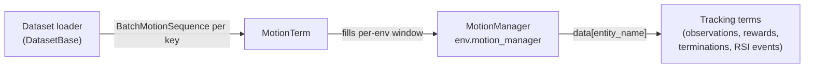

# Motion Tracking

This page explains the machinery behind Eden's motion-imitation tasks: the `EdenMimicConfig` config leaf, the
motion manager that serves a reference trajectory to every environment, the data layout that reference uses, and
the dataset cache that `eden preprocess` builds. Read it when you write or tune a tracking task, a tracking term, or
a new motion source. The shipped tracking tasks themselves (BeyondMimic, general_mimic, Weave HOI, ...) are described
in [Motion-tracking tasks](../tasks/motion-tracking.md); the dataset loaders are in
[Motion datasets](motion-datasets.md).


## The pieces

A tracking task has four layers. Each layer only talks to the one below it:



- A **dataset** (a [`DatasetBase`](../api/datasets.md) subclass) reads a motion library once, resamples every clip to
  `target_framerate`, fills the fields of a `BatchMotionSequence` per *motion sequence key* (one key per actor:
  `"g1"`, `"human"`, `"object"`, `"left_hand"`, ...), and caches the result.
- A **motion term** (`MotionTerm`, in `eden.managers.motion_manager`) owns one dataset, picks a clip and a start time
  for each of its environments at every reset, and maps the dataset's sequence keys to scene entity names.
- The **motion manager** (`MotionManager`, created by `MimicRLEnvBase` as `env.motion_manager`) advances a clock per
  environment and, once per step, copies a short window of reference frames into one `MotionReferenceData` buffer
  per tracked entity.
- **Tracking terms** read `env.motion_manager.data[entity_name]` and compare it with the simulated entity.

## A minimal tracking config

A tracking task subclasses `EdenMimicConfig` (in `eden.utils.configs`), which is `EdenRLConfig` plus one field,
`motion_options: MotionManagerOptions | None`. `env_class_for_config` maps it to `MimicRLEnvBase`; building it with
`RLEnvBase.from_config` raises a `TypeError` instead of silently building an env with no reference (see
[Environments](environments.md)).

The motion section of the BeyondMimic task (`eden/tasks/beyondmimic/config.py`, set by its `BeyondMimicDataMod`):

```python
from eden.managers.motion_manager import MotionTerm
from eden.options.managers.motions import MotionManagerOptions
from eden.tasks.beyondmimic.dataset import BvhCsvG1Dataset

config.motion_options = MotionManagerOptions(
    num_frames=1,
    data_start_from="current_time",
    frame_interval_s_range=(0.02, 0.02),
    # At clip end, soft-reset (resample start phase + teleport onto the reference)
    # instead of freezing at the last frame
    resync_on_motion_end=True,
    default=MotionTerm.configure(
        dataset_options=BvhCsvG1Dataset.configure(
            raw_data_path=self.raw_data_path,
            processed_data_path=self.processed_data_path,
            target_framerate=self.target_framerate,
        ),
        entities_map={"robot": "g1"},
        target_dofs_name={"g1": _G1Options.dofs_name},
        target_links_name={"g1": BvhCsvG1Dataset.motion_links_name["g1"]},
        motion_bin_length_s=1.0,
        adaptive_sampling=False,
        motion_start_from_middle_range=(0.0, 1.0),
    ),
)
```

Three things in that snippet are easy to get wrong:

- **`default=` is a term name.** Every extra keyword on `MotionManagerOptions` is a motion term, as on every other
  manager. Most tasks have exactly one, named `default`.
- **`entities_map` goes from scene entity to dataset key** (`{"robot": "g1"}`: the scene's `robot` tracks the
  dataset's `g1` sequence). A key that is not one of the dataset's `motion_sequence_keys` raises at construction
  and lists the available keys.
- **`target_dofs_name` and `target_links_name` are keyed by dataset key, not by entity name**, and need an entry for
  every key the dataset has (use `[]` for an actor with no DOFs, such as a rigid object). Names are matched with
  `resolve_matching_names`, so regex patterns work. The reference's DOF columns and link rows follow the order of
  these lists, which need not match the dataset's own order.

The rest of the config is ordinary RL: observation, reward and termination terms that read the reference, plus a
reset event that puts the robot onto it (next sections).

## What a step does

`MimicRLEnvBase.step()` calls `motion_manager.compute(dt)` before `RLEnvBase.step()`. That call:

1. advances each environment's motion clock by the control `dt`;
2. fills `data[entity]` for every tracked entity with `num_frames` reference frames;
3. if `resync_on_motion_end=True`, soft-resets environments whose clip just ran out (see
   [Clip ends](#clip-ends));
4. accumulates per-motion metrics when `compute_per_motion_metrics=True`.

Every reward, termination, metric and observation computed later in that step sees the same, fresh window.

### The reference window

`data[entity_name]` is a `MotionReferenceData` whose fields have shape `(num_envs, num_frames, ...)`:

| field | shape | meaning |
|---|---|---|
| `dofs_pos`, `dofs_vel` | `(N, F, D)` | joint positions / velocities, columns in `target_dofs_name` order |
| `base_pos_w`, `base_quat_w` | `(N, F, 3)`, `(N, F, 4)` | floating-base pose, world frame, quaternion **wxyz** |
| `base_lin_vel_w`, `base_ang_vel_w` | `(N, F, 3)` | floating-base velocities, world frame |
| `links_pos_w`, `links_quat_w` | `(N, F, L, 3)`, `(N, F, L, 4)` | tracked-link poses, rows in `target_links_name` order |
| `links_lin_vel_w`, `links_ang_vel_w` | `(N, F, L, 3)` | tracked-link velocities, world frame |
| `links_pos_b`, `links_quat_b`, `links_*_vel_b` | `(N, F, L, ...)` | the same in the reference's base frame |
| `contact_points_w`, `contact_points_valid` | `(N, F, L, P, 3)`, `(N, F, L, P)` | demonstrated contact points per (link, partner link) |
| `contact_label` | `(N, F, L)` int8 | per-link label: `+1` must touch, `-1` must not, `0` no label |
| `validity` | `(N, F)` bool | `False` where the frame lies past the end of the clip |
| `time_to_target_frame` | `(N, F)` | seconds from now to each frame; `-1` for an invalid frame |

World-frame positions already include the environment's `env_origins`, so they compare directly with
`entity.get_pos()` / `get_links_pos()`.

Which times the `F` frames sample is set on `MotionManagerOptions`:

| option | default | effect |
|---|---|---|
| `num_frames` | `1` | frames in the window. Size it to cover the largest `frame_offsets` any term reads: an offset `>= num_frames` raises with the fix. |
| `frame_interval_s_range` | `(0.1, 0.1)` | spacing between window frames in seconds, drawn per environment at reset from this range. The shipped tasks set it to the control `dt` (`(0.02, 0.02)` at 50 Hz). |
| `data_start_from` | `"one_frame_interval"` | `"current_time"`: frame 0 is now. `"one_frame_interval"`: frame 0 is one interval ahead. |

!!! warning "The default window starts one frame ahead"
    With the default `data_start_from="one_frame_interval"`, frame `0` is the *next* reference frame, so
    `motion_ends` fires one step before the policy sees the missing frame and "current frame" terms score
    against the future. Every shipped tracking task sets `data_start_from="current_time"`.

The frame read at a given time is `floor((start_time + t) * framerate)` of the clip. There is no interpolation at
lookup: clips are resampled once, at load, to the dataset's `target_framerate`. Set `target_framerate` to the
control rate (`1 / (sim_dt * decimation)`) so one step advances exactly one frame, as the shipped tasks do.

Frames past the end of a clip are marked invalid, hold the last valid pose, and have their velocities zeroed.
Tracking rewards that take `frame_offsets` average only over valid frames.

### Reading the reference in a term

The built-in terms show the pattern; `motion_link_position_tracking_exp` (`eden/managers/terms/rewards/tracking.py`)
reads:

```python
assert_motion_field_present(env, entity_name, "links_pos_w")
motion_idx = get_motion_link_idx(env, entity_name, links_name)
robot_idx = get_robot_link_idx(env, entity_name, links_name)
ref = env.motion_manager.data[entity_name]
offsets = resolve_frame_offsets(env, "links_pos_w", frame_offsets, ref.links_pos_w.shape[1])
motion_pos = select_motion_frames(ref.links_pos_w, offsets, motion_idx)   # (N, K, L, 3)
robot_pos = env.get_entity(entity_name).get_links_pos(ls_idx_local=robot_idx)  # (N, L, 3)
```

The helpers live in `eden.utils.motion_reference.lookup`:

- `get_motion_link_idx` / `get_motion_dofs_idx` resolve names to rows/columns of the reference;
  `get_robot_link_idx` / `get_robot_dofs_idx` resolve the same names on the simulated entity. They are different
  index spaces: never index one with the other.
- `current_motion_frame(field, sel_idx)` reads frame 0; `select_motion_frames(field, frames, sel_idx)` reads a set of
  frames, and `resolve_frame_offsets` validates and caches the offsets.
- `assert_motion_field_present(env, entity_name, field)` raises when the dataset never filled `field`.

!!! warning "An unfilled field is not `None`"
    `MotionReferenceData` allocates every field (zeros, identity quaternions), so a field the dataset does not
    provide reads as plausible-looking zeros forever. Call `assert_motion_field_present` for every field a term
    reads; the built-in terms do (class terms in `build()`, function terms on their first call). It also refuses a
    `base_*` field on a sequence flagged `is_free_floating=False`.

For general guidance on writing terms (function vs class, `build()` vs `compute()`, caching) see
[Terms](terms.md).

### Built-in tracking terms

Run `eden terms --grep motion` for the full list with parameters. The main families:

| kind | terms | reads |
|---|---|---|
| observation | `motion_dofs_pos`, `motion_dofs_vel`, `motion_base_pos_w`, `motion_base_quat_w`, `motion_links_pos_w`, `motion_links_quat_w`, `motion_phase` | current frame |
| observation | `motion_links_pos_b`, `motion_links_ori_b` | reference links in the robot's live anchor-link frame |
| observation | `motion_future_dofs_pos`, `motion_future_dofs_vel`, `motion_future_links_pos_b`, `motion_future_links_ori_b`, `motion_future_base_pos_w`, `motion_future_base_quat_w` | several window frames (`frame_offsets`) |
| observation | `motion_future_base_pos_b`, `motion_future_base_ori_b` | another entity's reference base in this entity's live anchor frame (`anchor_entity_name`, `anchor_link_name`) |
| observation | `motion_contact_flags`, `motion_future_contact_label` | demonstrated contacts |
| reward | `motion_base_position_tracking_exp`, `motion_base_orientation_tracking_exp`, `motion_link_position_tracking_exp`, `motion_link_orientation_tracking_exp`, `motion_dofs_pos_tracking_exp` | world-frame poses / joint positions |
| reward | `MotionRelativeBodyPositionErrorExp`, `MotionRelativeBodyOrientationErrorExp` | link poses relative to a yaw-aligned anchor link |
| reward | `MotionGlobalBodyLinearVelocityErrorExp`, `MotionGlobalBodyAngularVelocityErrorExp` | `links_lin_vel_w` / `links_ang_vel_w` |
| reward | `MotionContactChamferReward`, `MotionContactDistanceReward`, `MotionContactMatchReward` | `contact_points_*` |
| termination | `motion_ends` | `validity[:, 0]` |
| termination | `motion_*_tracking_error_above`, `bad_anchor_pos_z_only`, `bad_anchor_ori`, `BadMotionLinkPosZOnly`, `bad_base_ori`, `MotionBasePoseTrackingBreak` | pose errors |
| event | `ReferenceStateInitialization`, `ObjectReferenceStateInitialization` | the reset state (next section) |

Pick the term that reads what your dataset fills. A link-only human (HHI-Assist, OMOMO's SMPL-H joints) has no
`dofs_pos`, so `motion_dofs_pos_tracking_exp` cannot run on it; a rigid object has no DOFs and usually no links, so
it is tracked with the `motion_base_*` terms. The yaw-aligned `MotionRelativeBody*` rewards need both `links_pos_w`
and `links_quat_w` and suit free-floating characters whose world heading does not matter; for objects, where world
position and heading are the target, use the direct `motion_link_*` or `motion_base_*` terms.

The `entity_base_pos_b` / `entity_base_ori_b` observations are the simulated counterpart of
`motion_future_base_*_b`: an object's live pose in the robot's anchor frame. Build such a free object with
`align=False` so `get_pos()` is the authored body frame a reference records (see [Entities](entities.md)).

## Resets and reference-state initialization

On reset, each motion term draws a new clip and start time for the resetting environments, and a RESET-mode event
puts the entity onto the reference. BeyondMimic's event:

```python
from eden.managers.terms.events.motion import ReferenceStateInitialization

reset_from_motion=ReferenceStateInitialization.configure(
    mode=en.EventMode.RESET,
    entity_name="robot",
    pose_range={"x": (-0.05, 0.05), "y": (-0.05, 0.05), "z": (-0.01, 0.01),
                "roll": (-0.1, 0.1), "pitch": (-0.1, 0.1), "yaw": (-0.2, 0.2)},
    velocity_range=_VELOCITY_RANGE,
    dofs_position_range=(-0.1, 0.1),
    priority=100,
),
```

`ReferenceStateInitialization` writes the reference's base pose, base velocity and joint state onto a robot (a
floating or immobile base), with optional noise; `overall_noise_scale` scales every noise range at once so a
curriculum can anneal it. `ObjectReferenceStateInitialization` does the same for a free rigid object. Both accept
`max_depenetration_velocity` (m/s, default `None`) and `depenetration_window_s` (default `0.1`) to cap how fast the
contact solver may push a body out of an overlap it was seeded into, which keeps a light object from being flung
when the reference pose intersects a hand or the floor.

The reset runs in a fixed order around the scene reset, and three things follow from it:

1. `motion_manager.reset()` runs first and only resamples clip, start time and clock; it does not refill `data`.
2. The window is refilled while the scene reset and RESET events run. A RESET event must read its initial state with
   `motion_manager.get_reset_reference_state(envs_idx, [entity_name])`, which is what the RSI events do. Reading
   `motion_manager.data` there can return the previous step's window.
3. During the managers' own `reset()` calls the window already holds the *new* episode, so reading
   `motion_manager.data` there raises a `RuntimeError`. A term that grades the episode that just ended calls
   `motion_manager.record_ended_episode_validity(entity_name)` in `build()` and reads
   `motion_manager.ended_episode_validity(entity_name)` in `reset()`; a term that needs the new episode's reference
   reads it in `post_reset()`.

### Start times and clip selection

These `MotionTerm` options control what a reset draws:

| option | default | effect |
|---|---|---|
| `motion_start_from_middle_range` | `(0.0, 0.0)` | start at a uniform fraction of the clip in `[lo, hi]`; `(0.0, 1.0)` starts anywhere |
| `motion_bin_length_s` | `None` | split each clip into bins of this length and sample a start bin. When set, `motion_start_from_middle_range` is ignored (a warning says so). |
| `adaptive_sampling` | `False` | weight start bins by a smoothed failure rate (BeyondMimic's scheme); needs `motion_bin_length_s`. Tuned by `adaptive_kernel_size`, `adaptive_lambda`, `adaptive_uniform_ratio`, `adaptive_alpha`, `adaptive_failure_rate_max_over_mean`. |
| `env_starting_stub_sampling_strategy` | `"independent"` | `"independent"` draws a clip, then a start time in it; `"concat_motion_bins"` draws a bin over all clips laid end to end, so long clips are picked more often (needs `motion_bin_length_s`) |
| `start_at_timestep_zero_prob` | `0.0` | with this probability, start at frame 0 instead |
| `freeze_at_timestep_zero_prob` | `0.0` | each step, an environment still at time 0 stays there with this probability. Re-rolled every step, so `0.5` holds an environment about two steps on average: it adds start jitter, it does not freeze. |
| `motion_weights` | `None` | initial per-clip sampling weights, a list or a path to a JSON/YAML file with a `motion_weights` key. Its length must equal the number of loaded clips. |

### Hard-motion mining

`adaptive_motion_weights=True` turns on a per-clip curriculum: clips that end in early termination are drawn more
often, clips that play to the end less often. It is stepped once per training iteration by Eden's rsl-rl on-policy
and distillation runners (single-GPU and DDP); the FlashSAC runner refuses a config that enables it, because it
would never step it. The update is set by `motion_weight_update_mode`:

- `"snapshot"` (default) recomputes weights from the failure rates drained since the last update, clamps outliers
  at `motion_weight_failure_rate_max_over_mean` times the mean, and mixes with uniform by
  `motion_weight_uniform_mix`. Nothing compounds across updates.
- `"compound"` multiplies each weight by `motion_weight_success_discount` per success and
  `motion_weight_failure_amplify` per failure, floored at `motion_weight_floor`. It integrates every past outcome
  and can collapse onto a single clip on a large library; keep it for ablations.

`motion_weight_update_every_n_iters` sets the cadence. With `compute_per_motion_metrics=True` (which requires
`adaptive_motion_weights=True`) the manager also logs `Mimic/mpjpe_*`, `Mimic/root_pos_err_*` and
`Mimic/root_quat_err_*`, plus `Mimic/g_mpjpe_*` when `metric_anchor_link_name` is set. `log_per_motion_metrics`
adds per-clip histograms to Weights & Biases; `log_motion_id_to_filename` adds the file name of the most-sampled clip.

### Clip ends

By default a clip that runs out holds its last frame with zero velocity, `validity` turns `False`, and a
`motion_ends` termination (if configured) ends the episode. With `MotionManagerOptions.resync_on_motion_end=True`
the environment instead draws a new start, and every RSI event teleports its entity onto it, without ending the
episode. The RSI terms are resolved after the build, so enabling resync without one raises at construction.

## Several actors in one reference

A scene with several tracked entities (a humanoid and an object, two hands and an articulated object, two people)
is a dataset with several sequence keys and an `entities_map` entry per key. The Weave HOI task
(`eden/tasks/weave_hoi/config.py`):

```python
default=MotionTerm.configure(
    dataset_options=WeaveG1InspireHOIDataset.configure(split=self.split, objects=objects, ...),
    entities_map={"robot": "robot", "left_hand": "left_hand", "right_hand": "right_hand", "object": "object"},
    target_dofs_name={
        "robot": _RIG.robot_dofs,
        "left_hand": _RIG.left_hand_dofs,
        "right_hand": _RIG.right_hand_dofs,
        "object": [],
    },
    target_links_name={**_ALL_LINKS, "object": []},
    motion_start_from_middle_range=(0.0, 1.0),
    env_motion_groups=(
        MotionGroupOptions(entity_name="object", metadata_key="objects", variant_labels=objects)
        if len(objects) > 1
        else None
    ),
),
```

Each sequence also carries two metadata flags, set by the dataset: `is_free_floating` (consulted by
`assert_motion_field_present`, which refuses `base_*` fields of a fixed-base sequence) and `entity_kind`
(`"robot"`, `"humanoid"`, `"human"`, `"hand"`, `"rigid_object"`, `"articulated_object"` or `"other"`; advisory
only, never branched on). For a fixed-base actuated tool, leave the `base_*` fields empty, set
`is_free_floating=False`, and track it with the `motion_link_*` and `motion_dofs_pos_tracking_exp` terms.

### One object per environment from a bank

When the partner object differs per environment (a `GroupedEntityOptions` entity holding a bank of meshes, one
variant per environment), a clip only makes sense in an environment holding the object it was recorded with.
`env_motion_groups=MotionGroupOptions(...)` restricts every draw to matching clips:

- `entity_name`: the grouped scene entity (`"object"`);
- `metadata_key`: the dataset's per-clip label list to match (default `"objects"`); the dataset must declare it in
  `_PER_CLIP_METADATA_KEYS` so it survives subsetting;
- `variant_labels`: one label per variant, in the entity's `grouped_entities` order. Build it from the same constant
  that builds `grouped_entities`.

The build fails if a clip's label matches no variant, if a variant has no clip, or, under DDP, if a rank holds
environments of a group it has no clip of. `Entity.env_variant_idx` gives the variant each environment holds.
`env_motion_groups` cannot be combined with `symmetric_augmentation`.

### Several motion terms

A manager may hold more than one motion term (two libraries, say). Environments are split into contiguous slices,
one per term, proportionally to each term's number of clips, with at least one environment per term. An entity
tracked by two terms must have the same number of DOFs and links in both.

## Mirroring

`MotionManagerOptions.symmetric_augmentation=True` mirrors the reference across the x-z plane for a random half of
the environments, redrawn at every reset. It needs all three maps:

- `symmetric_augmentation_joint_mapping`: the index of each joint's mirror joint;
- `symmetric_augmentation_joint_reverse_buf`: a per-joint sign (`-1.0` for joints whose angle flips);
- `symmetric_augmentation_links_mapping`: the index of each tracked link's mirror link, in `target_links_name` order.

!!! warning
    If any of the three maps is missing, no environment is mirrored and nothing reports it. Check all three are set.

For mirroring the clips themselves once, at load time, use the `MirrorLR` dataset modifier instead (see
[Motion datasets](motion-datasets.md#modifiers)).

## The dataset cache and `eden preprocess`

Preparing a library (parsing files, resampling, forward kinematics for link poses, velocity estimation) can take
minutes to hours. When the dataset's `processed_data_path` is set, the first load writes the prepared clips there
and later loads read them back through `torch.load(mmap=True)`, so several ranks on one machine share the page
cache. Each task exposes `processed_data_path` as a task flag where it makes sense (`--processed_data_path`).

```bash
# Build the cache once, before a long training run
eden preprocess --task general_mimic --dataset_name amass --processed_data_path /data/caches/amass_g1.pt
```

`eden preprocess --task <name>` accepts the same task flags, `--config` and `--override` as `eden train`, plus
`--cpu`. It builds every dataset its `motion_options` declares (forward kinematics run on the GPU unless `--cpu`). A
task without `motion_options` is an error. When the task has no `processed_data_path`, nothing is saved, unless the
dataset derives its own default path: BeyondMimic's `BvhCsvG1Dataset` keys one in Eden's cache directory by the
settings that shape the clip.

To split a very large library across GPUs, start one process per GPU with `--num_batches N --batch_idx K`. Each
process prepares a contiguous slice of the clip list and saves it next to the canonical cache path, with a
`.batch_K_of_N` suffix. Pass `--batch_idx` explicitly: it defaults to `0`. Training loads only the canonical path,
so these batch files are not picked up by a training run as they are, and Eden has no command that merges them.

What the cache does and does not hold:

- **Filters are re-applied on load.** `include_pattern`, `exclude_pattern` and the list files filter a cached full
  library, so one cache can serve several subsets.
- **Modifiers are not in the cache.** The `modifiers` stack runs after every load, so changing it never needs a
  rebuild. Note that a modifier such as `SmoothStartTransition` therefore re-runs its per-clip IK on every load.
- **Settings that shape the data are checked.** `target_framerate`, the sequence keys, and every option a dataset
  lists in `_cache_identity_fields` (frame drops, velocity recomputation, dataset-specific settings) are recorded in
  the cache; loading it with a different value raises. Delete the file or point `processed_data_path` elsewhere.
  A cache that predates a recorded setting (so its value is unknown) is also refused, unless the dataset is
  configured with `strict_cache_identity=False`, which accepts it with a warning.
- **The format is versioned.** A cache written by an older layout fails to load with a message asking you to
  rebuild it.

!!! warning "Do not use `eden preprocess` on a task with modifiers"
    `eden preprocess` saves the dataset after its modifiers ran, so the cache it writes holds modified clips, and the
    next load applies the modifiers to them a second time. `GroundFirstFrame` (on by default in `general_mimic`) is
    unaffected because a second pass shifts by zero, but `SmoothStartTransition`, `Translate`, `Rotate`, `MirrorLR`
    or `SpeedScale` would be applied twice. Until this is fixed, build the cache of such a task by loading it once
    (for example a short `eden train` run) rather than with `eden preprocess`.

### Multi-GPU runs

Under DDP, rank 0 downloads and prepares the dataset while the other ranks wait at a barrier, then every rank loads
the cache rank 0 wrote. This only works with `processed_data_path` set; without it every rank prepares its own
copy. `MotionManagerOptions.mp_split_method` decides which clips each rank keeps on its GPU:

- `"None"` (default): every rank holds the whole library.
- `"Even"`: clips are dealt round-robin; trailing clips that do not divide evenly by the world size are dropped,
  with a warning.
- `"Segment"`: each rank holds one contiguous slice.

Hard-motion mining works with every split: weights and outcome counts stay sized to the full library on every rank
and are all-reduced each update. A rank left with no clip of an adaptive term raises. See
[Multi-GPU training](ddp.md) for launching.

## Frozen policies use `MotionCommand` instead

Eden has a second, lighter path for motion references: the `MotionCommand` command term
(`eden.managers.terms.commands.mimic`), used on a plain `RLEnvBase` by the frozen-policy ports in the
[policy zoo](policy-zoo.md). It loads BeyondMimic-format `.npz` clips as they are, with no dataset pipeline, cache,
curriculum or window, and exposes the current frame (plus `gather_motion_frames` for arbitrary future frames) on
the command term. Both paths use the same field names (`links_*_w`, `base_*_w`), so metric code reads either. Use
the motion manager for training; see [Commands](commands.md) for `MotionCommand`.

## See also

- [Motion datasets](motion-datasets.md): the loaders, the `MotionSequence` fields, writing a loader, modifiers.
- [Motion-tracking tasks](../tasks/motion-tracking.md): the shipped tasks and their flags.
- [Retargeting](retargeting.md): producing robot motion from human data.
- [Events](events.md) and [Curricula](curricula.md): RSI noise and annealing.
- API: [motion reference](../api/motion_reference.md), [datasets](../api/datasets.md).
