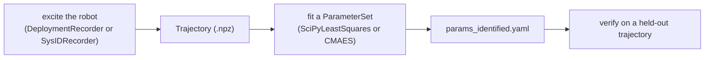

# Planning and system identification

Three extensions sit beside the RL stack: motion planners that compute collision-free joint paths for an arm
(cuRobo, OMPL), offline motion optimization that adapts a recorded clip to terrain (TCRS), and system
identification that fits a robot's joint dynamics in simulation to measurements from the real robot. This page
covers what each one does, how to call it, and its limits.

## Motion planning

A motion planner takes a built env and the name of an entity, and returns joint-space waypoints that you feed to a
joint-position action term. Both planners subclass [`MotionPlannerBase`](../api/extensions/motion-planning.md) (`eden/extensions/motion_planning/base.py`),
register in `MOTION_PLANNER_REGISTRY`, and are configured through `PlannerOptions` (`entity_name`, default
`"robot"`; backend fields arrive as extras).

| | `CuroboPlanner` | `OMPLPlanner` |
| --- | --- | --- |
| Module | `eden.extensions.motion_planning.curobo` | `eden.extensions.motion_planning.ompl` |
| Goal | end-effector pose (`ee_goal_pos`, `ee_goal_quat`, wxyz) | joint configuration (`qpos_goal`) |
| Batched over envs | yes | no (one env per call, `envs_idx`) |
| Collision world | meshes of the entities in `collision_entities_name` | the entity's own contacts in the live scene (`detect_collision`) |
| Install | cuRobo (see [cuRobo's install guide](https://curobo.org/get_started/1_install_instructions.html)); no Eden extra | `pip install ompl` (OMPL 1.7 or 2.x; see [OMPL releases](https://github.com/ompl/ompl/releases)); not available on Windows; no Eden extra |
| Recipe | `examples/recipes/planning/path_planning_curobo.py` | `examples/recipes/planning/path_planning_ompl.py` |

Both raise an `ImportError` with the install pointer when their library is missing.

### cuRobo

```python
# excerpt from examples/recipes/planning/path_planning_curobo.py
import torch
from curobo.util_file import get_robot_configs_path, join_path

from eden.extensions.motion_planning.curobo import CuroboPlanner
from eden.options.extensions.motion_planning import PlannerOptions

planner = CuroboPlanner(
    env,
    PlannerOptions(
        entity_name="robot",
        robot_config_file=join_path(get_robot_configs_path(), "franka.yml"),  # cuRobo's own Franka config
        ee_link_name="hand",
        collision_entities_name=["table", "plate"],
    ),
)
target_pos = env.entities["plate"].get_pos()
target_pos[:, 2] += 0.2
waypoints = planner.plan_motion(
    ee_goal_pos=target_pos,
    ee_goal_quat=torch.tensor([[0, 1, 0, 0]] * env.num_envs).to(env.device),
)
# waypoints: one (num_waypoints, n_dof) tensor per env
```

`CuroboPlanner` fields: `robot_config_file` (a cuRobo robot YAML; its `cspace` joints minus `lock_joints` are the
planned DOFs), `ee_link_name`, `collision_entities_name` (default none) and `interpolation_dt` (default `0.05` s).

- The collision world is built on the first `plan_motion` call. When the scene has changed since, call
  `planner.update_world(carried_entities=[...], num_envs=..., envs_idx=...)` first; entities in
  `carried_entities` (an object in the gripper) are left out of the obstacles.
- The goal pose is in the world frame; the planner converts it into the robot's base frame.
- Per env, a failed plan returns the start configuration as its single waypoint. Different envs return different
  waypoint counts, so the recipe pads the shorter paths while stepping.

### OMPL

```python
# excerpt from examples/recipes/planning/path_planning_ompl.py
from eden.extensions.motion_planning.ompl import OMPLPlanner
from eden.options.extensions.motion_planning import PlannerOptions

# robot = env.entities["robot"]; target_pos (num_envs, 3) and target_quat (num_envs, 4, wxyz) are the hand's goal
planner = OMPLPlanner(env, PlannerOptions(entity_name="robot"))
qpos_goal = robot.inverse_kinematics(links_name="hand", poss=target_pos, quats=target_quat)[0]
waypoints = planner.plan_motion(qpos_goal=qpos_goal, envs_idx=0)
for waypoint in waypoints:            # each an (n_qs,) tensor
    env.step(waypoint[:7].unsqueeze(0).repeat(env.num_envs, 1))
```

`plan_motion(qpos_goal, qpos_start=None, resolution=0.01, timeout=5.0, max_retry=1, smooth_path=True,
num_waypoints=100, ignore_collision=False, planner="RRTConnect", envs_idx=0)`. `planner` is the name of any
`ompl.geometric` planner class.

- **The return shape differs from cuRobo's**: a list of waypoints for the one env, each an `(n_qs,)` tensor, not a
  list per env. An infeasible problem returns an empty list (with a warning); one that does not converge within
  `max_retry` attempts returns the approximate path, or an empty list.
- Collision checking moves the entity: each sampled state is written with `set_qpos` and checked with
  `detect_collision`. Contacts already present at the start configuration (a gripper welded to its flange, an
  object resting in the hand) are ignored. The entity is put back at `qpos_start` when planning ends.
- Start or goal outside the joint limits relaxes the limits to contain them, with a warning.

## Motion optimization (TCRS)

`eden.extensions.motion_optimization.tcrs` is Eden's port of the TCRS terrain-adaptive motion optimizer: it turns
a flat-ground biped clip into one that walks on a terrain height field (footstep planning with MPPI, support-aware
pelvis height, whole-body Jacobian IK on a MuJoCo model of the robot). It is env-free and offline. Use it directly
through `TCRSMotionAdapter`, or on a whole motion dataset through the `TCRSTerrainAdapt` dataset modifier.

[TCRS terrain adaptation](tcrs-terrain-adaptation.md) is the full guide; `examples/recipes/motion_optimization/tcrs/`
holds the runnable recipes (`adapt_clip.py`, `adapt_dataset.py`, `render_on_terrain.py`).

## System identification

[`eden.extensions.sysid`](../api/extensions/sysid.md) fits per-DOF dynamics parameters of an Eden robot — `damping`, `armature`, `stiffness`,
`frictionloss`, and the PD gains `kp` / `kd` — so that the simulated response to a recorded action trace matches
the measured one. The workflow:



`examples/projects/sysid/xhand1/` is the complete worked example for a real XHand1 (collect, identify, verify),
and its `README.md` is the step-by-step guide, including the troubleshooting list.

### 1. Record a trajectory

A `Trajectory` (`eden/extensions/sysid/trajectory.py`) holds `times` and `(n_steps, dim)` arrays: `action` (the
action the action manager received, which the replay re-injects), `dofs_pos`, `dofs_vel`, `dofs_torque`,
`base_quat`, `base_ang_vel`, `base_lin_acc`, plus `dof_names` and an `initial_state` (`qpos`, `dofs_vel`, and
optionally `pos`, `quat`). Fields the measurement lacks are `None` and skipped. `save(path)` / `load(path)` use NPZ.

From a real robot, drive a connected `eden deploy` backend with an excitation:

```python
from eden.extensions.sysid import ChirpExcitation, DeploymentRecorder

# deployer: a connected DeploymentBase at its start pose; safety_limits: (num_dofs,) offset clamp in rad
excitation = ChirpExcitation(
    num_dofs=deployer.num_dofs, dof_indices=range(deployer.num_dofs),
    f_start=0.2, f_end=3.0, duration=30.0, amplitude=0.2,
)
recorder = DeploymentRecorder(deployer, excitation, kp_scale=0.5, safety_limits=safety_limits)
trajectory = recorder.run()
trajectory.save("data/chirp.npz")
```

- `deployer` must be connected and already at its start pose (its INIT finished). The recorder writes the wire
  directly, outside the deployment's operator state machine.
- The excitation is an **offset** added to a centre pose — the robot's measured pose at the start, or
  `center_dofs_pos`. `safety_limits` clamps the offset per DOF (radians), and the recorder warns, per DOF, when the
  centre ± peak offset leaves the joint limits: a joint driven into its stop clips on the real robot, and the fit
  then explains the clipping with friction.
- Excitations: `ChirpExcitation` (a swept sine, `stagger_phase` to decorrelate DOFs), `PRBSExcitation` (a
  pseudo-random binary sequence; good for stiction and friction) and `PlaybackExcitation` (replay recorded offsets
  with a zero-order hold).

In simulation (for a sim-to-sim check, or to test the pipeline on known parameters), add `SysIDRecorder` to the
env's recorder options and load an episode back with `Trajectory.from_recorder_episode(path, dof_names=...,
demo="demo_0")`; it reads the `sysid/*` keys of the recorder's default NPZ file. `SysIDRecorder(entity_name="robot",
include_torque=True, include_base=True)` records the action, a timestamp, joint state, the control force and the
base orientation and angular velocity; set `include_base=False` for a fixed-base arm. See
[Datasets and recording](datasets-and-recording.md).

### 2. Build the sim twin

Fit on a **dedicated sysid env**: an `RLEnvBase` holding the robot, built (`env.build()`), with no task logic it
needs. The rollouts call the action manager and `scene.step()` directly (`replay_rollout`), so terminations,
rewards, resets, commands, events and recorders never fire: a trajectory longer than the episode is not cut by an
auto-reset, and a domain-randomization event cannot change the parameters being fitted. Each rollout starts by
writing `initial_state` into the entity.

- Match the cadence: `sim_dt * decimation` must equal the trajectory's `dt`, or the replay runs at another rate
  than the robot did. The XHand1 example warns above a 2 % mismatch.
- Use a torque-mode controller such as `ExplicitPDController` (as the XHand1 sim twin does), so the PD damping is
  computed explicitly and the fitted `kd` and `armature` mean what they say. Under `EnvOptions(integrator="euler")`
  a position-mode controller's `kd · substep_dt` is folded into the armature at build — see
  [Entities](entities.md).
- `num_envs`: `1` for the serial optimizers, the population size for batched CMA-ES, `n_params + 1` for
  `parallel_fd` least-squares.

### 3. Fit the parameters

```python
from eden.extensions.sysid import ParameterSet, SciPyLeastSquares, Trajectory, make_parameter_from_default
from eden.extensions.sysid.report import write_summary
from eden.options.extensions.sysid import SystemIdentificationOptions

# env: the built sim twin (step 2); dof_names: the joints to fit, in the trajectory's column order
trajectories = [Trajectory.load("data/chirp.npz"), Trajectory.load("data/prbs.npz")]
params = ParameterSet([
    make_parameter_from_default(env, prop, prop, dof_names, per_dof=True)   # name, property, DOFs
    for prop in ("damping", "armature", "kp", "kd")
])
sysid = SciPyLeastSquares(
    env=env,
    options=SystemIdentificationOptions(entity_name="robot", signals=("dofs_pos",), max_iters=200, diff_step=1e-2),
)
initial = params.copy()
identified, result = sysid.fit(params, trajectories)
write_summary("results/sysid", initial, identified, result)   # params_identified.yaml, params_initial.yaml, summary.txt
```

- **Parameters.** A `Parameter(name, property, dof_names, entity_name="robot", per_dof=False, nominal, min_value,
  max_value, frozen=False)` targets one property on a set of DOFs, one scalar shared by all of them or one value per
  DOF. `make_parameter_from_default(env, name, property, dof_names, min_scale=0.1, max_scale=10.0, ...)` takes the
  built entity's current value as the nominal and bounds it multiplicatively; when that value is zero (an asset with
  no `frictionloss`), the bounds collapse, so construct that `Parameter` explicitly. Frozen parameters are kept but
  not optimized. `ParameterSet.save_yaml` / `load_yaml` round-trip a set.
- **Residual.** `SystemIdentificationOptions`: `entity_name`, `signals` (any of `dofs_pos`, `dofs_vel`,
  `dofs_torque`, `base_quat`, `base_ang_vel`; default the first three), `signal_weights`, `normalize` (default
  `True`: each signal block is divided by its measured RMS so units mix fairly), `max_iters` (`200`), `verbose`.
  Fit only the signals the robot really measures: a velocity finite-differenced from positions, or a torque in
  firmware units, biases the fit. Several trajectories are fitted jointly, which improves conditioning (a chirp and
  a PRBS trace have complementary spectra).
- **Optimizers** (both work in a unit hypercube over the parameter bounds):
    - `SciPyLeastSquares` — trust-region reflective least squares with box bounds. `diff_step` (default `1e-2`,
      a fraction of each bound range) is the finite-difference step: too small and the Jacobian is numerical noise,
      so the optimizer stops at iteration 0. `parallel_fd=True` scores all Jacobian columns in one batched replay
      and needs `env.num_envs == n_params + 1` exactly (any other count raises).
    - `CMAES` — for noisy, contact-heavy or saddle-shaped residuals. Needs the `cma` package (`pip install cma`;
      no Eden extra declares it). `sigma0` (default `0.25`), `population_size` (default CMA's own), and
      `batched=True` to score the whole population in one replay on an env with `num_envs == population_size`.
      When warm-starting from a previous fit, lower `sigma0` (the XHand1 example uses `0.05`) or the first
      population scatters away from it.
- `fit()` returns the identified `ParameterSet` and a `FitResult` (`cost`, `nfev`, `x`, `jacobian`, `message`,
  `history`, `extras`). `sysid.evaluate(params, trajectories)` returns the residual of one parameter set without
  optimizing.

### 4. Apply and verify

`apply_parameters(env, params)` writes a parameter set into every env (through `set_dofs_damping`,
`set_dofs_armature`, `set_dofs_stiffness`, `set_dofs_frictionloss`, `set_dofs_kp`, `set_dofs_kd`);
`apply_candidates(env, params, candidates)` writes one candidate per env. To verify, replay a held-out trajectory
with `single_candidate_rollout(env, params, trajectory, entity_name)` under the nominal and the identified set and
compare the error. `eden.extensions.sysid.report.signal_plots(...)` overlays measured and predicted signals.
Carry the identified values into a task through its robot's `default_dofs_*` fields.

### Adding an optimizer

Subclass `SystemIdentificationBase`, implement `fit(params, trajectories) -> (ParameterSet, FitResult)` with the
rollout helpers (`single_candidate_rollout`, `batched_candidate_rollout`) and `multi_trajectory_residual`, declare
backend options as class attributes (they arrive as `SystemIdentificationOptions` extras), and register it with
`@SYSID_REGISTRY.register()`.

## See also

- [Grasp sampling](grasp-sampling.md) — grasp poses to plan towards.
- [TCRS terrain adaptation](tcrs-terrain-adaptation.md) — the motion-optimization guide.
- [Deployment](deployment.md) — the backends `DeploymentRecorder` drives.
- [Entities](entities.md) — armature, damping and the two DOF index spaces.
- [Datasets and recording](datasets-and-recording.md) — `SysIDRecorder` and recorder files.
