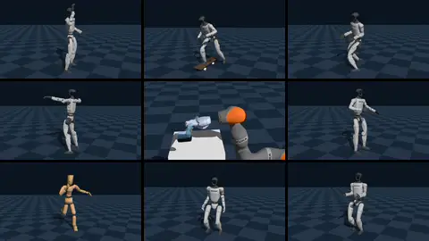

# The Policy Zoo

Eden ships published controllers that run as released, with no training: humanoid locomotion and motion tracking,
skateboarding, dexterous tool use, insertion, and clients for server-hosted vision-language-action models. This page
lists every policy in `eden/extensions/policies/`, what each one needs to run, and how `eden inference --policy`
builds its world.



## Run a policy

```bash
eden inference --policy sonic --motion_file examples/projects/mimic/beyondmimic/sample/G1_gangnam_style_V01_bvh_60hz.npz --vis
eden inference --policy holosoma --base_command 0.5 0.0 0.0 --vis     # walk forward at 0.5 m/s
eden inference --policy beyondmimic_moves --clip_name B_DadDance --vis
eden inference --policy husky --rec                                   # record an mp4
```

Weights download on first use from the policy's Hugging Face dataset into the asset cache (`policies/` under
`EDEN_ASSETS_DIR`, by default `~/.cache/eden/assets`), and are checked against the MD5 the policy pins. Policies with ONNX
weights need the `onnx` extra: `pip install 'eden-world[onnx]'`, or `uv sync --inexact --extra onnx` in a checkout.

`--policy` accepts the package name (`holosoma`), the registry key (`holosoma_locomotion_policy`), or the key without
its `_policy` suffix. The flags that matter for a policy run:

| Flag | What it does |
|------|--------------|
| `--policy NAME` | The policy to roll out. Mutually exclusive with `--checkpoint`. |
| `--task TASK` | Run the policy on a task's env instead of the policy's own world (below). Optional. |
| `--robot NAME` | The `eden.robots` class for a task-less run of a policy that does not pin its own robot (default `G1Dofs29`). Ignored when the policy pins one, and with `--task`. |
| `--entity_name NAME` | The scene entity the policy controls (default `robot`). |
| `--motion_file PATH` | The reference motion for a motion-tracking policy. Required when the policy takes one. |
| `--clip_name CLIP` | The clip for a per-clip policy (`beyondmimic_moves`); ignored by the others. |
| `--base_command VX VY WZ` | A constant command for a command-driven policy (default: stand). Padded or truncated to the policy's command width. |
| `--steps N` | Steps to run (default `1000`). `--episodes` is not available with `--policy`. |
| `--num_envs N` | Parallel envs, with `--task` only: a task-less run builds one env. |
| `--vis`, `--rec`, `--async`, `--cpu` | As for a checkpoint replay ([Training Runs](training-runs.md#replay-a-checkpoint)). |

### Task-less runs and `--task` runs

**Without `--task`**, Eden builds the policy's own world from its spec: one env, an empty scene holding the robot
`robot_options()` returns plus every entity `scene_entity_options()` declares (the skateboard, the tool and its table),
the policy's `env_options()` (its control rate and solver settings), and its observation, action and command terms.
This is the run the policy was ported for, and the one to start with.

**With `--task`**, the policy runs on that task's env, and the policy's command terms are merged into the task's. The
task must provide what the policy reads: the entities (checked at construction), and, for a policy that reads the
env's observations, the exact observation group it was built for. A policy that observes its command through the
task's own command terms ignores `--base_command`, and passing a non-zero one is an error.

## The shipped policies

### Humanoid locomotion

| `--policy` | What it is | Robot | Needs | Control |
|------------|------------|-------|-------|---------|
| `holosoma` | Holosoma velocity-tracking locomotion (ONNX); also the safety base `eden deploy` preloads on a G1 | `G1Dofs29` at Holosoma's default pose | `--base_command VX VY WZ`; `onnx` extra | 50 Hz |
| `homie` | OpenHomie walk/stand tracker for the lower body (walk and stand torch checkpoints) | `G1Dofs29` with HOMIE's pose and gains | `--base_command`: a 4-D `[vx, vy, wz, height_delta]` command, padded with zeros | 50 Hz |
| `amo` | AMO adaptive whole-body control (TorchScript) | `G1Dofs29NoWristDof` (23 DOF) | Nothing: its command term resamples its own commands | 50 Hz |
| `husky` | HUSKY humanoid skateboarding (ONNX) | `HuskyG1` (23 DOF) plus a skateboard | `--base_command`: a 2-D `[lin_vel_x, relative_heading]`; `onnx` extra | 50 Hz |
| `limx_oli_loco` | Velocity-tracking loco/stand controller for LimX Oli (rsl_rl actor) | `Oli` | **No released weights**: a local `velocity_tracking_flat` checkpoint trained for Oli (see [Local checkpoints](#local-checkpoints)) | the env default |

### Humanoid motion tracking

These track a reference motion. Each takes `--motion_file` (an Eden motion `.npz`, see
[Motion Tracking](motion-tracking.md)) except where noted.

| `--policy` | What it is | Robot | Needs | Control |
|------------|------------|-------|-------|---------|
| `sonic` | GEAR-SONIC universal-token whole-body controller (encoder + decoder ONNX) | `G1Dofs29` at SONIC's standing pose | `--motion_file`; `onnx` extra | 50 Hz |
| `twist2` | TWIST2 whole-body tracker (ONNX) | `G1Dofs29`, knees bent | `--motion_file`; `onnx` extra | 50 Hz |
| `humanoid_gpt` | Humanoid-GPT tracker, Transformer by default or MLP (ONNX) | `--robot` (default `G1Dofs29`) | `--motion_file` (a 50 Hz motion); `onnx` extra | 50 Hz |
| `protomotionv3` | ProtoMotions v3 `g1-bones-deploy` tracker (torch actor from the training checkpoint) | `G1Dofs29` | `--motion_file` | 50 Hz |
| `omnixtreme` | OmniXtreme flow-matching base policy plus residual correction (three ONNX graphs) | `OmniXtreme_G1` | `--motion_file`; `onnx` extra | 50 Hz |
| `gmt` | GMT general motion tracking (TorchScript) | `G1Dofs29NoWristDof` (23 DOF) | `--motion_file`: GMT's own `.pkl` format (samples in `examples/policies/gmt/motions/`) | 50 Hz |
| `beyondmimic_moves` | 60 BeyondMimic tracking policies from the `exptech/g1-moves` dataset, one per clip | `G1Dofs29` at the g1-moves pose | `--clip_name` (default `B_DadDance`); the clip's checkpoint and motion download on first use | 50 Hz |
| `metamotivo` | Meta Motivo (FB-CPR) behavior foundation model for an SMPL humanoid; behavior set by a context vector `z` | `SmplHumanoid` | The `metamotivo` package (`pip install "metamotivo[huggingface]@git+https://github.com/facebookresearch/metamotivo.git"`); the model loads from Hugging Face (`facebook/metamotivo-S-1` by default) | 30 Hz |

The sample motion `examples/projects/mimic/beyondmimic/sample/G1_gangnam_style_V01_bvh_60hz.npz` is what the
`sonic`, `humanoid_gpt` and `omnixtreme` examples default to; `examples/policies/twist2/resources/greeting.npz` is
TWIST2's.

### Manipulation

| `--policy` | What it is | Robot | Needs | Control |
|------------|------------|-------|-------|---------|
| `simtoolreal` | SimToolReal object-centric tool manipulation (rl_games LSTM actor reimplemented in torch) | `KukaSharpa` (KUKA iiwa14 arm + SharPa hand, 29 DOF) plus a table, a DexToolBench tool and a goal ghost | Nothing extra; the tool defaults to `long_screwdriver` | 60 Hz |
| `omnireset` | UWLab OmniReset state-based insertion expert | `OmniResetUR5e2f85` (UR5e + Robotiq 2F-85) plus the object pair | The `peg` pair is the one released expert | 10 Hz |

### Server-backed clients (VLAs and world models)

These policies run inference on a separate server and only exchange observations and actions with it. They need
the `policy-client` extra (`pip install 'eden-world[policy-client]'`), a running server, and a manipulation scene with
the cameras their setup reads; see [Remote Policy Clients](remote-policies.md).

| `--policy` | Server | Transport | Default address | Setups (`policy_setup`) |
|------------|--------|-----------|-----------------|--------------------------|
| `pi` | OpenPI (pi0, pi0-FAST, pi0.5) | `openpi_websocket` | `localhost:8000` | `widowx_bridge` (default), `google_robot`, `libero`, `droid`, `droid_jointpos`, `aloha` |
| `gr00t` | NVIDIA Isaac-GR00T | `zmq_msgpack` | `localhost:5555` | `simpler_env_widowx` (default), `libero_sim`, `oxe_droid_relative_eef_relative_joint` |
| `galaxeavla` | GalaxeaVLA (G0.5) | `galaxea_websocket` | `localhost:8765` | `galaxea_r1lite` (default), `galaxea_r1pro`, `droid_franka` |
| `cosmos3` | Cosmos3-Nano-Policy-DROID (world action model) | `openpi_websocket` | `localhost:8000` | DROID only |
| `molmoact2` | MolmoAct2 DROID server (absolute joint control) | `http_json_numpy` | `localhost:8000` | DROID only |
| `octo` | Octo, through an HTTP server | `http_json` | `localhost:9010` | WidowX only |

`eden inference --policy <client>` constructs the client with its defaults (the address, setup and no instruction
above), so to choose a server, a setup or a language instruction, drive the client from Python as
[Remote Policy Clients](remote-policies.md#wire-a-client-into-an-evaluation-loop) shows.

## Local checkpoints

Every policy's file locations are class constants, not options. To run your own weights in place of the released
ones, call `use_local_checkpoint` on the class before constructing it; it also clears the MD5 pinned to the released
file, which your file would fail:

```python
from eden.extensions.policies.limx_oli_loco.policy import OliVelocityLocoPolicy

OliVelocityLocoPolicy.use_local_checkpoint("logs/velocity_tracking_flat/<run>/model_3000.pt")
```

A policy that loads several files names the one to redirect: `SonicPolicy.use_local_checkpoint(path,
checkpoint_attr="decoder_checkpoint_path")`. On the command line, `eden deploy --policy NAME --policy_checkpoint
NAME=PATH` does the same for a deployment.

To fetch every policy's files from a mirror (an offline cluster, a shared read-only cache), export
`EDEN_ASSETS_DIR=/data/mirror`: policies then cache under `/data/mirror/policies/`.

## Policies on hardware and in MuJoCo

`eden deploy --policy NAME` loads any of these as a switchable slot on a real robot or, with `--mujoco`, in MuJoCo.
On a G1, Holosoma is preloaded as the safety base slot. Which policies can share one deployment, and how slots switch,
is in [Deployment](deployment.md#policy-slots). `examples/policies/policy_switch/main.py` shows the sim-side
counterpart: Holosoma and SONIC hot-swapping on one G1.

## Example scripts

Most policies also have a standalone script under `examples/policies/<name>/main.py` that builds the same world and
adds policy-specific controls (a keyboard command, a clip picker, recording): `amo`, `beyondmimic_moves`, `gmt`,
`holosoma`, `homie`, `humanoid_gpt`, `husky`, `metamotivo`, `omnireset`, `omnixtreme`, `protomotionv3`, `simtoolreal`,
`sonic` and `twist2`. Each script's header gives the command to run it.

## See also

- [Adding a Policy to the Zoo](extending-policies.md): write your own
- [API: eden.extensions.policies](../api/extensions/policies.md)
- [Porting a Pretrained Policy](policy-porting.md): reproduce a policy from another stack faithfully
- [Remote Policy Clients](remote-policies.md): VLA servers, transports, action chunking
- [Deployment](deployment.md): running these on a robot
