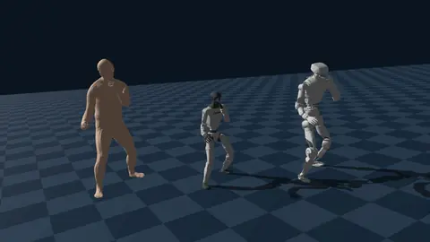
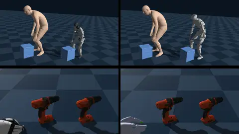

# Motion Retargeting

Retargeting maps motion recorded on one body (a person, a MANO hand) onto a robot with different proportions and
joints. `eden retarget` runs Eden's retargeting backends as batch jobs from the shell; this page covers each
subcommand, the data it needs, what it writes, and the Python API behind it. For hand-only retargeting from
keypoints in Python (live teleoperation included), see [Dex retargeting](dex-retargeting.md).



## Pick a backend

```bash
eden retarget omniretarget --src <OMOMO .pt dir> --task-name <clip> --out <dir>
eden retarget otretarget   --source omomo|seed --src <clip(s)> --body-model-path <path> --out <dir>
eden retarget soma         --src <SMPL .npz or dir> --body-model-path <path> --out <dir>
eden retarget dex          --src <keypoints .npz or dir> --out <.pkl or dir>
eden retarget flashdex import    --source taco --raw <release> --mano-dir <dir> --dataset <dir>
eden retarget flashdex kinematic --dataset <dir> --robot xhand
```

| subcommand | backend | input | output | target |
|---|---|---|---|---|
| `omniretarget` | `OmniRetargeter`: interaction-mesh (Laplacian) IK | one OMOMO (Holosoma) sequence, body only | `<clip>.npy`, `(T, 7 + 29)` qpos | G1, 29 DOF |
| `otretarget` | `OTRetargeter`: surface interactions carried by optimal transport, robot and objects solved together | canonical OMOMO SMPL-X sequences with objects, or SOMA-rig `.bvh` | `<rig>_<clip>.npz` (`RetargetResult`) | G1 or LimX Oli, with or without Wuji hands |
| `soma` | `SomaRetargeter`: the `eden-soma-retargeter` library | AMASS-style SMPL / SMPL-H / SMPL-X `.npz` | `.npz` with `qpos`, `dof_names`, `fps` | G1 or LimX Oli |
| `dex` | `DexRetargeter`: position optimizer | MANO keypoints `(T, 21, 3)` | `.pkl` of per-frame qpos | XHand (right) |
| `flashdex` | FlashDexRetarget kinematic pipeline | a released hand-object dataset (TACO, OakInk2, HOT3D, DexYCB) | `<dataset>/<robot>/motion.pt` | bimanual XHand or Sharpa Wave |

Rules of thumb: use `soma` for large body-only libraries (AMASS and video estimates), `otretarget` when the human
touches objects or the floor matters and you want the object moved with the robot, `omniretarget` for a quick
body-only OMOMO clip, and `flashdex` to turn hand-object datasets into training data for dexterous hands. No motion
capture at hand? [`eden pose gvhmr`](pose-estimation.md) recovers an AMASS-style SMPL-X clip from a video that
`soma` then retargets.



## Install

Every subcommand's `--help` works without its backend; a missing backend fails with the command to install it.

| subcommand | extra |
|---|---|
| `omniretarget` | `all` (it needs `cvxpy`, which only that extra brings) |
| `otretarget` | `ot-retargeter` |
| `soma` | `soma-retargeter` (checkout only, see below) |
| `dex` | `dex-retargeter` |
| `flashdex` | `flashdexretarget` |

=== "uv (checkout)"

    ```bash
    uv sync --inexact --extra ot-retargeter
    uv sync --inexact --extra soma-retargeter
    uv sync --inexact --extra dex-retargeter
    uv sync --inexact --extra flashdexretarget
    uv sync --inexact --extra all
    ```

=== "pip"

    ```bash
    pip install 'eden-world[ot-retargeter]'
    pip install 'eden-world[dex-retargeter]'
    pip install 'eden-world[flashdexretarget]'
    pip install 'eden-world[all]'
    ```

!!! note "`soma-retargeter` is uv-only"
    `eden-soma-retargeter` pins a `trimesh` version that conflicts with Genesis's, and only the checkout's uv
    override reconciles them, so pip cannot install this extra. Use `uv sync --inexact --extra soma-retargeter` in
    a checkout.

## Shared `--src` / `--out` conventions

`soma`, `dex` and `otretarget --source seed` accept a single file or a directory for `--src`:

- A **directory** is searched recursively. `soma` and `dex` mirror the source tree under `--out`, one output per
  input. `otretarget` writes flat `<rig>_<clip>.npz` files and refuses two clips with the same name in different
  folders.
- With a **single file**, `soma` and `dex` accept a file or a directory for `--out`.
- `soma` and `dex` refuse to write onto their own input, so `--src` equal to `--out` raises instead of overwriting
  clips.

Batch flags:

| flag | subcommands | effect |
|---|---|---|
| `--skip-existing` | `omniretarget`, `otretarget`, `soma`, `dex` | skip a clip whose output exists, so a long batch can resume |
| `--num-frames N` | `omniretarget`, `otretarget`, `soma` | keep the first `N` frames of each clip (quick tests) |
| `--cpu` | `otretarget`, `soma` | run on the CPU backend instead of the GPU |

## `omniretarget`: OMOMO human motion → G1

Retargets the body motion of one OMOMO sequence onto the 29-DOF G1 with OmniRetarget's interaction-mesh IK
(Laplacian deformation, foot sticking, ground and joint-limit constraints). The manipulated object is ignored.

```bash
eden retarget omniretarget \
    --src /data/omomo_holosoma \
    --task-name sub3_largebox_003 \
    --out results/omni
```

- `--src` is the directory of OMOMO Holosoma `.pt` sequences, the files
  [`OMOMOHolosomaDataset`](motion-datasets.md#shipped-loaders) downloads.
- `--task-name` picks the sequence by file stem; a trailing `.pt` is accepted.
- The human is scaled by the G1's height over the subject's (from the dataset's `human_height`).
- The output `<out>/<task-name>.npy` has shape `(T, 7 + 29)`: `[base_pos(3), base_quat_wxyz(4), joints(29)]`.

Retargeting the object together with the body is not in the CLI; see
`examples/recipes/retargeting/omniretarget/retarget_object_interaction.py`.

## `otretarget`: humans, hands and objects onto a humanoid

OTRetarget ([arXiv 2609.36602](https://arxiv.org/abs/2609.36602)) reads the demonstration's interactions off
surfaces rather than skeletons. Dense probes on the human, the robot links and the objects measure a signed distance,
a closest point and a direction to every *channel* (the floor and each object). An entropic optimal-transport plan,
solved once per (human part, robot link group) in a T-pose, carries each robot probe's targets from the human probes
it corresponds to. A per-frame constrained IK (a trust-region SQP solved with ProxQP) then solves the robot pose and
every object pose together, at native scale: nothing is rescaled.

```bash
# OMOMO: hands, body and object onto a G1 with Wuji hands
eden retarget otretarget --source omomo \
    --src /data/eden_omomo/sequences_canonical/sub3_largebox_003 \
    --objects-dir /data/eden_omomo/objects \
    --body-model-path /data/body_models/smplx \
    --rig g1_wuji --out results/otr

# BONES-SEED: a folder of SOMA-rig BVH clips, body only, onto a LimX Oli
eden retarget otretarget --source seed --src /data/seed_bvh \
    --body-model-path /data/soma/SOMA_neutral.npz --rig oli --out results/otr
```

Inputs:

| `--source` | `--src` | `--body-model-path` | also needs |
|---|---|---|---|
| `omomo` | one canonical OMOMO sequence directory (`<clip>/human.npz` + `object.npz`) or the folder holding them | the directory with `SMPLX_NEUTRAL.npz`, `SMPLX_MALE.npz`, `SMPLX_FEMALE.npz` | `--objects-dir`: the release's `objects/` (`<name>/<name>.obj`, metres) |
| `seed` | a SOMA-rig `.bvh` or a directory of them | `SOMA_neutral.npz` from the SOMA release | |

<!-- TODO(material): say where users obtain the canonical SMPL-X OMOMO release (sequences_canonical/, objects/) that --source omomo reads; the code names it eden_omomo but no loader downloads it. -->

The SMPL-X model files are licence-gated: download them from [smpl-x.is.tue.mpg.de](https://smpl-x.is.tue.mpg.de/).

`--rig` (default `g1_wuji`) selects the embodiment and its preset (`eden.extensions.retargeting.otretarget.PRESETS`):
`g1_wuji` and `oli_wuji` have dexterous Wuji hands, `g1` and `oli` have moulded hands and retarget the body only. A
preset holds the T-pose, the human-part ↔ robot-link groups and the style links.

Further flags:

| flag | effect |
|---|---|
| `--shard K/N` | retarget every `N`-th clip of the sorted list starting at the `K`-th, to split a library across jobs (default `0/1`) |
| `--clip-list FILE` | retarget only the clip names listed in `FILE`, one per line (applied before `--shard`); an unknown name raises |
| `--supports` | `omomo` only: add the untracked tables the object rests on as fixed plates, and write `<rig>_<clip>.supports.json` |
| `--keep-going` | on a clip that raises, write `<rig>_<clip>.error.txt`, continue, and exit non-zero at the end |

Each clip writes `<out>/<rig>_<clip>.npz` (`RetargetResult.save`), first under a temporary name so a killed job never
leaves a truncated file that `--skip-existing` would take as done. Its arrays:

- `qpos`: `(T, n_q)` rig configuration, root `[pos, quat_wxyz, joints]` then each welded hand's joints;
- `entity_qpos/<entity>`: the same split per scene entity, ready for `entity.set_qpos`;
- `object_poses/<name>`: `(T, 7)` solved `[pos, quat_wxyz]` per object;
- `fps`, `info/*` (per-frame solver diagnostics: `iterations`, `cost`, `qp_relaxed`, `penetration_mm`, ...) and
  `stats/*` (timings and problem size).

The loaders move the human vertically so its feet stand on `z = 0` (some OMOMO body fits float several centimetres
above the floor the object rests on, and OTRetarget would copy that gap onto the robot). Objects are never moved.

### From Python

The recipe README (`examples/recipes/retargeting/otretarget/README.md`) shows the API:

```python
from eden.extensions.retargeting.otretarget import PRESETS, OTRetargeter, for_body_model
from eden.extensions.retargeting.otretarget.sources import load_omomo_sequence

human, box = load_omomo_sequence(seq_dir, objects_dir, smplx_dir)
retargeter = OTRetargeter(env, OTRetargeter.configure(**PRESETS["g1_wuji"].retargeter_options()))
result = retargeter.retarget_motion(human, [box])     # robot + box solved jointly
env.entities["robot"].set_qpos(result.entity_qpos["robot"][t])
```

`env` is a built single-env scene holding the rig (the CLI builds it at `precision="64"`, the precision OTRetarget
was tuned in). For SOMA BVH input use `sources.load_soma_bvh` and `for_body_model(PRESETS[rig], "soma")`.

`OTRetargeter` is the paper's method alone; embodiment-specific stages are add-ons named in its `addons` option.
`floor_stance` keeps a legged robot's stance width on the floor and keeps planted feet from sliding; `hand_grasp`
closes dexterous fingers on held objects and corrects a hand that ends up on the wrong side of a thin part. The
presets give every rig `floor_stance`, and a rig with palms `hand_grasp`. A new embodiment needs a `RigPreset`; a new
body model needs only a `HumanSurfaceMotion` (posed vertices, faces, skinning weights, joint frames).

The recipe README lists every departure from the paper, the option behind it and the failure it fixes, plus the
interaction metrics (`eden.extensions.retargeting.otretarget.metrics.evaluate_retarget`) and a script that renders
the demonstration and the robot side by side.

## `soma`: SMPL-family motion → a humanoid

Batch-retargets AMASS-style SMPL, SMPL-H or SMPL-X clips to a floating-base robot through the
`eden-soma-retargeter` library, which fits each clip to the SOMA rig and solves IK. The library runs in a worker
subprocess without Genesis.

```bash
eden retarget soma \
    --src /data/amass/smplx \
    --body-model smplx \
    --body-model-path /data/body_models/smplx/SMPLX_NEUTRAL.npz \
    --robot unitree_g1 \
    --out results/soma
```

| flag | default | effect |
|---|---|---|
| `--body-model` | `smplx` | source model: `smpl`, `smplh` or `smplx` |
| `--body-model-path` | required | the model file (e.g. `SMPLX_NEUTRAL.npz`) or a directory of per-gender files |
| `--robot` | `unitree_g1` | `unitree_g1` or `limx_oli` |
| `--gender` | `neutral` | default gender; a clip's own `gender` field overrides it |
| `--target-fps` | `30` | rate every clip is resampled to |
| `--source-fps` | | override the clip's rate when its metadata is missing or wrong |
| `--snap-to-ground` | off | shift each clip by one constant height so the robot's lowest collision point over the clip touches `z = 0` |
| `--cpu` | off | run the fit on the CPU (default: GPU) |

Each input `.npz` must hold `poses`, `trans`, `betas` and a frame rate (`mocap_framerate` or `mocap_frame_rate`),
optionally `gender`. AMASS clips and `eden pose gvhmr` output both qualify. The SMPL-family model files are
licence-gated: download them from their project pages (SMPL, SMPL-H via MANO, SMPL-X).

Each input writes one `.npz` mirroring the source tree, with `qpos` of shape `(T, 7 + N)`
(`[x, y, z, qw, qx, qy, qz, joints...]`, Z-up, radians, joints in the robot entity's `dofs_name` order),
`dof_names` (so readers can select columns by name), `fps` and `source_path`. No shipped dataset loader reads these
files as they are; to train on them, write a small loader (see
[Writing a loader](motion-datasets.md#writing-a-loader)).

The fit targets the public 78-joint SOMA rig: `SomaRetargeter` passes `enable_procedural_transforms=False` because
the library's expanded twist-joint rig (its own default) also needs `SOMA_procedural_transforms.json` and
`SOMA_template_rig.usda`, which the public `nvidia/soma-x` assets do not ship. Both modes emit the same 78-joint
interface; the fitted rotations differ slightly. If you have those files, pass
`SomaRetargeter.configure(enable_procedural_transforms=True)`; there is no CLI flag for it.

Before building anything, the command checks the installed backend and refuses one it cannot fit with: an
`eden-soma-retargeter` older than 0.4.0 (no `enable_procedural_transforms`), or `py-soma-x` 0.1.0, which fits
near-zero rotations and reports them as a GPU problem.

In Python, `SomaRetargeter` (`eden.extensions.retargeting.soma_retargeter`) also takes `body_model="soma"` for
native SOMA arrays, `retarget_bvh(path)` for SOMA BVH files, and `retarget_motions(clips)` to solve many clips in one
batched IK. Call `close()` when done to stop the worker. `examples/recipes/retargeting/soma_retargeter/` covers
those and rendering to mp4.

## `dex`: MANO keypoints → a dexterous hand

Offline position retargeting of MANO-ordered hand keypoints onto a hand:

```bash
eden retarget dex --src /data/keypoints --preset xhand1_right_position --out results/dex
```

- Each `--src` `.npz` holds `keypoints` of shape `(T, 21, 3)` in MANO order and, optionally, a scalar `fps`
  (default 30).
- `--preset` must be a position preset; `xhand1_right_position` (the default) is the one that ships. Position
  presets match absolute keypoints, so the keypoints must already be in the robot's wrist frame.
- Each input writes a `.pkl`: `{"data": [qpos per frame], "meta_data": {"preset", "dof", "joint_names", "fps"}}`.

Video (MediaPipe) input and DexYCB-direct retargeting are covered in [Dex retargeting](dex-retargeting.md).

## `flashdex`: hand-object demos → bimanual robot hands

The kinematic half of [FlashDexRetarget](https://github.com/Holiday-Robot/FlashDexRetarget), without Isaac Sim: it
turns a released human hand-object dataset into the `motion.pt` that the `flashdexretarget` task trains a
multi-motion policy on. Two commands share one dataset directory:

```bash
# 1. a release → <dataset>/human_demo/<clip>.npz + <dataset>/objects/<id>/visual.obj
eden retarget flashdex import --source taco --raw /data/taco \
    --mano-dir /data/mano_v1_2/models --dataset /data/taco_fdr
# 2. support disks, reject rules, convex parts, MuJoCo physics IK, object URDFs and SDF grids
#    → <dataset>/xhand/{report.csv, retargeted/, motion.pt}
eden retarget flashdex kinematic --dataset /data/taco_fdr --robot xhand
```

Each robot's outputs go to `<dataset>/<robot>/`, so one import retargets to both robots (`--robot xhand`, then
`--robot sharpa`) and each keeps its own `motion.pt`; clips and objects are shared. `motion.pt` names its object
meshes relative to its own directory (`../objects/<id>`).

### Import

| `--source` | read by | `--raw` holds | notes |
|---|---|---|---|
| `taco` | `TacoDataset` | `Hand_Poses/`, `Object_Poses/`, `object_models_released/` | each hand takes the object it stays nearest to |
| `oakink2` | `OakInk2Dataset` | `anno_preview/`, `program/`, `object_repair/` | one clip per program stage; the desk is fitted over the whole recording |
| `hot3d` | `Hot3dDataset` | `dataset/<recording>/`, `_assets/assets/` | cut into segments where the hands hold objects |
| `dexycb` | `DexYCBDataset` | `<subject>/<sequence>/` (with the master camera's `labels_*.npz`), `calibration/`, `models/` | one hand per clip: needs `--sides right` or `--sides left` (`both` is refused) |

Each release is read by its [`eden.datasets` loader](motion-datasets.md#dataset-notes) with its MANO parameters
(`body_model_params`): the loader cuts the clips and picks the object each hand holds, and the import runs MANO,
levels the table and resamples to `fps` (default 60). Loader settings go under `source.dataset`. For example, to also
keep HOT3D segments where the two hands hold two objects (mode `C`):

```bash
eden retarget flashdex import --source hot3d --raw /data/hot3d --mano-dir /data/mano_v1_2/models \
    --dataset /data/hot3d_fdr --override "source: {name: hot3d, dataset: {modes: [B, C], min_frames: 45}}"
```

A one-hand segment (mode `A`) holds nothing in its idle hand, so it needs `--sides right` or `--sides left`.

The MANO models are licence-gated and never shipped: register at [mano.is.tue.mpg.de](https://mano.is.tue.mpg.de/),
download *Models & Code*, and pass its `models/` directory as `--mano-dir`.

Objects are exported from their geometry alone, which is all retargeting reads (a mesh with UVs gets trimesh's grey
placeholder texture). `--textures` also exports the release's materials and textures, for rendering `visual.obj`; it
costs every import a decode of each object's textures (a 4096² texture decodes to about 50 MB, one object at a time).

### Kinematic retargeting

The steps, in order (`eden/extensions/retargeting/flashdexretarget/pipeline.py`):

| step | does | writes (under the dataset) |
|---|---|---|
| preprocess | support disks, reject rules | `<robot>/report.csv` |
| convex | convex decomposition (CoACD or CuACD) | `objects/<id>/convex/*.obj` |
| retarget | MuJoCo physics IK | `<robot>/retargeted/<clip>.npz` |
| pack | kept clips into one file | `<robot>/motion.pt` |
| urdf | object URDFs for simulation | `objects/<id>/object.urdf` |
| sdf | object SDF grids | `objects/<id>/.sdf_cache/` |

The IK runs in CPU MuJoCo on the robot MJCFs under `hands/flashdexretarget/<robot>/` of the asset store, so
`motion.pt`'s `joint_pos` columns follow that MJCF's joint order; `motion.pt` also carries `robot`, `joint_names` and
`fps`. `--workers` sets the process count (default: half the CPU cores).

Every setting is an option in `eden.options.extensions.flashdexretarget` (`FDRImportOptions`,
`FDRKinematicRetargetingOptions` and the groups under it: `steps`, `desk`, `filters`, `convex`, `retarget`, `pack`,
`sdf`) with FlashDexRetarget's defaults. Set them from a `--config` file and repeated `--override` YAML mappings, as
with `eden train`:

```bash
# Review report.csv before running the IK
eden retarget flashdex kinematic --dataset /data/taco_fdr --override "steps: {retarget: false, pack: false}"
# GPU convex decomposition, fewer IK attempts, keep every clip
eden retarget flashdex kinematic --dataset /data/taco_fdr \
    --override "convex: {name: cuacd}" --override "retarget: {attempts: 3}" --override "filters: {enable: false}"
```

Each step is a cache, redone when anything it was made from changes:

- Convex parts are keyed on the object's `visual.obj` and the `convex` settings; an SDF grid on the mesh, `grid_n`
  and `extent`. A re-import whose release has another geometry for an object replaces its `visual.obj`, and warns.
- A retargeted clip is keyed on the robot model files, the imported clip, its support disks, its objects' convex
  parts, and the `retarget` settings other than the `quality` flags, which are rescored every run. `pack` refuses a
  clip made from other inputs. A clip whose IK fails is left out of `motion.pt`.
- `force: true` (on `convex` or `retarget`) redoes the step anyway.

Every file is written through a temporary file, so an interrupted run never leaves a truncated one. The IK model
overrides every contact's parameters (`mjENBL_OVERRIDE`, as FlashDexRetarget does), so contacts take
`retarget.contact`'s `o_solref`, `o_solimp` and `o_friction`.

The convex parts and the IK match FlashDexRetarget's own pipeline on the same inputs and settings, with two
deliberate differences: the kept IK run is smoothed by a moving average centred on each frame (one ending on it held
the hand a frame behind the object), and fingertip contact is measured to the object's surface rather than to its
nearest mesh vertex. Its Isaac-only USD conversion is replaced by the `urdf` step (convex parts collide, density
800 kg/m³ with the mass clamped to [0.05, 0.5] kg, as FlashDexRetarget authors it).

### Training on the result

The RL stage (one policy over every clip, whose completed rollouts are the physically valid trajectories) is the
`flashdexretarget` task:

```bash
eden train --task flashdexretarget --motion /data/taco_fdr/xhand/motion.pt --robot xhand
```

See [Manipulation tasks](../tasks/manipulation.md) and `eden/tasks/flashdexretarget/README.md`.

## See also

- [Dex retargeting](dex-retargeting.md): the `DexRetargeter` Python API, optimizers, and adding a hand.
- [Pose estimation](pose-estimation.md): video → SMPL-X for `soma`.
- [Motion datasets](motion-datasets.md): loaders for the human and robot motion these commands read and write.
- `examples/recipes/retargeting/`: worked scripts, including object-interaction and rendering variants the CLI omits.
- API: [retargeting](../api/extensions/retargeting.md).
