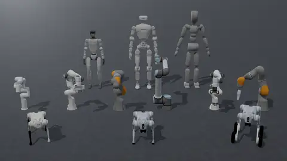

# Robots

Eden ships robot presets: options classes that load a robot asset with its joint order, default pose, PD gains,
armature and effort limits already set. This page covers using and overriding a preset, the full catalog,
composite rigs (an arm with a gripper or hand, a humanoid with a hand per wrist), the actuator specs gains are
derived from, and how to add a robot or a new asset family. The physics behind the fields (DOF ordering, the
armature default, gains vs passive springs) is on [Entities](entities.md).



## Using a robot

Every preset is importable as `en.robots.<Class>` (the lazy namespace for `eden.options.robots`) and is placed
in a scene like any other entity:

```python
import eden as en

scene_options = en.scenes.Empty(robot=en.robots.Go2())   # a Go2 on a ground plane, named "robot"
```

A preset is a Pydantic options class, so override any field at construction. The class's values are the
defaults; what you pass replaces them:

```python
robot = en.robots.G1Dofs29(
    default_root_pos=(0.0, 0.0, 0.8),
    default_dofs_armature={"*": 0.01},
)
```

!!! warning "A DOF dict you pass replaces the class's dict"
    `default_dofs_kp`, `default_dofs_kd` and every other `default_dofs_*` dict you pass **replace** the preset's
    dict rather than merging into it. A DOF your dict does not cover falls back to the simulator's value, which
    for a URDF's kp / kd is 0. Re-state every entry you are not deliberately changing; see
    [Actuator gains](entities.md#actuator-gains-default_dofs_kp-default_dofs_kd).

Presets are also registered by name in `ROBOT_REGISTRY`, keyed by the snake-cased class name:

```python
from eden.options.robots import ROBOT_REGISTRY

cls = ROBOT_REGISTRY.get("go2")      # -> Go2
robot = cls(default_root_pos=(0.0, 0.0, 0.4))
```

To look at a robot without writing a task, open it in the viewer or render a snapshot. Both take a class name or
an index key such as `robot/go2`:

```bash
eden view Go2                 # interactive viewer; -c shows collision geometry
eden snap G1Dofs29 -o g1.png  # one image
eden arrange FrankaEmikaPanda YCB003CrackerBox   # pose entities with sliders, export a SceneOptions snippet
```

## What a preset declares

A preset subclasses [`RobotOptions`](../api/options/robots.md), an `EntityOptions` with `is_articulated=True`
and `is_actuated=True`. It sets ordinary fields (validated, serialized with the config, overridable) and
class-level facts about the asset (`ClassVar`s, read by terms, rigs and deployment but not stored in configs).

| Field | Kind | Meaning |
|---|---|---|
| `file` | field | The asset's repo path (see [Where `file` comes from](entities.md#where-file-comes-from)). |
| `is_fixed_base` | field | Arms and grippers are fixed, mobile robots and hands are free. For an MJCF it must match the file ([rule](entities.md#is_fixed_base-must-match-an-mjcf)). |
| `dofs_name` | field | The controlled joints, in the order every DOF-indexed tensor uses ([DOF ordering](entities.md#dof-ordering)). |
| `default_root_pos`, `default_root_quat` | field | The root link's spawn pose, authored frame, wxyz. |
| `default_dofs_pos` | field | Joint positions at reset, and the zero point of position actions. |
| `default_dofs_kp`, `default_dofs_kd` | field | PD gains of Genesis' position / velocity controller. |
| `default_dofs_armature`, `_damping`, `_stiffness`, `_frictionloss`, `_force_limits` | field | Joint dynamics; anything unset comes from the asset or the actuator spec. |
| `links_to_keep` | field | URDF links Genesis must not merge away (feet, sensor frames). |
| `dofs_spec` | class | Actuator spec per DOF pattern ([Actuators](#actuators)). |
| `actuated_dofs_name` | class | The DOFs a policy drives; defaults to all of `dofs_name`. A hand with coupled joints lists only its drivers. |
| `ee_links_name` | class | End-effector links; `ee_links_name[0]` is the IK frame. |
| `feet_links_name` | class | Links the robot stands on. The deploy-time base-velocity estimator uses them; empty means "no feet" and makes it refuse (as `Go2W` does, whose feet are wheels). |
| `gantry_links_name` | class | Where `eden deploy --mujoco --gantry` hangs the robot. |
| `open_dofs_pos`, `close_dofs_pos` | class | Gripper presets only: the open and closed targets of the binary gripper action. |
| `tcp_offset`, `stroke` | class | Gripper facts: the pad midpoint in the gripper's base frame, and the pad-to-pad opening (m). |
| `max_substep_dt` | class | The coarsest `sim_dt / sim_substeps` the asset's constraints stay stiff at (`Robotiq2f85`: 0.001). |
| `metadata` | class | A `MetadataOptions` bag: hands declare `target_hand_links` (fingertips) and, for coupled fingers, `mimic_dofs` (`follower -> (driver, multiplier, offset)`). |

Several robot modules also export per-joint action scales computed from the same actuator specs, for a joint
action term's `scale` (for example `ImplicitPDController.configure(scale=GO2_ACTION_SCALE, ...)`):
`G1_ACTION_SCALE`, `GO1_ACTION_SCALE`, `GO2_ACTION_SCALE`, `GO2W_ACTION_SCALE`, `OLI_ACTION_SCALE`,
`YAM_ACTION_SCALE`.

## Robot catalog

The catalog below is `ROBOT_REGISTRY` (47 unit robots). "DOFs" is the length of the preset's `dofs_name`;
"Base" is its `is_fixed_base` default. Left / right hand pairs share a row.

### Arms and mobile manipulators

| Class | Registry key | DOFs | Base | Asset |
|---|---|---|---|---|
| `FrankaEmikaPanda` | `franka_emika_panda` | 9 (7 arm + 2 fingers) | fixed | `manipulators/franka_panda/panda.xml` |
| `FrankaEmikaPandaNoHand` | `franka_emika_panda_no_hand` | 7 | fixed | `manipulators/franka_panda/panda_nohand.xml` |
| `FrankaResearch3` | `franka_research3` | 7 | fixed | `arms/franka_fr3/fr3.xml` |
| `Iiwa14` | `iiwa14` | 7 | fixed | `arms/kuka_iiwa14/iiwa14.xml` |
| `UR5e` | `ur5e` | 6 | fixed | `arms/universal_ur5e/ur5e.urdf` |
| `UR10e` | `ur10e` | 6 | fixed | `arms/universal_ur10e/ur10e.urdf` |
| `Xarm7` | `xarm7` | 7 | fixed | `arms/ufactory_xarm7/xarm.urdf` |
| `Yam` | `yam` | 8 | fixed | `manipulators/i2rt_yam/yam.xml` |
| `WidowX250` | `widowx250` | 8 (with its own fingers) | fixed | `manipulators/trossen_wx250s/wx250s.xml` |
| `Aloha` | `aloha` | 16 (bimanual) | fixed | `manipulators/aloha_vx300s/aloha.urdf` |
| `OmniResetUR5e2f85` | `omni_reset_ur5e2f85` | 7 | fixed | `arms/omnireset_ur5e_2f85/omnireset_ur5e_2f85.xml` |

`OmniResetUR5e2f85` is one asset, a UR5e with a Robotiq 2F-85 exactly as the OmniReset policies were trained on
it; for a UR arm and gripper you can recombine, use the `UR5eRobotiq` rig below.

### Grippers

| Class | Registry key | DOFs | Base | Asset |
|---|---|---|---|---|
| `FrankaHand` | `franka_hand` | 2 | fixed | `grippers/franka_hand/franka_hand.xml` |
| `Robotiq2f85` | `robotiq2f85` | 6 (2 driven) | fixed | `grippers/robotiq_2f85/2f85.xml` |

Grippers default to a fixed base so they can be used standalone; set `is_fixed_base=False` to weld one onto an
arm (the composite rigs do). `Robotiq2f85` carries the closed-loop tuning described in
[Closed-loop grippers](entities.md#closed-loop-grippers-and-constraint-fidelity).

### Humanoids

| Class | Registry key | DOFs | Base | Asset |
|---|---|---|---|---|
| `G1Dofs23` | `g1_dofs23` | 23 | free | `humanoids/unitree_g1/g1_23dof.xml` |
| `G1Dofs29` | `g1_dofs29` | 29 | free | `humanoids/unitree_g1/g1_29dof_rev_1_0.xml` |
| `G1Dofs29NoWristDof` | `g1_dofs29_no_wrist_dof` | 23 (the 29-DOF G1 with wrists welded) | free | `humanoids/unitree_g1/g1_29dof_wrist_disabled.xml` |
| `G1Dofs29NoHands` | `g1_dofs29_no_hands` | 29 | free | `humanoids/unitree_g1/g1_29dof_rev_1_0_no_hand.xml` |
| `G1Dofs29Dex3` | `g1_dofs29_dex3` | 43 (29 + two 7-DOF Dex3 hands) | free | `humanoids/unitree_g1/g1_29dof_with_hand_sonic.xml` |
| `Oli` | `oli` | 31 | free | `humanoids/limx_oli/HU_D04_01.urdf` |
| `OliNoHands` | `oli_no_hands` | 31 | free | `humanoids/limx_oli/HU_D04_01_no_hand.urdf` |
| `SmplHumanoid` | `smpl_humanoid` | 69 | free | `humanoids/smpl_humanoid/smpl_humanoid.xml` |
| `PhcSmplHumanoid` | `phc_smpl_humanoid` | 69 | free | `humanoids/smpl_humanoid/smpl_humanoid_phc.xml` |

The `NoHands` variants exist to carry a real end-effector: they expose wrist flanges, so the arms carry the
welded hand's mass and not a moulded one as well.

### Quadrupeds

| Class | Registry key | DOFs | Base | Asset |
|---|---|---|---|---|
| `Go1` | `go1` | 12 | free | `quadrupeds/unitree_go1/go1.urdf` |
| `Go2` | `go2` | 12 | free | `quadrupeds/unitree_go2/go2.urdf` |
| `Go2W` | `go2_w` | 16 (12 legs + 4 wheels) | free | `quadrupeds/unitree_go2w/go2w.urdf` |

### Dexterous hands

All hands default to a free base. Each class name ends in `_L` or `_R`; the registry keys end in `_l` / `_r`.

| Classes | Registry keys | DOFs | Asset directory |
|---|---|---|---|
| `XHand1_L`, `XHand1_R` | `xhand1_l`, `xhand1_r` | 12 | `hands/robotera_xhand/` |
| `InspireRH56_L`, `InspireRH56_R` | `inspire_rh56_l`, `inspire_rh56_r` | 12 | `hands/inspire_hand/` |
| `InspireRH56DFQ_L`, `InspireRH56DFQ_R` | `inspire_rh56_dfq_l`, `inspire_rh56_dfq_r` | 12 (6 driven) | `hands/inspire_hand/` |
| `LeapHand_L`, `LeapHand_R` | `leap_hand_l`, `leap_hand_r` | 16 | `hands/leap_hand/` |
| `SharpaWave_L`, `SharpaWave_R` | `sharpa_wave_l`, `sharpa_wave_r` | 22 | `hands/sharpa_hand/` |
| `TesolloDG5F_L`, `TesolloDG5F_R` | `tesollo_dg5f_l`, `tesollo_dg5f_r` | 20 | `hands/tesollo_hand/` |
| `ManoHand_L`, `ManoHand_R` | `mano_hand_l`, `mano_hand_r` | 20 | `hands/mano_hand/` |
| `WujiHand1_L`, `WujiHand1_R` | `wuji_hand1_l`, `wuji_hand1_r` | 20 | `hands/wuji_hand1/` |
| `WujiHand1Simplified_L`, `WujiHand1Simplified_R` | `wuji_hand1_simplified_l`, `wuji_hand1_simplified_r` | 20 (primitive collision) | `hands/wuji_hand1/` |
| `WujiHand2Beta2_L`, `WujiHand2Beta2_R` | `wuji_hand2beta2_l`, `wuji_hand2beta2_r` | 20 | `hands/wuji_hand2beta2/` |
| `WujiHand2Beta2WithMount_L`, `WujiHand2Beta2WithMount_R` | `wuji_hand2beta2_with_mount_l`, `wuji_hand2beta2_with_mount_r` | 20 (root link is the mount plate) | `hands/wuji_hand2beta2/` |

!!! warning "The Inspire RH56 hands are marked unstable"
    `eden/options/robots/inspire_rh56.py` flags its base class as a placeholder whose setup is unstable: the
    Inspire hand is non-backdrivable with high joint friction, which the physics does not model yet. The
    `InspireRH56DFQ` hands couple six follower joints to six drivers through `metadata.mimic_dofs`, which an
    action term's `mimic_dofs` takes (see [Actions](actions.md)).

A few robots are defined outside the catalog because only one task or policy uses them: the LIBERO Panda and its
mounted rig (`LiberoPanda`, `LiberoMountedPanda` in `eden/options/robots/libero.py`) and the HUSKY G1
(`eden/extensions/policies/husky/policy.py`).

## Composite robots

A composite robot bundles several unit robots into one rig. It is itself a validated options object
(`CompositeEntityOptions`), so it round-trips through the config system and is placed in a scene under one name;
when the environment is constructed it expands into its unit robots plus the welds that join them.

```python
import eden as en
from eden.options.robots import Droid, COMPOSITE_ROBOT_REGISTRY

droid = Droid(base_pos=(0.0, 0.0, 0.4))                     # hand-less Panda + Robotiq 2F85
scene_options = en.scenes.Empty(is_support_enabled=True, robot=droid)
# -> entities "robot" (the arm) and "gripper", welded at the arm's "attachment" link

cls = COMPOSITE_ROBOT_REGISTRY.get("ur5e_2f85")             # -> UR5eRobotiq
```

The scene key must equal the rig's primary body name (`arm_name` / `robot_name`, `"robot"` by default), or
`SceneOptions` raises. Two rigs in one scene need distinct names, for example
`Droid(arm_name="left", gripper_name="left_gripper")`.

### Rig shapes

| Base class | Bodies | For |
|---|---|---|
| `ManipulatorOptions` | `arm` + `gripper`, welded at `ee_link` | an arm with a two-finger gripper |
| `DexManipulatorOptions` | `arm` + `hand`, welded at `ee_link` | an arm with a dexterous hand |
| `HumanoidOptions` | `robot` + `left_hand` + `right_hand`, welded at `left_ee_link` / `right_ee_link` | a humanoid with an end-effector per wrist |

The rigs expose what a controller needs as properties over their parts, so DOF lists and link names cannot drift
from the robot definitions:

```python
from eden.managers.terms.actions.task_space_actions import DifferentialIKController

DifferentialIKController.configure(
    entity_name=droid.arm_name, ee_link_name=droid.ee_link, dofs_name=droid.arm_dofs,
)
# droid.grasp_links, droid.gripper_dofs, droid.gripper_open, droid.gripper_close,
# droid.tcp_offset, droid.stroke, droid.max_substep_dt
```

- **Arm rigs** have `arm_dofs`, `grasp_links` (the links whose midpoint is the grasp point) and `base_pos`
  (places the arm base; `None` leaves `arm.default_root_pos` alone). `ManipulatorOptions` adds `gripper_dofs`,
  `gripper_open` / `gripper_close`, `stroke`, `tcp_offset` (the tool point in the `ee_link` frame, through the
  mount), `max_substep_dt` (the stricter of the two parts), `hold_width(width)` and `preset_hold(width)` (start
  the gripper closed on an object welded into it; refuses a width the gripper cannot close on).
  `DexManipulatorOptions` adds `hand_dofs` and `fingertip_links`; a dexterous hand has no open / close target.
- **Humanoid rigs** have `robot_dofs`, `left_hand_dofs` / `right_hand_dofs`, `left_hand_actuated_dofs` /
  `right_hand_actuated_dofs`, `left_hand_mimic_dofs` / `right_hand_mimic_dofs`, `left_grasp_links` /
  `right_grasp_links`, `base_pos` (the pelvis) and `feet_links` (the humanoid's own feet unless the rig's
  `feet_links_name` overrides them; `()` declares no feet).

### Mount transforms

An arm rig welds the end-effector at its own `default_root_pos` / `default_root_quat` unless the rig sets
`attach_offset` / `attach_quat` (position and wxyz orientation of the end-effector's base link in the `ee_link`
frame). Setting only one component keeps the end-effector's own value for the other; a rig whose class defaults a
component refuses a caller who sets only the other one, since the weld would mix two mounts. A humanoid rig uses
`mount_offset` / `mount_quat` for both wrists, with per-side `left_mount_*` / `right_mount_*` overrides for wrist
frames that are not mirror images.

!!! note "Hands with rotated axes"
    Genesis applies a weld's quaternion *before* the child's `up` / `front` alignment, so a hand whose `up` /
    `front` rotate its asset (the Wuji hands are rotated 180°) would end up pointing back up the forearm. The
    rigs pass every mount quaternion through `weld_quat(child, mount_quat)`, which cancels the alignment so the
    quaternion means the child's base-link orientation in the parent link frame. Use it when you write a weld
    for such a hand yourself; `has_frame_alignment(child)` tells you whether one is needed.

Every welded end-effector must have `is_fixed_base=False` (the rigs refuse one that is also pinned to the world),
and the industrial-arm rigs gravity-compensate both parts, while the humanoid rigs do not (the arms must carry the
payload).

### Rig catalog

`COMPOSITE_ROBOT_REGISTRY` holds 11 rigs:

| Class | Registry key | Parts | Weld link(s) |
|---|---|---|---|
| `Droid` | `droid` | `FrankaEmikaPandaNoHand` + `Robotiq2f85` (pads-only collision) | `attachment` |
| `PandaFrankaHand` | `panda_franka_hand` | `FrankaEmikaPandaNoHand` + `FrankaHand` | `attachment` |
| `UR5eRobotiq` | `ur5e_2f85` | `UR5e` + `Robotiq2f85` | `ee_link` |
| `UR10eRobotiq` | `ur10e_2f85` | `UR10e` + `Robotiq2f85` | `ee_link` |
| `FrankaXHand` | `franka_x_hand` | `FrankaEmikaPandaNoHand` + `XHand1_L` on the LeFranX right-angle coupling | `attachment` |
| `XArm7XHand1_L`, `XArm7XHand1_R` | `xarm7_xhand1_l`, `xarm7_xhand1_r` | `Xarm7` + `XHand1_L` / `XHand1_R` | `link_eef` |
| `KukaSharpa` | `kuka_sharpa` | `Iiwa14` + `SharpaWave_L` | `link7` |
| `G1Inspire` | `g1_inspire` | `G1Dofs29NoHands` + `InspireRH56DFQ_L` / `_R` | `left_wrist_yaw_link`, `right_wrist_yaw_link` |
| `G1Wuji` | `g1_wuji` | `G1Dofs29NoHands` + `WujiHand2Beta2WithMount_L` / `_R` | `left_ee_link`, `right_ee_link` |
| `OliWuji` | `oli_wuji` | `OliNoHands` + `WujiHand2Beta2WithMount_L` / `_R` | `left_hand_mount`, `right_hand_mount` |

`Droid` uses the hand-less Panda, the arm it was tuned on; `Droid(arm=FrankaResearch3())` gives the FR3 pairing.
The shared pad-only Robotiq 2F85 is what lets `manipulation_lift_box` swap arms with its `--manipulator` flag
(`droid`, `ur5e_2f85`, `ur10e_2f85`) while the grasp point, gripper action and gripper-keyed rewards stay the
same (see [Task mods](task-mods.md)).

### Writing a rig

Subclass one of the three bases with default fields and register it:

```python
from pydantic import Field

from eden.options.entities import RobotOptions
from eden.options.materials import RigidMaterialOptions
from eden.options.robots import COMPOSITE_ROBOT_REGISTRY, ManipulatorOptions, Robotiq2f85, UR5e


@COMPOSITE_ROBOT_REGISTRY.register()
class MyUR5eRobotiq(ManipulatorOptions):
    arm: RobotOptions = Field(default_factory=lambda: UR5e(material=RigidMaterialOptions(gravity_compensation=1.0)))
    gripper: RobotOptions = Field(
        default_factory=lambda: Robotiq2f85(is_fixed_base=False, collision_link_patterns=[".*pad"])
    )
    ee_link: str = "ee_link"
    grasp_links: list[str] = ["left_pad", "right_pad"]
```

A new rig *shape* subclasses `CompositeEntityOptions` and implements `entity_parts()` (the ordered
`(name, options)` pairs) and `attachments()` (child → `(parent, link[, offset, quat])`). Do not override
`entity_options()`: it holds the duplicate-name check, and a subclass that overrides it raises at class
definition. The modules under `eden/options/robots/composite/` are the reference implementations, and
`tests/options/robots/composite/` pins their contracts.

## Actuators

An actuator spec is a class in `eden.options.actuators` that describes one motor:

| Attribute | Meaning |
|---|---|
| `EFFORT_LIMIT` | torque limit (N·m), written as the DOF's symmetric force range |
| `ROTOR_INERTIA`, `GEAR_RATIO` | single-stage (floats) or two-stage planetary (3-tuples); `ARMATURE()` is the reflected inertia |
| `STIFFNESS`, `DAMPING` | passive joint spring and damper (not kp / kd) |
| `FULL_TORQUE_SPEED`, `NO_LOAD_SPEED`, `DRIVING_TORQUE_LIMIT`, `BRAKING_TORQUE_LIMIT` | the torque-speed envelope |
| `STATIC_FRICTION`, `DYNAMIC_FRICTION`, `FRICTION_ACTIVATION_SPEED` | joint friction model parameters |

A robot maps DOF patterns to specs in its `dofs_spec` class variable. At build, a DOF covered by the spec gets the
spec's stiffness, damping, armature and effort limit unless the robot's options set that property explicitly.
Robots that derive their gains from the spec do it in the class body with the Raibert heuristic in
`eden.utils.actuator`, which targets a 10 Hz closed-loop bandwidth by default (`NATURAL_FREQ = 2π·10`):

- `kp = ARMATURE · ω²`
- `kd = 2 · ζ · ARMATURE · ω`, with damping ratio `ζ = 2.0` by default
- action scale `= 0.25 · EFFORT_LIMIT / kp`

```python
# eden/options/robots/unitree_go2.py
_Go2_DOFS_SPEC = {"*_hip_joint": UnitreeGo2HV, "*_thigh_joint": UnitreeGo2HV, "*_calf_joint": UnitreeGo2HVCalf}

class Go2(RobotOptions):
    dofs_spec: ClassVar[dict[str, type[ActuatorSpecOptions]]] = _Go2_DOFS_SPEC
    default_dofs_kp: dict[str, float] = {p: s.RAIBERT_HEURISTIC_KP() for p, s in _Go2_DOFS_SPEC.items()}
    default_dofs_kd: dict[str, float] = {p: s.RAIBERT_HEURISTIC_KD() for p, s in _Go2_DOFS_SPEC.items()}
    default_dofs_armature: dict[str, float] = {p: s.ARMATURE() for p, s in _Go2_DOFS_SPEC.items()}
    default_dofs_force_limits: dict[str, float] = {p: s.EFFORT_LIMIT for p, s in _Go2_DOFS_SPEC.items()}
```

The shipped specs cover Unitree motors (`Unitree7520_22`, `Unitree7520_14`, `Unitree5020_16`,
`Unitree5020_16_DOUBLE`, `Unitree4010_25`, `Unitree8010_6`, `Unitree8010_6Calf`, `UnitreeGo2HV`,
`UnitreeGo2HVCalf`), DAMIAO motors (`DamiaoDM4310`, `DamiaoDM4340`) and the LimX Oli joint groups
(`LimxOliHipKnee`, `LimxOliAnkleWaist`, `LimxOliShoulderElbow`, `LimxOliWristHead`).

## Adding a robot

1. **Get the asset.** Put the URDF / MJCF (and its meshes) where `file` can reach it: a local path while you
   develop, or the repo path in the asset dataset once it is uploaded. Give URDF links explicit `<mass>` and
   `<inertia>` ([why](entities.md#load-time-options)).
2. **Write the preset** in `eden/options/robots/<vendor>_<model>.py`, subclassing `RobotOptions` and registering
   it:

    ```python
    from typing import ClassVar

    from eden.options.catalog import ROBOT_REGISTRY
    from eden.options.entities import RobotOptions


    @ROBOT_REGISTRY.register()
    class MyArm(RobotOptions):
        file: str = "arms/my_arm/my_arm.xml"
        is_fixed_base: bool = True
        dofs_name: list[str] = [f"joint{i}" for i in range(1, 7)]
        default_dofs_pos: dict[str, float] = {"joint2": -0.5, "joint3": 1.0}
        default_dofs_kp: dict[str, float] = {"*": 400.0}
        default_dofs_kd: dict[str, float] = {"*": 40.0}
        default_dofs_armature: dict[str, float] = {"*": 0.1}   # from the source asset, not Genesis' default
        default_dofs_force_limits: dict[str, float] = {"joint[1-3]": 87.0, "joint[4-6]": 12.0}
        ee_links_name: ClassVar[list[str]] = ["flange"]
    ```

    The registry key is the snake-cased class name (`my_arm`); a robot registry also accepts `name=` for an
    alias. Import the class in `eden/options/robots/__init__.py` so `en.robots.MyArm` and the registry find it.
3. **Take the dynamics from the source.** Copy kp / kd, armature, damping, frictionloss and effort limits from
   the stack the robot was tuned on (Isaac Lab actuator config, MJCF `armature`, vendor data sheet). Never
   inherit the 0.1 armature fill for a URDF ([the 0.1 trap](entities.md#armature-defaults-and-the-urdf-01-trap)),
   and remember Isaac Lab's actuator `stiffness` is Eden's `default_dofs_kp`. A motor shared by several joints is
   better written once as an `ActuatorSpecOptions` subclass and mapped through `dofs_spec`.
4. **Declare the asset facts** your tasks will need: `feet_links_name` (and the same names in `links_to_keep` for
   a URDF, so they are not merged away), `ee_links_name`, gripper `open_dofs_pos` / `close_dofs_pos` /
   `tcp_offset` / `stroke`, hand `metadata.target_hand_links`, `max_substep_dt` for a closed-loop mechanism.
5. **Look at it and audit it.** `eden view MyArm -c` shows the collision geometry. After building an env, read
   back `get_dofs_kp()`, `get_dofs_kd()`, `get_dofs_armature()` and `get_dofs_force_range()`: those are the
   values the solver integrates.
6. **Test it** in `tests/options/robots/test_<module>.py`, following the existing files there (see
   [Testing](testing.md)).

## Adding an asset family

An asset family is a base options class that a group of assets (robots or objects) shares, for example
`YCBOptions` in `eden/options/objects/ycb.py`:

```python
class YCBOptions(EntityOptions):
    up: tuple[int, int, int] = (0, 0, 1)
    front: tuple[int, int, int] = (0, 1, 0)
    registry: str = "..."            # the Hugging Face user or org that hosts the dataset
    dataset: str = "eden_ycb"
    assets_subdir: ClassVar[str] = "ycb"
```

- **Name a cache subdirectory with `assets_subdir`**, a class constant. An unset `local_dir` then means that
  subdirectory of the asset root, resolved at load time, so `EDEN_ASSETS_DIR` moves every default and a saved
  config's `local_dir` stays unset. Never give `local_dir` a default.
- **Fetch through the options.** Inside the family, call `options.fetch_asset(file)` for an entity's files and
  `FamilyOptions.fetch_family_asset(file)` for files no entity is built from. Never call
  `get_asset_path(..., local_dir=options.local_dir)`. Two source scans in `tests/options/test_entities.py` refuse
  both mistakes.
- **Register the members** in a family registry (`Registry("...")` from `eden.utils.registry`) if they should be
  addressable by key; `eden view` and `eden snap` index every class under `eden.options.objects` and
  `eden.options.robots`, and family-registry entries as `<registry>/<key>`.
- A policy's files follow the same rule, with `registry`, `dataset`, `local_dir` and `assets_subdir` as class
  constants (not options) and `fetch_asset` / `resolve_local_dir` as class methods; see
  [Extending policies](extending-policies.md).

## See also

- [Entities](entities.md): frames, DOF ordering, gains, armature, contacts
- [Scenes and terrains](scenes-and-terrains.md): scene presets, objects, terrains
- [Actions](actions.md): the controllers that drive a robot
- [Deployment](deployment.md): running a trained policy on the real robot
- [Policy porting](policy-porting.md): matching a robot's dynamics to a source stack
- API: [`eden.options.robots`](../api/options/robots.md), [`eden.options.actuators`](../api/options/actuators.md)
