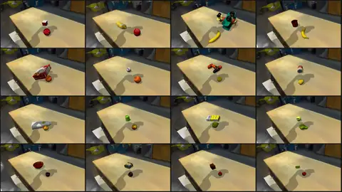

# Scenes and terrains

A scene is the set of named entities an environment builds: the robot, the ground, the props, and the welds
between them. This page covers `SceneOptions` and the scene presets, the object libraries you can drop into a
scene, placing objects on support surfaces, procedural terrains, and Gaussian-splat scenes of real rooms. How
each entity behaves once built is on [Entities](entities.md); the robots themselves are on [Robots](robots.md).

## `SceneOptions`

[`SceneOptions`](../api/options/scenes.md) (in `eden.options.entities`) takes each entity as a keyword
argument; the keyword is the entity's name in `env.entities` and in every term that refers to it.

```python
import eden as en
from eden.options.entities import BoxOptions, PlaneOptions, SceneOptions
from eden.options.objects.ycb import YCB003CrackerBox

scene_options = SceneOptions(
    plane=PlaneOptions(),
    robot=en.robots.Droid(base_pos=(0.0, 0.0, 0.0)),   # a composite: expands into "robot" + "gripper"
    box=YCB003CrackerBox(default_root_pos=(0.5, 0.0, 0.1)),
    marker=BoxOptions(size=(0.02, 0.02, 0.02), default_root_pos=(0.5, 0.2, 0.3), fixed=True),
)
```

What `SceneOptions` checks when it is constructed:

- Every value is an entity options object or a composite rig; anything else raises.
- A composite is placed under its primary body's name (`Droid`'s `arm_name`, `"robot"` by default), and no two
  entities, plain or composite-produced, share a name.
- A scene with a Mochi entity holds only Mochi and kinematic entities (see
  [Mochi entities](entities.md#mochi-entities)).

`attachments_dict` welds entities together (see [Attaching entities](entities.md#attaching-entities)).
`named_entities()` returns every entity the scene will build, composites expanded. A task variant drops an entity
with `scene_options.remove_entity(name)`, which also removes that entity's own weld; it refuses an entity others
are welded onto, a field declared on a `SceneOptions` subclass, and a single body of a composite. Removing an
entity does not touch the terms, cameras or sensors that name it, so update those too.

Gaussian-splat options are not part of `SceneOptions`: they live on the config root because they select the
environment class (see [Gaussian-splat scenes](#gaussian-splat-scenes)).

## Scene presets

The presets in `eden.options.scenes` (also `en.scenes`) are factory functions that return a plain
`SceneOptions`, so a config built from one saves and reloads like any other.

| Preset | Short alias | Entities it adds |
|---|---|---|
| `EmptySceneOptions(robot, *, is_support_enabled=False, surface=None, **entities)` | `en.scenes.Empty` | `robot`, `plane` |
| `BimanualEmptySceneOptions(right_robot, left_robot, *, ...)` | `en.scenes.BimanualEmpty` | `right_robot`, `left_robot`, `plane` |
| `TabletopSceneOptions(robot, *, plane=None, table=None, **entities)` | `en.scenes.Tabletop` | `robot`, `plane`, `table` (a work table at x = 0.5 m) |
| `KitchenCountertopSceneOptions(robot, *, plane=None, countertop=None, **entities)` | `en.scenes.KitchenCountertop` | `robot`, `plane`, `countertop` |
| `LBMEvalSceneOptions(left_robot=None, right_robot=None, plane=None, **entities)` | `en.scenes.LBMEval` | the LBM Riverway dual-arm station with two Pandas (default) on its gantry plates |

```python
scene_options = en.scenes.Empty(robot=en.robots.G1Dofs29(), cube=BoxOptions(size=(0.1, 0.1, 0.1)))
```

In `Empty` and `BimanualEmpty`, `is_support_enabled` and `surface` configure the default plane. Passing
`plane=...` replaces the flat ground with your own entity (a `TerrainOptions`, a low-friction plane) under the
same name, so everything that addresses the ground by name keeps working; combining it with
`is_support_enabled` or `surface` raises, since there is no default plane left to configure.

Benchmark ports ship their own scene factories, each returning a `SceneOptions`:

| Module | Factories |
|---|---|
| `eden.options.scenes.libero` | `LiberoTabletopSceneOptions`, `LiberoFloorSceneOptions`, `LiberoKitchenTabletopSceneOptions`, `LiberoLivingRoomTabletopSceneOptions`, `LiberoStudyTabletopSceneOptions`, `LiberoCoffeeTableSceneOptions` (each LIBERO workspace with its Panda, mounted where LIBERO mounts it) |
| `eden.options.scenes.robocasa.base` | `RobocasaOneWallSmall`, `RobocasaOneWallLarge`, `RobocasaLShapedSmall`, `RobocasaLShapedLarge`, `RobocasaGalley`, `RobocasaUShapedSmall`, `RobocasaUShapedLarge`, `RobocasaGShapedSmall`, `RobocasaGShapedLarge`, `RobocasaWraparound`, each also as `...Empty` (kitchen only, no accessories); first argument `style` (`"industrial"`, `"scandinavian"`, `"modern_1"`, …) |
| `eden.options.scenes.robocasa365.base` | `Robocasa365Layout001` … `Robocasa365Layout010`, each also as `...Empty`; first argument `style` (`"style001"`, …) |
| `eden.options.scenes.replica_cad.base` | `ReplicaCADSceneOptions(config_path)`, assembled from an upstream ReplicaCAD scene JSON |
| `eden.options.scenes.calvin` | `CalvinPlayTableSceneOptions(robot=None)`, the CALVIN play table with its three blocks |

Of these, only the LIBERO scenes back shipped tasks (see [LIBERO](../tasks/libero.md)); the others are scene
and asset ports you can build tasks on.

### CALVIN play table

Eden ships no CALVIN tasks, only the scene and its assets, as a starting point for your own:

```python
import eden as en
from eden.options.scenes.calvin import CalvinPlayTableSceneOptions

scene_options = CalvinPlayTableSceneOptions(robot=en.robots.FrankaEmikaPanda())  # set the robot's pose yourself
```

`CalvinPlayTableSceneOptions(robot=None, **entities)` returns a `SceneOptions` with `plane`, `table` and the
three blocks `block_red`, `block_blue` and `block_pink` resting on the table, plus `robot` when you pass one and any
further entities. Place the robot yourself: the factory sets no robot pose.

The assets are in `eden.options.objects.calvin`, built from the original CALVIN URDFs (table D) and fetched
from the family's own Hub dataset (`CALVIN_HF_DATASET = "eden_calvin"`) into the `calvin` cache subdirectory:

| Class | Registry key (`CALVIN_OBJECT_REGISTRY`) | What it is |
|---|---|---|
| `CalvinPlayTable` | `table` | the play table, fixed and articulated: DOFs `base__slide`, `base__drawer`, `base__button`, `base__switch` (all 0 by default) |
| `CalvinRedBlock` | `block_red` | the medium block |
| `CalvinBlueBlock` | `block_blue` | the small block |
| `CalvinPinkBlock` | `block_pink` | the large block |

Every CALVIN asset is scaled by `CALVIN_GLOBAL_SCALING = 0.8`. On first use the table's URDF tree is copied to a
per-user cache with the texture coordinates stripped from its OBJ meshes, so the mesh loaders accept them, and
its concave base is decomposed tightly (`decompose_robot_error_threshold=0.0`) so blocks rest on the visual
tabletop instead of inside a single convex hull.

## Objects

Object libraries live in `eden.options.objects.<family>`. Each family is an `EntityOptions` subclass that fixes
the Hub dataset, the cache subdirectory and the asset's axes, and each object is a subclass that names its file:

```python
from eden.options.objects.ycb import YCB003CrackerBox, YCB006MustardBottle
from eden.options.objects.objaverse import ObjaverseApple

box = YCB003CrackerBox(default_root_pos=(0.5, 0.0, 0.1))
apple = ObjaverseApple(variant=3, default_root_pos=(0.4, 0.1, 0.05))   # Objaverse classes hold several meshes
```

Override fields as for any entity: `is_fixed_base`, `scale`, `material=RigidMaterialOptions(rho=..., friction=...)`,
`default_geoms_sol_params` (to stiffen an object a gripper holds, see
[Closed-loop grippers](entities.md#closed-loop-grippers-and-constraint-fidelity)).

| Module | Family | What it holds | Classes |
|---|---|---|---|
| `ycb` | `YCBOptions` | the YCB object set (`YCB002MasterChefCan`, …) | 79 |
| `objaverse` | `ObjaverseObjectOptions` | Objaverse meshes, one class per category with numbered variants; `OBJAVERSE_OBJECTS_REGISTRY` | 82 |
| `robolab` | `RoboLabObjectOptions`, `RoboLabFixtureOptions` | the RoboLab library (YCB, HOPE, HOT3D, HANDAL, VOMP, Objaverse, fruits and vegetables, blocks, fixtures) converted to URDF; `ROBOLAB_REGISTRY` keys like `"ycb/banana"` | 323 |
| `replica_cad` | `ReplicaCADObjectOptions` | ReplicaCAD stages and furniture; `REPLICA_CAD_STAGE_REGISTRY`, `REPLICA_CAD_OBJECT_REGISTRY` | 107 |
| `robocasa` / `robocasa365` | | RoboCasa / RoboCasa365 kitchen layouts and accessories; `ROBOCASA*_KITCHEN_REGISTRY`, `ROBOCASA*_ACCESSORIES_REGISTRY` | 149 / 137 |
| `libero` | `LiberoObjectOptions` | LIBERO objects and workspaces; `LIBERO_OBJECT_REGISTRY` | 42 |
| `robosuite` | `RobosuiteObjectOptions` | the robosuite benchmark objects and the Rethink mount | 24 |
| `lbm_eval` | `LBMEvalObjectOptions` | LBM-eval objects and the Riverway station | 51 |
| `polaris` | `PolarisObjectOptions` | PolaRiS objects | 32 |
| `simpler` | `SimplerObjectOptions` | SIMPLER objects | 10 |
| `calvin` | `CalvinObjectOptions` | the CALVIN play table and blocks; `CALVIN_OBJECT_REGISTRY` | 5 |
| `dextoolbench` | `DexToolBenchOptions` | the DexToolBench hand tools; `DEXTOOLBENCH_REGISTRY` | 13 |
| `arctic` | `ArcticObjectOptions` | ARCTIC articulated objects; `ARCTIC_OBJECTS_REGISTRY` | 6 |
| `omomo` | `OMOMOObjectOptions` | OMOMO interaction objects; `OMOMO_OBJECTS_REGISTRY` | 16 |
| `piano`, `husky`, `mujoco_playground` | | single assets: `Piano` (an 88-key keyboard), `HuskySkateboard`, `DexCube` | 1 each |

"Classes" counts every class in the module, family bases included. Each family caches into its own subdirectory
of the asset root, and its files download on first use (see [Assets](../getting-started/assets.md)).

!!! note "Mesh objects and the solver frame"
    A free mesh object is re-origined onto its centre of mass, so `get_pos()` and `default_root_pos` are
    different points unless you pass `relative=True` (see
    [Which frame?](entities.md#which-frame-relativefalse-vs-relativetrue)). The gap is largest for tools and
    long objects whose centre of mass sits far from the mesh origin (2.9 to 14.8 cm on the DexToolBench tools).

Primitives (`BoxOptions`, `SphereOptions`, `CylinderOptions`, `PlaneOptions`) need no asset. A primitive's mass
comes from its volume and `material.rho` (`RigidMaterialOptions` defaults to `rho=200.0`).

### Finding an asset

- `eden view <Name>` opens any robot or object in the viewer (`-c` shows collision geometry); `eden snap <Name>`
  renders an image; `eden arrange <Name> [<Name> ...]` poses several with sliders and prints a `SceneOptions`
  snippet. Names are class names (`RoboLabYcbBanana`) or family-registry keys (`robolab/ycb/banana`, and the bare
  key when it is unambiguous).
- In code, `eden.options.catalog.find_entity_options(name)` resolves the same names to the class. It reads an
  index of every class under `eden.options.objects` and `eden.options.robots`, cached on disk and rebuilt when a
  source file changes.
- `eden.options.catalog.MANIFEST` is a smaller, curated index with semantic metadata (category, placement,
  whether an asset is a support surface or a container), currently populated from ReplicaCAD:

    ```python
    from eden.options.catalog import MANIFEST

    MANIFEST.ensure()
    MANIFEST.names(category="furniture/seating")
    opts = MANIFEST.make("sofa", default_root_pos=(0.0, 0.0, 0.0))
    ```

## Placing objects on support surfaces

An entity with `is_support_enabled=True` extracts its upward-facing surfaces after the build, and the placement
event terms sample collision-free poses on them for another entity, per environment:

```python
# examples/recipes/scenes/asset_placement.py
env = EnvBase(
    env_options=EnvOptions(num_envs=8),
    scene_options=SceneOptions(
        plane=PlaneOptions(),
        station=LBMRiverwayStation(),          # support-enabled, restricted to its table top
        cube=BoxOptions(size=(0.04, 0.04, 0.04), is_fixed_base=False),
    ),
    event_options=EventManagerOptions(
        place_cube=EventTerm.configure(
            mode=EventMode.RESET,
            func=place_uniform,
            params={"entity_name": "cube", "support_entity_name": "station", "samples_per_area": 100},
        ),
    ),
)
```

The placement terms in `eden.managers.terms.events.placement` are `place_uniform`, `place_constant_xy`,
`place_range_xy`, `PlaceGaussian` and `PlaceFromLayouts` (see [Events](events.md)). The support fields on the
entity tune the extraction:

| Field | Default | Meaning |
|---|---|---|
| `is_support_enabled` | `False` | extract support surfaces at build |
| `support_links_name` | `[]` | only these links' geometry counts (empty: every link); use it on a multi-link asset whose other surfaces must not receive objects |
| `support_minimum_clearance` | `0.05` | the free height a surface needs above it |
| `support_shrink` | `0.1` | inset applied to each surface polygon |
| `support_sample_method` | `"uniform"` | `"uniform"` or `"grid"` |
| `support_num_sample_points` | `300` | sample points per square metre (uniform) |
| `support_grid_size` | `0.01` | grid spacing (grid) |

Support surfaces are extracted only for contact-producing rigid entities: the option is ignored on a kinematic
entity (with a warning) and rejected on deformable and Mochi entities.

## Terrains

A `TerrainOptions` entity is a height field stitched from a rows × cols grid of *terrain generators*, one per
subterrain cell. The built entity is a fixed [`Terrain`](../api/entities.md), placed with `default_root_pos` at
the grid's `[0, 0]` corner.

```python
# eden/tasks/velocity_tracking/terrain/config.py
import eden as en
from eden.options.entities import SceneOptions, TerrainOptions
from eden.utils.terrains import (
    FlatTerrain,
    PyramidSlopedTerrain,
    PyramidStairsTerrain,
    RandomUniformTerrain,
    WaveTerrain,
)

def _make_terrain_grid() -> list[list]:
    grid = []
    for i in range(10):                      # rows: difficulty increases along x
        t = i / 9
        sh, sl, rh, wa = round(t * 0.1, 4), round(t * 1.0, 4), round(0.02 + t * 0.08, 4), round(t * 0.2, 4)
        grid.append([
            FlatTerrain.configure(),
            FlatTerrain.configure(),
            PyramidStairsTerrain.configure(step_width=0.3, step_height=sh),
            PyramidStairsTerrain.configure(step_width=0.3, step_height=sh),
            PyramidStairsTerrain.configure(step_width=0.3, step_height=-sh),
            PyramidStairsTerrain.configure(step_width=0.3, step_height=-sh),
            PyramidSlopedTerrain.configure(slope=sl),
            PyramidSlopedTerrain.configure(slope=-sl),
            RandomUniformTerrain.configure(min_height=-rh, max_height=rh, step=0.02, downsampled_scale=0.5),
            WaveTerrain.configure(num_waves=4.0, amplitude=wa),
        ])
    return grid

scene_options = SceneOptions(
    terrain=TerrainOptions(
        subterrain_size=(8.0, 8.0),
        horizontal_scale=0.1,
        vertical_scale=0.005,
        terrain_generators=_make_terrain_grid(),
        default_root_pos=(-10 * 8.0 / 2.0, -10 * 8.0 / 2.0, 0.0),   # centre the 80 x 80 m grid on the origin
    ),
    robot=en.robots.G1Dofs29(),
)
```

`examples/recipes/terrain/terrain_gen.py` previews every generator.

### `TerrainOptions` fields

| Field | Default | Meaning |
|---|---|---|
| `terrain_generators` | `[[FlatTerrain.configure()]]` | the grid; must be rectangular, rows along x and columns along y |
| `subterrain_size` | `(32.0, 32.0)` | size of each cell in metres (holds every built-in parkour course) |
| `horizontal_scale` | `0.25` | height-field cell size in metres |
| `vertical_scale` | `0.005` | metres per height unit |
| `randomize` | `False` | when `False`, every cell is generated from seed 0, so the terrain is the same on every run |
| `use_checker_surface` | `False` | render a checkerboard (1 m squares by default); cannot be combined with `surface` |
| `uv_scale` | `None` | texture repeats across the whole terrain, a scalar or `(x, y)`; `None` picks one repeat per axis, or 1 m checker squares |
| `default_root_pos` | `(0, 0, 0)` | world position of the grid's `[0, 0]` corner; `default_root_quat` must stay the identity |

A terrain is always fixed, carries no DOFs, and cannot take a Mochi material. To put a robot on terrain in a
preset scene, pass it as the ground: `en.scenes.Empty(robot=..., plane=TerrainOptions(...))`.

### Generators

All generators are in `eden.utils.terrains` and registered in `TERRAIN_GENERATOR_REGISTRY`. Configure one with
`<Generator>.configure(**params)`; heights are in metres unless the parameter says otherwise.

| Generator | Parameters (defaults) |
|---|---|
| `FlatTerrain` | none |
| `RandomUniformTerrain` | `min_height=-0.1`, `max_height=0.1`, `step=0.1`, `downsampled_scale=0.5` |
| `SlopedTerrain` | `slope=-0.5` |
| `PyramidSlopedTerrain` | `slope=-0.1` |
| `DiscreteObstaclesTerrain` | `max_height=0.05`, `min_size=1.0`, `max_size=5.0`, `num_rects=20` |
| `WaveTerrain` | `num_waves=2.0`, `amplitude=0.1` (waves along both axes) |
| `StairsTerrain`, `PyramidStairsTerrain` | `step_width=0.75`, `step_height=-0.1` |
| `SteppingStonesTerrain` | `stone_size=1.0`, `stone_distance=0.25`, `max_height=0.2`, `platform_size=0.0` |
| `FractalTerrain` | `levels=8`, `scale=1.0` |
| `PerlinNoiseTerrain` | `octaves=6`, `persistence=0.5`, `lacunarity=2.0`, `scale=20.0`, `amplitude=1.0` (in `vertical_scale` units), `seed=-1` (random) |
| `GapTerrain` | `gap_width=0.3`, `gap_depth=1.0`, `platform_width=1.0`, `num_gaps=4` |
| `PitTerrain` | `pit_depth=0.5`, `pit_size_range=(0.5, 1.5)`, `num_pits=8`, `platform_size=1.0` |
| `RidgeTerrain` | `ridge_height=0.15`, `ridge_width=0.1`, `ridge_spacing=0.5` |
| `CraterTerrain` | `crater_depth=0.3`, `crater_radius_range=(0.5, 2.0)`, `num_craters=6` |
| `NarrowBeamsTerrain` | `num_beams=16`, `beam_width=0.3`, `beam_height=0.2`, `platform_width=1.5`, `floor_depth=1.0` |
| `RandomGridTerrain` | `grid_width=0.5`, `grid_height_range=(0.0, 0.3)`, `platform_width=1.0` |
| `RandomBoxesTerrain` | `num_boxes=40`, `box_size_range=(0.3, 1.0)`, `box_height_range=(0.05, 0.5)`, `platform_width=1.0` |
| `TiltedGridTerrain` | `grid_width=1.0`, `tilt_range=15.0`, `height_range=0.1`, `platform_width=1.0` |
| `NestedRingsTerrain` | `num_rings=5`, `ring_width=0.4`, `gap_width=0.2`, `height_range=(0.1, 0.4)`, `platform_width=1.0` |
| `HeightFieldFileTerrain` | `file`: an exported height-field `.npz` (see below) |

The parkour course generators, ported from extreme-parkour, carve corridor courses and also emit waypoint
**goals** for goal-following commands: `ParkourTerrain`, `ParkourGapTerrain`, `ParkourHurdleTerrain`,
`ParkourStepTerrain`, `ParkourDemoTerrain` and `GapParkourTerrain`. `HalfSlopedTerrain` emits a slope direction,
and `HalfPlatformTerrain` and `CustomSteppingStonesTerrain` are standalone obstacles. Their parameters and the
guarantees on their goals are documented in `eden/utils/terrains/parkour_terrains.py`; the
`extreme_parkour` task uses them on 16 × 4 m lanes. A generator that raises (a course that does not fit its
cell) is reported with the cell's row and column.

### The `Terrain` entity

After the build, the terrain answers height and layout queries:

| Member | Returns |
|---|---|
| `bounds` | `(x_min, x_max, y_min, y_max)` in world metres |
| `get_height(grid)` | heights (world z) at `(B, h, w, 2)` world xy points, bilinear; pass `normalize=False` if the points are already in `[-1, 1]` |
| `subterrain_origins` | `(rows, cols, 3)` world centres of the cells |
| `goals`, `goals_count` | `(rows, cols, max_goals, 3)` world waypoints per cell and the real count per cell (raises unless every cell's generator produces goals) |
| `slope_vectors` | `(rows, cols, 3)` per-cell slope directions (only `HalfSlopedTerrain` sets them) |
| `height_field_units` | the stitched height field in `vertical_scale` units (numpy, dim 0 = x) |
| `export_height_field(path)` | write the height field in metres to a versioned `.npz` |

The `GridScanDots` observation (`eden.managers.terms.observations.locomotion`) samples `get_height` around the
robot for a height scan; the velocity-tracking terrain task uses it (see [Observations](observations.md)).

### Height fields on disk

`Terrain.export_height_field(path)` and `eden.utils.terrains.export_height_field` write a small `.npz` format
(version 1: `height_field` in metres with axis 0 along world +x, `horizontal_scale`, and the `origin` of corner
`[0, 0]`), for offline tools such as the terrain-adaptive retargeter (see
[TCRS terrain adaptation](tcrs-terrain-adaptation.md)). To rebuild that exact terrain in a scene:

```python
from eden.utils.terrains import terrain_options_from_height_field_file

terrain = terrain_options_from_height_field_file("terrain.npz")   # a TerrainOptions at the file's origin
```

It wraps the file in a one-cell grid of `HeightFieldFileTerrain` with `vertical_scale=1.0` and the matching
`subterrain_size`; building that by hand, the sizes must match the file or the generator raises.

### Writing a generator

Subclass `TerrainGenerator`, declare parameters as annotated class attributes, register it, and fill
`subterrain.height_field_raw` (indexed `(x, y)`, in `vertical_scale` units) in `compute`:

```python
import numpy as np

from eden.utils.terrains import TERRAIN_GENERATOR_REGISTRY, TerrainGenerator


@TERRAIN_GENERATOR_REGISTRY.register()
class RampTerrain(TerrainGenerator):
    """A ramp that rises along x."""

    rise: float = 0.5   # metres over the cell

    def compute(self, subterrain):
        rows, cols = subterrain.height_field_raw.shape
        ramp = np.linspace(0.0, self.rise / subterrain.vertical_scale, rows)
        subterrain.height_field_raw[:] = ramp[:, None]
        return subterrain
```

Then use it in a grid as `RampTerrain.configure(rise=0.3)`. Generators that emit goals set `subterrain.goals` (an
`(N, 2)` array in cell-local metres); see the parkour module for the conventions.

## Gaussian-splat scenes

A splat scene renders a photogrammetric capture of a real room (a Gaussian-splat `.ply`) behind the simulated
robot and objects. This is how the PolaRiS tasks put a simulated DROID arm into scanned kitchens and evaluate
policies in them (real-to-sim evaluation).



The splat is not an entity. It is configured with `splat_options` on the config root, and the config class
selects the environment class:

| Config | Environment | `splat_options` type | Backend |
|---|---|---|---|
| `EdenSplatConfig` | `SplatEnvBase` | `SplatOptions` | gsplat, composited over the sim render |
| `EdenSplatRLConfig` | `SplatRLEnvBase` | `SplatOptions` | gsplat, with the full RL manager surface |
| `EdenNyxSplatConfig` | `NyxSplatEnvBase` | `NyxSplatOptions` | Nyx path tracer, splat as a light field |

All three are in `eden.utils.configs`; the options are in [`eden.options.splat`](../api/options/splat.md). Each
splat file is a `PCDOptions` passed by name:

```python
# eden/tasks/polaris/base_config.py (make_polaris_splat) and food_bussing/config.py
from eden.options.splat import PCDOptions, SplatOptions

splat_options = SplatOptions(
    background=PCDOptions(
        path="food_bussing/assets/g60_corner_charuco_static/splat.ply",
        dataset="eden_polaris",
        assets_subdir="polaris",
        pos=(0.52, 0.6, 0.42),
        quat=(0.5, -0.5, -0.5, -0.5),
    ),
)
```

`PCDOptions` fields: `path` (fetched from `registry` / `dataset` when it is not a local file, at construction),
`scale`, `pos`, `quat` (wxyz), `multiplier` and `tint` (Nyx only), and `attach_entity` / `attach_link`, which make
the splat follow an entity's pose per environment (requires `SplatOptions(per_env_gaussians=True)`).

`SplatOptions` fields:

- `per_env_gaussians` (default `False`): one shared Gaussian set for every env (memory-light), or one per env so
  attached splats follow each env's poses (memory grows with `num_envs`).
- `minibatch` (default `None`): render this many envs at a time to bound peak VRAM.
- `camera_mode` (default `"auto"`): `"single"` renders one env-invariant view and broadcasts it, `"batched"`
  renders every env's camera, and `"auto"` picks batched for attached or following cameras and when
  `per_env_gaussians` is on. `"single"` with `per_env_gaussians=True` raises.

The splat stands behind empty space only where the camera's `SplatComposite` overlay lets it; a task whose splat
replaces a simulated surface (a table plane) names that entity in the overlay, as the PolaRiS tasks do with
`SplatComposite.configure(entities=["plane"])`. Camera overlays, the renderers and the Nyx options are covered
on [Sensors and rendering](sensors-and-rendering.md).

To inspect a capture on its own, `eden view path/to/splat.ply` opens it in the viewer (`-m` scales its radiance,
`--env-brightness` sets the background). The PolaRiS tasks are described on [PolaRiS](../tasks/polaris.md).

## See also

- [Entities](entities.md): frames, contacts, friction, deformables
- [Robots](robots.md): robot presets and composite rigs
- [Events](events.md): placement and reset events
- [Task configuration](task-config.md): where `scene_options` sits in a task config
- [Velocity tracking](velocity-tracking.md): a task on procedural terrain
- API: [`eden.options.entities`](../api/options/entities.md), [`eden.options.scenes`](../api/options/scenes.md),
  [`eden.options.splat`](../api/options/splat.md)
