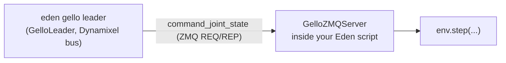

# Teleoperation

Eden can be driven by a person instead of a policy: a keyboard, gamepad or SpaceMouse on the desktop, a GELLO
leader arm, a Meta Quest or PICO headset, a Wuji Glove, or the SONIC whole-body pipeline for a Unitree G1. This
page covers what each input path needs, how its process layout looks, and how its readings reach the env's
action terms. To save what you teleoperate as a dataset, see
[Datasets and recording](datasets-and-recording.md).

## Choosing an input path

| Input | Process layout | Command | Install | Start from |
| --- | --- | --- | --- | --- |
| Keyboard, gamepad | in the sim process | — | `all` extra (`pynput`, `inputs`) | `examples/recipes/teleop/keyboard/`, `examples/recipes/teleop/ps4/` |
| SpaceMouse | in the sim process | — | the `spnav` package (no extra declares it) | `examples/recipes/teleop/spacemouse/` |
| On-screen joint sliders | in the sim process | — | `vis` extra (`imgui-bundle`) | `examples/recipes/teleop/gui/teleoperation_gui_franka.py` |
| GELLO leader arm | leader process → sim over ZMQ | `eden gello calibrate`, `eden gello leader` | `gello` extra + `dynamixel-sdk` | `examples/recipes/teleop/gello/` |
| Meta Quest (WebXR) | bridge process ↔ sim over ZMQ | `eden metaquest bridge` | `metaquest` extra + `metaquest-git` group | `examples/recipes/teleop/metaquest/` |
| PICO (XRoboToolkit) | bridge process ↔ sim over ZMQ | `eden pico bridge` | `pico` extra + a locally built `xrobotoolkit_sdk` | `examples/recipes/teleop/pico/` |
| Wuji Glove | in the sim process (no bridge) | `eden wuji scan`, `eden wuji monitor` | `wuji` extra (Linux only) | `examples/recipes/teleop/wuji/` |
| SONIC whole-body (G1 + PICO) | operator process → robot process over ZMQ | `eden teleop sonic operator`, `eden teleop sonic robot` | `sonic` + `onnx` or `onnx-gpu` extras, `sonic-viz` for the operator views | `examples/recipes/teleop/sonic/README.md` |

Every recipe folder above is runnable as-is and lists its options with `--help`; `eden examples list --capability
teleop.gello` (or `teleop.keyboard`, `teleop.metaquest`, …) finds them by capability. The headset and glove
folders carry a `README.md` with the full hardware setup; this page summarizes them and points at the parts that
are easy to get wrong.

## Desktop devices

### The device contract

Every desktop device subclasses [`DeviceBase`](../api/utils/devices.md) (`eden/utils/devices/base.py`):

- `get_command()` returns the current reading as a `torch.Tensor` (on the CPU; move it to `env.device`).
- `add_callback(key, fn)` registers `fn(on_press: bool)` for a key or button, called on press and on release.
- `reset()` clears the reading.

The device only produces numbers. Turning them into motion is the job of the env's action terms, so a teleop
loop is a few lines:

```python
# excerpt from examples/recipes/teleop/keyboard/teleoperation_keyboard.py
from eden.utils.devices.keyboard import SE3Keyboard

keyboard = SE3Keyboard()
keyboard.add_callback("x", lambda on_press: env.reset() if on_press else None)

while True:
    action = keyboard.get_command()  # (7,): 6-D delta pose + gripper toggle
    env.step({
        "ee_controller": action[:6].unsqueeze(0).repeat(env.num_envs, 1).to(env.device),
        "gripper_controller": action[6:].unsqueeze(0).repeat(env.num_envs, 1).to(env.device),
    })
```

In that recipe `ee_controller` is a `DifferentialIKController` (or `OperationalSpaceController`) configured with
`position_scale=0.05` and `orientation_scale=0.05`, and `gripper_controller` is a `BinaryJointController`. See
[Actions](actions.md) for both.

!!! note "Device readings are normalized"
    `SE3Keyboard(pos_max=1.0, rot_max=1.0)` emits a delta pose in `[-1, 1]` per axis. The metres and radians
    come from the task-space controller's `position_scale` / `orientation_scale`. Lowering `pos_max` clamps the
    device below full deflection; the physical step is then the product of the two.

!!! tip "Turn off the viewer's own key bindings"
    The keyboard recipes build the env with `EnvOptions(enable_default_keybinds=False)`, so the Genesis
    viewer's built-in shortcuts do not fire on the same keys the teleop device listens to.

### Keyboard

`SE3Keyboard` (`eden/utils/devices/keyboard.py`) has two layouts: `SE3Keyboard.default_key_bindings()` (the
default) and `SE3Keyboard.wasd_key_bindings()`; pass one as `key_bindings=`.

| Command | Default (+ / −) | WASD layout (+ / −) |
| --- | --- | --- |
| Move along x | `8` / `2` | `w` / `s` |
| Move along y | `4` / `6` | `a` / `d` |
| Move along z | `7` / `9` | `q` / `e` |
| Rotate about x | Up / Down | Up / Down |
| Rotate about y | Right / Left | Right / Left |
| Rotate about z | `1` / `3` | `z` / `c` |
| Toggle gripper | Space | Space |

Held keys ramp up through `tanh`, so the reading approaches full deflection as key-repeat accumulates.

!!! warning "pynput listens to the whole desktop, and needs one"
    `pynput` reads the keyboard globally, not the focused window, so keys you type into a terminal reach the
    device too. It also needs a local display: over a plain SSH shell the import fails with a message saying so.

### SE(2) velocity input for locomotion

For a walking robot, `TeleopSE2Keyboard` and `SE2Gamepad` emit a normalized `(vx, vy, wz)` deflection.
`eden.utils.devices.se2.make_se2_device("keyboard" | "gamepad", options)` builds one, and the
`OperatorVelocityCommand` command term reads it every control step, scaled and clamped into the term's
`lin_vel_x_range` / `lin_vel_y_range` / `ang_vel_z_range`. Substitute it for a trained `UniformVelocityCommand`
and the robot goes where you steer it, never faster than it was trained for. It reads a physical device, so it
is for deployment and interactive evaluation, not training. See [Commands](commands.md).

`make_se2_device("keyboard")` binds these keys:

| Command | Key (+) | Key (−) |
| --- | --- | --- |
| Forward / backward `vx` | Up | Down |
| Strafe `vy` | Left | Right |
| Turn `wz` | `,` | `.` |

The keyboard bindings avoid letters and digits on purpose: `eden deploy` reads `s` (START), `x` (STOP), `i`
(INIT), `k` (KILL) and digits from the terminal, and a global listener on WASD would turn typing START into a
backwards command. A held key is full deflection from the first press (`TeleopSE2Keyboard`, not the `tanh`-ramped
`SE2Keyboard`), so the commanded speed does not depend on your key-repeat rate. A `TeleopSE2Keyboard()` built
directly keeps `SE2Keyboard`'s numpad layout (8/2, 4/6, 7/9); pass `key_bindings=teleop_key_bindings()` (from
`eden.utils.devices.se2`) to get the table above. The gamepad layout is
`options={"layout": "ps4"}` (default) or `"xbox"`.

### Gamepad, SpaceMouse and sliders

- `SE3Gamepad` / `SE2Gamepad` (`eden/utils/devices/gamepad.py`, the `inputs` package) — PS4 and Xbox axis scaling
  are built in (`SCALE_PS4`, `SCALE_XBOX`). Button callbacks use the `inputs` event names, e.g.
  `gamepad.add_callback("BTN_EAST", ...)` in `examples/recipes/teleop/ps4/teleoperation_ps4.py`.
- `SE3Spacemouse` / `SE2Spacemouse` (`eden/utils/devices/spacemouse.py`) — read through `spnav`.
- `SliderGUI` (`eden/utils/devices/gui_slider.py`) — one ImGui slider per DOF in the Genesis viewer plus a
  Reset button. Build the env with `show_viewer=True`, then pass `viewer=env.scene.viewer`, `dofs_name`,
  `dofs_pos_limits` (an `(n_dofs, 2)` tensor; infinite limits are clipped to ±π) and optionally
  `reset_callback=env.reset`.

## GELLO leader arms

GELLO is a low-cost leader arm built from Dynamixel servos. You move the leader by hand; its joint angles drive
the simulated follower. The leader and the sim are two processes joined by a ZMQ request/reply socket:



### Install

```bash
pip install 'eden-world[gello]'      # or, in a checkout: uv sync --inexact --extra gello
pip install dynamixel-sdk            # the servo driver; no extra declares it
```

### 1. Calibrate the leader (once per leader)

Hold the leader at a known joint configuration and pass it as `--start-dofs` (radians):

```bash
eden gello calibrate \
    --port /dev/ttyUSB0 \
    --start-dofs 0 0 0 0 0 0 \
    --signs 1 1 -1 1 1 1 \
    --gripper \
    --output configs/gello_ur5e.yaml
```

It prints a ready-to-paste `GelloLeaderConfig(...)` and, with `-o/--output` (`.json`, `.yaml` or `.yml`), saves
it. Other flags: `--joint-ids` (Dynamixel IDs of the arm DOFs; default `1..N`), `--gripper-id` (default `N+1`),
`--baudrate` (default `57600`; high-speed boards use `1000000`), `--warmup-reads`, `--max-pi-multiple`,
`--gripper-open-delta-deg` / `--gripper-close-delta-deg` (shifts applied to the current gripper reading to
estimate its open and closed ends).

### 2. Start the follower in Eden

`GelloZMQServer` (`eden/utils/devices/gello/zmq_server.py`) wraps a built env and serves its arm (and optional
two-DOF gripper) over ZMQ. Its reading is the latest joint target the leader sent:

```python
# excerpt from examples/recipes/teleop/gello/teleoperation_gello_ur5e_robotiq.py
from eden.options.robots.robotiq_2f85 import Robotiq2f85
from eden.options.robots.universal_ur5e import UR5e
from eden.utils.devices.gello.zmq_server import GelloZMQServer

server = GelloZMQServer(
    env=env,
    arm_entity_name="arm",
    arm_dofs_name=UR5e.actuated_dofs_name,
    ee_link_name=UR5e.ee_links_name[0],
    gripper_entity_name="gripper",
    gripper_dofs_name=Robotiq2f85.actuated_dofs_name,
    host="127.0.0.1",
    port=6001,
)
try:
    server.start()
    while True:
        cmd = server.get_command().to(env.device)
        env.step({
            "arm_dof_controller": cmd[: len(UR5e.actuated_dofs_name)].unsqueeze(0),
            "gripper_controller": cmd[len(UR5e.actuated_dofs_name):].unsqueeze(0),
        })
finally:
    server.stop()
```

In the recipe the arm term is an `ImplicitPDController` with `reference_source=ReferenceSource.ZERO` and
`scale=1.0` (absolute joint targets), and the gripper term a `BinaryJointController` between the gripper's
`open_dofs_pos` and `close_dofs_pos`. Recipes exist for a UR5e + Robotiq 2F-85, a WidowX-250s and a bimanual
ALOHA.

!!! warning "Pass the port explicitly"
    `GelloZMQServer` defaults to `port=5001`, while `eden gello leader` and `GelloClient` default to `6001`. The
    recipes pass `--port 6001` to the server; do the same in your own script, or the leader connects to nothing.

### 3. Run the leader

```bash
eden gello leader -c configs/gello_ur5e.yaml --port /dev/ttyUSB0 --zmq-host 127.0.0.1 --zmq-port 6001
```

It sends the calibrated joint state at 100 Hz until Ctrl-C, after checking that the server's DOF count equals the
leader's. The same loop in Python:

```python
import time

from eden.utils.devices.gello import GelloClient, GelloLeader, GelloLeaderConfig

config = GelloLeaderConfig.load("configs/gello_ur5e.yaml")
leader = GelloLeader(port="/dev/ttyUSB0", config=config, start_dofs=[0.0] * config.num_dofs)
client = GelloClient(host="127.0.0.1", port=6001)
try:
    while True:
        client.command_joint_state(leader.get_command())
        time.sleep(1 / 100)
finally:
    leader.close()
    client.close()
```

What the leader sends:

- Each arm DOF is `(raw − offset) · sign`, in radians. The gripper, when configured, is normalized to `[0, 1]`
  with `0` open and `1` closed.
- `start_dofs` re-aligns the offsets by whole turns (multiples of 2π) so that the leader reads close to that
  configuration at start-up. `eden gello leader` passes all zeros, so start the leader near its zero pose.
- `get_offset(current_dofs, start_dofs, signs)` (`from eden.utils.devices.gello import get_offset`) is the
  module-level helper the calibration uses; it searches offsets in multiples of π/2.

`GelloClient` exposes the server's RPCs:

| Method | Returns |
| --- | --- |
| `num_dofs()` | `int` (arm DOFs + 1 with a gripper) |
| `get_joint_positions()` | `np.ndarray`: arm positions, plus the normalized gripper position (`0` open, `1` closed) |
| `get_observations()` | `dict` with `joint_positions`, `joint_velocities`, `ee_pos_quat` (world frame, wxyz) and `gripper_position` |
| `command_joint_state(joint_state)` | `None`; the server rejects a wrong length or non-finite values |

## Meta Quest (WebXR)

A Meta Quest opens a WebXR page that `eden metaquest bridge` serves over Wi-Fi (through `televuer` and its Vuer
server). The bridge publishes the headset's tracking and shows the stereo frames your Eden script renders:

```text
Meta Quest ──WebXR/Wi-Fi──▶ eden metaquest bridge
                             │ poses  (ZMQ PUB :5557)  ──▶ your Eden script
                             ◀ frames (ZMQ PULL :5556) ──┘ (renders a stereo camera pair)
```

Install the extra together with `televuer`, which is not on PyPI:

```bash
uv sync --inexact --extra metaquest --group metaquest-git
```

Outside a checkout, the bridge's import error prints the equivalent `pip install` command with the pinned
`televuer` git requirement.

Run the bridge in one terminal and the sim in another:

```bash
eden metaquest bridge                          # hand tracking (default)
eden metaquest bridge --tracking controller    # motion controllers instead
uv run python examples/recipes/teleop/metaquest/demo.py            # hand-tracking recipe
uv run python examples/recipes/teleop/metaquest/controller_demo.py # controller recipe
```

The bridge prints the URL to open on the headset (`https://<host-ip>:8012/?ws=wss://<host-ip>:8012`). WebXR
needs HTTPS: the headset must accept a TLS certificate whose SAN covers the host's LAN address (a self-signed
pair works; accept it once in the headset browser).

Bridge flags: `--width` (default `1280`, both eyes) / `--height` (`480`), `--fps` (`30`), `--display-mode`
(`immersive`, `ego` or `pass-through`) and `--tracking` (`hand` or `controller`).

!!! note "`eden metaquest bridge --help` prints Vuer's options"
    The `televuer` import parses the command line itself, so `--help` lists Vuer's server settings rather
    than the bridge's flags. The flags above are the ones the bridge reads (`eden/utils/devices/metaquest/xr_bridge.py`).

What the bridge publishes:

- WebXR treats hands and controllers as separate input sources, so the bridge runs one mode at a time and every
  published dict carries `"mode": "hand"` or `"mode": "controller"`.
- Hand mode carries head and wrist poses, 25 hand-joint positions, and pinch/squeeze. Controller mode carries head
  and wrist (grip) poses, per-hand trigger, grip, A/B buttons and thumbstick.
- Poses are already in the Genesis world frame (x forward, y left, z up, metres, origin at the XR tracking
  origin), so the sim side uses them directly.
- Both processes share `eden.utils.devices.metaquest.protocol` (`POSE_PORT = 5557`, `FRAME_PORT = 5556`, keep-latest
  sockets), so ports and framing have one definition.

For arms, `ClutchPoseMapper` (`eden/utils/devices/metaquest/pose_mapping.py`, ported from vr-teleop-kit) turns a
controller pose into an end-effector target. Hold the grip to engage and the target follows your hand's
*relative* motion; release to reposition your hand without moving the robot. When you pass the arm's current
end-effector pose to `mapper.target(...)`, motion past the mapper's reach limit is absorbed (a "slipping clutch")
instead of building up error the arm cannot follow. `examples/recipes/teleop/metaquest/controller_teleop.py`
drives two YAM arms this way: controller pose → `ClutchPoseMapper.target` → `RigidEntity.inverse_kinematics` →
`control_dofs_pos`, with the triggers on the grippers.

To teleoperate a registered task instead of the recipe's toy scene, build it with
`RLEnvBase.from_config(cfg)`, add a stereo camera pair through the config's `cameras_options`, and keep the
recipe's pose → action and render → stream loop.

## PICO (XRoboToolkit)

A PICO 4 or PICO 4 Ultra streams its tracking to the XRoboToolkit PC Service on the host. `eden pico bridge`
reads that service and drives the headset's *Remote Vision* video link:

```text
PICO ──Wi-Fi──▶ XRoboToolkit PC Service ──▶ eden pico bridge
                                            │ poses  (ZMQ PUB :5557)  ──▶ your Eden script
  headset decoder ◀── H.264 / TCP ──────────┤ frames (ZMQ PULL :5556) ◀──┘
                                            └ control server TCP :13579
```

The bridge publishes the **same dict schema and ZMQ channels** as `eden metaquest bridge --tracking
controller`, so the Meta Quest controller recipes run unchanged against a PICO. PICO adds keys:
`{side}_menu_button`, `trackers` (up to 5 motion trackers), `body_ready` / `body` (the 24 SMPL-ordered joints in
Full-body mode), and `body_raw` / `body_raw_timestamp_ns` (the untouched service-frame poses).

Setup:

1. `uv sync --inexact --extra pico` (or `pip install 'eden-world[pico]'`): PyAV for the H.264/H.265 encoder and pyzmq.
2. Install the XRoboToolkit PC Service on the host (see [XR-Robotics](https://github.com/XR-Robotics)).
3. Build the `xrobotoolkit_sdk` Python module from `XRoboToolkit-PC-Service-Pybind` with Eden's interpreter
   active (`bash setup_ubuntu.sh`). It is built against the service's `libPXREARobotSDK.so`, so no index can
   ship it and no extra declares it; the bridge fails at start-up with this hint when it is missing. The library
   is preloaded from `/opt/apps/roboticsservice/SDK/x64`, so no `LD_LIBRARY_PATH` export is needed; set
   `EDEN_PXREA_SDK_DIR` to search another directory first.
4. Install the XRoboToolkit app on the headset, connect it to the host, select Head + Controller tracking, enable
   Send, and tap Listen under Remote Vision.

```bash
eden pico bridge
uv run python examples/recipes/teleop/pico/demo.py                  # GPU; --backend cpu for CPU
uv run python examples/recipes/teleop/pico/controller_teleop.py     # bimanual YAM arms
```

Bridge flags: `--fps` (pose publish rate), `--control-address` (default `0.0.0.0:13579`), `--pose-port`,
`--frame-port`, `--no-video` (tracking only), `--no-derived-body` (publish `body_raw` only, skipping the per-joint
body dict and the trackers) and `--tracker-role SERIAL=ROLE` (repeatable).

!!! tip "Label your motion trackers"
    The service reports trackers by serial number only. Run the bridge once: it logs each unlabeled serial. Then
    map them, e.g. `eden pico bridge --tracker-role PA12345=waist --tracker-role PB67890=left_foot`, and
    `state()["trackers"]["waist"]` is keyed by role.

!!! note "Hand tracking is not index-compatible with the Quest recipe"
    `PicoXrClient.hand_joints()` exposes PICO's 26-joint OpenXR hand layout, but the bridge publishes controller
    state only. The Quest hand recipe assumes WebXR's 25-joint layout.

`examples/recipes/teleop/pico/README.md` covers the in-headset steps, the control-frame options of `demo.py`
(gaze-relative or room-fixed clutch, `--viewer-camera`) and firmware quirks.

## Wuji Glove

The Wuji Glove needs no bridge: `WujiGlove` (`eden/utils/devices/wuji/glove.py`) talks to `wuji_sdk` in your
process over USB or Ethernet, keeping the newest frame of each subscribed stream.

```bash
uv sync --inexact --extra wuji          # Linux only: wuji-sdk ships manylinux wheels
eden wuji scan                          # list the gloves on the bus
eden wuji monitor --side right --seconds 30
```

`eden wuji monitor` prints, once per tick, whether the glove is solving a pose, each fingertip's distance from
the wrist, and the tactile sheet's active-taxel count and peak. Its flags: `--sn`, `--side {left,right}`,
`--streams ...`, `--rate-hz` (default device rate 120 Hz), `--seconds` (`0` runs until Ctrl-C) and `--exclusive`.

```python
from eden.utils.devices.wuji import WujiGlove

glove = WujiGlove(side="right", streams=("hand_skeleton", "tactile"), rate_hz=60)
keypoints = glove.get_command()   # (21, 3) landmarks in Eden's hand frame; zeros before the first frame
pressure = glove.tactile()        # (24, 31) sheet in [0, 1]; dead taxels are nan; None before the first frame
glove.close()
```

Subscribe only to the streams you use (`STREAMS` lists them; the default is `hand_skeleton`, `hand_joint_angles`
and `tactile`): each one is another callback into Python. Every getter returns `None` until its stream's first
frame, so a loop can hold its last pose instead of blocking.

!!! warning "Telemetry"
    Importing `wuji_sdk` starts a background worker that sends anonymous usage events to a third-party analytics
    host. Set `WUJI_TELEMETRY_DISABLE=1` to turn it off. Eden does not set it for you.

Frames: the glove reports the hand relative to the **wrist**, not the room — pair it with an arm, headset or
tracker for a world-frame wrist pose. Eden re-expresses the vendor's anatomical wrist frame as a hand frame with x
distal (along the fingers) and z dorsal (out of the back of the hand), so an axis means the same direction on
either glove; pass `frame="wuji"` to a getter for the vendor's raw numbers.

Driving a robot hand from it (`examples/recipes/teleop/wuji/`):

- `glove_demo.py` draws the skeleton and the tactile pressure, with no robot.
- `glove_teleop.py` drives a simulated Wuji Hand 2. `--retargeter wuji` (default) uses the vendor's
  `RetargetSession` for that hand; `--retargeter dexpilot` uses Eden's `DexRetargeter` (needs the
  `dex-retargeter` extra), which matches fingertip vectors only and leaves PIP/DIP under-constrained on a
  human-sized hand. Prefer `wuji` for the Wuji Hand 2; `dexpilot` is the route to other hands (`--preset`). See
  [Dex retargeting](dex-retargeting.md).
- `glove_real_hand.py` drives a **real** Wuji Hand 2 through `WujiHandDeployment`; `--dry-run` retargets without
  connecting the hand. See [Deployment](deployment.md) before running it.

Glove gotchas:

- `tactile_binary` and `tactile_residual` read zero until you run the vendor's per-glove tactile calibration;
  plain `tactile` needs none. Raw `tactile` is not contact: an unworn glove reads well above zero across much of
  the sheet.
- The hardware pins dead taxels to `-1.0`; Eden's getters turn them into `nan`, so reduce with `torch.nanmean`.
  `state()` keeps the raw `-1.0`, because `nan` is not valid JSON.
- The active-taxel count is `N_ACTIVE_TAXELS` (526), not the number of non-sentinel cells (`N_UNMASKED_TAXELS`,
  534).
- `hand_joint_angles` are the *human* hand's 21 DOFs, not a robot's. Retarget from `keypoints()`.

## SONIC whole-body teleoperation

`eden teleop sonic` runs Eden's port of NVIDIA's GR00T-WholeBodyControl teleop stack: a PICO 4 Ultra (headset,
two controllers, two ankle trackers) drives a Unitree G1 under the SONIC policy. Two processes speak the
reference's byte-compatible ZMQ protocol:

```text
PICO ─Wi-Fi→ XRoboToolkit PC Service
               └→ eden pico bridge (spawned by the operator, pose PUB :5559)
                    └→ eden teleop sonic operator ──ZMQ :5556 (pose / planner / command)──→ eden teleop sonic robot
                                                 ←──ZMQ :5557 (g1_debug feedback)─────────┘ (G1 body + SONIC + planner)
```

```bash
pip install 'eden-world[sonic,onnx-gpu]'      # onnx for CPU inference; add sonic-viz for --vis-vr3pt / --vis-smpl
eden teleop sonic robot --vis                  # T1: Genesis G1 + SONIC policy + planner
eden teleop sonic operator --vis-vr3pt --vis-smpl   # T2: PICO tracking; --robot-host <ip> across machines
```

The operator also needs `xrobotoolkit_sdk` (see [PICO](#pico-xrobotoolkit)). By default it spawns the PC Service
and a pose-only bridge; `--no-service-start`, `--no-bridge-start` and `--bridge-host` change that, and `--sdk`
reads the SDK in-process. The G1 model and the SONIC encoder/decoder/planner ONNX files download on first use;
the robot process (`eden teleop sonic robot`) takes `--encoder-path` / `--decoder-path` / `--planner-path` to use
local files instead.

Operator modes, selected on the PICO with the button combos below (each on its rising edge, except the menu
pause). The names are the ones the operator prints. The table is `eden/extensions/teleop/sonic/state_machine.py`:

| Mode | Entered by | Left by | What moves |
| --- | --- | --- | --- |
| `PLANNER` | A+B+X+Y from `OFF`; A+X from `POSE`; a stick click from the `PLANNER_VR_3PT` it opened | A+X → `POSE`; left-stick click → `PLANNER_VR_3PT` | joystick locomotion |
| `POSE` | A+X from `PLANNER`; B+Y from `PLANNER_FROZEN_UPPER_BODY`; A+X or B+Y from `PLANNER_VR_3PT`; releasing the menu in `POSE_PAUSE` | A+X → `PLANNER`; B+Y → `PLANNER_FROZEN_UPPER_BODY`; left menu held → `POSE_PAUSE` | whole body from the SMPL body pose |
| `PLANNER_FROZEN_UPPER_BODY` | B+Y from `POSE`; a stick click from the `PLANNER_VR_3PT` it opened | B+Y → `POSE`; left-stick click → `PLANNER_VR_3PT` | planner legs, arms frozen where they were |
| `PLANNER_VR_3PT` | left-stick click from `PLANNER` or `PLANNER_FROZEN_UPPER_BODY` | left-stick click → back to that mode; A+X or B+Y → `POSE` | arms follow your hands, legs walk on the planner |
| `POSE_PAUSE` | holding the left menu button in `POSE` | releasing it → `POSE` | nothing new: the operator stops streaming poses |

A+B+X+Y disengages (→ `OFF`) from every mode.

A+B+X+Y while engaged **disengages**: the robot is handed to the planner's idle and keeps balancing, unlike the
reference stack, whose `stop` ends the robot process with a damping-only command. Robot-terminal keys: `9`
toggles the elastic band, `7`/`8` set its length, `o` is the e-stop, `i` re-captures the heading. A headless
robot host has no keyboard, so use `--drop-band-after SECONDS`.

The robot process has three bodies. The default is the Genesis simulator. `--mujoco` (sim-to-sim) and `--real`
(the real G1 over DDS, which needs `unitree_sdk2py`) drive the body-only 29-DOF G1 through the `eden deploy`
backends: the Dex3 hands are not driven, the deployment's own STOP / INIT / START sequence comes first, and the
deployment flags keep their `eden deploy` spelling (`--deploy_kp_kd_scale`, `--target_lpf`, `--disable_joints`,
`--debug_record`, `--debug_record_path`). `--joint-vel-limit` (default 35 rad/s, `--real` only) stops the session
when any body joint exceeds it. `--auto-reset` (Genesis and `--mujoco` only) resets the session to the launch state
when the robot falls with the band off.

!!! warning "`--real` is uncommissioned"
    The `--real` path has been exercised only against an in-memory wire, not on a robot. Commission it at a low
    `--deploy_kp_kd_scale`, with the robot supported by a gantry. See [Deployment](deployment.md).

!!! warning "Port collision with a standalone PICO bridge"
    A default-port `eden pico bridge` (frames :5556, poses :5557) collides with the SONIC wire (:5556 / :5557).
    The bridge the operator spawns uses `--no-video --pose-port 5559`. When you run one yourself, use those flags
    (and `--no-derived-body --fps 120`) and start the operator with `--no-bridge-start`.

`examples/recipes/teleop/sonic/README.md` holds the full procedure: the calibration pose, engaging POSE,
recalibrating VR_3PT, the health lines both processes print, and every control.

## Writing an operator stack

`eden.extensions.teleop` holds the interfaces an operator-station stack implements; the SONIC stack under
`eden/extensions/teleop/sonic/` is the reference implementation of all three.

- [`TeleopOperator`](../api/extensions/teleop.md) — the operator lifecycle, configured by `TeleopOptions` (`robot_host`, `port`,
  `feedback_port`; device-specific fields arrive as extras). `run()` calls `setup()`, then `step()` until
  `should_stop()`, and always `teardown()`, which must cope with a `setup()` that failed part-way.
- `TeleopInputSource` — a tracked-input reader with `start`, `stop`, `get_latest` (`None` before the first
  frame), `get_timestamp_ns`, `controllers` and a `disconnected` property.
- `TeleopStreamer` — one control mode's per-tick pipeline: `run_once(...)` publishes at most one message per
  tick and paces itself; `reset_yaw()` runs on mode entry, `on_mode_exit()` on exit.

`TeleopInputSource` and `TeleopStreamer` are plain ABCs because they are constructed with live sockets and
callables, not from an options schema.

## See also

- [Datasets and recording](datasets-and-recording.md) — record a teleoperated session to HDF5, then LeRobot.
- [Actions](actions.md) — the IK, OSC, PD and binary gripper terms a device drives.
- [Commands](commands.md) — `OperatorVelocityCommand`.
- [Dex retargeting](dex-retargeting.md) — mapping a human hand onto a robot hand.
- [Deployment](deployment.md) — running on the real robot.
