---
hide:
  - navigation
  - toc
---

<div class="eden-hero" markdown>

# { width="320" }{ width="320" } { #eden }

<p class="eden-tagline">
<strong>E</strong>mbodied-AI <strong>D</strong>evelopment <strong>E</strong>nvironments <strong>N</strong>exus
</p>
<p class="eden-subtitle">
A robot-learning framework built on Genesis: write a task as one typed config, train it across thousands of
GPU-parallel environments, then run the same policy on a real robot.
</p>

<div class="eden-actions" markdown>

[Get started](getting-started/index.md){ .md-button .md-button--primary }
[View on GitHub](https://github.com/embodied-ai-nexus/Eden){ .md-button }

</div>

</div>

{ .eden-teaser }

## What Eden gives you

<div class="eden-grid" markdown>

<div class="eden-card" markdown>

### A task is one typed config

Scene, observations, actions, rewards, terminations, events, curricula and the learning runner live in one
Pydantic object. It validates when you construct it, saves to JSON or YAML, and turns its variants into CLI flags.

</div>

<div class="eden-card" markdown>

### Composable terms

Observations, rewards, terminations, commands, events and curricula are small registered terms. A plain function
with a decorator becomes a new one, and `eden terms --grep <text>` finds an existing one with its parameters.

</div>

<div class="eden-card" markdown>

### Robots and objects

Humanoids, quadrupeds, arms and dexterous hands come as ready-made robot options, and composite rigs bolt a hand
onto an arm. Robot and object assets download on first use.

</div>

<div class="eden-card" markdown>

### Physics and sensing

The Genesis solvers (rigid, PBD, MPM, SPH, FEM) are set through `EnvOptions`, plus Mochi, an implicit solver that
couples rigid, soft, cloth and rod bodies. Cameras render through a rasterizer, a batch renderer or the Nyx path
tracer, next to depth, lidar, tactile, IMU, contact and audio sensors.

</div>

<div class="eden-card" markdown>

### Motion and demonstration data

Load human-motion datasets, retarget them to robots, estimate motion from video, teleoperate with GELLO, Meta
Quest, PICO or the Wuji Glove, and record or script demonstrations into HDF5 and LeRobot datasets.

</div>

<div class="eden-card" markdown>

### Train, export, deploy

Train with rsl_rl (the default), rl_games, skrl or Stable-Baselines3, on one GPU or many. Export a policy to ONNX
or TorchScript, check it against MuJoCo with `eden deploy --mujoco`, then run it on hardware with `eden deploy`.

</div>

</div>

## From install to a trained policy

```bash
pip install eden-world                  # or, in a clone of the repository: uv sync
eden list                               # every registered task and its variant flags
eden train --task reacher               # train a Yam arm to reach sampled targets
eden inference --task reacher --checkpoint <path/to/model.pt> --vis
eden inference --policy homie --vis     # roll out a published policy, no training needed
```

[Installation](getting-started/installation.md) covers platforms and optional extras, and the
[Quick start](getting-started/quickstart.md) walks through these commands and where their output goes.

## A task is one config

The reacher task, abridged from
[`eden/tasks/benchmark/reacher/config.py`](https://github.com/embodied-ai-nexus/Eden/blob/main/eden/tasks/benchmark/reacher/config.py),
the template every built-in task follows:

```python
@TASK_REGISTRY.register(modifiers=(ReacherDifficultyMod,))  # adds `eden train --task reacher --difficulty hard`
class ReacherConfig(EdenRLConfig):
    env_options: EnvOptions = EnvOptions(num_envs=4096, episode_length_s=9.0, sim_dt=0.01, sim_substeps=2, ...)
    scene_options: SceneOptions = en.scenes.Empty(robot=en.robots.Yam())
    observation_options: ObservationManagerOptions = ObservationManagerOptions(
        policy=ObservationGroupOptions(
            dofs_pos=observations.DofsPos.configure(entity_name="robot"),
            dofs_vel=observations.DofsVel.configure(entity_name="robot"),
            ...
        ),
    )
    action_options: ActionManagerOptions = ActionManagerOptions(
        joint_pos_controller=actions.ImplicitPDController.configure(
            entity_name="robot", dofs_name="joint*", scale=0.05, reference_source=ReferenceSource.DELTA,
        ),
    )
    command_options: CommandManagerOptions = CommandManagerOptions(
        reaching_target=UniformT3Command.configure(x_range=(0.3, 0.5), y_range=(-0.1, 0.1), z_range=(0.25, 0.35)),
    )
    reward_options: RewardManagerOptions = RewardManagerOptions(
        reaching_task=RewardTerm.configure(func=reaching_reward, weight=1.0, params={...}),
        action_rate=RewardTerm.configure(func=rewards.action_rate_l2, weight=-0.01),
    )
    termination_options: TerminationManagerOptions = TerminationManagerOptions(
        timeout=DoneTerm.configure(func=terminations.time_out, time_out=True),
    )
    runner_options: RslRlOnPolicyRunnerOptions = RslRlOnPolicyRunnerOptions(...)
```

[Key concepts](getting-started/concepts.md) explains each piece, and
[Your first task](getting-started/first-task.md) builds one from scratch.

## Gallery

<div class="eden-grid" markdown>

<div class="eden-card" markdown>


**Sensors**: a Go2 with LiDAR in a scanned tunnel.

</div>

<div class="eden-card" markdown>

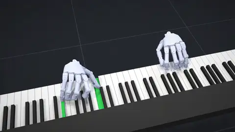

**Multi-modality**: playing piano, with sound synthesised from the pressed keys.

</div>

<div class="eden-card" markdown>

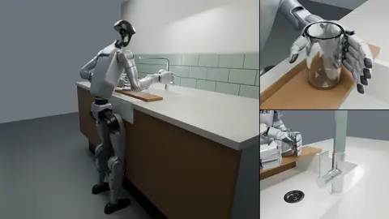

**Beyond rigid bodies**: a G1 fills a glass with water at a kitchen tap.

</div>

<div class="eden-card" markdown>

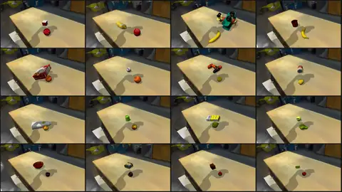

**Batch rendering**: batched Gaussian-splat backgrounds behind a heterogeneous simulation.

</div>

<div class="eden-card" markdown>

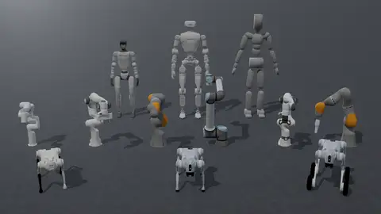

**Embodiments**: built-in robots, composite rigs and object sets.

</div>

<div class="eden-card" markdown>

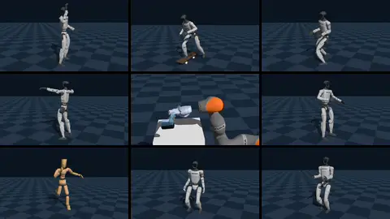

**Policy zoo**: published controllers run as shipped with `eden inference --policy <name>`.

</div>

<div class="eden-card" markdown>

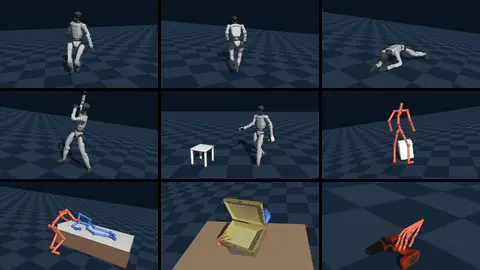

**Motion datasets**: loaders that share one motion format.

</div>

<div class="eden-card" markdown>

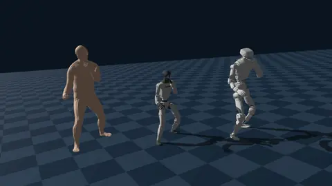

**Cross-embodiment retargeting** with `eden retarget`.

</div>

<div class="eden-card" markdown>

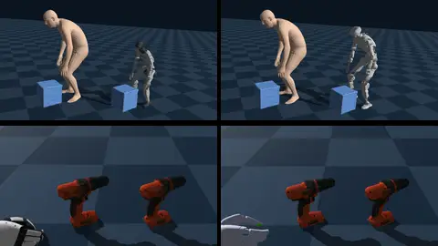

**Human-object retargeting**: the object comes along, onto a rig or a hand.

</div>

<div class="eden-card" markdown>


**Train at scale**: `eden train --task <task> --num_envs 4096`, across GPUs with DDP.

</div>

<div class="eden-card" markdown>

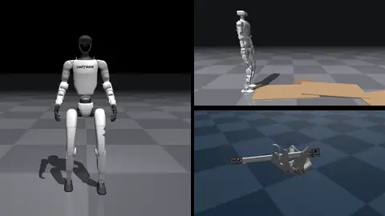

**Sim-to-sim**: `eden deploy --task <task> --checkpoint model.pt --mujoco`.

</div>

<div class="eden-card" markdown>

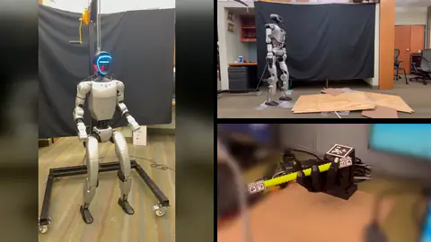

**Sim-to-real**: `eden deploy --task <task> --checkpoint model.pt`.

</div>

<div class="eden-card" markdown>


**Motion tracking** with the native motion manager.

</div>

<div class="eden-card" markdown>

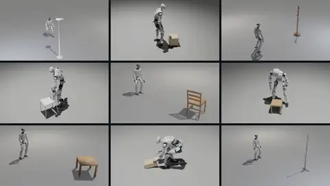

**Human-object interaction**: humanoids with dexterous hands move objects.

</div>

<div class="eden-card" markdown>


**Multi-agent RL**: two agents with their own observations, actions and rewards.

</div>

<div class="eden-card" markdown>

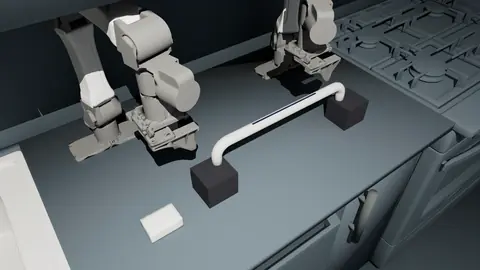

**Soft-body manipulation**: a trained policy wipes a bar with a foam sponge.

</div>

<div class="eden-card" markdown>

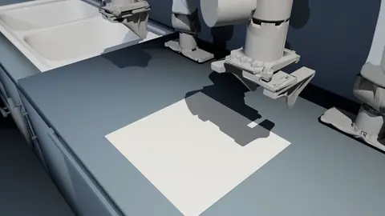

**Cloth manipulation**: two arms fold a towel in half.

</div>

<div class="eden-card" markdown>

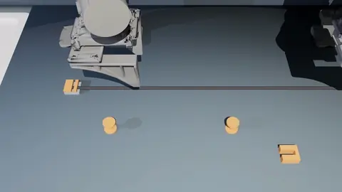

**Cable routing**: a cable routed around two spools into a port.

</div>

<div class="eden-card" markdown>

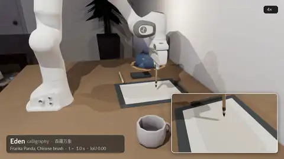

**Calligraphy** with a modeled Chinese brush.

</div>

<div class="eden-card" markdown>

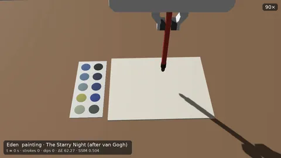

**Wet-acrylic painting**, with the wet paint blending.

</div>

<div class="eden-card" markdown>

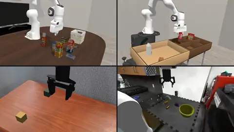

**Benchmark suites**: LIBERO, robosuite, SIMPLER, PolaRiS and more, reimplemented.

</div>

</div>

## Where to go next

<div class="eden-grid" markdown>

<div class="eden-card" markdown>

### [Get started](getting-started/index.md)

Install Eden, train and watch a policy, and learn the handful of ideas every task is built from.

</div>

<div class="eden-card" markdown>

### [Task suites](tasks/index.md)

The registered tasks by family, and how to list, train and evaluate them.

</div>

<div class="eden-card" markdown>

### [Building tasks](guides/task-config.md)

Task configs, variants, terms, entities and environments, in depth.

</div>

<div class="eden-card" markdown>

### [Training and deployment](guides/training-runs.md)

Training runs and checkpoints, other RL libraries, multi-GPU training, the policy zoo, export and
[deployment](guides/deployment.md).

</div>

<div class="eden-card" markdown>

### [Examples](examples/index.md)

Runnable projects, policy demos and single-capability recipes, browsable with `eden examples list`.

</div>

<div class="eden-card" markdown>

### [Reference](reference/cli.md)

Every `eden` command and its flags, the [environment variables](reference/environment-variables.md) Eden reads,
and the [API reference](api/index.md).

</div>

</div>

## Acknowledgments

Eden builds on these open-source projects:

- [genesis-world](https://github.com/Genesis-Embodied-AI/genesis-world): the simulation backend, with
  [gs-madrona](https://github.com/Genesis-Embodied-AI/gs-madrona) (batch renderer) and
  [genesis-nyx](https://github.com/Genesis-Embodied-AI/genesis-nyx) (path tracer).
- [quadrants](https://github.com/Genesis-Embodied-AI/quadrants): the compiler that generates parallel kernels for
  GPUs and CPUs.
- [IsaacLab](https://github.com/isaac-sim/IsaacLab) and [mjlab](https://github.com/mujocolab/mjlab): reference
  manager-based environment implementations.
- [ManiSkill](https://github.com/haosulab/ManiSkill): a reference holistic environment for embodied agents.
- [ProtoMotions](https://github.com/NVlabs/ProtoMotions) and [MimicKit](https://github.com/xbpeng/MimicKit):
  reference environments for human motion priors.
- [Holosoma](https://github.com/amazon-far/holosoma) and
  [InstinctLab](https://github.com/project-instinct/InstinctLab): reference end-to-end humanoid frameworks.

## Citation

If you use Eden in your research, please cite:

```bibtex
@misc{Eden,
  author = {Eden Authors},
  title = {Eden: One Task Definition from Simulation to Real Robots},
  month = {November},
  year = {2026},
  url = {https://github.com/embodied-ai-nexus/Eden}
}
```

Eden is released under the Apache 2.0 License.
