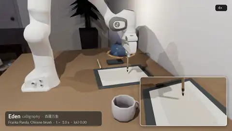
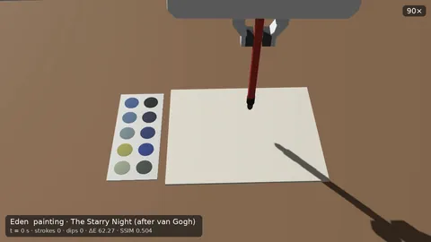
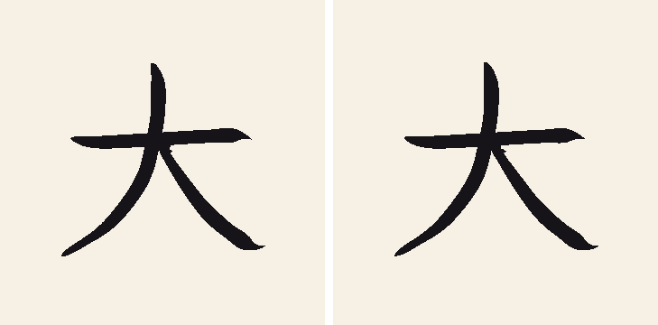
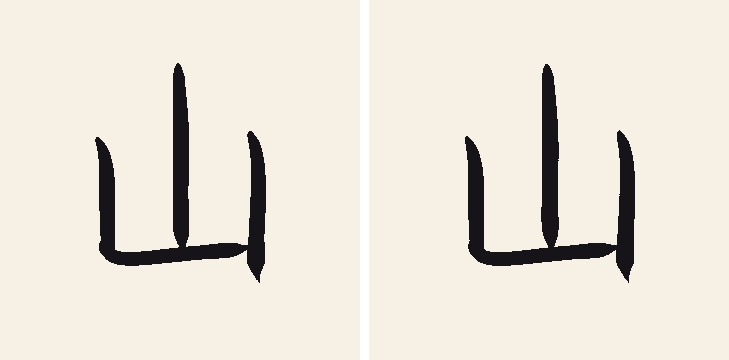
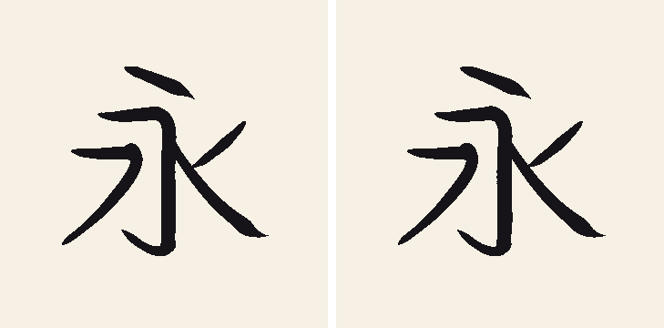
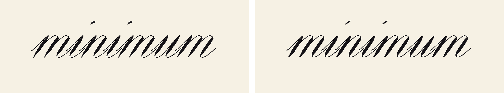
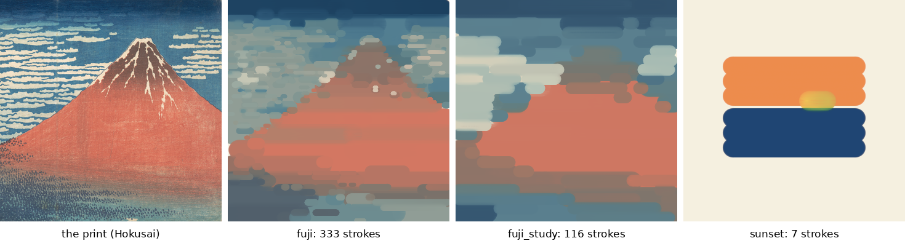
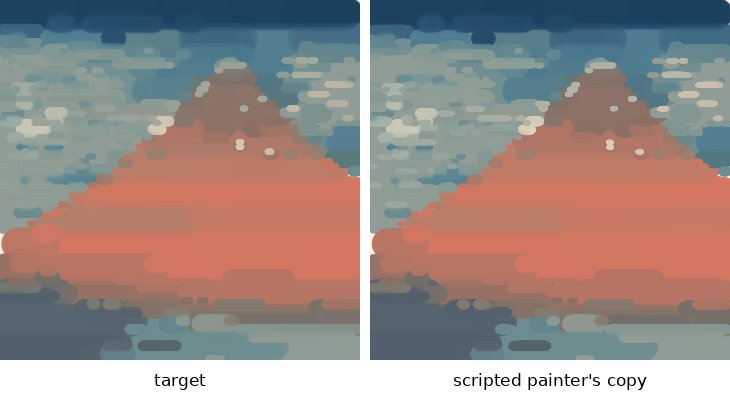
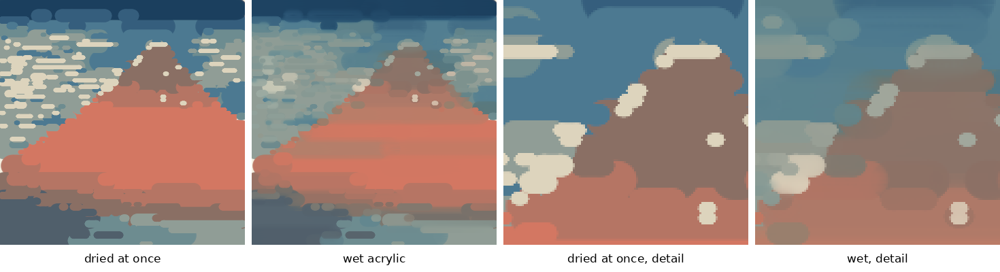
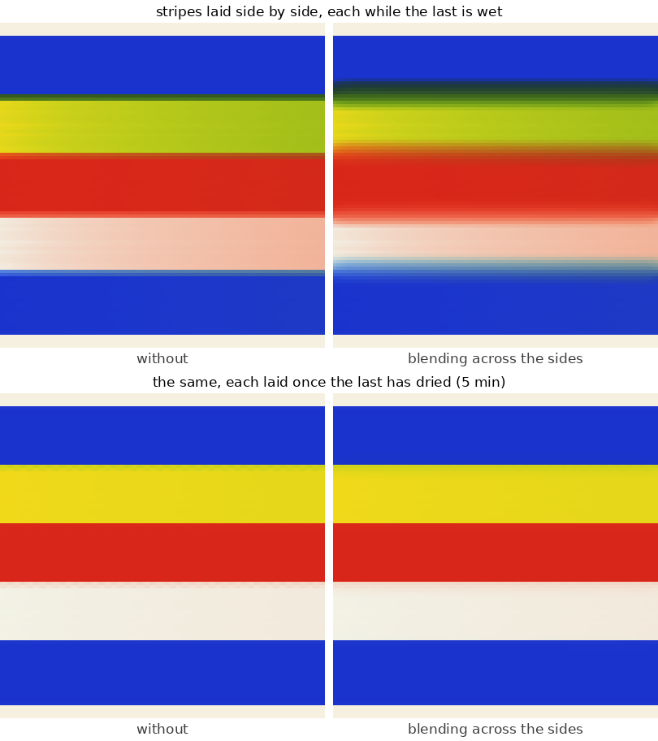

# Art: calligraphy and painting

Seven RL tasks in which a Panda copies a work on a sheet of paper: four of calligraphy, with a Chinese brush or a
pointed pen, and three of acrylic painting, with a round brush and a palette. The tool models and the works are
Eden's own; the copies are graded by the picture and hand rules that the
[RoboPaint benchmark](https://robopaint.embodied-first-exam.ai) publishes. Read this page to train or record the
tasks, generate demonstrations, or understand the tool and paint models. The code is in `eden/tasks/art/`.

<div class="grid" markdown>





</div>

These two README clips show the tool and paint models on works that are not registered tasks.

## The tasks

| Task (`--task`) | Work | Tool | Strokes | Episode | Envs |
|-----------------|------|------|---------|---------|------|
| `art_calligraphy_dai` | 大 (big), kaisho (楷書), 12 cm | Chinese brush | 3 | 60 s | 256 |
| `art_calligraphy_san` | 山 (mountain), kaisho, 12 cm | Chinese brush | 3 | 60 s | 256 |
| `art_calligraphy_ei` | 永 (eternity), kaisho, 12 cm | Chinese brush | 5 | 60 s | 256 |
| `art_calligraphy_lettering_minimum` | *minimum*, round hand, 14 mm x-height | pointed pen | 9 | 120 s | 256 |
| `art_painting_sunset` | a sea, a sky and a low sun (3 paints) | paintbrush | 7 | 90 s | 64 |
| `art_painting_fuji_study` | a study of Hokusai's *Fine Wind, Clear Morning* (5 paints, two layers) | paintbrush | 116 | 800 s | 64 |
| `art_painting_fuji` | Hokusai's *Fine Wind, Clear Morning* (10 paints, four layers) | paintbrush | 333 | 1200 s | 64 |

```bash
eden smoke --task art_calligraphy_ei
eden train --task art_calligraphy_dai
eden train --task art_painting_sunset
eden datagen --task art_painting_fuji_study --num_episodes 10 --num_envs 4 --output_dir data/demos
```

!!! warning "The art tasks run in 32-bit precision only"
    The tool models, the plans and the grading run in float32, and the published plans are pinned as planned in
    float32. The copy metric refuses `eden.init(precision="64")` when it is built; initialize Eden at the default
    `precision="32"` instead. Casting the samples down would not do: the plan guide and the scripted demonstrators
    read the float64 poses too.

## The workcell

Shared by both families (`eden/tasks/art/workcell.py`). The robot faces +x.

- **The desk and the sheet.** A Panda stands on a desk 0.75 m high; the sheet lies on a felt pad in front of it, its
  centre 0.50 m out (`workcell.SHEET_CENTER`). The sheet frame is `(u, v)` from that centre: `u` to the robot's
  right, `v` up the page, away from the robot.
- **The tool is welded in the Franka Hand**, its fingers closed on the handle, and held 35 mm from its back end so the
  back end clears the palm.
    - **The brush**: a Chinese writing brush, a 13.5 cm bamboo handle and ferrule and a 30 mm tuft 9 mm thick at the
      ferrule. It points straight down.
    - **The pen**: an 11.5 cm holder and a 22 mm nib. It leans 45 degrees along round hand's 55-degree slant, so the
      nib's slit runs along the downstrokes: they come out shaded and the upstrokes hairline.
    - **The paintbrush**: a round painting brush, a 15 cm handle and ferrule and a 15 mm tuft 8 mm thick, held so its
      tip is where the Chinese brush's is. It points straight down.
- **What marks does not collide.** The hairs, the tuft and the nib are drawn but have no collision; what they mark is
  the tool model's, read from where the tip would be undeformed. The rest of each tool collides, so pressing deeper
  than the hairs are long drives the ferrule into the paper.

!!! note "Why the tool is welded, not held by friction"
    The [whiteboard tasks](whiteboard.md) hold their marker by friction alone. Over a 30–60 s writing episode a
    friction grip creeps: a pen held that way turned 29 degrees about its axis and slid 5 mm out of the pinch in
    50 s, and a pen's shading depends on how its nib is turned. The tool is welded to the arm's flange link, as the
    hand itself is. A DOF-less body welded one attachment further down, to the hand link, reads an all-zero pose
    after build and reset until the first physics step.

## Plans and works

Every work is a **plan** of the tool's tip (`eden/tasks/art/plans.py`): stroke by stroke, key points `(u, v, depth)`
joined by a centripetal Catmull-Rom spline, where `depth` is how far below the paper the tip goes (negative in the
air). Every stroke starts and ends in the air, and between strokes the tip rises to 1 cm (`plans.TRAVEL_HEIGHT`). A
work's **target** is what its own tool model lays along its plan, so a copy can match it, and a plan replayed through
the robot shows the work can be made.

## Calligraphy

`eden/tasks/art/calligraphy/`. The success metric is `CalligraphyWriting`, keyed `writing`.






Each work's target (left) and the scripted writer's copy through the task's own IK action (right), run to the end of
its plan (Genesis CPU, one env). These are the metric's ink grids.

### The tools

Both tools are kinematic, as RoboPaint's are: what a tool lays down follows from where its tip is and its depth, not
from a contact force. The tip is sampled after every 5 ms sim step (`eden/tasks/art/calligraphy/tools.py`).

- **The Chinese brush** (`DynamicBrush`) is the dynamic virtual brush of Wang, Chen, Deng, Hutchinson and Dellaert,
  *Robot Calligraphy using Pseudospectral Optimal Control in Conjunction with a Novel Dynamic Brush Model*
  (IROS 2020), with that paper's fitted width, drag and offset as functions of depth `z` (in cm):
  `Width(z) = 1.187 z - 0.03`, `Drag(z) = 1.075 z + 0.138` and `Offset(z) = -0.967 z² + 2.11 z - 0.036`. It deforms
  no further than 1.5 cm deep, and the width's and drag's inertia is 0.02 per sample.
    - The mark is a teardrop: its flat end `w` wide at the hairs' root, narrowing on a parabola over `d`.
    - The root stays where the hairs touched until the tip has moved `Offset(z)` from it, then is dragged after the
      tip, so the hairs trail the stroke and swing round its turns.
    - One deviation from a literal reading of the paper: the root's direction updates only once the tip is more than
      0.1 mm (in the air) or 1 mm (on the paper) from it. A brush lowered onto the paper then starts with its hairs
      trailing the way it came in, at any speed.
- **The pointed pen** (`PointedPen`) marks an ellipse at the tip: a 0.4 mm hairline along the slit, and across it
  0.4 mm up to 1 mm deep, swelling linearly to 2 mm at 3.5 mm deep. A stroke pulled along the slit comes out shaded,
  one across it a hairline.

### The works

The three characters are kaisho (楷書, regular script) as Japanese schools teach it, 12 cm, in the standard Japanese
stroke order and direction. Their shapes are those of [Klee One](https://github.com/fontworks-fonts/Klee) (Fontworks,
SIL Open Font License 1.1), a 教科書体 (textbook) kaisho:

1. Key points are authored along each glyph's strokes with a brush's pressure: pressed in at the start (起筆),
   lighter through the stroke (送筆), then pressed to a stop (止め) or lifted into a sweep (払い).
2. The points are then moved, at most 4.8 mm each, so the ink the brush model lays along them matches the glyph.
   The fitted plans' IoU with the glyphs is 0.90 (大), 0.86 (山) and 0.81 (永).

*minimum*, the copybooks' drill for the pointed pen's shaded downstrokes, is built from round hand's basic strokes
(hairline entries, swelling shaded downstrokes, overturns and underturns), slanted 55 degrees.

### Grading

- **Ink** is a byte per cell on a grid over the whole sheet: 0.5 mm cells for the brush works, 0.2 mm for the pen. A
  cell is inked once a footprint covers its centre. Ink only exists on the sheet, and the brush never runs dry:
  RoboPaint counts dips, but nothing here makes a dip necessary.
- **The picture rules** are RoboPaint's, judged at the placement shown (RoboPaint first registers a copy to its
  target within 5 mm; here the copy must be where the target is). Each work can set its own thresholds (its `rule`);
  the defaults (`WritingRule` in `eden/tasks/art/calligraphy/grading.py`) are:
    - the IoU of the ink with the target (≥ 0.8);
    - the boundary F-measure, matching outlines within 1 mm (≥ 0.75), read in a crop round the target;
    - each stroke's share of the target covered (≥ 80 %);
    - stray ink farther than 1 mm from the target, as a share of the target's area (≤ 4 %).
- **The hand rules** are counted as the tool moves (`eden.tasks.art.terms.CopyMetric`):
    - *Strokes*: no more than the work has. A stroke is a touch-down after the tool was lifted at least 1 mm clear of
      the paper or off the sheet; a tip grazing on and off within that is still the same stroke.
    - *Path*: the tip's path on the paper within 2.5 times the plan's.
    - *Mark width*: the mean width of the mark along that path at least a third of the plan's.
- **The grade** is the IoU while every rule passes, and is held just under the IoU threshold otherwise, so the
  `written` termination (`OnMetricSuccess`) means all rules are met.

!!! note "Lettering's IoU threshold is 0.7, not RoboPaint's 0.85"
    RoboPaint sets its own thresholds for pen lettering: IoU 0.85 and boundary F 0.8 (stricter than the defaults
    above), stroke coverage 0.75 (looser). A pen's hairline is two 0.2 mm cells wide, so a copy that wanders 0.1 mm either side of it inks half as much
    again. The scripted writer's copies, faithful by eye and on every other rule, score 0.80 at its 1.5 cm/s and 0.77
    at 2 cm/s. The *minimum* work's rule (`works.LETTERING_RULE`) keeps RoboPaint's boundary F (0.8) and stroke
    coverage (0.75) with an IoU of 0.7.

### The policy's view

- **Actions.** One term, `arm`: differential IK at the tool's undeformed tip, 20 Hz, up to 1 cm and 0.05 rad a step.
- **Observations** (identical `policy` and `critic` groups, no noise): the arm's joint positions and velocities, the
  tip's `(u, v, depth)` and the tool's axis in the sheet frame (`TipPose`), the tool's last mark (for the brush,
  where its bent hairs lie: `ToolMark`), the next plan points with depth, each flagged where a new stroke starts
  (`NextPlanPoints`), the strokes left, the grade (`CopyGrade`) and the last action.
- **Rewards.** `inked` (the target first inked, 100 for all of it), `progress` (the plan's points the touching tip
  first reaches, 20 for all of them), `stray` (ink off the target, -50 per target area), `reach` / `reach_fine` (the
  tip toward the next plan point at its depth), `success` (a bonus of 50), and small action-rate and joint-speed
  penalties.
- **Terminations.** `timeout` and `written`.

## Painting

`eden/tasks/art/painting/`. The success metric is `PaintingCopy`, keyed `painting`.



The three works' targets: what the paint model lays along each plan. For the Hokusai works, the woodblock print they
were planned from, cropped to the sheet (left).



*fuji*'s target (left) and the scripted painter's copy through the task's own IK action, dipping as the plan does,
run to the end of its plan (Genesis GPU, one env). These are the metric's canvases.

### The palette

A tray on the desk to the robot's left of the sheet, its face level with the paper's, with a 22 mm well of each of
the work's paints in columns of five, 3 cm apart (`eden/tasks/art/painting/palette.py`). It is the work's own
(`PaletteOptions(work=...)`): the metric reads a dip off the work's wells, and refuses a scene whose palette is
another work's. The paint in the wells is drawn and does not collide.

### The brush and the paint

The brush is kinematic: what it lays follows from its tip and depth, sampled after every 5 ms sim step
(`eden/tasks/art/painting/paint.py`).

- **The mark** is a disc at the tip, 1 mm across at a touch and growing linearly to 18 mm at 15 mm deep (fully
  pressed), with a 0.5 mm soft edge (`RoundBrush`). RoboPaint's four acrylic brush sizes, 16, 9.4, 5.2 and 3 mm, are
  presses of this one brush.
- **The paint is wet acrylic** (`Acrylic`), and the brush and the sheet exchange it as the brush moves. Each rate is
  per brush diameter travelled on the paper, not per second or per sample, so what is laid does not depend on the
  brush's speed or the sampling rate.
    - **Paints mix as pigments do.** A paint is a Kubelka-Munk pigment (an absorption per colour channel and a
      scattering). Pigments mix in proportion to the amount of each, and the colour shown is the mix's reflectance,
      so blue and yellow make green, not grey.
    - **The brush lays its paint** over paper or dry paint, covering all but `exp(-20)` of a cell it passes over the
      middle of (`deposit_rate`). Laid into **wet** paint it covers far less (`wet_resistance`, 0.85): it mixes in.
    - **The brush picks up the wet paint** it drags through (`pickup_rate`, 0.25 per diameter), so its colour drifts
      toward it until the next dip.
    - **The bristles streak** what is laid into wet paint, or from a brush running dry (`streaks`). A full brush on
      paper or dry paint covers evenly.
    - **Wet paint blends across a stroke's sides.** Within 2.5 mm of either side (`blend_width`) the paint is smoothed
      with the paint beside it (`blend_rate`, 3 per diameter), as freely as both are wet. So a stroke laid beside wet
      paint meets it in a gradient, and keeps a sharp edge against bare paper and dried paint.
    - **The paint dries.** Its wetness falls by `e` every two minutes of the episode (`open_time`, 120 s).
- **The brush carries a load** and holds one paint at a time (`PaintLoad`). A dip, the tip pressed more than 1 mm
  into a well, fills it with that well's paint at the end of the control step the dip began in (the brush is taken as
  clean: there is no rinse). A full load covers 3000 mm², a 25 cm stroke 12 mm wide. The paint stays opaque while the
  load is above a fifth, then fades to nothing: a stroke with too little paint is a dry brush.
- **Paint only exists on the sheet.** A brush pressed past the sheet's edge paints the part of its mark on the paper.



*fuji*'s target in paint that dries at once (each stroke flat and opaque over the last) and in wet acrylic: where a
stroke meets one still wet the two blend, its bristles streak it, and the brush carries the colour it picked up into
the strokes after.



Stripes 10 mm wide laid 9 mm apart, each a fresh dip, without and with the blending across the sides: laid while the
last is wet, neighbours meet in a gradient; laid once it has dried, each keeps its edge.

### The works

- ***sunset*** is authored: three 16 mm sweeps of sky, three of sea, and a short sweep of sun on the horizon.
- **The Hokusai works** are planned (`eden/tasks/art/painting/planner.py`) from the Metropolitan Museum of Art's scan
  of the woodblock print (accession JP2960, which the Met titles *South Wind, Clear Sky*; released as CC0), cropped
  to a square round the mountain. The planner paints first the ground in broad strokes, then the forms, then the
  details:
    1. The palette is k-means in CIELAB over the picture.
    2. Each layer has a brush size. Where the canvas so far is further than the layer's ΔE threshold from the picture
       blurred to that size, each paint's region is swept with horizontal strokes, each at most as long as a load
       lasts above its reserve. The ground layer goes on lightest paint first and later layers darkest first, so
       light details (clouds, snow) go on top.

    *fuji* has four layers (16, 9.4, 5.2 and 3 mm brushes), *fuji_study* the first two.

Every stroke is a sweep: it comes down before its start, runs level at the depth that makes its brush size, and
lifts off past its end. A target is painted at the scripted painter's pace, so its paint dries between strokes as a
copy's does at that pace; a copy painted faster blends more, one painted slower less.

!!! note "Planned works are fetched, planned once and pinned"
    A Hokusai work is a `PlannedPainting` recipe in `eden/tasks/art/painting/works.py`. Its picture is in the
    [`Kashu7100/eden_art`](https://huggingface.co/datasets/Kashu7100/eden_art) dataset at a pinned revision
    (`PICTURES_REVISION`). The plan is made on the CPU the first time a task needs it (some 10–20 s; one process
    plans and any other waits for it) and kept under `~/.cache/eden/art/plans/` (under `$XDG_CACHE_HOME` when it is
    set), in a file named for the recipe, the picture and the plan's digest. A kept plan is found without fetching
    the picture, so an offline run needs only that cache directory.

    Each recipe pins `plan_sha256`, the digest of its plan as published. A change to the planner or the paint model
    does not re-plan a kept work; re-pinning the digest does. A plan made on another machine is checked against the
    digest and, if it differs, used with a warning, since its target and stroke count are not the published task's.
    `tests/tasks/art/painting/test_works.py` re-plans the works from scratch and checks the digests (marked `slow`).

### Grading

The canvas is per env, over the whole sheet, in 0.5 mm cells, each with its dry paint's colour and the wet paint over
it. It is float32 whatever Eden's precision.

- **The picture rules** are RoboPaint's acrylic ones, judged at the placement shown (`eden/tasks/art/painting/grading.py`).
  The copy and the target are blurred by a 1 mm Gaussian, then:
    - the CIELAB colour difference per cell (ΔE\*ab, CIE 1976): mean ≤ 2 and 90th percentile ≤ 6;
    - the SSIM of the lightness L\*: ≥ 0.92;
    - the correlation of the lightness gradients' magnitudes (Sobel), the edges: ≥ 0.8;
    - the IoU of the cells painted at all with those the target paints: ≥ 0.95.

    The colour, the SSIM and the edges are read in a crop round the target's paint, the coverage over the whole sheet:
    RoboPaint's paintings cover their canvas, and a small work's bare paper would otherwise dilute every measure.
- **The hand rules** are counted as the brush moves:
    - *Strokes*: at most 1.3 times the plan's. A dip is not a stroke, but going to the palette lifts the brush off
      the sheet.
    - *Path*: the tip's path on the paper within 3 times the plan's.
    - *Scribbles*: a stroke at least 1 cm long whose path is over 2.5 times the distance from its start to its end (a
      zigzag, a loop, a there-and-back) is a scribble; scribbles may take at most a tenth of the path.
- **The grade** is the lightness SSIM while every rule passes, and is held just under the SSIM threshold otherwise,
  so the `painted` termination (`OnMetricSuccess`) means all rules are met.
- ***sunset*'s mean ΔE is 1, not 2.** It is a small work on a bare sheet: its sun is a small part of the crop, and a
  copy would meet a mean ΔE of 2 as soon as the brush touched down for the sun.

!!! tip "Envs per GPU"
    Each env carries a full-sheet canvas of dry and wet paint, so the painting tasks default to 64 envs (the
    calligraphy tasks to 256). Raise `--num_envs` only as far as your GPU memory allows.

<!-- TODO(material): current per-step cost and per-env memory of the painting metric, measured on the current code (the old page quoted RTX 3080 numbers: 47 ms per fuji step at 64 envs, 8.1 MB + 6.2 MB per env). -->

### The policy's view

- **Actions.** One term, `arm`: differential IK at the brush's undeformed tip, 20 Hz, up to 1 cm and 0.05 rad a step.
- **Observations** (identical `policy` and `critic` groups, no noise): the arm's joints, the tip's pose
  (`TipPose`), the paint on the brush, its load and colour (`BrushPaint`), the paint the plan's next point needs,
  its well's offset from the tip and whether the brush holds another paint (`NextPaint`), the next plan points, the
  strokes left, the grade (`CopyGrade`: a reset env's is its bare sheet's, not 0) and the last action.
- **Rewards.** `error_drop` (the copy's mean ΔE brought toward the target, 100 for all of the bare sheet's error),
  `progress` (the plan's points the touching tip first reaches with their paint on the brush, at full opacity, 20 for
  all of them; a point passed with a dry brush or another paint stays unreached), `reach` / `reach_fine`, `success`
  (a bonus of 50), and small action-rate and joint-speed penalties.
- **Terminations.** `timeout` and `painted`.

## Recording the marks

The ink and the paint live in the metric, not in the scene, so a plain camera shows a blank sheet. `eden inference
--rec` records each task's `recording_camera()`, which carries a `PlanePaintOverlay` painting the metric's marks
where the camera sees the sheet, shaded as the renderer shaded the sheet (so the tool's shadow falls across them) and
hidden by the tool and the hand in front of them. The calligraphy camera looks down from above the robot's right
side; the painting camera from high over the arm, so the painting reads upright. The training configs declare no
camera, so training builds none.

To show the marks in another camera, give its `CameraOptions` the same overlay. Ink takes a colour; paint is drawn
in its own colours, so the painting overlay takes none:

```python
from eden.entities.camera_overlays import PlanePaintOverlay
from eden.options.camera import CameraOptions
from eden.tasks.art.calligraphy.grading import INK_COLOR

ink_camera = CameraOptions(cam_pos=..., cam_lookat=..., overlays=[PlanePaintOverlay.configure(metric_name="writing", color=INK_COLOR)])
paint_camera = CameraOptions(cam_pos=..., cam_lookat=..., overlays=[PlanePaintOverlay.configure(metric_name="painting")])
```

## Scripted demonstrators

Each task has a privileged demonstrator registered under its name (`ScriptedWriter` in
`eden/tasks/art/calligraphy/scripted_demos.py`, `ScriptedPainter` in `eden/tasks/art/painting/scripted_demos.py`),
which is also the proof that each work can be made. Both follow the work's tip path through the task's own action with
the suite's `TipFollower` (`eden/tasks/art/scripted.py`): each step commands a gain times the offset from the tip to
the path, and the path's clock waits while the tip trails it. They read the tip and the plan and never touch the tool
or the marks.

```bash
eden datagen --task art_calligraphy_ei --num_episodes 100 --num_envs 16 --output_dir data/demos
```

- They have no randomness and make no deliberate mistakes, so `--seed` changes nothing and `--p_mistake` must be 0.
- The writer draws at 2 cm/s with the brush and 1.5 cm/s with the pen (each tool's `ToolSpec.draw_speed`); the
  painter paints and dips at 3 cm/s. The painter dips where the plan dips: before the first stroke, before a change
  of paint, and before a stroke that would leave the brush under its reserve.
- An episode ends when the task does, on success, which can come before the last stroke is finished.
- `tests/tasks/art/calligraphy/test_scripted_demos.py` pins all four calligraphy works and
  `tests/tasks/art/painting/test_scripted_demos.py` pins *sunset* (marked `slow`).

<!-- TODO(material): per-task scripted results on the current code (time to success, IoU / ΔE / SSIM at success and at the end of the plan, strokes, dips, wall time). -->

See [Scripted demonstrations](../guides/scripted-demos.md).

## Not ported

- **RoboPaint's brush engine.** Its acrylic brush is libmypaint's; this paint model is Eden's own, so RoboPaint's
  thresholds hold for it as rules, not as calibrated equivalents.
- **RoboPaint's exemplars, plans and targets.** Its calligraphy rubbings and copybook pages and its reference
  painter's runs are not released; the works here are Eden's.
- **Registration.** RoboPaint aligns a copy to its target within 5 mm before scoring it.
- **Dipping for ink and rinsing.** The calligraphy brush never runs dry; a paint dip replaces the paint on the brush
  however dirty it was, and the wells stay clean.

## See also

- [Whiteboard drawing](whiteboard.md), the friction-held-marker counterpart
- [Sensors and rendering](../guides/sensors-and-rendering.md) for `PlanePaintOverlay`
- [Scripted demonstrations](../guides/scripted-demos.md)
- [Task suites overview](index.md)
