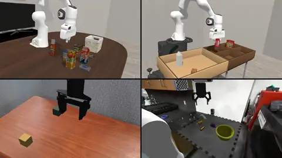

# LIBERO

Eden runs the 130 tasks of the [LIBERO](https://github.com/Lifelong-Robot-Learning/LIBERO) benchmark through one
registered task, `libero`, which builds any catalog task from its upstream BDDL file. Read this page to evaluate a
policy on LIBERO in Eden, including a generalist policy served by a remote server. The code is in
`eden/tasks/libero/`.



## What is ported

- **The catalog.** All five suites, by their upstream names: `libero_spatial`, `libero_object`, `libero_goal` and
  `libero_10` (10 tasks each) and `libero_90` (90 tasks), plus the derived `libero_100` (`libero_90` followed by
  `libero_10`). The 10-task suites also carry LIBERO's official continual-learning task orders.
- **The tasks.** Each task's scene, fixtures, movable objects, language instruction and goal come from its BDDL
  file, which is fetched on first use from the
  [`Kashu7100/eden_libero`](https://huggingface.co/datasets/Kashu7100/eden_libero) dataset along with the objects.
- **The robot and controller.** LIBERO's mounted Panda (`eden.options.robots.libero.LiberoPanda`), driven by an
  `OperationalSpaceController` in robosuite's `OSC_POSE` convention (0.05 m and 0.5 rad per unit action) and a
  stateful `LiberoPandaGripperController` (`+1` closes, `-1` opens, `0` holds).
- **The goal check.** `LiberoGoalMetric` evaluates the task's BDDL goal predicates (`On`, `In`, `Open`, ...) with
  the upstream semantics.
- **The protocol.** 20 Hz control (a 2 ms step, `decimation=25`), five zero-action settling steps
  (`LIBERO_RESET_WARMUP_STEPS`) and then 600 policy actions (`LIBERO_POLICY_HORIZON_STEPS`). The episode ends on
  goal success or after those 605 steps.

The task defines no rewards: it is an evaluation task, not an RL training task.

## Fixed-state bundles

LIBERO evaluates every task from a fixed set of initial states. Eden resets from a **fixed-state bundle** per task,
which holds the exact poses, joint positions and velocities of each init ID. Eden does not ship, generate or
download these bundles: you provide them.

The layout is:

```text
<bundle_root>/<suite>/<task>/state-bundle/task.json
<bundle_root>/<suite>/<task>/state-bundle/states.npz
```

`task.json` names the task, its init IDs and its entities; `states.npz` stores the arrays under semantic keys such
as `entity/robot/root_pos_world` and `entity/robot/joint/joint1/qpos`, so each array is bound to the entity or joint
it restores rather than to a position in a list. Both are validated when the env builds
(`eden.tasks.libero.state_bundle.load_state_bundle`).

If you omit `bundle_root`, the task looks under `libero/fixed_states` in the asset directory. Nothing populates that
path for you, so in practice you pass `bundle_root`.

!!! note "BDDL `:init` is not the reset state"
    The BDDL `:init` predicates are kept as symbolic catalog facts (`LiberoTaskSpec.initial_state`) for inspection
    and tooling. They are not used to reconstruct simulator state; the bundle is the only reset source.

## Selecting a task and its init states

`libero` takes three TaskMod flags (`LiberoTaskMod`):

| Flag | Meaning | Default |
|------|---------|---------|
| `--task_name` | A catalog task name | `pick_up_the_alphabet_soup_and_place_it_in_the_basket` (the first `libero_object` task) |
| `--bundle_root` | Root of the `<suite>/<task>/state-bundle` directories | `libero/fixed_states` in the asset directory |
| `--init_ids` | Comma-separated init IDs, one per env | empty: the first `num_envs` states of the bundle |

```bash
eden smoke --task libero \
    --task_name pick_up_the_alphabet_soup_and_place_it_in_the_basket \
    --bundle_root /path/to/libero-fixed-states
```

`--init_ids` may name any nonempty subset of the bundle's init IDs. Because it assigns one state per env, it **sets**
`num_envs`.

!!! warning "`--init_ids` and `--num_envs` must agree"
    Every `num_envs` override is applied *after* the task's modifiers run, so a later override can contradict the
    count `--init_ids` set. `eden smoke --num_envs` defaults to 2 and always applies, so a single-state smoke run
    needs both flags. A mismatch is rejected when the env builds, naming both values.

    ```bash
    eden smoke --task libero --init_ids 7 --num_envs 1   # one env, fixed state 7
    eden smoke --task libero                              # num_envs envs, the first num_envs states
    ```

To list tasks, use the catalog functions:

```python
from eden.tasks.libero import get_suite_names, get_suite_task_names, get_task_spec

get_suite_names()                       # ('libero_spatial', ..., 'libero_90', 'libero_100')
get_suite_task_names("libero_goal")     # in task order 0; pass task_order_index= for another
spec = get_task_spec("turn_on_the_stove")
spec.language_instruction, spec.goal_state
```

## Running an episode in Python

```python
import torch

import eden
from eden.envs.base import RLEnvBase
from eden.tasks import TASK_REGISTRY
from eden.tasks.libero import LIBERO_RESET_WARMUP_STEPS

eden.init()
config = TASK_REGISTRY.build(
    "libero",
    task_name="pick_up_the_alphabet_soup_and_place_it_in_the_basket",
    bundle_root="/path/to/libero-fixed-states",
    init_ids="7",
)
env = RLEnvBase.from_config(config)
env.build()
observations, _ = env.reset()

# The benchmark protocol: five exact zero-action settling steps before the 600 policy actions.
zero_action = {
    "osc_pose": torch.zeros((env.num_envs, 6), device=env.device),
    "gripper": torch.zeros((env.num_envs, 1), device=env.device),
}
for _ in range(LIBERO_RESET_WARMUP_STEPS):
    observations, _, _, _, _ = env.step(zero_action)
```

The `policy` observation group is not concatenated. It holds `agentview_rgb` and `eye_in_hand_rgb` (128 × 128 by
default), `arm_joint_pos` and `gripper_joint_pos`. The language instruction is `config.language_instructions[0]`.

## Evaluating a generalist policy

Two remote-policy clients ship a LIBERO setup that matches the upstream evaluation client end to end:

| Client | `policy_setup` | Upstream client it matches |
|--------|----------------|----------------------------|
| `PiPolicy` (`eden.extensions.policies.pi.policy`) | `libero` | OpenPI `examples/libero/main.py` |
| `Gr00tPolicy` (`eden.extensions.policies.gr00t.policy`) | `libero_sim` | Isaac-GR00T's LIBERO eval |

Both drive the task's own `osc_pose` and `gripper` terms, mirror the images left-right as LIBERO's training images
are, and step at 20 Hz. The clients need the `policy-client` extra (`pip install 'eden-world[policy-client]'`, or
`uv sync --inexact --extra policy-client` in a checkout).

!!! warning "Render at 256 × 256 for these checkpoints"
    The stock task renders 128 × 128, but OpenPI's and GR00T's LIBERO checkpoints were trained on 256 × 256
    renders, and both clients refuse a camera at another resolution rather than upsample. Set both cameras before
    building:

    ```python
    config.cameras_options.agentview.cam_resolution = (256, 256)
    config.cameras_options.eye_in_hand.cam_resolution = (256, 256)
    ```

    Do not resize the frames in the client instead: an upsampled render is off the training distribution.

A minimal OpenPI loop:

```python
import torch

import eden
from eden.envs.base import RLEnvBase
from eden.extensions.policies.pi.policy import PiPolicy
from eden.options.managers.observations import ObservationManagerOptions
from eden.tasks import TASK_REGISTRY
from eden.tasks.libero import LIBERO_RESET_WARMUP_STEPS

eden.init()
config = TASK_REGISTRY.build("libero", task_name="turn_on_the_stove", bundle_root="/path/to/libero-fixed-states")
config.env_options.num_envs = 1
config.cameras_options.agentview.cam_resolution = (256, 256)
config.cameras_options.eye_in_hand.cam_resolution = (256, 256)
config.observation_options = ObservationManagerOptions(**PiPolicy.observation_options(policy_setup="libero"))
env = RLEnvBase.from_config(config, eval_mode=True)
env.build()

policy = PiPolicy(env, PiPolicy.configure(host="localhost", port=8000, policy_setup="libero"))  # your server
policy.set_task(config.language_instructions[0])

observations, _ = env.reset()
policy.reset_server()
zero = {"osc_pose": torch.zeros((1, 6), device=env.device), "gripper": torch.zeros((1, 1), device=env.device)}
for _ in range(LIBERO_RESET_WARMUP_STEPS):
    observations, *_ = env.step(zero)
for _ in range(600):
    observations, _, terminated, _, _ = env.step(policy.step(observations))
    if terminated.any():
        break
```

`PiPolicy`'s default port is 8000. See [Remote policies](../guides/remote-policies.md) for the client architecture, the gripper conventions and the
construction checks that refuse a mis-wired env.

## Scenes

The 130 benchmark tasks use one of five reusable LIBERO scene presets, chosen from the BDDL problem name
(tabletop, floor, kitchen tabletop, living-room tabletop and study tabletop); a sixth, the coffee table, covers
additional tasks. The presets are in `eden.options.scenes.libero` (see
[Scenes and terrains](../guides/scenes-and-terrains.md)). A preset holds only the workspace and the robot; the task
layer adds the declared fixtures and objects, the cameras, the reset term and the goal metric. Constructing a preset
on its own does not give a runnable LIBERO task: use `TASK_REGISTRY.build("libero", ...)`.

::: eden.tasks.libero.scenes
    options:
      show_root_heading: false
      members:
        - make_libero_scene_options

## Public API

::: eden.tasks.libero
    options:
      show_root_heading: false

## See also

- [robosuite](robosuite.md), the simulator LIBERO is built on, also ported
- [Remote policies](../guides/remote-policies.md)
- [Task suites overview](index.md)
