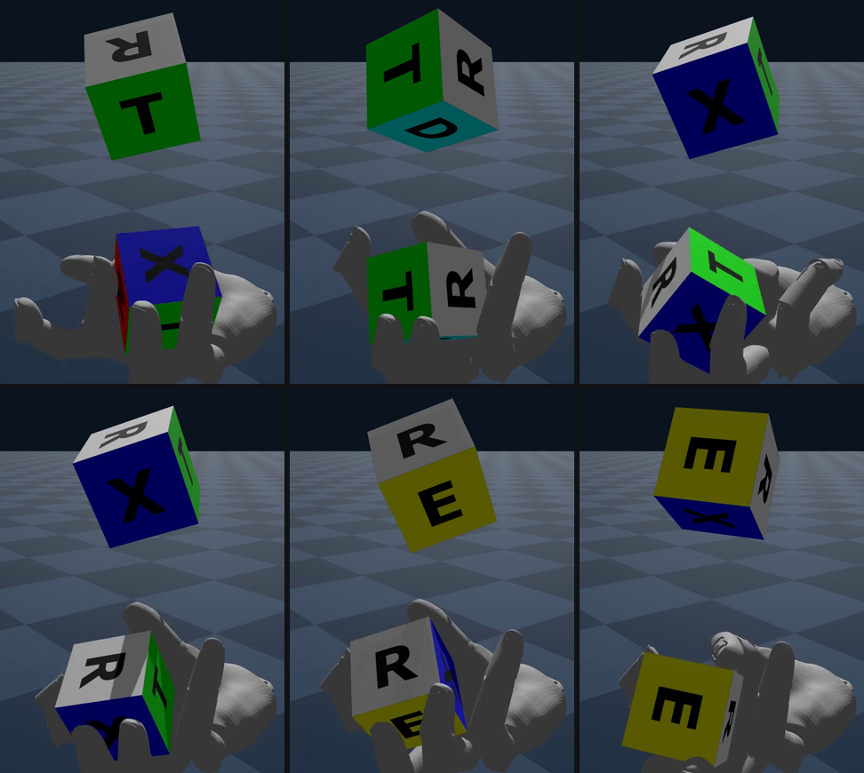
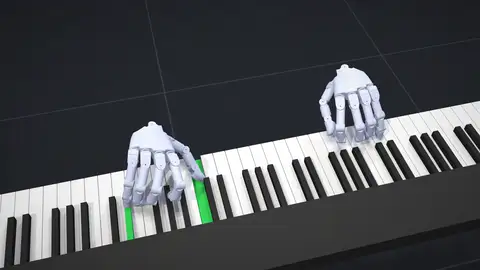

# Manipulation Tasks

Eden's own manipulation tasks: arm-and-gripper reaching and lifting, a dexterous-hand lift, in-hand cube
reorientation, piano playing, two-part assembly, and hand-object tracking with dexterous hands. This page gives, for
each task, the robot, what the policy learns, its flags, what it needs installed, and the commands to train and
replay it. The ported benchmark suites (robosuite, LIBERO, SIMPLER, PolaRiS, Mochi, ...) have their own pages, linked
from the [task index](index.md), which also has the commands every task shares.

| Task | Robot | Flags | Default `num_envs` |
|---|---|---|---|
| [`reacher`](#reacher) | I2RT YAM arm | `--difficulty` | 4096 |
| [`manipulation_reach_droid`](#reach-droid) | Franka Panda + Robotiq 2F-85 | — | 4096 |
| [`manipulation_lift_box`](#lift-box) | Franka Panda + Robotiq 2F-85, or UR5e / UR10e + 2F-85 | `--manipulator`, `--reset_buffer` | 4096 |
| [`manipulation_lift_box_rgb`](#lift-box-from-rgb) | Franka Panda + Robotiq 2F-85 | — | 1024 |
| [`manipulation_lift_ycb_rgb`](#lift-ycb-from-rgb) | Franka Panda + Robotiq 2F-85 | `--object_properties` | 1024 |
| [`manipulation_dex_lift`](#dexterous-lift) | Franka + XHand1 (left) | — | 4096 |
| [`reorient`](#in-hand-reorientation) | Wuji Hand 1 (simplified collision model) | `--hand` | 4096 |
| [`piano`](#piano) | Two Wuji Hand 2 (beta2) | `--song` | 1024 |
| [`omnireset`](#omnireset) | UR5e + Robotiq 2F-85 | `--robot` | 4096 |
| [`flashdexretarget`](#flashdexretarget) | XHand, or two Sharpa Wave hands | `--motion`, `--robot`, `--learner` | 4096 |

`num_envs` is per GPU rank. Override it with `--num_envs N`.

## Reacher

The canonical Eden task config (`eden/tasks/benchmark/reacher/config.py`) and the template every other task follows:
a YAM arm moves its end effector to a target sampled in a box, with an exponential reaching reward, action-rate,
joint-limit and joint-velocity penalties, and a curriculum that stages the weight of the joint-velocity penalty. The arm uses incremental joint
position control (`ReferenceSource.DELTA`, target = current position + 0.05 × action).

```bash
eden train --task reacher --difficulty hard
eden inference --task reacher --checkpoint logs/reacher/<run>/model_<iter>.pt --rec
```

`--difficulty` sets three things together, because shrinking the target without sharpening the reward or shortening
the episode just makes a longer, sparser task:

| `--difficulty` | Target half-extent, xy / z (m) | `reaching_std` | Episode (s) |
|---|---|---|---|
| `easy` | 0.15 / 0.075 | 0.30 | 12 |
| `medium` (default) | 0.10 / 0.05 | 0.20 | 9 |
| `hard` | 0.05 / 0.025 | 0.10 | 6 |

The target box is centred on (0.4, 0.0, 0.3) m. [Your first task](../getting-started/first-task.md) builds a task
like this one from scratch.

## Reach (Droid)

`manipulation_reach_droid` is the reacher on the Droid rig (Franka arm + Robotiq 2F-85): joint-position arm control,
a uniform 3D target, an exponential reaching reward and the same penalties and curriculum. The end effector is the
midpoint of the gripper's finger pads. It mirrors mjlab's `Reach-{Robot}`.

```bash
eden train --task manipulation_reach_droid
```

!!! note "The Droid rig's arm is a Panda"
    `Droid` is a hand-less Franka Emika Panda with a Robotiq 2F-85, not the FR3 that mjlab pairs the gripper with:
    the rig was tuned on that arm and kept on it so trained policies stay valid. `Droid(arm=FrankaResearch3())`
    gives the FR3 pairing. See [Robots](../guides/robots.md).

## Lift box

A port of mjlab's `Lift-{Robot}`, trained from scratch: every episode starts at the arm's ready-to-grasp home pose
with the cube spawned in a region on the table, so the policy learns reach → grasp → move to target with no warm
start. Arm control is 6-DOF differential IK (`DifferentialIKController`); the gripper is a binary open/close
controller on the Robotiq drivers, which are force-limited so closing on the cube makes a friction grip instead of
crushing through it. The rewards follow mjlab's `lift_env_cfg`: shaped reaching, lifting, and coarse (std 0.3) and
fine (std 0.05) goal tracking gated on the lift.

```bash
eden train --task manipulation_lift_box
eden train --task manipulation_lift_box --manipulator ur5e_2f85
eden inference --task manipulation_lift_box --checkpoint logs/manipulation_lift_box/<run>/model_<iter>.pt --rec
```

| Flag | Choices / default | Effect |
|---|---|---|
| `--manipulator` | `droid` (default), `ur5e_2f85`, `ur10e_2f85` | The arm. Every rig carries the same Robotiq 2F-85, so the grasp point, gripper action and gripper rewards are unchanged; only the arm entity, the IK frame and joint set, and the experiment name change. The observation width follows the arm's DOF count, so checkpoints do not transfer between arms. |
| `--reset_buffer` | none | A reset-state buffer file to restore every reset from, replacing the cube placement and the arm-joint jitter. Capture one with `capture_reset_states(env, ["robot", "gripper", "cube"])` (`eden.utils.buffers.reset_states`). Rows are drawn uniformly; the goal command still draws each episode's goal. |

## Lift box from RGB

`manipulation_lift_box_rgb` keeps the lift-box physics, actions, rewards, terminations, events and curricula, and
changes the perception. A 128 × 72 wrist RGB camera on the tool flange feeds a spatial-softmax CNN (one conv stack
per image group ending in a soft-argmax that emits each channel's expected image location). The actor loses the
privileged object pose and must find the cube in the image; the critic keeps the full privileged state. Both read the
shared `camera` group.

```bash
eden train --task manipulation_lift_box_rgb
```

It renders with the gs-madrona batch renderer, which is not an Eden extra: install `gs-madrona` (Linux x86-64 only)
first.

!!! warning "Two Madrona traps this config avoids"
    Either one leaves the actor effectively blind, with no error. Madrona renders **ambient light only until lights
    are added**, and it fixes the light count when the scene is built, so the lights are declared on
    `BatchRendererOptions` and applied before `scene.build()`. And `BoxOptions` defaults to a grey surface, which is
    invisible on a grey table, so the cube is coloured red and the table darkened. Reuse both in any vision task on
    the batch renderer.

## Lift YCB from RGB

`manipulation_lift_ycb_rgb` extends the RGB lift with a different rigid YCB object in each env: master chef can,
tomato soup can, tuna can, pudding box, gelatin box, potted meat can, apple and foam brick. The objects are one
`GroupedEntityOptions` entity still named `cube`, so every inherited term works unchanged; Genesis distributes the
variants in contiguous blocks across the envs (128 envs per object at 1024 envs), and the variant an env holds is
fixed at build. Because each object rests at a different height, an `ObjectRestHeight` metric latches each env's
actual resting height after the reset settles, and the four lift rewards use it instead of one scalar.

```bash
eden train --task manipulation_lift_ycb_rgb --object_properties ycb
```

| `--object_properties` | Effect |
|---|---|
| `uniform` (default) | Every object at the default density and friction 2.0. |
| `ycb` | Each object at its published YCB mass (scaled with the mesh) and a friction by surface material. |

## Dexterous lift

`manipulation_dex_lift` keeps the lift-box structure (shaped reach, dense lift, grasped-and-lifted gate, coarse and
fine goal tracking, a goal-range curriculum, staged smoothness curricula, contact stiffening) and swaps the gripper for
a 12-DOF XHand1 (left). The rig is `FrankaXHand`: the hand on a right-angle coupling, palm down at the ready pose.
The arm uses differential IK and the hand a joint-space PD over its 12 DOFs. The end effector is the centroid of the
five fingertips, and a per-fingertip approach reward replaces the gripper's grasp bonus.

```bash
eden train --task manipulation_dex_lift
```

The policy is trained to be deployed on the real rig:

- It observes only what the rig measures: joint encoders, its own last action, the goal, forward kinematics of
  those, and the cube pose a camera would estimate from AprilTags on the cube, with that estimate's noise and a
  3-frame history. The cube's orientation is a 6D rotation, so the sign a pose estimator picks does not matter.
  Simulator-only state (hand joint velocities, cube velocity, fingertip-to-cube offsets) is critic-only.
- The hand keeps the URDF effort limits (0.4 / 1.1 N·m), every hand link meets the cube with stiffened contact, hand
  friction is drawn per env from U(0.8, 2.0) against a 0.5 cube and table, lift goals are 10–30 cm above the cube's
  rest position in the arm's base frame, and the action-rate penalty is 5× the lift-box task's.

!!! note "Deployment is not complete yet"
    The cube pose reaches the policy through the `cube` entity, so a deployment writes the camera's estimate into it
    each control step. The Franka and XHand backends ship with Eden; the AprilTag observer that does that write is
    not in Eden yet, and MuJoCo sim-to-sim cannot load this rig yet (the module docstring of
    `eden/tasks/manipulation/dex_lift/config.py` explains why).

## In-hand reorientation

A port of wuji-mjlab's `reorient` task: a palm-up, fixed-base 20-DOF Wuji Hand 1 holds a 54 mm cube and rotates it to
a target orientation given in the wrist-tag frame, holds it there, then chases the next target, without dropping it.



```bash
eden train --task reorient --hand right --num_envs 4096 --logger wandb
eden inference --task reorient --checkpoint logs/reorient/<run>/model_<iter>.pt --rec
```

`--hand` (`right`, default, or `left`) swaps the chirality; the grasp keyframe is mirrored for the left hand.

What to know before changing it (the module docstring of `eden/tasks/reorient/config.py` has the full list):

- **The goal is a state machine, not a timer.** Reaching a goal opens a success window that pays an escalating hold
  reward before the next goal is drawn. The success state is measured in `InHandReorientCommand.post_physics_refresh`
  and only the goal switch is published in `_update_command`, following the hook rule in
  [Writing terms](../guides/terms.md).
- **Drop detection is one metric term** that the reward, the termination and the critic observation all read.
- **The goal is drawn**: a kinematic twin of the cube, invisible to the physics, floats over the palm at the target
  orientation in a recorded rollout.
- **The policy group is reproducible on hardware**: joint angles, joint tracking error and the cube pose relative to
  the wrist tag. Everything privileged is critic-only.
- **The hand is soft.** Its actuator table is the manufacturer's (kp about 0.2–0.7 N·m/rad), and blanket gains break
  it.

`docs/assets/reorient/reorient.mp4` is a recording of a trained policy. It was trained before the success-window fix
above, so reproducing its numbers needs a retrain.

## Piano

Eden's take on RoboPianist's `PianoWithShadowHands`, with two Wuji Hand 2 (beta2) hands on a simulated 88-key
keyboard. The policy sees the key states of the current control step and the next ten (half a second at 20 Hz
control over 200 Hz physics), and is paid for pressing the keys that are due, and nothing else, at the moment they are
due. Each hand is a free body whose 6-axis wrist pose is driven by `FreeBasePoseController` with its weight carried,
so each hand has 26 action axes (20 finger joints and 6 wrist axes).

{ width="60%" }

```bash
eden train --task piano --song twinkle_twinkle
eden train --task piano --song chpn-p7.mid          # a MIDI file, by name if it is in the scores directory
eden inference --task piano --checkpoint logs/piano/<run>/model_<iter>.pt --rec
```

`--song` takes a built-in song (`five_finger_scale`, `ode_to_joy`, `twinkle_twinkle`, the default) or a `.mid` file:
its path, or its file name alone if the file is in the scores directory `~/.cache/eden/scores` (under
`$XDG_CACHE_HOME` when that is set). The file-name form keeps the saved config portable. Where the MIDI file says
which hand plays what, each hand is placed over its own part. The episode is as long as the score.

The task itself is silent. To hear a policy, add a `PianoAudio` sensor and a microphone at evaluation time; the
example does that:

```bash
uv run python examples/projects/manipulation/piano/main.py play --song twinkle_twinkle --vis --play
uv run python examples/projects/manipulation/piano/main.py play --song twinkle_twinkle --record -o /tmp/twinkle.mp4
```

The module docstring of `eden/tasks/piano/config.py` lists every difference from RoboPianist (the free-flying hands,
actions as offsets from a rest pose, a softer key-press margin, a lighter energy penalty, the rewards dropped and
added, and annotation-free fingering).

## OmniReset

UWLab's OmniReset stage-1 task (`OmniReset-Ur5eRobotiq2f85-RelCartesianOSC-State-v0`): a UR5e with a Robotiq 2F-85
assembles an object pair, each episode starting from one of four recorded reset-state families drawn with equal
probability, with UWLab's scene, observations, relative Cartesian OSC controller, rewards, startup randomization and
PPO recipe. The recorded states are downloaded from UWLab's Hugging Face dataset on first use.

```bash
eden train --task omnireset
```

| `--robot` | Rig |
|---|---|
| `uwlab` (default) | UWLab's UR5e + 2F-85 (`OmniResetUR5e2f85`), the rig the released expert drives. |
| `ur5e_2f85` | Eden's own `ur5e_2f85` composite, for training a policy of your own. Run `python -m eden.tasks.omnireset.retarget --pair peg` once first, to retarget UWLab's states onto it. |

UWLab evaluates with every episode from the `ObjectAnywhereEEAnywhere` family. To evaluate a checkpoint that way,
override the reset weights:

```bash
eden inference --task omnireset --checkpoint logs/omnireset/<run>/model_<iter>.pt --num_envs 256 --episodes 256 \
    --override "event_options: {reset_states: {category_weights: {ObjectAnywhereEEAnywhere: 1.0,
    ObjectRestingEEGrasped: 0.0, ObjectAnywhereEEGrasped: 0.0, ObjectPartiallyAssembledEEGrasped: 0.0}}}"
```

The released expert runs with `uv run python examples/policies/omnireset/main.py`. Genesis combines contact friction
as `max` where PhysX averages, so only the insertive object's friction is randomized (0.9–1.6). The config's
docstring reports the released expert at 94 % success from `ObjectAnywhereEEAnywhere` over that range, and 87 %
over UWLab's 0.65–1.3 averaged span.

## FlashDexRetarget

The RL half of FlashDexRetarget on Genesis. One policy, trained across every clip of a retargeted dataset, drives one
or two robot hands (6 actuated forearm joints plus fingers each) so the objects follow their recorded trajectories
while the hands follow the human (MANO) wrists and fingertips. A PD wrench pulls each object toward its reference at
first and is withdrawn as the policy improves (`FDRAssistCurriculum`). The clips a policy completes are physically
valid robot hand-object trajectories — the retargeting's real output.

The task trains on a `motion.pt` that `eden retarget flashdex` builds from a released hand-object dataset:

```bash
# 1. Build the dataset (needs the flashdexretarget extra and the licence-gated MANO models).
eden retarget flashdex import --source taco --raw /data/taco --mano-dir /data/mano_v1_2/models --dataset /data/taco_fdr
eden retarget flashdex kinematic --dataset /data/taco_fdr --robot xhand

# 2. Train. The robot is the one motion.pt was retargeted to.
eden train --task flashdexretarget --motion /data/taco_fdr/xhand/motion.pt
eden train --task flashdexretarget --motion /data/taco_fdr/xhand/motion.pt --learner flashsac

# 3. Roll out with the assist off; prints per-episode completion and tracking errors.
eden inference --task flashdexretarget --checkpoint logs/flashdexretarget/<run>/model_<iter>.pt
```

| Flag | Default | Meaning |
|---|---|---|
| `--motion` | required | The `<dataset>/<robot>/motion.pt` that `eden retarget flashdex kinematic` wrote, next to its object URDFs. |
| `--robot` | the motion's own | `xhand` or `sharpa`. |
| `--learner` | `ppo` | `ppo` (rsl_rl PPO) or `flashsac` (FlashDexRetarget's off-policy learner). |

Install what each step needs:

=== "pip"

    ```bash
    pip install "eden-world[flashdexretarget]"   # the dataset pipeline (eden retarget flashdex)
    pip install "eden-world[flashsac]" "rsl-rl-flashsac @ git+https://github.com/Holiday-Robot/rsl_rl_flashsac@9822b1b7e0b5cce45e7f79d6b3e2c169fa042faa"
    ```

=== "uv (checkout)"

    ```bash
    uv sync --inexact --extra flashdexretarget
    uv sync --inexact --extra flashsac --group flashsac-git
    ```

!!! warning "A held-out evaluation cannot use `--motion` on the run's checkpoint"
    `eden inference` replays the run's saved `config.json`, and a task flag such as `--motion` cannot apply to a saved
    config. To roll a policy out on other clips, copy the checkpoint out of its run directory first, so no
    `config.json` sits beside it:

    ```bash
    cp logs/flashdexretarget/<run>/model_<iter>.pt /tmp/policy.pt
    eden inference --task flashdexretarget --motion /data/held_out/xhand/motion.pt --learner <learner> \
        --checkpoint /tmp/policy.pt --num_envs 512 --episodes 2048
    ```

With FlashSAC the replay buffer holds whole observations in float16: 50M rows with one XHand need about 154 GB of
GPU memory, so set `runner_options.algorithm.replay_buffer_size` for your GPU (the task README gives 10M rows,
31 GB, as fitting a 48 GB card). `eden/tasks/flashdexretarget/README.md` lists every piece of the port and every
difference from the original. Building its dataset (`eden retarget flashdex`) is covered on
[Retargeting](../guides/retargeting.md).

## See also

- [Task index](index.md) — every task, and the ported benchmark pages.
- [Robots](../guides/robots.md) — the arm-and-gripper composites (`Droid`, `ur5e_2f85`, `FrankaXHand`, ...).
- [Actions](../guides/actions.md) — differential IK, binary grippers, OSC and free-base pose control.
- [Sensors and rendering](../guides/sensors-and-rendering.md) — cameras, the batch renderer, `PianoAudio`.
- [Motion-tracking tasks](motion-tracking.md) — whole-body tracking, including the hand-object `contrack`.
