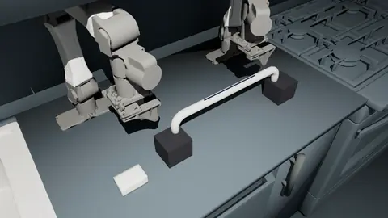
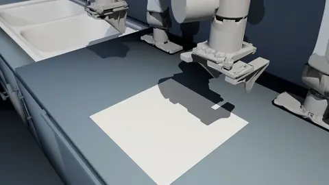
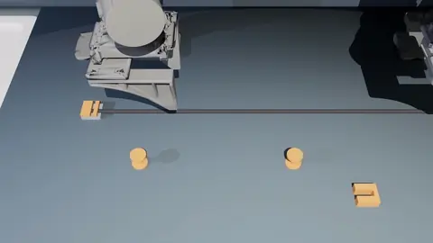

# Mochi deformable tasks

Three batched RL tasks in which two arms handle a soft body: a foam sponge, a terry towel and a cable. They run on
the Mochi solver, Eden's host of the Genesis port of Meta's SuperDex implicit solver. Read this page to train or
replay them, and for what Mochi changes about contact-rich deformable manipulation. The code is in
`eden/tasks/mochi/`.

Each task is Eden's version of one of RoboSimStudio's three demos (`examples/08_demos` in that project), built at
that demo's numbers on its bimanual i2RT YAM workcell and scored with the demo's own goal. Every env carries its own
soft body in one Mochi solve.

<div class="grid" markdown>







</div>

The README labels the wiping clip as a trained policy and the folding and routing clips as scripted runs.

## The tasks

| Task (`--task`) | Demo | Soft body | Goal (success) | Episode |
|-----------------|------|-----------|----------------|---------|
| `mochi_wipe_the_bar` | `wipe_the_bar` (`surface_prep`) | 50 × 75 × 30 mm `FIRM_FOAM` sponge (E 80 kPa) | 90 % of a 243-cell marker stripe on a grab bar's crown worn clean | 15 s |
| `mochi_fold_the_towel` | `fold_the_towel` (`cloth_fold` / `towel_half`) | 30 cm terry towel, 500 g/m², 30 × 30 cells | fold score ≥ 0.85, fold extent ≤ 0.6, the towel at rest, both hands clear | 12 s |
| `mochi_route_the_cable` | `route_the_cable` (VABAR `cable_route/port_easy`) | 600 mm, 7 mm cable of 50 segments, welded at one end | two segments in each spool's seat, three in the port with the free end, hands clear, at rest | 20 s |

```bash
eden smoke --task mochi_wipe_the_bar
eden train --task mochi_wipe_the_bar        # 256 envs, default fp32 precision
```

Each task trains 256 envs with PPO at 30 Hz control: one 1/30 s Mochi step (`decimation=1`) with 4 Newton
iterations (`MochiOptions(n_newton_iterations=4)`).

### `mochi_wipe_the_bar`

A 25 mm chrome tube with a 340 mm straight run on two 32 mm elbows, its legs 50 mm into 76 × 80 × 70 mm blocks on a
10 mm mat; the sponge lies on the mat 70 mm past the near block. The stripe is the middle 200 mm of the bar's crown,
9 degrees either side: 243 cells of 2.5 mm, each wearing by Preston's law with the demo's constants
(`custom_terms.wipe.BarStripeWipe`).

The right arm does the job: it takes the sponge off the mat with its jaws across the 50 mm side, carries it over the
near block and strokes the stripe. Its jaws squeeze at most 8 N a finger, the demo's cap. Once the grip has settled,
the demo's latch (`SettledGraspLatch`) pins the foam under the pads to the hand until the jaws open. The left arm
stands at its ready posture. The episode ends on success.

### `mochi_fold_the_towel`

The towel lies flat at `(-0.05, +0.06)` on the bench; the crease is its centreline across y, and the far half is
carried over onto the near half. The fold is scored with the cloth suite's measures (`custom_terms.fold`:
`ClothFoldScore`, SoftGym's ClothFold with a drag term and one layer's 7.5 mm forgiven, and `ClothFoldExtent`).
"At rest" means a 95th-percentile particle speed under 0.02 m/s; "hands clear" means no particle within 2 cm of a
tool centre.

The left arm takes the far edge and carries it over. The right arm, its jaws shut, presses the near half to the
bench so the flap does not drag it along.

### `mochi_route_the_cable`

The cable is welded under an anchor bracket and lies along +y. Two ManipulationNet F1 spools stand 240 mm apart
(a 4.75 mm shaft between 12.5 mm flanges); the cable must pass the first on the far side and the second on the
robot's side. A port 61 mm out from the second spool is a 10 mm channel between 12.5 mm walls, facing the run. The
goal is the board's `routed` (`custom_terms.route`), counted on the rod's segments; "at rest" means no node faster
than 50 mm/s and "hands clear" more than 50 mm from the cable.

Both arms act: the right makes the three placements and the left plugs the end. The jaws hold the cable by
friction at the demo's 6000 N/m servo.

### Rewards and terminations

The rewards stage the demo's job: reach the part, hold it (gated on the grip or the latch), bring it to the goal,
and the task's own measure. The wipe ends on success. The fold and the routing hold a state, so they do not
terminate on success: they pay a bonus every step the goal holds (`custom_terms.MetricsHold`) and run to the time-out.
Ending those episodes on success forfeited the dense terms' remaining pay, and the policy learned to keep hold of the
towel.

## The workcell

Positions are in RoboSimStudio's work-surface frame: the origin at the middle of the bench top, +x away from the
arms, +y toward the left arm, z up from the bench top, which is the ground plane. Two Eden `Yam` arms
(`eden.options.robots.i2rt_yam.Yam`) stand at the demo's mounts, 0.3475 m behind the middle and 0.62 m apart
(`eden.tasks.mochi.common.YAM_BASES`).

- **Gravity-free arms**, as the demo's gravity-compensated arms are (Mochi has no compensation term).
- **The demo's servo gains**, not the asset's sim-to-real defaults: kp 300 / kv 30 for the arm (1600 / 70 for the
  wiping arm, which the demo stiffens), and each demo's calibrated squeeze for the jaws.
- **A squeeze cap is a gain.** Mochi clamps no drive force, so the asset's effort limits are dropped and the cap is
  set through kp: closed on a part `w` wide, each finger squeezes with `finger_kp × w / 2`. 320 N/m puts the demo's
  8 N cap on the 50 mm sponge.
- **Actions.** Each acting arm moves its tool centre (between the fingertip pads) by differential IK with its tilt
  held pointing down, turns it about the vertical where the demo does (the cable), and opens and closes its jaws.
- **No fingertip micro-spheres.** The YAM's MJCF carries six 0.6 mm collision spheres per finger for MuJoCo's point
  contacts. Mochi samples every collision triangle, so they were 55 % of the arm's contact samples and slowed a
  step sevenfold when a policy pushed its hand into the sponge. The task loads a copy without them
  (`common.yam_mochi_file`); the pads' boxes carry the grip.

## Replaying the demo routines

`examples/recipes/mochi/rss_demo_routines.py` plays each demo's own routine (the same moves, speeds and marks)
through `env.step` and the task's own actions. A routine that meets the goal shows the goal is reachable from the
policy's action space.

```bash
uv run python examples/recipes/mochi/rss_demo_routines.py --task mochi_wipe_the_bar
uv run python examples/recipes/mochi/rss_demo_routines.py --task mochi_route_the_cable -b 4
```

<!-- TODO(material): current measured results (routine success per task, trained-policy success at the current
mounts, env-steps/s). The old page's numbers were measured before the arms collided and are not reproduced here. -->

## Recording the wipe

The stripe is the metric's ink, not geometry, so a plain camera shows a clean bar. `eden inference --rec` records the
task's `recording_camera()`, whose `PlanePaintOverlay` paints each cell as dark as the ink it holds, in
`STRIPE_COLOR`, shaded as the renderer shaded the bar. The training config declares no camera. See
[Sensors and rendering](../guides/sensors-and-rendering.md) for camera overlays.

## Where Mochi differs from the demos' physics

Mochi solves the arms, the parts and the fixtures in one implicit Newton system. RoboSimStudio runs MuJoCo for the
arms and couples SuperDex (the sponge) or VBD (the towel, the cable's capsules) to it. Where that mattered:

- **The sponge needs the latch, for the demo's reason.** Friction alone picks and carries the sponge, but a stroke
  drags it out of the jaws, as it did in the demo.
- **The towel is taken by the benchmark's latch, not the demo's pinch.** The demo's jaws gather the two faces of a
  5 mm VBD slab. A Mochi shell is one surface (here with a 2.5 mm collider either side), and the fingertips press it
  into the bench instead of gathering it. So closing the jaws seizes the edge strip within 3 cm of the tool centre
  (`FeatureGraspLatch`, RoboSimStudio's `attach`); a close with nothing in reach seizes nothing.
- **The cable lies on its own bed.** A rod touches through its centreline, so the bench must push back at the
  cable's radius; the same plane would also stop the fingertips at the centreline, and the jaws would ride over the
  cable. So the cable lies on an invisible bed in the bench's plane, the arms stop on the bench, and each plane's
  pairs with the other's bodies are off.
- **The cable bed is grippier than the demo's bench** (0.3 combined friction against the demo's 0.02): the demo's
  contacts are sticky, which is static friction, and Mochi's friction grows with slip below its falloff.
- **The arms collide**, where the demo's pass through each other. So the right hand presses the towel at
  `(0.08, -0.04)`, 80 mm farther out than the demo's mark: at the demo's mark the folding arm stopped against the
  pressing one 45 mm short of its place.
- **The sponge is meshed 6 × 9 × 4** (350 nodes, about 8 mm apart) rather than the demo's 9 × 13 × 6 (980): twice
  as fast.
- **The cable** is a Mochi discrete elastic rod with the demo cable's bending rigidity (its per-joint stiffness
  times the segment length) and an axial stiffness that keeps it all but inextensible, as rigid capsules are.

## Physics notes

- **Contact stiffness is 1e7 Pa/m** (`common.CONTACT_STIFFNESS`), which Mochi conditions well in single precision,
  so the tasks train under the default fp32. Mochi's 1e9 default needs `eden.init(precision="64")`.
- **A Mochi scene is all-Mochi.** Every entity, the bench plane included, takes a `Mochi*MaterialOptions`. See
  [Physics](../guides/physics.md).
- **Pins survive resets.** Mochi keeps a pin, and where it holds the vertex, outside the state a reset restores. So
  the cable's weld is re-pinned at every reset (`PinSoftBodyVertices`), and the latches release their pins.
- **A diverged env is reset alone.** An env whose implicit solve fails is truncated and reset
  (`Episode_Termination/solver_error`) while the others go on (`EnvBase.get_solver_error_envs_mask`); its reward is
  zeroed for that step.

## See also

- [Physics](../guides/physics.md) for the Mochi solver and its options
- `examples/recipes/mochi/` for standalone Mochi scenes (cloth, rods, soft bodies, grippers)
- [Task suites overview](index.md)
