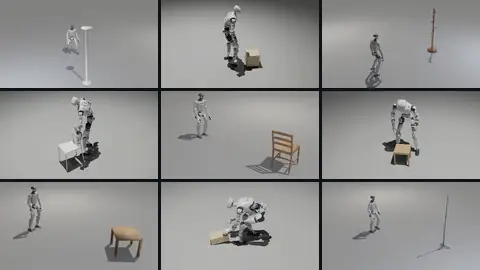
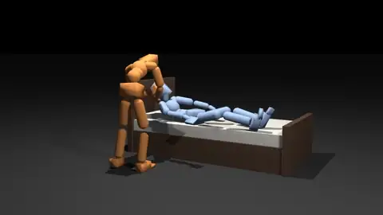

# Motion-Tracking Tasks

Eden's motion-tracking tasks train a policy to reproduce reference motion clips in physics: a humanoid dancing, a
humanoid carrying an object, a hand manipulating an object, two humanoids interacting. This page gives, for each
task, the robot, the data it tracks and where that data comes from, its flags, and the commands to train and replay
it. How a dataset becomes the motion reference a task reads is on [Motion tracking](../guides/motion-tracking.md);
the commands every task shares are on the [task index](index.md).

<figure markdown>
  { width="32%" }
  { width="32%" }
  { width="32%" }
  <figcaption>Whole-body tracking, human-object interaction, and two-agent assistance.</figcaption>
</figure>

| Task | Robot | Tracks | Flags | Default `num_envs` |
|---|---|---|---|---|
| [`beyondmimic`](#beyondmimic) | Unitree G1 29-DOF | One BVH-retargeted CSV clip | `--raw_data_path`, `--processed_data_path`, `--target_framerate` | 4096 |
| [`general_mimic`](#general-mimic) | Unitree G1 29-DOF | A library of G1-retargeted clips (LAFAN1 or AMASS) | `--dataset_name` and 24 more | 4096 |
| [`weave_hoi`](#weave-g1-inspire-hoi) | G1 + two Inspire RH56DFQ hands | OMOMO human-object clips, object simulated | `--objects`, `--split`, `--raw_data_path`, `--processed_data_path` | 4096 |
| [`contrack`](#contrack) | xArm7 + XHand | One hand-object clip with contact annotations | `--data`, `--target_framerate` | 4096 |
| [`assistmimic`](#assistmimic) | Two SMPL humanoids | Paired Inter-X help-up clips | — (trained by an example script) | 1024 |
| [`assistmimic_bed`](#assistmimic) | Two SMPL humanoids | Paired HHI-Assist get-out-of-bed clips | — (trained by an example script) | 1024 |

All but the AssistMimic tasks are `EdenMimicConfig` tasks: they declare a `motion_options` block that loads a dataset
into the motion manager, and the task's data mod (`BeyondMimicDataMod`, `GeneralMimicDataMod`, `WeaveHOIDataMod`,
`ContrackDataMod`) is what fills it from the flags. Build them with `TASK_REGISTRY.build(...)` or `eden train`; a bare
config class has no motion reference.

## BeyondMimic

The BeyondMimic single-clip tracking recipe on the G1: the policy sees the reference joint state and the reference
torso pose relative to its own, and is rewarded for matching the reference's 14 tracked links. Explicit PD control
at 50 Hz, 10 s episodes, and at the end of a clip the episode resynchronizes onto the reference instead of freezing.

```bash
eden train --task beyondmimic                                   # the bundled sample clip
eden train --task beyondmimic --raw_data_path /data/my_g1_csvs  # a directory of clips, or one .csv
eden inference --task beyondmimic --checkpoint logs/beyondmimic/<run>/model_<iter>.pt --rec
```

| Flag | Default | Meaning |
|---|---|---|
| `--raw_data_path` | the sample clip | A directory of BVH-retargeted G1 CSV files, or one file. Each CSV row is `base_pos(3), base_quat_xyzw(4), dofs_pos(29)`. Omitted, the sample clip `G1_gangnam_style_V01_bvh_60hz.csv` is fetched from Eden's example-data repo on the Hugging Face Hub on first use. |
| `--processed_data_path` | a keyed file in `~/.cache/eden` | The processed-motion cache. The default is keyed by every setting that shapes the prepared motion, so a cache built for one clip set, rate or frame range is never loaded for another. |
| `--target_framerate` | `50.0` | Rate (Hz) the clip is retimed to. |

An empty path (`--raw_data_path "$UNSET_VAR"`) is an error rather than a silent fall-back to the sample clip.

!!! warning "Trim the first row of the sample clip"
    Row 1 of the sample CSV is a retargeting artifact: the root jumps 11.6 cm between rows 1 and 2. Velocities are
    differences of positions, so it gives a 5.8 m/s root velocity at frame 0, and reference-state initialization then
    launches the robot at reset with no error raised. The dataset's `frame_range` field slices the CSV rows before
    anything else (a Python slice, `[start, end)`), and the task leaves it unset. Trim the artifact with an override:

    ```bash
    eden train --task beyondmimic \
        --override 'motion_options: {default: {dataset_options: {frame_range: [1, 1942]}}}'
    ```

    `examples/projects/mimic/beyondmimic/README.md` describes the same issue for its CSV-to-npz conversion script.

The frozen published BeyondMimic controllers run without training through the
[policy zoo](../guides/policy-zoo.md) (`eden inference --policy beyondmimic_moves`).

## General mimic

Multi-clip G1 tracking at the scale of tens to hundreds of clips — what ProtoMotions calls a motion tracker, as
opposed to the single-clip BeyondMimic policy. Same action, rewards and tracked links as BeyondMimic (taken from
ProtoMotions' `g1-bones-deploy` numbers), plus a lookahead of the reference 1, 2, 4 and 8 motion frames ahead
(+20, 40, 80 and 160 ms), 5 s episodes so the curriculum sees more episode ends, and an adaptive per-clip sampling
curriculum that spends more episodes on the clips the policy fails.

```bash
eden train --task general_mimic                                       # LAFAN1 retargeted to G1
eden train --task general_mimic --dataset_name amass --raw_data_path /data/amass_g1
eden train --task general_mimic --include_pattern '^walk'             # only the LAFAN1 walks
eden train --task general_mimic --arch_preset sonic_flat              # SONIC's 6-layer MLP, for AMASS scale
```

The most used flags (run `eden train --task general_mimic --help` for all of them):

| Flag | Default | Meaning |
|---|---|---|
| `--dataset_name` | `lafan1` | `lafan1`: LAFAN1 retargeted to the G1 (CSV). `amass`: AMASS retargeted to the G1, in IsaacLab-AMP NPZ format. Both are downloaded from the Hugging Face Hub when `--raw_data_path` is omitted. |
| `--raw_data_path`, `--processed_data_path`, `--target_framerate` | auto-download, auto, `50.0` | As for BeyondMimic. |
| `--include_pattern`, `--exclude_pattern` | none | A regular expression (`re.search`) on each clip's file name; keep or drop the matches. |
| `--include_list_file`, `--exclude_list_file` | none | A YAML or JSON list of clips to keep or drop, matched on file name without extension (ProtoMotions `amass_*_train.yaml` files work). |
| `--adaptive_motion_weights` / `--no-adaptive_motion_weights` | on | The per-clip curriculum. `--motion_weight_*` flags tune it; `--motion_weight_update_mode snapshot` (default) is SONIC's stateless formulation. |
| `--smooth_start_transition` | off | Prepend each clip with a stand-up → IK → SLERP segment so the reset from the default pose to frame 0 is not a teleport. A modifier, so it runs on every load and leaves the cache alone; do not combine it with `eden preprocess` (see [the warning](../guides/motion-tracking.md#the-dataset-cache-and-eden-preprocess)). |
| `--ground_first_frame` | on | Shift each clip up so frame 0 sits on the floor. Runs a transient Genesis env per cache load; set `--ground_first_frame_chunk_size` for libraries of 100k+ clips. |
| `--arch_preset` | `default` | `default` (3-layer MLP) or `sonic_flat` (SONIC's 6-layer MLP, for AMASS-scale libraries). |
| `--compute_per_motion_metrics`, `--log_per_motion_metrics` | on, on | Per-clip tracking errors and per-clip W&B scalars. Turn the per-clip scalars off for very large libraries. |

For a large library, build the processed cache ahead of training, sharded across GPUs, with
`eden preprocess --task general_mimic ... --num_batches N --batch_idx K`. To replay every clip of the library once
with a translucent reference ghost, use `examples/projects/mimic/general_mimic/main.py inference --model <checkpoint>`.

## Weave G1-Inspire-HOI

A port of Weave's `G1-Inspire-HOI-v0`: a G1 with two Inspire RH56DFQ hands tracks OMOMO human-object clips, and the
object is simulated and tracked too. The object is reset from the reference with the robot, rewarded and terminated
on its world pose, and observed in the pelvis frame; per-link contact labels from the reference are observed five
frames ahead and rewarded, and losing a grasp the reference expects ends the episode. Each hand's six follower
finger joints are driven in software from its six drivers, so the action is 41-D (29 body joints + 2 × 6 finger
drivers). Training uses a SimBaV2 actor-critic with PPO and the Muon optimizer, at Weave's hyperparameters.

```bash
eden train --task weave_hoi                                    # all 9 objects, test split
eden train --task weave_hoi --objects smallbox                 # a single-object specialist
eden train --task weave_hoi --objects smallbox,largebox --split train
eden smoke --task weave_hoi --objects smallbox --num_envs 4
```

| Flag | Default | Meaning |
|---|---|---|
| `--objects` | `all` | Comma-separated objects: `clothesstand`, `floorlamp`, `largebox`, `largetable`, `smallbox`, `smalltable`, `tripod`, `whitechair`, `woodchair`. Several objects share one policy, each env holding one object. |
| `--split` | `test` | `test` (1,605 clips, Weave's `train.yaml`) or `train` (7,869). |
| `--raw_data_path` | download | Root of an `appolyn/Weave` snapshot (holding `reference/` and `objects/`). Omitted, the selected split and objects are downloaded into the Hugging Face cache. |
| `--processed_data_path` | none | A processed-motion cache `.pt`. Omitted, the npz files are read on every build. |

A run on all nine objects uses the experiment name `weave_hoi`; any other object set gets its own,
`weave_hoi_<obj>-<obj>...`, so runs on different object sets are kept apart. The Weave paper reports 95.3 % success for the joint nine-object policy
on the test split at 27k iterations, and about 91 % for single-object specialists at 3k (from
`eden/tasks/weave_hoi/README.md`, which also lists every deviation from Weave: friction combination, per-object
density, finger gain randomization, contact force, observation width 1011 instead of 999, and a depenetration cap).

## ConTrack

A port of ConTrack: a fixed-base xArm7 + XHand tracks one reference clip of robot joints, object pose and per-finger
contact annotations. The rig is the `XArm7XHand1_R` / `_L` composite, which expands into a `robot` (7-DOF arm) and a
`hand` (12-DOF) entity. The policy outputs residual joint targets around the reference, and rewards come in three
named reward groups (task `rg`, style `rs`, penalty `rp`) that a constrained-MDP PPO balances with a dual controller.
One clip per run, as in the source.

```bash
eden train --task contrack --data /data/clip.h5 --num_envs 8000
eden train --task contrack                     # the sample clip, fetched on first use
```

| Flag | Default | Meaning |
|---|---|---|
| `--data` | the sample clip | One ConTrack reference clip (`.h5`). Omitted, the sample clip is fetched from Eden's example-data repo on the Hugging Face Hub. The mod reads the clip while building the config (handedness picks the left or right rig), so on an air-gapped host pass `--data` explicitly. |
| `--target_framerate` | `50.0` | Reference retiming rate (Hz). It must match the control rate; ConTrack's source runs at 60 Hz. |

!!! note "The training backend is installed separately"
    The CMDP-PPO algorithm lives in `rsl_rl_contrack`, a standalone fork of rsl_rl that is not an Eden extra.
    `eden train --task contrack` raises with the exact install command when it is missing. Building the env,
    `eden smoke` and clip playback work without it. See `examples/projects/mimic/contrack/README.md`.

## AssistMimic

A simplified port of AssistMimic on PHC's SMPL humanoid (69 DOFs, no fingers): a PHC-initialized caregiver helps a
weakened recipient while both track a paired interaction clip. Both humanoids live in one env, each with its own
observation group, reward group and action term.

| Task | Dataset | Scene | Recipient |
|---|---|---|---|
| `assistmimic` | Inter-X | floor | lower body at half gain, 80 N·m |
| `assistmimic_bed` | HHI-Assist | floor and bed | also hips (20 N·m) and trunk (40 N·m); the caregiver is paid for unloading them |

Two agents per env is something no single-agent runner trains, so the configs declare no `runner_options` and
**`eden train` refuses them**. The trainer (rl_games PPO through Eden's rl_games wrapper, one PHC-initialized actor
per role and a shared critic) is the example `examples/projects/mimic/assistmimic/main.py`, run in stages:

```bash
cd examples/projects/mimic/assistmimic
uv run python main.py adapt --dataset inter-x -b 1024 -s 700       # 1. adapt PHC's phc_3 to Genesis
uv run python main.py train --dataset inter-x \
    --phc-caregiver <adapt run>/phc_genesis_caregiver.pth \
    --phc-recipient <adapt run>/phc_genesis_recipient.pth           # 2. train both roles together
uv run python main.py play --dataset inter-x --checkpoint <checkpoint>.pth --clip 0 -r
```

`--dataset hhi-assist` selects `assistmimic_bed`. The example needs the `rl-games` extra
(`pip install "eden-world[rl-games]"`, or `uv sync --inexact --extra rl-games` in a checkout). The PHC checkpoint
(about 439 MB) and the sample clips download on first use. The example's README covers the stages, checkpoints,
evaluation, data conversion and the port notes.

## See also

- [Motion tracking](../guides/motion-tracking.md) — `EdenMimicConfig`, the motion manager and the motion format.
- [Motion datasets](../guides/motion-datasets.md) — the dataset loaders and dataset modifiers.
- [Retargeting](../guides/retargeting.md) — produce clips for your own robot with `eden retarget`.
- [Terrain adaptation (TCRS)](../guides/tcrs-terrain-adaptation.md) — adapt flat-ground clips to a terrain.
- [Manipulation tasks](manipulation.md#flashdexretarget) — `flashdexretarget`, hand-object tracking for dexterous hands.
