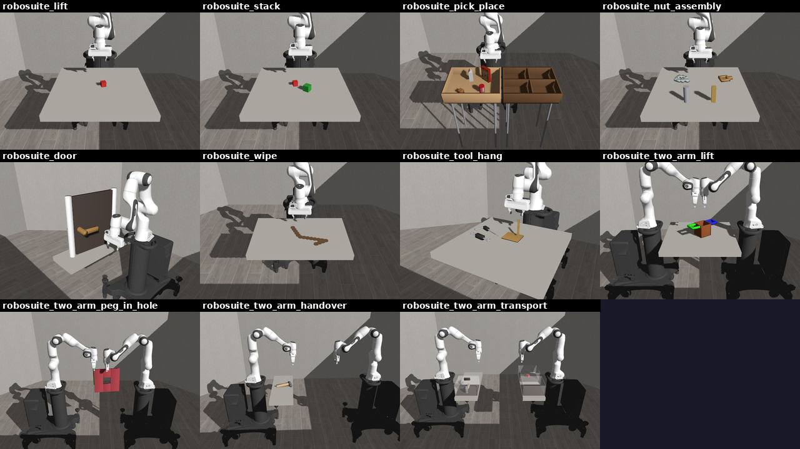

# robosuite

Eden ports the eleven manipulation tasks of [robosuite](https://github.com/ARISE-Initiative/robosuite) (MIT) as
registered RL tasks. Read this page to train or evaluate on them, to swap the robot, or to know exactly where a
port differs from the original. The code is in `eden/tasks/robosuite/`.



## The tasks

Each task is one `robosuite_<task>` config in `eden/tasks/robosuite/<task>/config.py`. The arena, the robot
placement, the object placement ranges, the dense-reward multipliers and the success predicates follow robosuite's
numbers. The module docstring of each config lists those numbers and every deviation for that task.

| Task (`--task`) | robosuite source | Extra flags | Dense reward |
|-----------------|------------------|-------------|--------------|
| `robosuite_lift` | `Lift` | | robosuite's |
| `robosuite_stack` | `Stack` | | robosuite's |
| `robosuite_pick_place` | `PickPlace`, `PickPlaceMilk` / `Bread` / `Cereal` / `Can` | `--object {all,milk,bread,cereal,can}` | robosuite's |
| `robosuite_nut_assembly` | `NutAssembly`, `NutAssemblySquare` / `Round` | `--nut {both,square,round}` | robosuite's |
| `robosuite_door` | `Door` (`use_latch`) | `--latch {latch,no_latch}` | robosuite's |
| `robosuite_wipe` | `Wipe` | | robosuite's |
| `robosuite_tool_hang` | `ToolHang` | | **Eden's** (robosuite's is sparse) |
| `robosuite_two_arm_lift` | `TwoArmLift` | `--arrangement {opposed,parallel}` | robosuite's |
| `robosuite_two_arm_peg_in_hole` | `TwoArmPegInHole` | `--arrangement {opposed,parallel}` | robosuite's |
| `robosuite_two_arm_handover` | `TwoArmHandover` | `--arrangement {opposed,parallel}` | robosuite's |
| `robosuite_two_arm_transport` | `TwoArmTransport` | `--arrangement {opposed,parallel}` | **Eden's** (robosuite has none) |

Every task also takes `--robot` (see [Swapping the robot](#swapping-the-robot)). The flags are TaskMods, so
`eden train --task <task> --help` lists them with their choices; see [Task mods](../guides/task-mods.md).

- `--object` and `--nut` are robosuite's `single_object_mode=2` variants: the other objects and every term that
  names them are removed (`eden.tasks.robosuite.variants.drop_object`), and success narrows to the kept object.
- `--latch latch` is robosuite's `use_latch=True`: a sprung handle whose bolt holds the door shut until the handle
  turns past about 1.25 rad, so it is the harder variant. `no_latch` loads the bare-handle `door.xml`.
- `--arrangement` is robosuite's two-arm `env_configuration`: `opposed` faces the arms across the workspace,
  `parallel` stands them side by side facing +x. A non-default arrangement suffixes the experiment name.
- robosuite's `PickPlaceSingle` and `NutAssemblySingle` pick a random object at every reset. They have no
  counterpart: a config fixes its entities, and swapping an entity per reset is not expressible in one.

`ToolHang` and `TwoArmTransport` have no dense reward in robosuite (robosuite ignores `reward_shaping=True` for
`TwoArmTransport`), so every shaping term in those two configs is Eden's. Their success terms (`success` and
`transported`) are robosuite's predicates, check for check, so success rates are comparable; returns are not.

## Train, evaluate and build

```bash
eden train --task robosuite_lift
eden train --task robosuite_lift --robot droid          # another arm + gripper
eden train --task robosuite_door --latch no_latch
eden inference --task robosuite_lift --checkpoint <path/to/checkpoint.pt>
```

Every task trains 4096 envs by default (`common.robosuite_env_options`) with one shared PPO recipe
(`common.ppo_runner_options`, 3000 iterations). See [Training runs](../guides/training-runs.md) for where logs and
checkpoints land and how to resume.

To build an env in Python, pass the TaskMod flags as keyword arguments to `TASK_REGISTRY.build`:

```python
import eden
from eden.envs.base import RLEnvBase
from eden.tasks import TASK_REGISTRY

eden.init()
config = TASK_REGISTRY.build("robosuite_stack", robot="droid")
env = RLEnvBase.from_config(config)
env.build()
observations, _ = env.reset()
```

## The MDP

**Timing.** robosuite steps MuJoCo at 500 Hz and its policy at 20 Hz. Eden keeps the 20 Hz control rate over a
5 ms Genesis step with 2 substeps (`decimation=10`, from `eden.tasks.robosuite.common.robosuite_env_options`).

**Actions.** Per arm, 7-D: a 6-D delta end-effector pose and a binary gripper, as robosuite's `OSC_POSE` + `GRIP`.
The pose delta is a `DifferentialIKController` with robosuite's per-step limits (5 cm and 0.5 rad); the gripper is a
`BinaryJointController`. The terms are keyed `<slot>_arm` and `<slot>_gripper` (`robot_arm` / `robot_gripper` on
the single-arm tasks). `TwoArmPegInHole` has no gripper action, as in robosuite.

**Observations.** robosuite's proprioceptive set per arm (joint sin/cos and velocities, `eef_pos`, `eef_quat`,
gripper positions and velocities) plus, per object, `<obj>_pos`, `<obj>_quat` and `gripper_to_<obj>`. A `policy`
group carries 0.5 cm uniform noise on the object poses; a `critic` group has the same terms uncorrupted
(`common.policy_and_critic`).

**Resets.** Each arm's joints get robosuite's initialization noise (robosuite samples `N(0, 0.02)` per joint; Eden
uses the uniform half-width `±0.02`), and objects are placed in robosuite's ranges.

## Where the ports differ from robosuite

All of these are deliberate. Each config's module docstring lists the task-specific ones.

- **Episode length.** robosuite runs 1000 steps (50 s). Eden defaults to 10 s
  (`eden.tasks.robosuite.common.EPISODE_LENGTH_S`). For parity, pass
  `--override 'env_options: {episode_length_s: 50}'`.
- **Reward composition.** robosuite returns the success reward *instead of* the shaping terms (or the `max` of its
  staged rewards). Eden sums separate terms, weighted by robosuite's multipliers. The ordering of states is the same
  (a solved state always beats an unsolved one); the absolute scale is not robosuite's.
- **Fixed object sizes.** robosuite resamples cube, peg and hammer dimensions on every hard reset. Genesis builds
  geometry once, so each task fixes them at the midpoint of robosuite's range.
- **Placement without rejection sampling.** Where robosuite draws several objects from one region and rejects
  overlaps, each object gets its own sub-region (for example, each `PickPlace` object spawns in its own quadrant of
  `bin1`).
- **Early termination.** An object that falls below the table ends the episode (`common.fallen_termination`).
  robosuite only terminates on the horizon, except in `Wipe`.
- **Stiffer contacts on what a hand carries.** In `ToolHang` and `TwoArmTransport` the objects a hand picks up carry
  a 0.005 s contact time constant (`common.GRASPED_SOL_PARAMS`) instead of Genesis' 0.02 s default. At the default,
  the 20 N pinch sinks the pads millimetres into a 3 cm handle and the object turns or creeps out of the fingers.
  The objects are stiffened, not the pads, so every other task's contacts are unchanged.
- **robosuite's Panda gripper.** The default rig's Franka Hand gets robosuite's `PandaGripper` actuation: kp 1000
  clipped to ±20 N, no velocity gain, joint damping 100, armature 1, friction loss 1, pad friction 2
  (`eden.tasks.robosuite.rigs`). Eden's stock `FrankaHand` closes with at most 4 N per finger, which cannot lift
  robosuite's 0.25 kg lid.
- **The delta-pose action acts at the flange, not between the fingers.** robosuite's `OSC_POSE` controls the
  end-effector site between the fingers. The ports run differential IK on the rig's `ee_link`, the arm's mounting
  flange, which is the gripper's `tcp_offset` behind it (10.3 cm on the Franka Hand, 14.1 cm on a Robotiq 2F-85).
  Translations match; a pure-rotation action sweeps the fingertips through an arc of up to `0.5 rad × tcp_offset`
  (about 5 cm) where robosuite turns them in place. The `eef_pos` observation is the pad midpoint, as robosuite's
  is. Moving the control point would change the action space of every task and checkpoint, so it is kept as a
  documented deviation.
- **One frame for every object reading.** Genesis re-origins a free rigid body onto its centre of mass, and the
  root-pose getters default to that frame. Every object quantity in these ports (the `<obj>_pos` / `<obj>_quat`
  observations, `gripper_to_<obj>`, the reaching rewards, the lift and containment metrics, the fallen-object
  terminations and the placement events) reads the frame the asset was authored in (`relative=True`), which is the
  frame robosuite's `object-state` reports. The two differ by 6.8 cm on the hammer and 5.8 cm on the ToolHang frame,
  and the offset rotates with the object. Object pose observations go through
  `common.object_pose_observations()` so the choice is made in one place.
- **TwoArmPegInHole's objects are held, not flange-mounted.** robosuite builds those robots without grippers and
  mounts the peg and the plate on the bare flange. Eden's rigs keep their grippers, so the mounting poses are
  re-based on each rig's tool point (`ManipulatorOptions.tcp_offset`) and the fingers start closed on the object
  (`ManipulatorOptions.preset_hold`). The peg and hole geometry the reward reads is unchanged.
- **Wipe.** robosuite's rigid wiping pad is replaced by the rig's two-finger gripper (its action slot stays);
  robosuite's 100 markers 5 mm apart become 16 markers 3 cm apart, each a scene entity; a marker counts as wiped
  when the grasp point passes within 2 cm horizontally and 3 cm vertically. The contact-count bonus and the summed
  reward's normalisation are dropped.

## Swapping the robot

Every robot slot holds a [`ManipulatorOptions`](../guides/robots.md) composite: an arm and a welded two-finger
gripper, expanding into `<slot>` and `<slot>_gripper` entities at build. The default is `panda_franka_hand`
(`PandaFrankaHand`: the hand-less Panda plus the `FrankaHand`), robosuite's own robot at robosuite's home pose.
`--robot` takes any arm + two-finger-gripper composite in `COMPOSITE_ROBOT_REGISTRY`; today that is
`panda_franka_hand`, `droid`, `ur5e_2f85` and `ur10e_2f85`.

```bash
eden train --task robosuite_two_arm_lift --robot ur5e_2f85 --arrangement parallel
```

Swapping is a scene edit. Every robot-shaped term names only its *slot* and reads the arm, the gripper, the mount
link, the pad links and both DOF lists off the composite in `build()`. `RobosuiteRobotMod` replaces the composite
in each slot, retargets the `<slot>_arm` and `<slot>_gripper` action terms, refits the substep and suffixes the
experiment name. The new arm stands where the Panda stood.

!!! warning "A Robotiq rig raises `sim_substeps`"
    A gripper whose MJCF encodes a closed loop declares the coarsest substep it stays stiff at
    (`RobotOptions.max_substep_dt`; the Robotiq 2F-85's is 1 ms, because Genesis clamps a `solref` time constant
    to `2 × substep_dt`). Swapping in such a rig raises `sim_substeps` from 2 to 5
    (`common.fit_substeps_to_rigs`, logged at info level). That costs 2.5× the physics per step; the alternative
    is a gripper that silently cannot hold anything.

!!! note "Checkpoints do not transfer across robots"
    The observation width follows the arm's DOF count, so a policy trained on one rig does not load on another.

A new rig needs only a `ManipulatorOptions` registration in `COMPOSITE_ROBOT_REGISTRY` whose gripper declares a
tool point and a stroke (`RobotOptions.tcp_offset` / `stroke`); it then appears in `--robot` automatically.

## Scripted demonstrations

`eden datagen` has a demonstrator for seven of the tasks: `robosuite_lift`, `robosuite_stack`,
`robosuite_pick_place`, `robosuite_door`, `robosuite_wipe`, `robosuite_tool_hang` and
`robosuite_two_arm_transport` (`eden/tasks/robosuite/scripted_demos.py`). `robosuite_pick_place` can also run
camera-only, locating the objects through the `agentview` camera:

```bash
eden datagen --task robosuite_tool_hang --num_envs 16 --num_episodes 32 --output_dir data/demos
eden datagen --task robosuite_pick_place --camera_only
```

What each demonstrator does and its measured success rates are in
[Scripted demonstrations](../guides/scripted-demos.md).

## Assets

The objects are the option classes of `eden.options.objects.robosuite` (`RobosuiteCan`, `RobosuiteSquareNut`,
`RobosuiteDoor`, `RobosuitePotWithHandles`, ...), registered in `ROBOSUITE_OBJECT_REGISTRY` under robosuite's names,
plus the `RethinkMount` pedestal every arm stands on. Their files are robosuite's own object MJCFs, meshes and
textures, and MJCFs re-authored from robosuite's procedural composites. They download on first use from the
[`Kashu7100/eden_robosuite`](https://huggingface.co/datasets/Kashu7100/eden_robosuite) dataset into `robosuite/`
under the asset directory; a local copy there wins. See [Assets](../getting-started/assets.md).

The arena looks like robosuite's: every scene carries LIBERO's floor workspace (robosuite's arena MJCF, the
6 × 6 m tiled floor and six visual walls, from the `eden_libero` dataset) as a *kinematic* entity, over an invisible
plane that provides the ground collision (`common.arena_entities`).

Genesis' MJCF loader differs from MuJoCo in ways that would leave every object grey or broken, so each option
derives a Genesis-ready copy at load time (`resolve_runtime_file`; the transforms are in
`eden.options.objects.mjcf_transforms`). The serialized `file` keeps naming the source, so saved configs stay
portable. The transforms:

- unwrap robosuite's wrapper body, and add or strip the root free joint to follow `is_fixed_base`;
- give every collision geom a visual-only twin carrying its material (Genesis draws collision geoms with a grey
  proxy surface);
- replace `cube` textures, which Genesis cannot map onto geoms without texture coordinates, with the material's
  mean colour;
- declare radians: robosuite's object files have no `<compiler>` element, so loaded on their own their angles
  compile as degrees (the door's hinge range `0 0.4` became 0.4 degrees and the door could not open).

## See also

- [Task suites overview](index.md)
- [LIBERO](libero.md), which shares robosuite's arena and controller conventions
- [Scripted demonstrations](../guides/scripted-demos.md)
- [Robots](../guides/robots.md) for `ManipulatorOptions` and the composite registry
