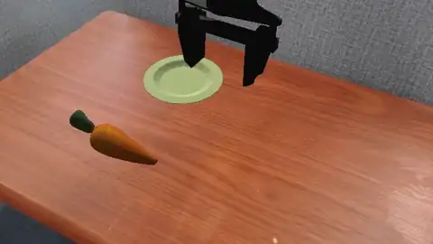

# SIMPLER

Eden ports the four WidowX (BridgeData V2) tasks of [SIMPLER](https://github.com/simpler-env/SimplerEnv), the
real-to-sim evaluation suite for generalist manipulation policies. Read this page to evaluate a VLA such as Octo,
OpenPI or GR00T on them, or to generate demonstrations. The code is in `eden/tasks/simpler/`.



## The tasks

| Task (`--task`) | SIMPLER task | Instruction | Success metric |
|-----------------|--------------|-------------|----------------|
| `simpler_put_spoon_on_table_cloth` | `PutSpoonOnTableClothInScene` | "put spoon on table cloth" | `placement`: the spoon on the cloth (`object_a_is_on_b`) |
| `simpler_put_carrot_on_plate` | `PutCarrotOnPlateInScene` | "put carrot on plate" | `placement`: the carrot on the plate |
| `simpler_stack_green_cube_on_yellow_cube` | `StackGreenCubeOnYellowCubeInScene` | "put green cube on yellow cube" | `placement`: the green cube on the yellow one |
| `simpler_put_eggplant_in_basket` | `PutEggplantInBasketScene` | "put eggplant in basket" | `placement`: the eggplant inside the sink's basket box (`object_in_region`) |

The tasks are built for evaluation and demonstration, not RL: they define a success metric but no rewards, and they
default to one env and SIMPLER's 5 Hz control. Every scene's objects are `source` (what is moved) and `target`
(where it goes), so a metric or a demonstrator reads the same names on every task.

## What matches SIMPLER

- **The robot.** A system-identified WidowX 250 (`eden.tasks.simpler.base_config.DEFAULT_ROBOT`): its kp/kd tables
  come from fitting the real BridgeData V2 arm, not the robot's stock gains, and it is gravity-compensated.
- **The frame.** The world frame is the arm's `base_link`, as in SIMPLER, which mounts its cameras on that link.
- **The camera.** SIMPLER's base-mounted `3rd_view_camera` pose for each scene, with the Logitech C920 intrinsics
  the BridgeData V2 demonstrations were recorded with (`C920_INTRINSIC`).
- **The real-image backdrop.** Each camera composites the scene over SIMPLER's real "inpainting" photo
  (`real_inpainting/bridge_real_eval_1.png` for the table tasks, `real_inpainting/bridge_sink.png` for the sink),
  through a `BackgroundImageComposite` camera overlay. The ground plane, and on the sink task the sink, are drawn by
  the photo rather than rendered.
- **The layouts.** The three table tasks place their objects from SIMPLER's own episode grids
  (`bridge_table.config.simpler_layouts`, applied by the `PlaceFromLayouts` event): every ordered pair of corners of
  a square round the grid centre, once per source yaw, in SIMPLER's episode order.
- **Control.** 5 Hz (`sim_dt=0.005`, `decimation=40`), a `DifferentialIKController` on `gripper_link`
  (`ee_controller`) and a binary gripper (`gripper_controller`).

Where Eden differs:

- **Torsional friction is on**, with a 2 cm contact patch on the fingers
  (`default_geoms_friction_torsional`). Without it a spoon pinched at one point spins about the line between the
  fingertips and hangs below the grasp.
- **The sink is fitted by eye.** Its pose and scale (`SINK_POS`, `SINK_SCALE`) were aligned to the backdrop photo
  through the task camera, and the eggplant spawns on the basin floor's `+y` half so a rolled one stays reachable.
- **The sim step is 5 ms** (200 Hz), where SIMPLER used 2 ms.

## Evaluating a generalist policy

Three remote-policy clients have a setup for SIMPLER's WidowX:

| Client | Setup | Notes |
|--------|-------|-------|
| `OctoPolicy` (`eden.extensions.policies.octo.policy`) | (single setup) | one action per request |
| `PiPolicy` (`eden.extensions.policies.pi.policy`) | `policy_setup="widowx_bridge"` | Bridge EE-delta |
| `Gr00tPolicy` (`eden.extensions.policies.gr00t.policy`) | `policy_setup="simpler_env_widowx"` | 256 × 256 images |

Each client brings its own observation groups and action terms (its gripper is a `GripperDecisionController`
reading the server's open/close convention, not the task's `BinaryJointController`), so replace both on the config
before building. The clients need the `policy-client` extra (`pip install 'eden-world[policy-client]'`, or
`uv sync --inexact --extra policy-client` in a checkout).

```python
import eden as en
import genesis as gs
from eden.envs.base import env_class_for_config
from eden.extensions.policies.gr00t.policy import Gr00tPolicy
from eden.options.managers.actions import ActionManagerOptions
from eden.options.managers.observations import ObservationManagerOptions
from eden.tasks import TASK_REGISTRY

en.init(backend=gs.gpu)
cfg = TASK_REGISTRY.build("simpler_put_carrot_on_plate")
cfg.observation_options = ObservationManagerOptions(**Gr00tPolicy.observation_options(policy_setup="simpler_env_widowx"))
cfg.action_options = ActionManagerOptions(**Gr00tPolicy.action_options(policy_setup="simpler_env_widowx"))
env = env_class_for_config(cfg).from_config(cfg, eval_mode=True)
env.build()

policy = Gr00tPolicy(env, Gr00tPolicy.configure(host="localhost", port=5555, policy_setup="simpler_env_widowx"))
policy.set_task(cfg.language_instructions[0])

for episode in range(5):
    obs, _ = env.reset()
    policy.reset_server()
    for _ in range(100):
        obs, *_ = env.step(policy.step(obs))
```

`eden inference --task simpler_put_carrot_on_plate --policy gr00t` runs the same loop from the command line with
the client's defaults. The `PiPolicy` and `Gr00tPolicy` setups check the env when the client is constructed and
refuse one that does not step at SIMPLER's 5 Hz, or whose observation and action terms do not match the setup. See [Remote policies](../guides/remote-policies.md).

## Scripted demonstrations

Every SIMPLER task has an `eden datagen` demonstrator (`eden/tasks/simpler/scripted_demos.py`): a keyframe tower
controller for the cube stack and a put-on tool routine for the other three. The put-on demonstrators can also run
camera-only (`--camera_only`), locating the objects through the task camera.

```bash
eden datagen --task simpler_stack_green_cube_on_yellow_cube --num_envs 16 --num_episodes 64
eden datagen --task simpler_put_carrot_on_plate --camera_only
```

Success rates and what each demonstrator does are in [Scripted demonstrations](../guides/scripted-demos.md).

## Assets

The objects (`eden.options.objects.simpler`: `SimplerCarrot`, `SimplerSpoon`, `SimplerEggplant`,
`SimplerTableCloth`, `SimplerPlateObjaverseLarger`, `SimplerSink`, plus two 3 cm box cubes) and the backdrop photos
download on first use from the `eden_simpler` dataset into `simpler/` under the asset directory
(`SimplerObjectOptions.fetch_family_asset`). See [Assets](../getting-started/assets.md).

## See also

- [Remote policies](../guides/remote-policies.md)
- [Camera overlays](../guides/sensors-and-rendering.md) for `BackgroundImageComposite`
- [PolaRiS](polaris.md), the DROID counterpart of this real-to-sim evaluation setup
- [Task suites overview](index.md)
