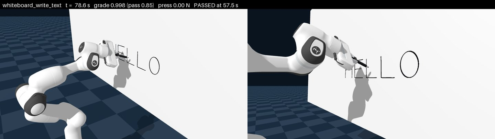
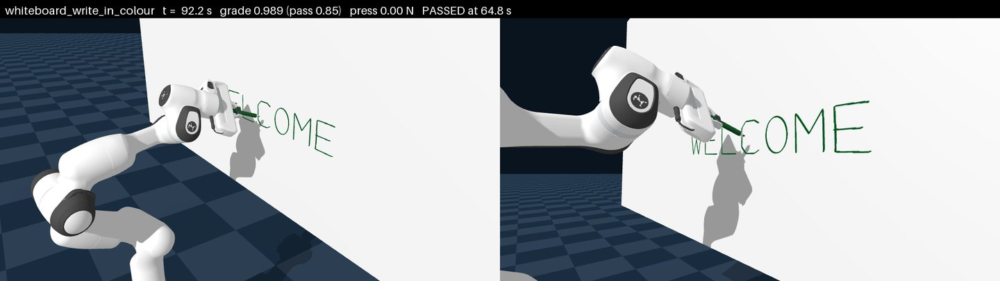
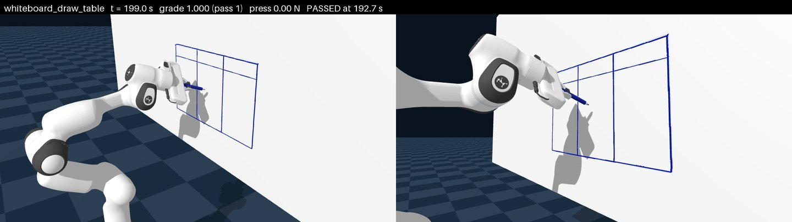

# Whiteboard drawing

Three RL tasks in which a Panda writes and draws on a whiteboard with a marker it holds by friction alone. They are
Eden's port of the drawing tasks of RoboWorld's `whiteboard` environment
([gym-anything/robotics](https://github.com/gym-anything/robotics), MIT): the same references at the same sizes and
places on the same board, the same ink law and the same verifiers. Read this page to train on them, record them,
or understand how the ink is graded. The code is in `eden/tasks/whiteboard/`.

| Task (`--task`) | Original task | Reference | Marker | Success | Episode |
|-----------------|---------------|-----------|--------|---------|---------|
| `whiteboard_write_text` | `write-text` | HELLO, 0.60 m wide | black | lettering F1 ≥ 0.85 within 2 mm | 90 s |
| `whiteboard_write_in_colour` | `write-in-colour` | WELCOME, 0.70 m wide | green | lettering F1 ≥ 0.85 within 2 mm | 120 s |
| `whiteboard_draw_table` | `draw-table` | blank table, 0.60 m wide (thick frame, header line, two column lines) | blue | every line ≥ 90 % covered, no gap over 10 mm, ≤ 1 cm² of stray ink | 240 s |

```bash
eden smoke --task whiteboard_draw_table
eden train --task whiteboard_write_text        # 512 envs
```





The scripted drawer at the end of its plan (Genesis CPU, one env), with the reference drawn faintly under the ink.

## The workcell

The board, the marker and the ink law are the original's; the robot is not. The original's G1 humanoid has to take
a capped marker from the tray and uncap it; here a Panda with its Franka Hand already holds the uncapped marker.

- **The board** is the original's MooreCo 8 × 4 ft board (2.4384 × 1.2192 m, bottom edge 0.9144 m up). Every drawing
  is centred where the original puts it: 1.28 m high, 5 cm right of the board's middle (`common.DRAWING_CENTER`).
- **The arm** stands on a 0.63 m stand (`common.STAND_HEIGHT`) 0.50 m from the board, its base right in front of the
  drawing centre. The height and distance were searched, not copied: the original's height puts the drawing centre
  in the Panda's wrist singularity, and one continuous IK family has to reach the whole table with every joint at
  least 0.12 rad inside its limits.
- **The marker** is the original's STAEDTLER 351 B: a 14 mm barrel, 16.2 g uncapped, and a 5 × 2 × 7.5 mm chisel nib.
  The original bonds an elastic nib (0.9 MPa) to the barrel. Here the nib is a body on a 2 mm slide along the barrel
  with the spring that solid nib has along it, `E A / L` = 1200 N/m, so the press force is read off the solver's
  nib–board contact. The hand holds the barrel pitched 20 degrees nib-down with the chisel turned 45 degrees, so
  horizontal and vertical lines come out equally wide.

!!! note "Nothing holds the marker but friction"
    At every reset `PlaceMarkerInGrasp` puts the marker between the pads and commands the fingers shut at the Franka
    Hand's rated 70 N grasp. There is no weld, latch or gripper action. `MarkerDropped` ends the episode once the
    marker's grip point is more than 2 cm from the pads' midpoint. The pads have torsional friction (the nib's drag
    acts 10 cm ahead of them), and the pads and the barrel carry stiffened contact parameters: on Genesis' default
    0.02 s time constant the pinch crept, the barrel sliding 2.5 mm under a 1 N press.

## Ink and grading

`WhiteboardDrawing` (`eden.tasks.whiteboard.custom_terms`) is each task's success metric, keyed `drawing`, and owns
the ink. The laws and verifiers are ported in `eden/tasks/whiteboard/grading.py`.

- **Ink is laid only where the solver reports the `nib` geom pressing on the board**, never on proximity, and only
  while the marker faces the board (its axis within 78 degrees of the board's normal, the original's gate). The
  transfer is the original's, `(1 - p)(1 - exp(-350 dt min(F, 1 N) m))` under the chisel's elliptical footprint
  `m = clip(4 (1 - r), 0, 1)`; the visible weight is the original's `clip((p - 0.02) / 0.13, 0, 1)`.
- **The nib is sampled after every 5 ms sim step**, not once per 50 ms control step: its pose, its press and whether
  it faces the board. Each sample lays one footprint, so a touch or a lift inside a control step inks exactly the
  sim steps it lasted. The original integrates at every 0.5 ms tick. A sample from an env the solver failed on
  (non-finite pose or press) draws nothing.
- **Ink off the pigment grid** (beyond the drawing's area) is not graded; only its visible area is added up, and all
  of it counts as stray. Off the grid the pigment is kept, under the same law, in a patch that follows the nib 3 cm
  either way (`grading.OFF_GRID_PATCH`), so a stroke, a resting nib, a light press that darkens over time and a nib
  tapping one spot all count the area they would ink on the grid. The only overcount is ink the nib comes back to
  after moving more than 3 cm away.
- **Grading is incremental.** Ink only grows, and only under the nib, so the running totals the F1 and the stray-ink
  rule need are updated in the cells each step inks, never over the whole grid.
- **Text** is graded with the original's F1 (`TextJudge`): ink within 2 mm of the reference raster over all ink, and
  the reference reached by ink within 2 mm. Success at 0.85.
- **The table** is graded with the original's table verifier (`TableJudge`), at the placement shown. Each line is read
  across its normal for the ink centred on it, junctions excluded; a line passes at ≥ 90 % coverage with no uncovered
  run over 10 mm, and the board passes with at most 1 cm² of visible stray ink. The table's grade is 1.0 exactly when
  it passes.

Not ported:

- **The table's registration search.** The original accepts a copy up to 30 mm, 5 % or 2 degrees off where it is
  shown; here the placement must match, which is stricter.
- **The table's skip fill.** The original credits skips under 6 mm between long inked stretches.
- **The "no other colour" check.** The hand holds one marker.
- **The 1500 µL reservoir.** A task uses at most about 25 µL of it.

!!! note "The original's lettering threshold passes an unfinished word"
    F1 ≥ 0.85 can be reached before the whole word is inked, if the ink is precise. The scripted drawer's text
    episodes end on success before the word is finished. The threshold is the original's, kept as is.

## Recording the ink

The ink lives in the metric, not in the scene, so a plain camera shows a clean board. `eden inference --rec` records
the task's `recording_camera()`: the arm and the whole board from behind the robot's right shoulder, with a
`PlanePaintOverlay` that paints the drawing's visible ink in the marker's colour where the camera sees the board's
face. It shades the ink as the renderer shaded the board, so the arm's shadow falls across the strokes, and it uses
the frame's point cloud, so the arm hides the strokes behind it. The training config declares no camera, so training
builds none.

To show the ink in another camera, give its `CameraOptions` the same overlay:

```python
from eden.entities.camera_overlays import PlanePaintOverlay
from eden.options.camera import CameraOptions
from eden.tasks.whiteboard import common

ink = common.COLORS[config.scene_options.marker.ink]  # the marker's colour, the one place the task sets it
camera = CameraOptions(cam_pos=..., cam_lookat=..., overlays=[PlanePaintOverlay.configure(metric_name="drawing", color=ink)])
```

## The policy's view

- **Actions.** One term, `arm`: differential IK at the nib's tip, 20 Hz, up to 1 cm and 0.05 rad a step. A rotation
  turns the marker about where it writes.
- **Observations** (`policy` and `critic` groups are identical; no noise is configured): the arm's joint positions and
  velocities, the nib tip's `(u, v, gap)` in the drawing frame and the marker's axis (`NibPose`), the nib's press
  averaged over the control step (`NibForce`), the next four reference points to ink, five guide points apart, each
  with a flag where a new stroke starts on the way to it (`NextStrokePoints`), the drawing's grade and the last
  action.
- **Rewards.**
    - `inked`: reference points first inked, 100 for the whole drawing.
    - `stray`: visible ink off the drawing, -5 per cm².
    - `reach` / `reach_fine`: the nib toward the next point on the board's face.
    - `success`: a bonus of 50.
    - `action_rate` and `arm_joint_vel`: small penalties.

    Every per-step term but the penalties is positive, so dropping the marker, which ends the episode, forfeits the
    rest of the reward.
- **Terminations.** `timeout`, `drawn` (success) and `marker_dropped`.

## The scripted drawer

`ScriptedDrawer` (`eden/tasks/whiteboard/scripted_demos.py`) shows each task can be completed through the task's own
action, and it is each task's `eden datagen` demonstrator:

```bash
eden datagen --task whiteboard_write_text --num_episodes 100 --num_envs 16 --output_dir data/demos
```

It has no randomness and makes no deliberate mistakes, so `--seed` changes nothing and `--p_mistake` must be 0. Per
stroke it travels to a hover point off the board, presses in, traces the stroke and lifts back, trimming the press
depth each step toward a 0.8 N press on the nib (an integral force loop: the arm's 1–3 mm tracking error is larger than
the nib's 2 mm of spring, so a fixed depth skips). It reads the arm's kinematics, the nib's pose and press, and the
reference; it never touches the marker or the ink. `tests/tasks/whiteboard/test_scripted_demos.py` pins all three
tasks (marked `slow`). See [Scripted demonstrations](../guides/scripted-demos.md).

<!-- TODO(material): per-task results of the scripted drawer (time to success, final grade, press statistics) measured on the current code. -->

## See also

- [Art: calligraphy and painting](art.md), which shares the "ink in the metric" design but welds its tool
- [Sensors and rendering](../guides/sensors-and-rendering.md) for `PlanePaintOverlay`
- [Task suites overview](index.md)
