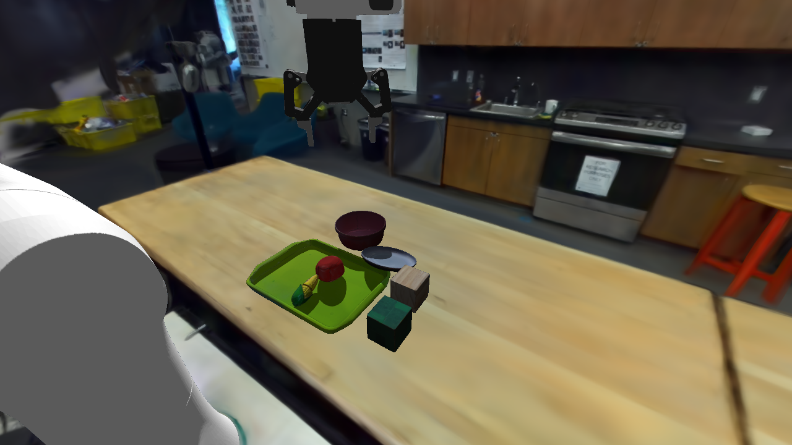
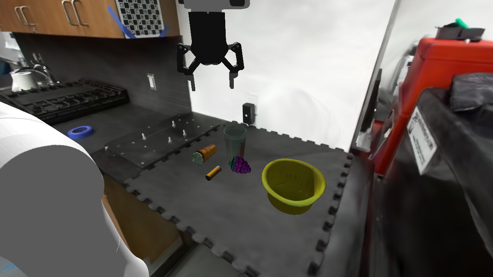
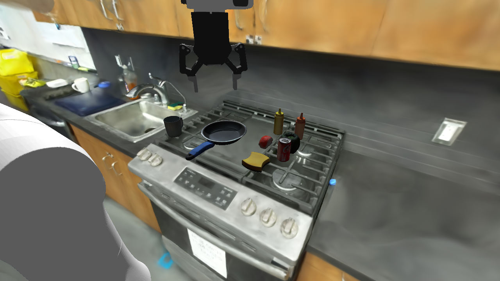
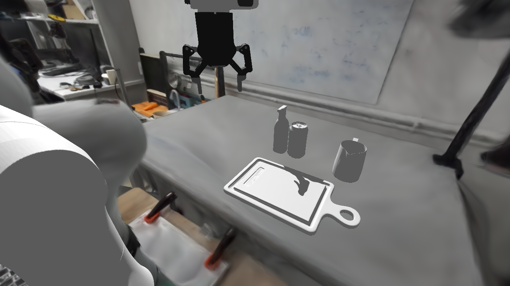
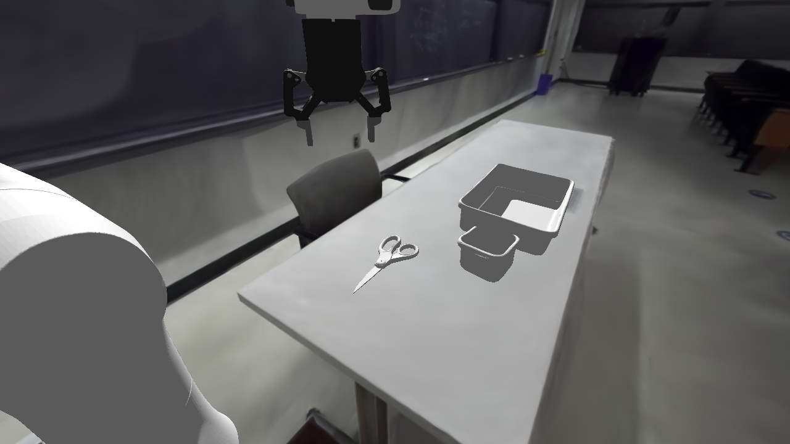
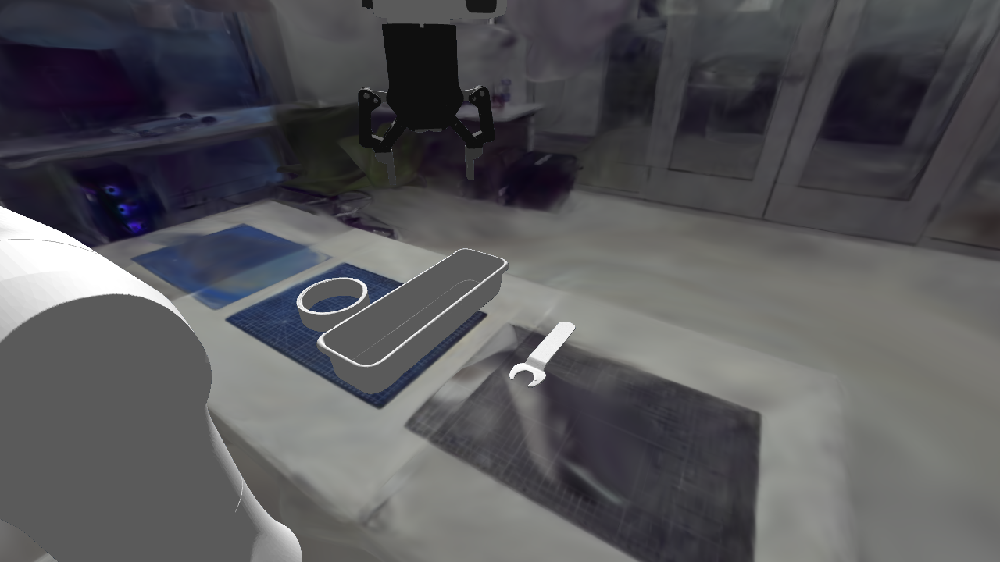

# PolaRiS

The following six PolaRiS Envs for the DROID dataset are implemented in `eden.tasks.polaris`.

| Task Config | Image | 
| --- | --- |
| `PolarisBlockStackKitchenConfig` |  | 
| `PolarisFoodBussingConfig` |  | 
| `PolarisPanCleanConfig` |  | 
| `PolarisMoveLatteCupConfig` |  | 
| `PolarisOrganizeToolsConfig` |  | 
| `PolarisTapeIntoContainerConfig` |  |


```bash
python examples/projects/manipulation/polaris/main.py --task polaris_organize_tools --vis 
```

Every task scores PolaRiS's own rubric as its `rubric` metric (success: every criterion reached;
the metric's value is PolaRiS's progress score), and each `*_batched` task has a scripted
demonstrator for `eden datagen` — see `docs/guides/scripted-demos.md`:

```bash
eden datagen --task polaris_move_latte_cup_batched --num_envs 16 --num_episodes 64
```


## Citation
```bibtex
@article{jain2025polarisscalablerealtosimevaluations,
    title={PolaRiS: Scalable Real-to-Sim Evaluations for Generalist Robot Policies}, 
    author={Arhan Jain and Mingtong Zhang and Kanav Arora and William Chen and Marcel Torne and Muhammad Zubair Irshad and Sergey Zakharov and Yue Wang and Sergey Levine and Chelsea Finn and Wei-Chiu Ma and Dhruv Shah and Abhishek Gupta and Karl Pertsch},
    year={2025},
    eprint={2512.16881},
    archivePrefix={arXiv},
    primaryClass={cs.RO},
    url={https://arxiv.org/abs/2512.16881}, 
}
```