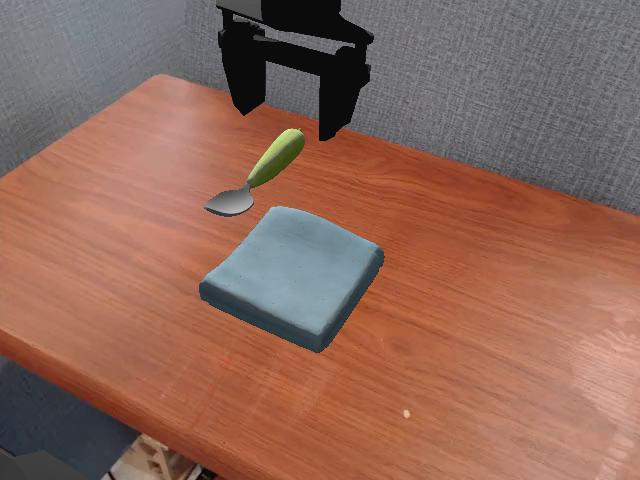
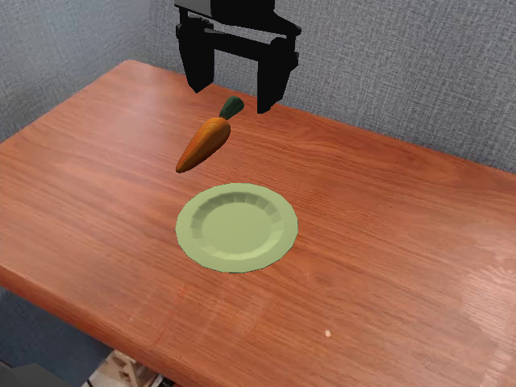
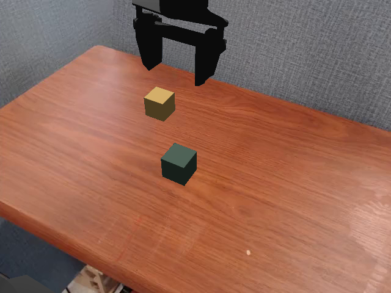
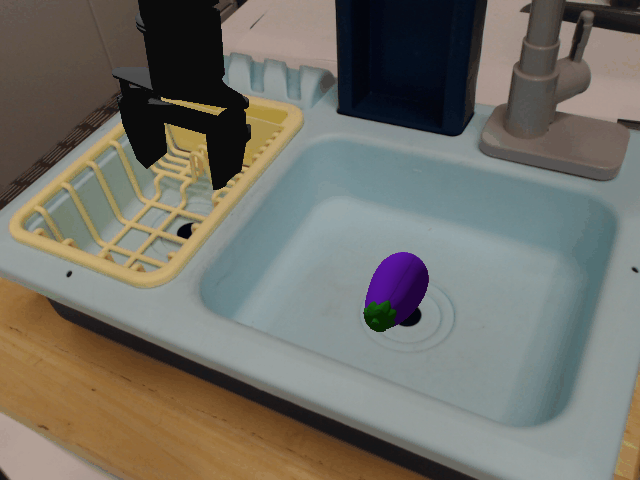

# SimplerEnv: Bridge Tasks

The following four SIMPLER Envs for the BridgeV2 dataset are implemented in `eden.tasks.simpler`.

| Task Config | Image | 
| --- | --- |
| `SimplerPutSpoonOnTableClothConfig` |  | 
| `SimplerPutCarrotOnPlateConfig` |  | 
| `SimplerStackGreenCubeOnYellowCubeConfig` |  | 
| `SimplerPutEggplantInBasketConfig` |  | 


```bash
python examples/projects/manipulation/simpler/main.py --task simpler_stack_green_cube_on_yellow_cube --vis
```

## Citation
```bibtex
@article{li24simpler,
    title={Evaluating Real-World Robot Manipulation Policies in Simulation},
    author={Xuanlin Li and Kyle Hsu and Jiayuan Gu and Karl Pertsch and Oier Mees and Homer Rich Walke and Chuyuan Fu and Ishikaa Lunawat and Isabel Sieh and Sean Kirmani and Sergey Levine and Jiajun Wu and Chelsea Finn and Hao Su and Quan Vuong and Ted Xiao},
    journal = {arXiv preprint arXiv:2405.05941},
    year={2024}
}
```